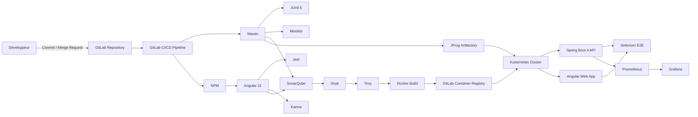
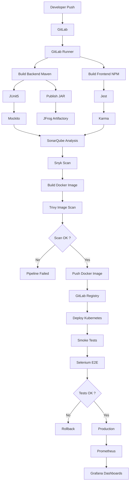
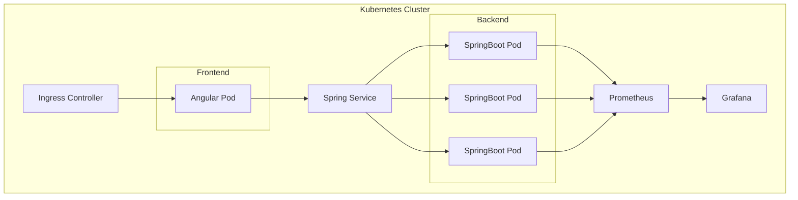

Voici une architecture de référence **Enterprise** pour une stack **Java Spring Boot 4 + Angular 21** avec une **chaîne DevSecOps / CI-CD complète** intégrant toutes les technologies demandées.

## Architecture globale



---

# Pipeline CI/CD complet



---

# Architecture Kubernetes



---

# Chaîne DevSecOps complète

```text
Developer
      │
      ▼
GitLab Repository
      │
      ▼
GitLab CI/CD
      │
      ├─────────────── Build Backend (Maven)
      │                    │
      │                    ├── Compilation
      │                    ├── JUnit5
      │                    ├── Mockito
      │                    └── Packaging JAR
      │
      ├─────────────── Build Frontend (NPM)
      │                    │
      │                    ├── npm install
      │                    ├── Angular Build
      │                    ├── Jest
      │                    └── Karma
      │
      ▼
SonarQube
      │
      ▼
Snyk
      │
      ▼
Docker Build
      │
      ▼
Trivy Scan
      │
      ▼
GitLab Container Registry
      │
      ├──────────────► Kubernetes
      │
      ▼
JFrog Artifactory
      │
      ▼
Release Management
      │
      ▼
Deployment Kubernetes
      │
      ▼
Selenium E2E
      │
      ▼
Production
      │
      ▼
Spring Boot Actuator (/actuator/prometheus)
      │
      ▼
Prometheus
      │
      ▼
Grafana
```

---

# Ordonnancement idéal du pipeline GitLab

| Stage                | Outils               | Objectif                         |
| -------------------- | -------------------- | -------------------------------- |
| 1. Checkout          | GitLab               | Récupération du code             |
| 2. Backend Build     | Maven                | Compilation Spring Boot          |
| 3. Backend Tests     | JUnit5 + Mockito     | Tests unitaires                  |
| 4. Front Build       | NPM + Angular CLI    | Compilation Angular              |
| 5. Front Tests       | Jest + Karma         | Tests unitaires Front            |
| 6. Quality Gate      | SonarQube            | Qualité, couverture, duplication |
| 7. Security Scan     | Snyk                 | Vulnérabilités des dépendances   |
| 8. Docker Build      | Docker               | Création de l'image              |
| 9. Image Scan        | Trivy                | Scan des images Docker           |
| 10. Publish          | GitLab Registry      | Publication de l'image           |
| 11. Publish Artifact | JFrog Artifactory    | Archivage des JAR                |
| 12. Deploy           | Kubernetes           | Déploiement                      |
| 13. E2E              | Selenium             | Validation fonctionnelle         |
| 14. Monitoring       | Prometheus + Grafana | Supervision                      |

---

## Flux de bout en bout

```text
Développeur
      │
      ▼
 GitLab
      │
      ▼
 GitLab CI/CD
      │
      ├── Maven
      ├── NPM
      ├── JUnit5
      ├── Mockito
      ├── Jest
      ├── Karma
      ├── SonarQube
      ├── Snyk
      ├── Docker Build
      ├── Trivy
      ├── GitLab Registry
      ├── JFrog Artifactory
      ├── Kubernetes
      ├── Selenium
      └── Production
                  │
                  ▼
        Spring Boot Actuator
                  │
                  ▼
            Prometheus
                  │
                  ▼
               Grafana
```

Cette architecture suit les pratiques DevSecOps modernes : qualité de code (SonarQube), tests unitaires (JUnit 5, Mockito, Jest, Karma), sécurité des dépendances (Snyk), sécurité des images (Trivy), gestion des artefacts (JFrog Artifactory), conteneurisation (Docker + GitLab Registry), orchestration (Kubernetes), tests de bout en bout (Selenium) et observabilité (Prometheus + Grafana).
