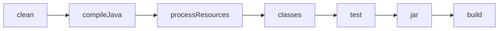
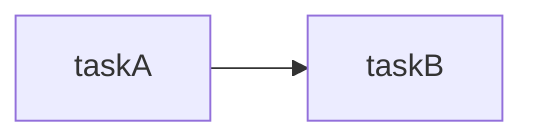
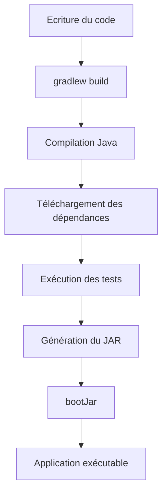

# Cours : Les bases de Gradle avec un mini projet Spring Boot

> **Objectif** : À la fin de ce cours, tu seras capable de comprendre le fonctionnement de Gradle, de créer un projet Spring Boot, de gérer les dépendances, de lancer les tests et de générer un exécutable.

---

# 1. Qu'est-ce que Gradle ?

**Gradle** est un outil d'automatisation de build.

Il permet de :

* compiler le code Java
* télécharger les bibliothèques (Spring Boot, JUnit…)
* lancer les tests
* générer un fichier JAR ou WAR
* exécuter l'application
* publier une application

Sans Gradle, il faudrait faire toutes ces opérations à la main.

---

## Le rôle de Gradle

```text
Code Java
    │
    ▼
Gradle
    │
    ├── Télécharge les dépendances
    ├── Compile le code
    ├── Lance les tests
    ├── Génère le JAR
    └── Exécute l'application
```

---

# 2. Notre projet fil rouge

Nous allons construire une petite API Spring Boot qui gère des livres.

```
Book API

GET     /books
GET     /books/{id}
POST    /books
DELETE  /books/{id}
```

---

# 3. Structure du projet

```
book-api
│
├── build.gradle
├── settings.gradle
├── gradlew
├── gradlew.bat
│
├── gradle/
│
└── src
    ├── main
    │    ├── java
    │    │     └── com/example/bookapi
    │    │              │
    │    │              ├── BookApiApplication.java
    │    │              ├── controller
    │    │              ├── service
    │    │              └── model
    │    │
    │    └── resources
    │          └── application.properties
    │
    └── test
```

---

# 4. Le fichier build.gradle

C'est **le cœur du projet**.

```groovy
plugins {
    id 'java'
    id 'org.springframework.boot' version '3.5.0'
    id 'io.spring.dependency-management' version '1.1.7'
}

group = 'com.example'
version = '1.0.0'

java {
    sourceCompatibility = JavaVersion.VERSION_21
}

repositories {
    mavenCentral()
}

dependencies {

    implementation 'org.springframework.boot:spring-boot-starter-web'

    testImplementation 'org.springframework.boot:spring-boot-starter-test'
}

tasks.named('test') {
    useJUnitPlatform()
}
```

---

## Que fait ce fichier ?

```text
plugins
    │
    ▼
Ajoute des fonctionnalités

repositories
    │
    ▼
Où télécharger les dépendances

dependencies
    │
    ▼
Quelles bibliothèques utiliser

tasks
    │
    ▼
Comment construire le projet
```

---

# 5. Les plugins

```groovy
plugins {

    id 'java'

    id 'org.springframework.boot'

    id 'io.spring.dependency-management'

}
```

Chaque plugin ajoute des fonctionnalités.

## Plugin Java

```groovy
id 'java'
```

Ajoute :

* compilation Java
* génération du JAR
* tests
* documentation

Sans ce plugin, Gradle ne sait même pas compiler du Java.

---

## Plugin Spring Boot

```groovy
id 'org.springframework.boot'
```

Ajoute :

* bootRun
* bootJar
* gestion Spring Boot

Exemple :

```
gradlew bootRun
```

Lance directement le serveur Spring Boot.

---

# 6. Les repositories

```groovy
repositories {

    mavenCentral()

}
```

Gradle télécharge les bibliothèques depuis Internet.

```
Votre projet

      │

      ▼

 Maven Central

      │

      ▼

spring-web

jackson

hibernate

JUnit

...
```

Sans repository, aucune dépendance ne peut être téléchargée.

---

# 7. Les dépendances

Une dépendance est une bibliothèque externe.

Par exemple :

```
Spring MVC

Jackson

Tomcat

JUnit

Hibernate
```

Dans Gradle :

```groovy
dependencies {

    implementation 'org.springframework.boot:spring-boot-starter-web'

}
```

---

## implementation

La dépendance est utilisée :

* pour compiler
* pour exécuter

Exemple :

```java
@RestController
public class BookController {

}
```

Sans Spring Web :

```
@RestController

↓

Compilation impossible
```

---

## testImplementation

```groovy
testImplementation 'org.springframework.boot:spring-boot-starter-test'
```

Disponible uniquement pour les tests.

---

# 8. Le wrapper Gradle

Dans le projet :

```
gradlew
gradlew.bat
```

Ils permettent d'utiliser **la bonne version de Gradle**, sans installation manuelle.

Sous Linux/Mac :

```bash
./gradlew build
```

Sous Windows :

```bash
gradlew build
```

---

# 9. Le cycle de build

Quand on lance :

```bash
gradlew build
```

Gradle exécute plusieurs tâches.



Chaque étape dépend de la précédente.

---

# 10. Première classe Spring Boot

```java
@SpringBootApplication
public class BookApiApplication {

    public static void main(String[] args) {

        SpringApplication.run(BookApiApplication.class, args);

    }

}
```

---

# 11. Premier contrôleur

```java
@RestController
@RequestMapping("/books")
public class BookController {

    @GetMapping
    public List<String> getBooks() {

        return List.of(
                "Clean Code",
                "Spring in Action",
                "Effective Java"
        );

    }

}
```

---

# 12. Lancer l'application

Commande :

```bash
gradlew bootRun
```

Résultat :

```
Tomcat started on port 8080
```

Requête :

```
GET localhost:8080/books
```

Réponse :

```json
[
  "Clean Code",
  "Spring in Action",
  "Effective Java"
]
```

---

# 13. Les principales tâches Gradle

## build

```bash
gradlew build
```

Compile le projet.

---

## clean

```bash
gradlew clean
```

Supprime le dossier :

```
build/
```

---

## test

```bash
gradlew test
```

Lance les tests.

---

## bootRun

```bash
gradlew bootRun
```

Lance Spring Boot.

---

## bootJar

```bash
gradlew bootJar
```

Produit :

```
build/libs/book-api.jar
```

---

# 14. Les tests

```java
@SpringBootTest
class BookApiApplicationTests {

    @Test
    void contextLoads() {

    }

}
```

Lancement :

```bash
gradlew test
```

Gradle :

```
Compile

↓

Lance JUnit

↓

Génère un rapport
```

---

# 15. Ajouter une dépendance

Imaginons que nous voulions utiliser Lombok.

```groovy
dependencies {

    implementation 'org.springframework.boot:spring-boot-starter-web'

    compileOnly 'org.projectlombok:lombok'

    annotationProcessor 'org.projectlombok:lombok'

}
```

Après modification :

```bash
gradlew build
```

Gradle télécharge automatiquement Lombok.

---

# 16. Une tâche personnalisée

On peut créer ses propres tâches.

```groovy
tasks.register("hello") {

    doLast {

        println("Bonjour Gradle !")

    }

}
```

Exécution :

```bash
gradlew hello
```

Résultat :

```
Bonjour Gradle !
```

---

# 17. Dépendance entre tâches

```groovy
tasks.register("taskA") {

    doLast {
        println("A")
    }

}

tasks.register("taskB") {

    dependsOn("taskA")

    doLast {
        println("B")
    }

}
```

Exécution :

```
gradlew taskB
```

Sortie :

```
A

B
```

Le diagramme suivant illustre cette dépendance :



---

# 18. Où Gradle stocke les fichiers ?

Après un build :

```
build/

    classes/

    libs/

        book-api.jar

    reports/

        tests/

    tmp/
```

Le dossier `build/` est généré automatiquement et peut être supprimé avec `gradlew clean`.

---

# 19. Cycle complet du projet



---

# 20. Les commandes indispensables à retenir

| Commande               | Description                          |
| ---------------------- | ------------------------------------ |
| `gradlew tasks`        | Liste toutes les tâches disponibles  |
| `gradlew clean`        | Supprime le dossier `build`          |
| `gradlew build`        | Compile, teste et génère le JAR      |
| `gradlew test`         | Lance uniquement les tests           |
| `gradlew bootRun`      | Démarre l'application Spring Boot    |
| `gradlew bootJar`      | Génère un JAR exécutable Spring Boot |
| `gradlew dependencies` | Affiche l'arbre des dépendances      |
| `gradlew help`         | Affiche l'aide Gradle                |

---

# Les notions essentielles à retenir

* **Gradle** automatise le build d'un projet Java.
* Le fichier **`build.gradle`** est le point central de la configuration.
* Les **plugins** ajoutent des fonctionnalités (Java, Spring Boot, etc.).
* Les **repositories** indiquent où récupérer les bibliothèques.
* Les **dependencies** définissent les bibliothèques utilisées par le projet.
* Les **tasks** représentent les actions exécutées par Gradle (`build`, `test`, `bootRun`, `clean`...).
* Le **Gradle Wrapper** (`gradlew`) garantit que tous les développeurs utilisent la même version de Gradle.
* Le répertoire **`build/`** contient tous les artefacts générés (classes compilées, rapports de tests, JAR, etc.).

Avec ces bases, tu disposes des concepts indispensables pour comprendre et utiliser Gradle sur un projet Spring Boot. Tu pourras ensuite approfondir des sujets plus avancés comme les builds multi-modules, les plugins personnalisés, les optimisations de performances ou l'intégration dans une chaîne CI/CD.
