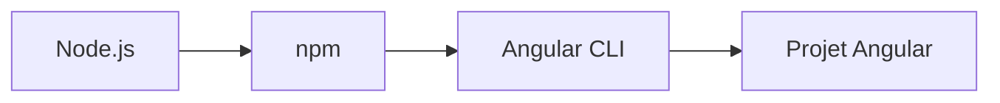
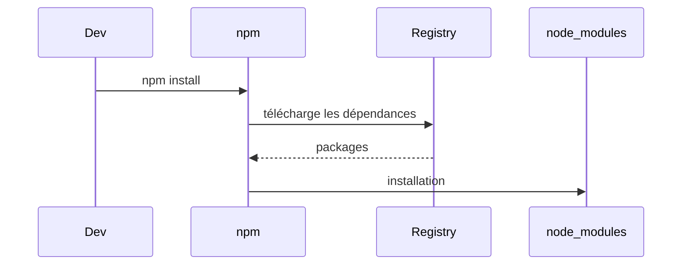
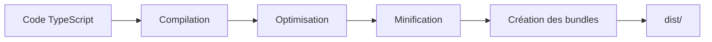
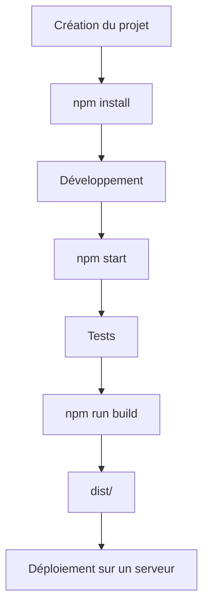

# Tutoriel : Comprendre le build avec npm grâce à un mini projet Angular 21

> **Objectif**
>
> À la fin de ce tutoriel, tu sauras :
>
> * ce qu'est `npm`
> * à quoi sert `package.json`
> * comment fonctionne un build Angular
> * comment créer un projet Angular
> * comment compiler ton application
> * ce que contient le dossier `dist`
> * quelles sont les commandes indispensables

Nous allons développer un mini projet **TodoApp**, une application permettant d'ajouter des tâches.

---

# 1. Les outils indispensables

Avant de commencer, il faut comprendre les différents acteurs.



## Node.js

Node.js est le moteur JavaScript qui permet d'exécuter du JavaScript en dehors du navigateur.

Sans Node.js, Angular ne peut pas fonctionner.

---

## npm

npm signifie **Node Package Manager**.

Son rôle est de :

* installer des bibliothèques
* lancer des scripts
* gérer les dépendances du projet

Par exemple :

```bash
npm install
```

installe toutes les dépendances du projet.

---

## Angular CLI

Angular CLI est l'outil qui permet de créer et compiler un projet Angular.

Exemples :

```bash
ng new
```

```bash
ng serve
```

```bash
ng build
```

---

# 2. Création du projet

Créons notre projet.

```bash
ng new todo-app
```

Angular pose quelques questions puis crée l'arborescence.

```
todo-app

src/

public/

package.json

angular.json

tsconfig.json
```

Chaque fichier a un rôle.

---

## package.json

C'est le cœur du projet.

```json
{
  "name": "todo-app",
  "scripts": {
    "start": "ng serve",
    "build": "ng build"
  }
}
```

Il contient :

* le nom du projet
* les dépendances
* les scripts npm

---

# 3. Les dépendances

Le projet dépend de nombreuses bibliothèques.

Par exemple :

```json
"dependencies": {

   "@angular/core": "^21.0.0",

   "@angular/router": "^21.0.0",

   "rxjs": "^8.0.0"

}
```

Ces bibliothèques ne sont pas écrites par nous.

npm va les télécharger.

---

# 4. Installation des dépendances

Commande :

```bash
npm install
```

Que se passe-t-il ?



À la fin, un dossier apparaît :

```
node_modules/
```

Il contient toutes les bibliothèques utilisées.

---

# 5. Les scripts npm

Dans le `package.json`, on trouve :

```json
"scripts": {

   "start": "ng serve",

   "build": "ng build"

}
```

Lorsque l'on tape :

```bash
npm run build
```

npm cherche le script nommé **build**.

Puis il exécute :

```bash
ng build
```

Même principe avec :

```bash
npm start
```

qui lance :

```bash
ng serve
```

---

# 6. Notre mini projet

Créons un composant.

```bash
ng generate component todo-list
```

Angular génère :

```
todo-list/

todo-list.ts

todo-list.html

todo-list.css

todo-list.spec.ts
```

---

# 7. Le composant

## todo-list.ts

```typescript
import { Component } from '@angular/core';

@Component({
  selector: 'app-todo-list',
  templateUrl: './todo-list.html'
})
export class TodoList {

  tasks = [
    'Apprendre npm',
    'Comprendre Angular',
    'Faire un build'
  ];

}
```

---

## todo-list.html

```html
<h2>Mes tâches</h2>

<ul>

  @for(task of tasks; track task){

      <li>{{task}}</li>

  }

</ul>
```

Lorsque l'application démarre, Angular affiche :

```
Mes tâches

• Apprendre npm

• Comprendre Angular

• Faire un build
```

---

# 8. Lancer le projet

Commande :

```bash
npm start
```

ou

```bash
ng serve
```

Le navigateur affiche :

```
http://localhost:4200
```

Le projet est compilé **à la volée**.

À chaque modification :

```
Sauvegarde

↓

Compilation

↓

Rafraîchissement automatique
```

---

# 9. Le build

Lorsque le projet est terminé :

```bash
npm run build
```

Voici ce qui se passe.



---

# 10. La compilation

Notre code :

```typescript
const title = "Todo App";
```

est transformé en JavaScript compatible avec tous les navigateurs.

Cette étape est automatique.

---

# 11. L'optimisation

Angular cherche :

* les fonctions inutilisées
* les imports inutilisés
* le code mort

Puis les supprime.

On appelle cela le **Tree Shaking**.

Exemple :

```typescript
export function a(){}

export function b(){}

export function c(){}
```

Si seule la fonction `a()` est utilisée, le build supprimera `b()` et `c()`.

---

# 12. La minification

Avant :

```javascript
function calculateTotal(price, quantity){

    const total = price * quantity;

    return total;

}
```

Après :

```javascript
function a(b,c){return b*c}
```

Le code devient beaucoup plus petit.

---

# 13. Les bundles

Au lieu d'envoyer plusieurs centaines de fichiers :

```
200 fichiers
```

Angular crée quelques gros fichiers.

```
main.js

styles.css

polyfills.js
```

Le navigateur charge beaucoup plus rapidement.

---

# 14. Le dossier dist

Après le build :

```
dist/

browser/

main.js

styles.css

favicon.ico

assets/
```

C'est ce dossier qui sera envoyé sur le serveur.

Le dossier `src` ne sert plus.

---

# 15. Ajouter une bibliothèque

Supposons que l'on souhaite utiliser Bootstrap.

Installation :

```bash
npm install bootstrap
```

npm :

* télécharge Bootstrap
* met à jour `package.json`
* met à jour `package-lock.json`
* installe les fichiers dans `node_modules`

Ensuite on peut déclarer le CSS dans `angular.json` ou l'importer selon la configuration du projet.

---

# 16. Les commandes à connaître

| Commande                    | Description                       |
| --------------------------- | --------------------------------- |
| `npm install`               | Installe les dépendances          |
| `npm start`                 | Lance le serveur de développement |
| `npm run build`             | Construit l'application           |
| `npm test`                  | Lance les tests                   |
| `ng generate component nom` | Crée un composant                 |
| `ng serve`                  | Lance Angular sans passer par npm |

---

# 17. Cycle de vie d'un projet Angular



---

# Ce qu'il faut retenir

* **Node.js** permet d'exécuter JavaScript en dehors du navigateur.
* **npm** gère les dépendances et exécute les scripts définis dans `package.json`.
* **Angular CLI** crée, lance et compile les projets Angular.
* `npm install` installe toutes les bibliothèques nécessaires.
* `npm start` démarre un serveur de développement avec rechargement automatique.
* `npm run build` compile, optimise et prépare l'application pour la production.
* Le dossier **`dist/`** contient les fichiers prêts à être déployés.

## Pour aller plus loin

Une excellente suite à ce tutoriel serait un **projet fil rouge plus complet** (30 à 40 pages) dans lequel on construirait progressivement une application **Todo** avec :

* une architecture Angular moderne (composants standalone),
* le routage,
* les services et l'injection de dépendances,
* les appels HTTP vers une API,
* les formulaires,
* les environnements (`development` et `production`),
* l'analyse du contenu du dossier `dist` après chaque évolution,
* et enfin le déploiement avec un pipeline de build complet. Cela permettrait de voir concrètement l'impact de chaque commande `npm` et de chaque étape du build sur un projet réel.
