Voici un **tutoriel complet et structuré sur AWS (Amazon Web Services)** avec des **exemples concrets** et des **diagrammes Mermaid** pour bien visualiser les concepts.

---

# ☁️ 1. C’est quoi AWS ?

Amazon Web Services est la plateforme cloud d’Amazon. Elle permet de louer des ressources informatiques à la demande :

* serveurs (machines virtuelles)
* bases de données
* stockage
* IA / machine learning
* réseaux
* déploiement d’applications

👉 Idée clé : tu ne possèdes plus de serveurs → tu les **utilises à la demande** et tu payes uniquement ce que tu consommes.

<div align="center">
	
</div>

```
Amazon Web Services (AWS) est la plateforme cloud la plus complète et la plus largement adoptée au monde. 
Elle propose plus de 200 services complets issus de centres de données du monde entier. 
Des millions de clients (dont certaines des startups les plus dynamiques au monde, de très grandes entreprises 
et des agences fédérales de premier plan) utilisent AWS pour réduire leurs coûts, gagner en agilité et innover plus rapidement.
```

---

# 🧱 2. Les grands concepts du cloud AWS

## 2.1 Infrastructure globale

AWS est organisé en :

* **Regions** (ex: Paris, Irlande)
* **Availability Zones (AZ)** : centres de données dans une région
* **Edge locations** : cache (CDN)

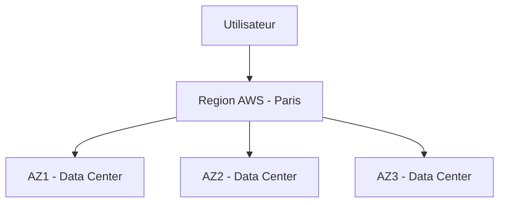

👉 Objectif : haute disponibilité et tolérance aux pannes.

---

# 💻 3. Les services AWS essentiels

## 3.1 EC2 (serveurs virtuels)

Amazon EC2 = machine virtuelle dans le cloud.

### Exemple :

Tu veux héberger un site web.

👉 Tu lances une machine Linux sur AWS.

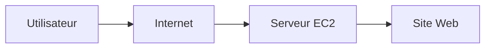

### Cas concret :

* Ubuntu server
* Apache/Nginx
* Node.js / Python backend

💡 Tu peux :

* augmenter la puissance (scale vertical)
* ajouter plusieurs serveurs (scale horizontal)

<div align="center">
	
</div>

```
Capacité de calcul sécurisée et redimensionnable pour pratiquement toutes les charges de travail
EC2 offre la plateforme de calcul la plus variée et la plus complète, avec plus de 750 instances. 
Vous y avez accès au processeur, à la solution de stockage, aux réseaux, au système d’exploitation 
et au modèle d’achat les plus récents pour vous aider à répondre au mieux aux besoins de votre charge de travail
```
```
Avantages : L'engagement SLA (Service Level Agreement), Optimiser les performances et les coûts, Outils de migration AWS
Use cases : Exécuter des applications métier et natives cloud
```
---

## 3.2 S3 (stockage)

Amazon S3 = stockage de fichiers.

### Exemple :

Tu stockes :

* images
* vidéos
* backups
* fichiers utilisateurs

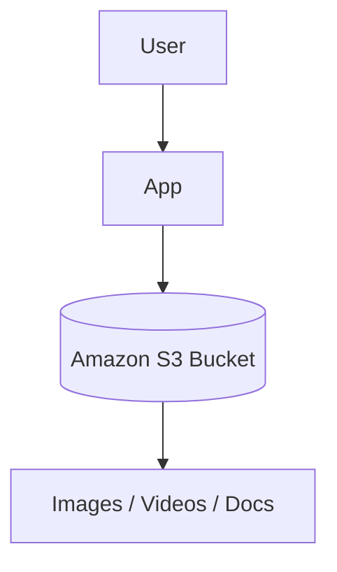

💡 Avantages :

* quasi illimité
* très durable (11 9's)
* accessible via URL

---

## 3.3 RDS (bases de données)

Amazon RDS = base de données managée.

Supporte :

* MySQL
* PostgreSQL
* MariaDB
* SQL Server

### Exemple :

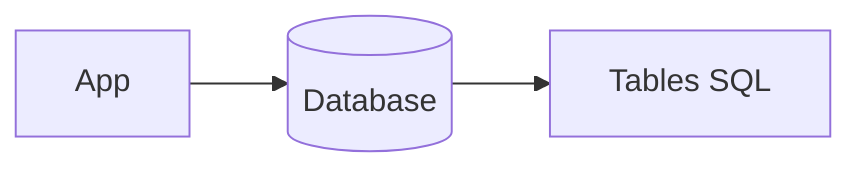

💡 AWS gère :

* backups
* mises à jour
* réplication

---

## 3.4 Lambda (serverless)

AWS Lambda = exécuter du code sans serveur.

### Exemple :

Upload d’une image → redimension automatique

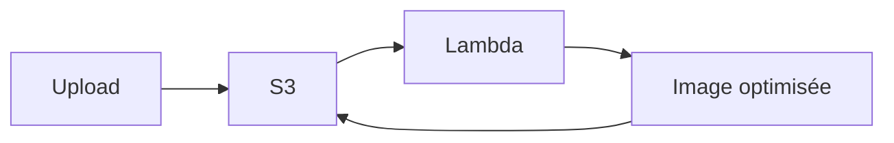

💡 Tu ne gères aucun serveur.

---

# 🌐 4. Architecture complète (exemple réel)

## Exemple : site e-commerce

* Frontend web
* Backend API
* base de données
* stockage images

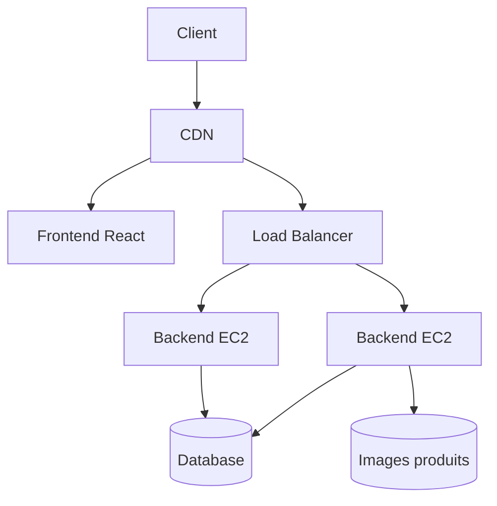

---

# ⚖️ 5. Load Balancer (répartition de charge)

Elastic Load Balancing

👉 répartit le trafic entre plusieurs serveurs

### Exemple :

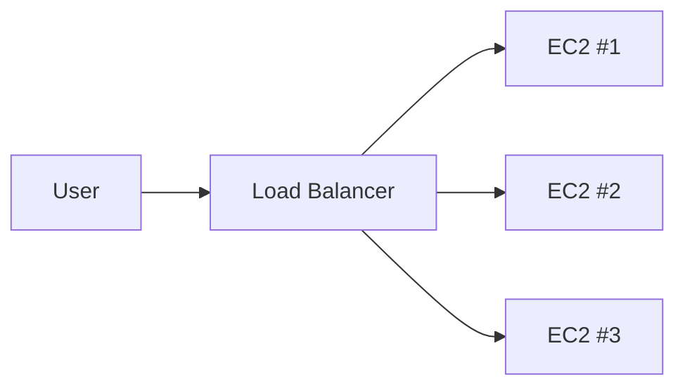

💡 Avantages :

* pas de surcharge
* haute disponibilité
* tolérance aux pannes

---

# 📦 6. Stockage avancé : S3 détaillé

## Structure :

* Bucket = dossier principal
* Objects = fichiers
* Keys = chemins

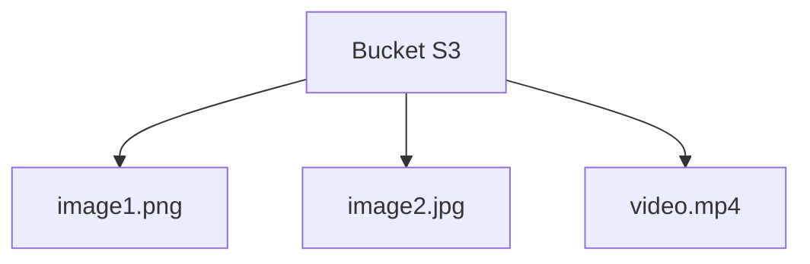

## Exemple URL :

```
https://bucket-name.s3.amazonaws.com/image1.png
```

---

# 🔐 7. Sécurité AWS (très important)

AWS Identity and Access Management (IAM)

## IAM = gestion des accès

### Exemple :

* Développeur → accès EC2
* Marketing → accès S3 uniquement

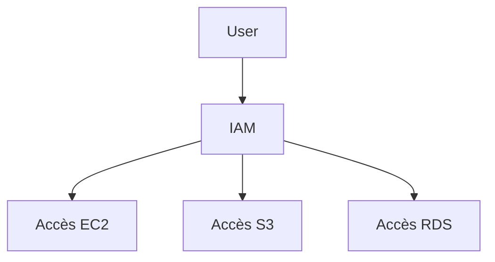

💡 principe clé :
👉 **Least Privilege (moindre privilège)**

---

# 🚀 8. Déploiement simple d’une application AWS

## Étapes typiques :

1. créer un serveur EC2
2. installer Node.js / Python
3. déployer le code
4. connecter base RDS
5. stocker fichiers dans S3

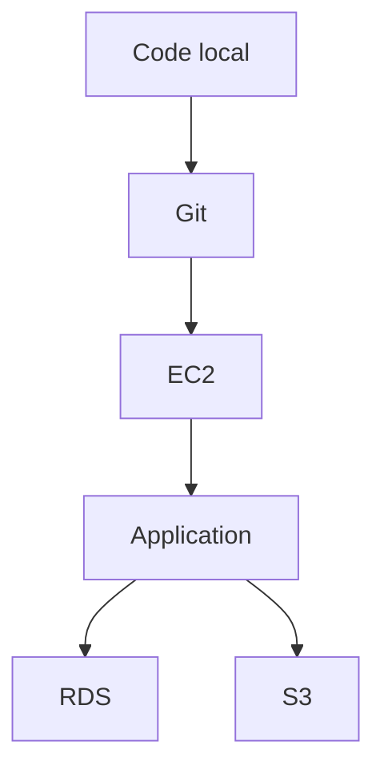

---

# 📊 9. Scalabilité AWS

## Auto Scaling

AWS Auto Scaling

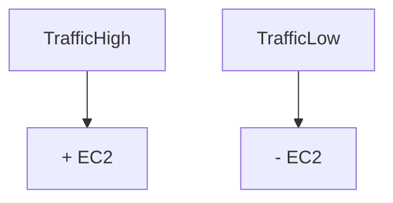

💡 Le système ajuste automatiquement les serveurs.

---

# 🌍 10. Cas réel complet (startup)

### Exemple : Instagram-like

* S3 → images
* EC2 → API
* RDS → utilisateurs
* Lambda → compression images
* CloudFront → accélération

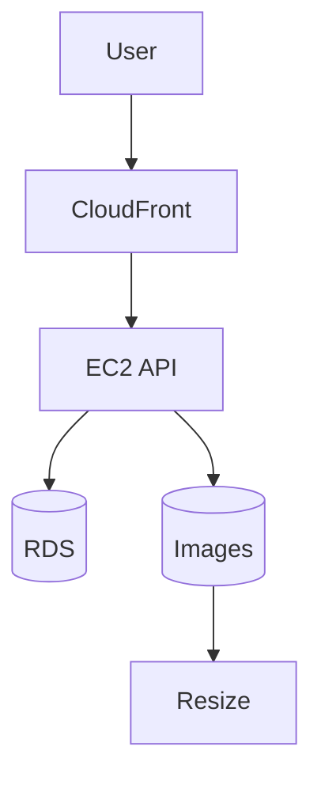

---

# 🧠 11. Résumé simple

| Service      | Rôle               |
| ------------ | ------------------ |
| EC2          | Serveurs           |
| S3           | Stockage           |
| RDS          | Base de données    |
| Lambda       | Code sans serveur  |
| IAM          | Sécurité           |
| ELB          | Répartition trafic |
| Auto Scaling | Ajuste serveurs    |


