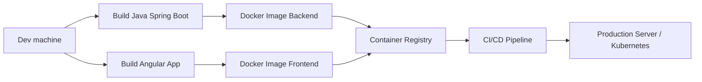
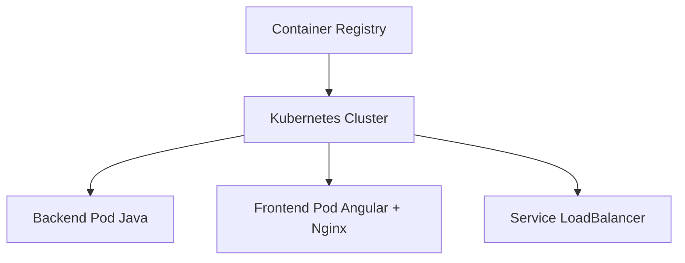

Voici un **tuto complet et concret sur les Container Registry** dans un contexte de développement **Java (Spring Boot) + Angular**, avec un focus sur les outils les plus utilisés du marché, des exemples de Dockerfiles, commandes, CI/CD et des diagrammes Mermaid.

---

# 🧠 1. C’est quoi un Container Registry ?

Un **Container Registry** est un dépôt centralisé qui permet de :

* stocker des images Docker
* versionner les images
* les partager entre équipes / environnements (dev, staging, prod)
* les utiliser dans des pipelines CI/CD

👉 En clair :

> c’est le “Git des images Docker”

---

# 🧱 2. Architecture typique Java + Angular + Registry



---

# 🏆 3. Les Container Registry les plus populaires

## 🥇 Docker Hub

* le plus connu
* simple à utiliser
* public + privé

👉 [https://hub.docker.com](https://hub.docker.com)

### Commandes :

```bash
docker login
docker tag myapp-backend user/myapp-backend:1.0
docker push user/myapp-backend:1.0
```

---

## 🥈 GitHub Container Registry (GHCR)

* intégré à GitHub
* très utilisé en open-source et CI/CD GitHub Actions

👉 [https://ghcr.io](https://ghcr.io)

### Exemple :

```bash
docker login ghcr.io -u USERNAME -p TOKEN
docker tag backend ghcr.io/mon-org/backend:1.0
docker push ghcr.io/mon-org/backend:1.0
```

---

## 🥉 GitLab Container Registry

* intégré à GitLab CI/CD
* très pratique en entreprise

👉 [https://gitlab.com](https://gitlab.com)

---

## ☁️ AWS Elastic Container Registry (ECR)

* utilisé en production AWS
* sécurisé et scalable

👉 [https://aws.amazon.com/ecr](https://aws.amazon.com/ecr)

---

## ☁️ Google Artifact Registry

* remplaçant de GCR
* très utilisé avec Kubernetes (GKE)

👉 [https://cloud.google.com/artifact-registry](https://cloud.google.com/artifact-registry)

---

## ☁️ Azure Container Registry (ACR)

* intégré à Azure DevOps + AKS

👉 [https://azure.microsoft.com/products/container-registry](https://azure.microsoft.com/products/container-registry)

---

# ☕ 4. Exemple concret : Backend Java Spring Boot

## 📦 Dockerfile (backend)

```dockerfile
FROM eclipse-temurin:21-jdk

WORKDIR /app

COPY target/app.jar app.jar

EXPOSE 8080

ENTRYPOINT ["java", "-jar", "app.jar"]
```

## 🧪 Build + image

```bash
mvn clean package

docker build -t my-backend:1.0 .
```

---

# 🌐 5. Exemple Angular (frontend)

## 📦 Dockerfile Angular

```dockerfile
# build stage
FROM node:20 AS build

WORKDIR /app

COPY package*.json ./
RUN npm install

COPY . .
RUN npm run build --configuration production

# production stage
FROM nginx:alpine

COPY --from=build /app/dist/frontend /usr/share/nginx/html

EXPOSE 80
```

---

# 📤 6. Push vers un Container Registry

## Exemple Docker Hub

```bash
docker login

docker tag my-backend:1.0 monuser/backend:1.0
docker push monuser/backend:1.0
```

---

## Exemple GitHub Container Registry

```bash
docker login ghcr.io -u mon-user

docker tag my-backend:1.0 ghcr.io/mon-org/backend:1.0

docker push ghcr.io/mon-org/backend:1.0
```

---

# 🔄 7. Pipeline CI/CD (GitHub Actions)

Exemple complet :

```yaml
name: Build and Push Docker Images

on:
  push:
    branches: [ "main" ]

jobs:
  build:
    runs-on: ubuntu-latest

    steps:
      - name: Checkout
        uses: actions/checkout@v4

      - name: Login to GHCR
        run: echo "${{ secrets.GITHUB_TOKEN }}" | docker login ghcr.io -u ${{ github.actor }} --password-stdin

      - name: Build image
        run: docker build -t ghcr.io/my-org/backend:latest ./backend

      - name: Push image
        run: docker push ghcr.io/my-org/backend:latest
```

---

# 🚀 8. Déploiement (exemple Kubernetes)



---

# 🧩 9. Bonnes pratiques importantes

## 🔐 Sécurité

* ne jamais mettre de secrets dans les images
* utiliser des tokens (PAT, IAM roles)
* scanner les images (Trivy, Snyk)

## 🏷️ Tagging

Toujours versionner :

```bash
myapp:1.0.0
myapp:2026-06
myapp:latest (à éviter en prod)
```

---

## ⚡ Optimisation images

### Java :

* utiliser JDK slim ou distroless

### Angular :

* build multi-stage (node → nginx)

---

# 📊 10. Comparatif rapide

| Registry              | Avantage         | Inconvénient    |
| --------------------- | ---------------- | --------------- |
| Docker Hub            | simple           | limité en privé |
| GHCR                  | intégré GitHub   | dépend GitHub   |
| GitLab Registry       | CI/CD natif      | GitLab requis   |
| AWS ECR               | entreprise cloud | complexe        |
| GCP Artifact Registry | Kubernetes natif | GCP lock-in     |
| Azure ACR             | DevOps intégré   | Azure lock-in   |

---

# 🧠 11. Résumé mental simple

👉 Flow classique :

```
Code Java + Angular
        ↓
Docker build
        ↓
Container Registry
        ↓
CI/CD
        ↓
Kubernetes / Server
```


