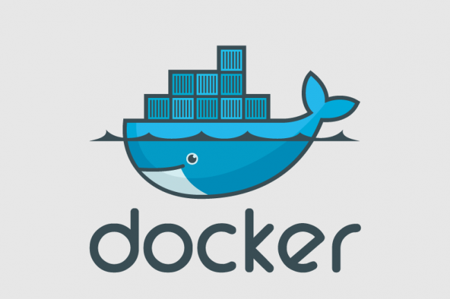
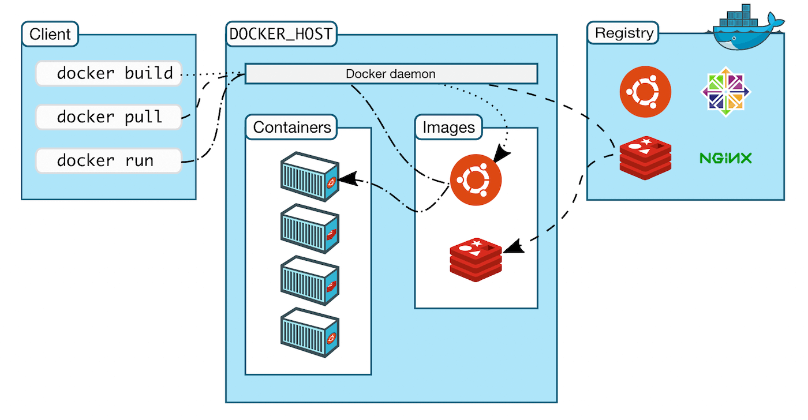

# DOCKER
<div align="center">
	
</div>

## 1.C’est quoi Docker (en une phrase)
**Docker** permet d’exécuter des applications dans des conteneurs,<br>
c’est-à-dire des environnements isolés, légers, reproductibles, qui contiennent le code + ses dépendances + sa config.

👉 Résultat :
```
“Ça marche sur ma machine” devient “ça marche partout”.
```

## 2.Conteneur vs Machine virtuelle
🖥️ **Machine virtuelle (VM)**
- Contient un OS complet
- Lourde (Go de RAM)
- Démarrage lent

📦 **Conteneur Docker**
- Partage le noyau de l’OS hôte
- Très léger (Mo)
- Démarrage en quelques secondes

👉 Docker ≠ VM
👉 Docker utilise la virtualisation au niveau du système, pas du matériel.

## 3.Les concepts fondamentaux
**1.Image**<br>
👉 Un modèle immuable (template)<br>
Contient :
- un OS minimal (Alpine, Ubuntu…)
- une app
- ses dépendances
On ne l’exécute pas directement

Exemples :
- nginx
- node:18
- python:3.12

**2.Conteneur**<br>
👉 Une instance en cours d’exécution d’une image
- Peut être démarré, arrêté, supprimé
- Éphémère par défaut

**3.Dockerfile**<br>
👉 Le script qui décrit comment construire une image

**4.Docker Hub**<br>
👉 Un registre d’images (comme GitHub mais pour Docker)
- https://hub.docker.com
- Public ou privé

## 4.Installer Docker
Sur Linux / Mac / Windows :
- Docker Desktop (Mac / Windows)
- Docker Engine (Linux)

Vérification :
```bash
docker --version
docker info
```

## 5.Premiers pas avec Docker
🔹 **Tester Docker**
```bash
docker run hello-world
```
👉 Docker :<br>
1.Télécharge l’image<br>
2.Crée un conteneur<br>
3.L’exécute<br>
4.L’arrête<br>

🔹 **Lancer un conteneur**
```bash
docker run nginx
```
⚠️ Nginx tourne… mais tu n’y as pas accès.

🔹 **Exposer un port**
```bash 
docker run -p 8080:80 nginx
```
- 8080 → ton PC
- 80 → conteneur
👉 http://localhost:8080

🔹 **Mode détaché (en arrière-plan)**
```bash 
docker run -d -p 8080:80 nginx
```

## 6.Gérer les conteneurs
<div align="center">
	
</div>

**Lister les conteneurs**
```bash
docker ps        # actifs
docker ps -a     # tous
```

**Arrêter un conteneur**
```bash
docker stop <container_id>
```

**Supprimer un conteneur**
```bash
docker rm <container_id>
```

**Voir les logs**
```bash
docker logs <container_id>
```

**Entrer dans un conteneur**
```bash
docker exec -it <container_id> bash
```

## 7.Créer sa propre image (Dockerfile)
**Exemple simple : app Node.js**

📁 **Structure**
```pgsql
app/
 ├─ index.js
 ├─ package.json
 └─ Dockerfile
```

**Dockerfile**
```dockerfile
FROM node:18

WORKDIR /app

COPY package*.json ./
RUN npm install

COPY . .

EXPOSE 3000

CMD ["node", "index.js"]
```

**Construire l’image**
```bash 
docker build -t my-node-app .
```

**Lancer le conteneur**
```bash 
docker run -p 3000:3000 my-node-app
```

## 8.Volumes (persistance des données)
Par défaut :<br>
❌ Quand un conteneur meurt → données perdues

**Volume Docker**
```bash
docker run -v data:/var/lib/mysql mysql
```

**Bind mount (dossier local)**
```bash
docker run -v $(pwd):/app node
```
👉 Très utilisé en développement.

## 9.Réseaux Docker
Docker crée automatiquement un réseau interne.<br>
**Exemple : app + base de données**
```bash
docker network create my-network
```
```bash
docker run -d --name db --network my-network mysql
docker run -d --name app --network my-network my-app
```
👉 Les conteneurs communiquent via leur nom (db).

## 10.Docker Compose (indispensable)
👉 Pour lancer plusieurs conteneurs facilement

**docker-compose.yml**
```yaml
version: "3.8"

services:
  web:
    image: nginx
    ports:
      - "8080:80"

  redis:
    image: redis

```

**Lancer**
```bash
docker compose up
```

**Arrêter**
```bash
docker compose down
```

## 11.Bonnes pratiques Docker
✅ Utiliser des images légères (alpine)<br>
✅ Un conteneur = un rôle<br>
✅ Ne pas stocker de secrets dans l’image<br>
✅ Utiliser .dockerignore<br>
✅ Limiter les droits (USER node)<br>

## 12.Docker en production
Docker est utilisé avec :
- Docker Swarm
- Kubernetes
- CI/CD (GitHub Actions, GitLab CI)
👉 Docker = brique de base du cloud moderne.

## 13.Docker ≠ Kubernetes
| Docker               | Kubernetes             |
| -------------------- | ---------------------- |
| Lance des conteneurs | Orchestre des milliers |
| Simple               | Complexe               |
| Local / prod         | Prod à grande échelle  |

## 14.Résumé ultra-court
- Image → modèle
- Conteneur → instance
- Dockerfile → recette
- Docker Compose → multi-services
- Volume → données persistantes
