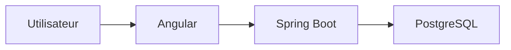
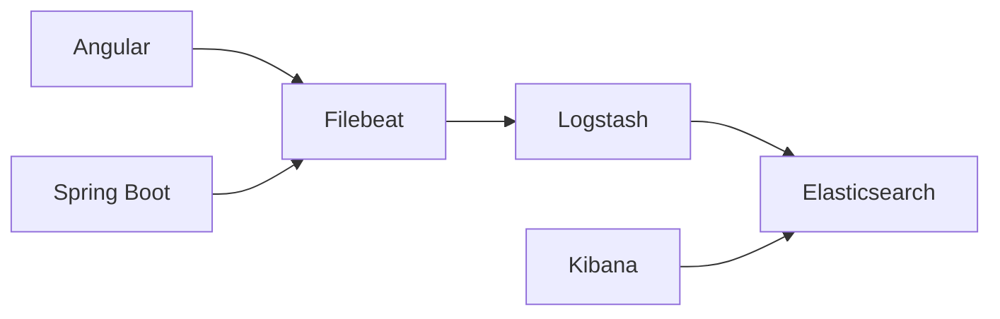
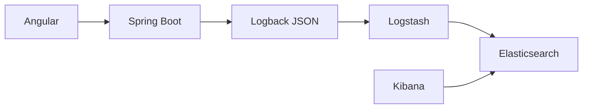
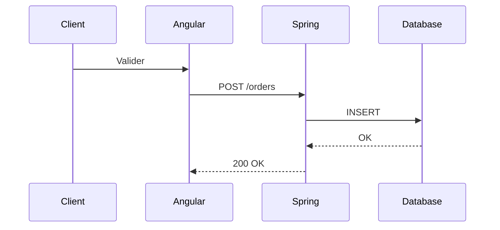
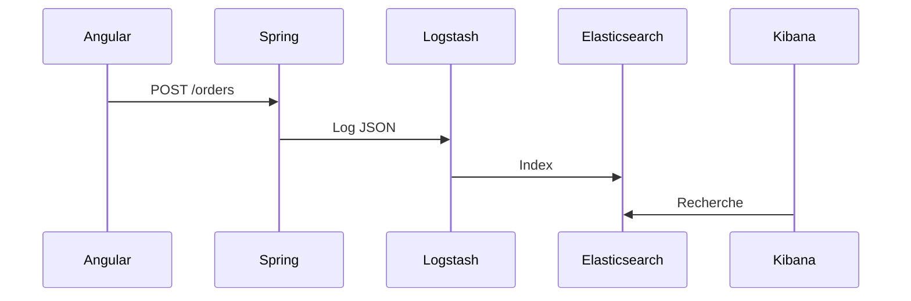
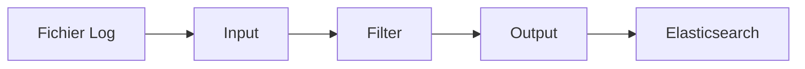
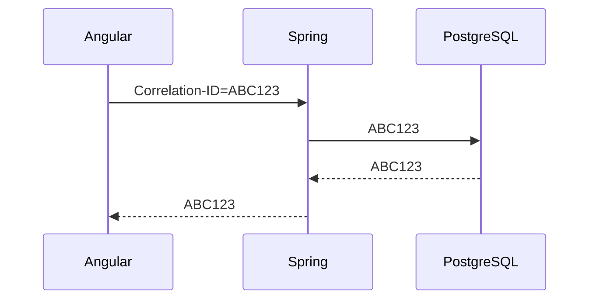
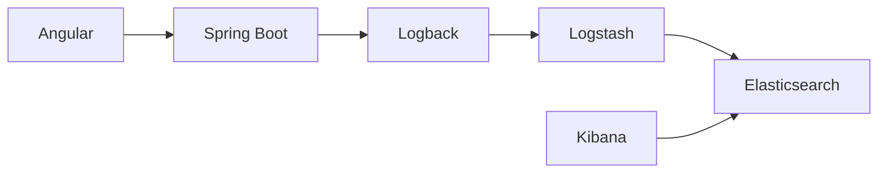

# Les bases de la Stack ELK pour une app Java SpringBoot + Angular

> **Objectif :** Comprendre comment utiliser la stack ELK afin de centraliser les logs d'une application Java Spring Boot et Angular pour faciliter le débogage, la supervision et l'analyse.

---

# Sommaire

1. Pourquoi utiliser ELK ?
2. Les composants de la stack
3. Architecture complète
4. Les différents types de logs
5. Exemple sans ELK
6. Exemple avec ELK
7. Elasticsearch
8. Logstash
9. Kibana
10. Intégration avec Spring Boot
11. Intégration avec Angular
12. Les bonnes pratiques
13. Résumé

---

# 1. Pourquoi utiliser ELK ?

Imaginons une application composée de :

* un Frontend Angular
* un Backend Spring Boot
* une base PostgreSQL

Lorsqu'un utilisateur rencontre un problème, les logs sont répartis sur plusieurs machines.

Sans centralisation, retrouver une erreur peut prendre plusieurs heures.

## Sans ELK



Les logs sont dispersés :

```
Angular.log
backend.log
database.log
serveur.log
```

Il faut chercher dans chaque fichier.

---

# Avec ELK

Tous les logs arrivent au même endroit.



On peut alors rechercher :

```
userId = 254

ou

ERROR

ou

/api/orders
```

en quelques secondes.

---

# 2. Les composants de la stack

La stack ELK est composée de trois outils.

| Outil         | Rôle                 |
| ------------- | -------------------- |
| Elasticsearch | Stocker les logs     |
| Logstash      | Transformer les logs |
| Kibana        | Visualiser les logs  |

On peut retenir :

```
Collecter

↓

Transformer

↓

Stocker

↓

Visualiser
```

---

# 3. Architecture générale



---

# 4. Les niveaux de logs

En Java, on distingue plusieurs niveaux.

```text
TRACE
DEBUG
INFO
WARN
ERROR
```

## TRACE

Très détaillé.

Exemple :

```java
log.trace("Entrée dans la méthode calculate()");
```

---

## DEBUG

Informations utiles au développeur.

```java
log.debug("Utilisateur chargé : {}", user);
```

---

## INFO

Information normale.

```java
log.info("Connexion réussie");
```

---

## WARN

Quelque chose d'anormal mais non bloquant.

```java
log.warn("Le fichier est presque plein");
```

---

## ERROR

Erreur bloquante.

```java
log.error("Impossible de sauvegarder la commande");
```

---

# 5. Exemple concret sans ELK

Le client crée une commande.



Si une erreur survient :

```
Angular.log

backend.log

postgres.log
```

Il faut tout consulter.

---

# 6. Même exemple avec ELK



Tous les événements sont consultables dans Kibana.

---

# 7. Elasticsearch

Elasticsearch est une base de données orientée documents.

Au lieu de stocker des lignes SQL :

```
id
nom
prenom
```

on stocke des documents JSON.

Exemple :

```json
{
    "date":"2025-06-01",
    "level":"INFO",
    "service":"order-service",
    "message":"Nouvelle commande créée",
    "user":"Martin"
}
```

Chaque document est indexé.

La recherche est extrêmement rapide.

---

## Les Index

Un index est comparable à une table SQL.

SQL

```
Table Users
```

Elasticsearch

```
users-2025
```

ou

```
logs-2025-06
```

---

# 8. Logstash

Logstash reçoit les logs.

Il peut :

* supprimer des champs
* ajouter des informations
* convertir un format
* enrichir les données

Exemple

Log reçu

```text
INFO User connected
```

Log transformé

```json
{
"level":"INFO",
"application":"order-service",
"message":"User connected",
"environment":"DEV"
}
```

---

## Pipeline Logstash



---

# 9. Kibana

Kibana est l'interface graphique.

On peut :

* rechercher

* filtrer

* créer des graphiques

* créer des dashboards

Exemple de recherche

```
level:ERROR
```

ou

```
userId:25
```

ou

```
service:"payment"
```

---

# 10. Intégration Spring Boot

## Ajouter Logback

```xml
<dependency>

    <groupId>net.logstash.logback</groupId>

    <artifactId>logstash-logback-encoder</artifactId>

</dependency>
```

---

## Configuration Logback

```xml
<configuration>

<appender name="stash"

class="net.logstash.logback.appender.LogstashTcpSocketAppender">

<destination>

localhost:5000

</destination>

<encoder

class="net.logstash.logback.encoder.LogstashEncoder"/>

</appender>

<root level="INFO">

<appender-ref ref="stash"/>

</root>

</configuration>
```

Les logs seront envoyés directement à Logstash.

---

## Exemple de code

```java
@RestController
@RequestMapping("/orders")
@Slf4j
public class OrderController {

    @PostMapping
    public ResponseEntity<Order> create(@RequestBody OrderDto dto){

        log.info("Création d'une commande");

        Order order = service.create(dto);

        log.info("Commande {} créée", order.getId());

        return ResponseEntity.ok(order);

    }

}
```

---

## Ce qui sera envoyé

```json
{
"time":"2025-06-01",

"level":"INFO",

"logger":"OrderController",

"message":"Commande 54 créée"
}
```

---

# 11. Intégration Angular

Angular peut aussi envoyer des logs.

Créer un service.

```typescript
@Injectable()

export class LoggerService {

log(message:string){

console.log(message);

}

}
```

Pour une application professionnelle, ce service peut appeler une API.

```typescript
this.http.post("/api/logs",{

level:"INFO",

message:"Utilisateur connecté"

});
```

Le backend enregistrera ensuite le log dans Elasticsearch.

---

# 12. Corrélation des logs

L'une des notions les plus importantes est le **Correlation ID**.

Chaque requête reçoit un identifiant unique.

```
Request

↓

Correlation ID

↓

Tous les logs possèdent le même identifiant
```

Exemple :

```
Request

ABC123
```

Angular

```
ABC123
```

Backend

```
ABC123
```

Database

```
ABC123
```

Ainsi, il est très facile de reconstituer le parcours complet d'une requête.



---

# 13. Les bonnes pratiques

### Toujours utiliser les bons niveaux de logs

❌

```java
log.error("Utilisateur connecté");
```

✅

```java
log.info("Utilisateur connecté");
```

---

### Ne jamais enregistrer

* mots de passe

* cartes bancaires

* tokens JWT

* données médicales

---

### Utiliser des messages explicites

❌

```java
log.info("Erreur");
```

✅

```java
log.error("Impossible de créer la commande {}", orderId);
```

---

### Logger les exceptions

```java
try{

...

}catch(Exception e){

log.error("Erreur lors du paiement",e);

}
```

Le second paramètre permet de conserver la **stack trace**, essentielle pour diagnostiquer l'origine d'une erreur.

---

# Résumé



## Points clés à retenir

* **Elasticsearch** stocke les logs sous forme de documents JSON et permet des recherches très rapides.
* **Logstash** collecte, transforme et enrichit les logs avant leur stockage.
* **Kibana** offre une interface pour rechercher, filtrer et créer des tableaux de bord.
* **Spring Boot** peut envoyer des logs structurés grâce à Logback et un encodeur JSON.
* **Angular** peut produire des logs côté client et les transmettre au backend.
* Les **Correlation IDs** permettent de suivre une requête de bout en bout, du navigateur jusqu'à la base de données.
* Utilisez des niveaux de log adaptés (`DEBUG`, `INFO`, `WARN`, `ERROR`) et évitez de journaliser des données sensibles.

Une bonne maîtrise de ces bases constitue un excellent point de départ avant d'aborder des sujets plus avancés comme la configuration complète de Logstash, les dashboards Kibana, le déploiement avec Docker Compose, ou encore l'intégration avec OpenTelemetry et les outils d'observabilité modernes.
