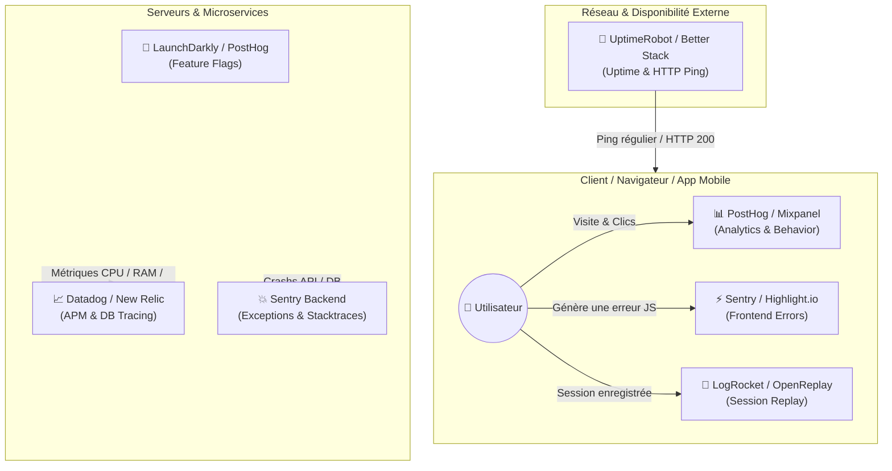
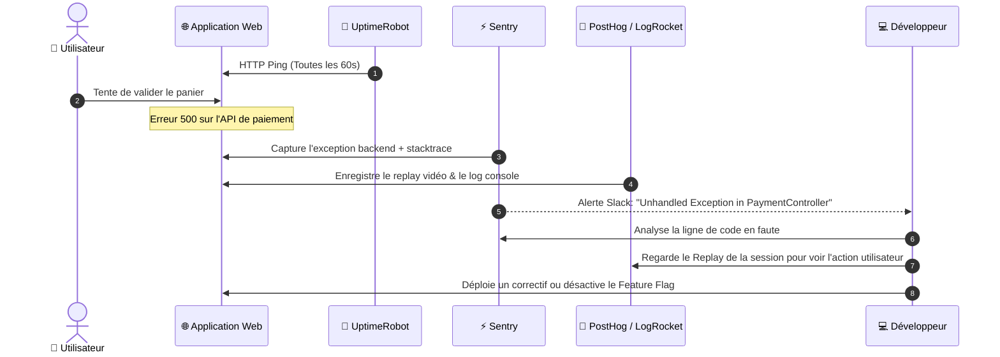

# Guide Complète de l'Écosystème d'Observabilité, Tracking & Monitoring

Ce document récapitule les outils majeurs utilisés par les développeurs et équipes produit pour surveiller, déboguer et optimiser leurs applications web et mobiles.

---

## 1. Vue d'Ensemble & Positionnement dans la Stack

Chaque outil intervient à un niveau précis de l'architecture applicative et du cycle de vie des requêtes ou sessions utilisateurs.

---

## 2. Synthèse Comparative des Outils

| Outil | Catégorie Principale | Cas d'Usage Majeur | Open-Source ? |
| :--- | :--- | :--- | :--- |
| **Sentry** | Error Tracking & Crash Reporting | Identifier et corriger les bugs applicatifs avec stacktrace complète. | Oui (Self-hostable) |
| **PostHog** | Product Analytics & All-in-One DevSuite | Tout-en-un : Analytics, Session Replay, Feature Flags, A/B Testing. | Oui (Self-hostable) |
| **UptimeRobot** | Uptime & Synthetic Monitoring | Vérifier si un site ou une API est en ligne et alerter en cas de panne. | Non (Freemium) |
| **LogRocket** | Session Replay & Frontend Monitoring | Rejouer en vidéo les sessions utilisateurs avec logs console et réseau. | Non |
| **OpenReplay** | Session Replay & DevTools | Alternative open-source et sécurisée à LogRocket. | Oui (Self-hostable) |
| **Highlight.io** | Full-stack Observability | Suite open-source moderne : replay, suivi d'erreurs et gestion de logs. | Oui (Self-hostable) |
| **Datadog** | APM & Infrastructure Monitoring | Observabilité complète d'architectures lourdes (Cloud, K8s, DB, Logs). | Non |
| **New Relic** | APM & Performance Monitoring | Monitoring global de performances d'applications et requêtes SQL. | Non |
| **Better Stack** | Uptime, On-Call & Centralized Logs | Monitoring d'uptime élégant avec gestion des gardes (On-Call) et logs. | Non |
| **Mixpanel** | Product Analytics | Analyse approfondie des tunnels de conversion et de la rétention. | Non |
| **Amplitude** | Product Analytics & Data Platform | Analytics produit avancé et segmentation comportementale. | Non |
| **LaunchDarkly** | Feature Flagging & Toggling | Activer/Désactiver des fonctionnalités à chaud sans redéploiement. | Non |

---

## 3. Détail par Catégorie d'Outils

### A. Suivi des Erreurs (Error & Crash Tracking)
* **Sentry**
  * **À quoi ça sert :** Capture en temps réel chaque exception ou bug non géré dans votre code (Frontend et Backend).
  * **Pour le dev :** Donne la ligne exacte de code qui a échoué, les variables de contexte, le navigateur/OS de l'utilisateur et la stacktrace complète.
* **Highlight.io**
  * **À quoi ça sert :** Plateforme moderne regroupant gestion des erreurs, session replay et journaux (logs) dans une interface unifiée.

### B. Session Replay & Diagnostic Utilisateur
* **LogRocket / OpenReplay**
  * **À quoi ça sert :** Enregistre la session utilisateur sous forme de rendu vidéo interactif.
  * **Pour le dev :** Associe le replay aux logs de la console du navigateur, aux requêtes réseau (avec headers/payloads) et aux mutations d'état (ex: Redux, Vuex). Permet de reproduire instantanément des bugs complexes "incapables d'être reproduits localement".

### C. Analytics Produit & Feature Flags
* **PostHog**
  * **À quoi ça sert :** Couteau suisse pour développeurs et product managers. Regroupe l'analyse de trafic, le session replay, les feature flags et l'A/B testing.
  * **Pour le dev :** Permet de mesurer l'impact d'une release et d'activer/désactiver des fonctionnalités à la volée.
* **Mixpanel / Amplitude**
  * **À quoi ça sert :** Spécialistes de la data produit. Permettent de comprendre le comportement utilisateur, les taux de conversion et la rétention.
* **LaunchDarkly**
  * **À quoi ça sert :** Leader de la gestion des **Feature Flags** d'entreprise.
  * **Pour le dev :** Déployer du code masqué en production et l'activer progressivement pour 1%, 5%, 50% des utilisateurs, ou couper la fonction instantanément en cas d'anomalie.

### D. APM & Monitoring d'Infrastructure
* **Datadog / New Relic**
  * **À quoi ça sert :** Surveillance globale des serveurs, bases de données, conteneurs Docker/Kubernetes et microservices.
  * **Pour le dev :** Trouver les goulets d'étranglement (ex: une requête SQL qui prend 4 secondes) et visualiser le parcours d'une requête à travers plusieurs microservices (Distributed Tracing).

### E. Disponibilité & Alertes (Uptime Monitoring)
* **UptimeRobot**
  * **À quoi ça sert :** Envoie des pings HTTP/TCP à intervalles réguliers (ex: toutes les 60 secondes) pour s'assurer que vos endpoints répondent en `200 OK`.
  * **Pour le dev :** Prévient en secondes par Slack, SMS ou Email dès qu'un serveur tombe ou qu'un certificat SSL arrive à expiration.
* **Better Stack**
  * **À quoi ça sert :** Combine le monitoring d'uptime, la gestion des plannings d'astreinte (On-Call) et un agrégateur de logs ultra-rapide.

---

## 4. Flux de Traitement d'un Incident (Workflow Type)

Voici comment ces outils collaborent en synergie lors d'un incident en production :

---

## 5. Recommandations de Stacks par Profil

### Stack 1 : Startup / Projets Indépendants / SaaS Bootstrapped
* **PostHog** (Analytics + Session Replay + Feature Flags)
* **Sentry** (Error Tracking Backend & Frontend)
* **UptimeRobot** (Monitoring basique gratuit/pas cher)

### Stack 2 : Équipe Open-Source / Soucieuse de la Confidentialité (Self-Hosted)
* **OpenReplay** ou **Highlight.io** (Replay & Erreurs)
* **PostHog Self-Hosted**
* **UptimeRobot** ou **Statping**

### Stack 3 : PME / Scaling Tech
* **Sentry** (Tracking précis des pannes)
* **PostHog** ou **Mixpanel** (Product)
* **Better Stack** (Uptime + Logs + On-Call)
* **LaunchDarkly** (Feature Flags avancés)

### Stack 4 : Enterprise / Multi-Services Heavy
* **Datadog** ou **New Relic** (APM, Infra & Distributed Tracing)
* **Sentry** (Crash Analytics)
* **Amplitude** (Product Intelligence)
* **LaunchDarkly** (Enterprise Feature Management)
