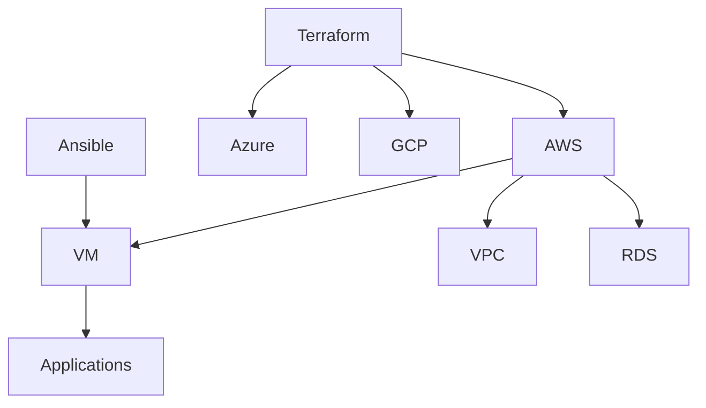
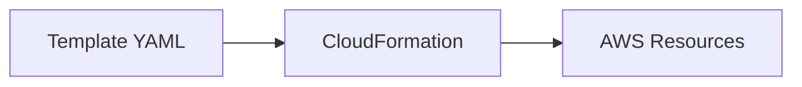
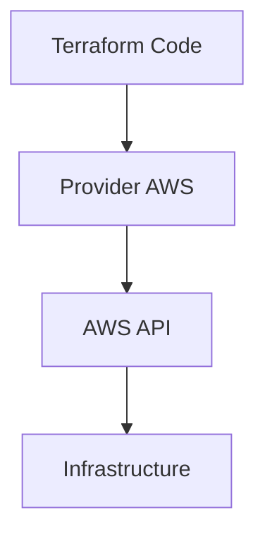
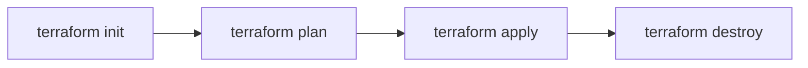
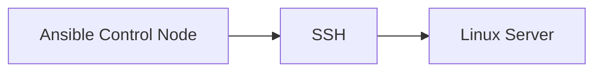
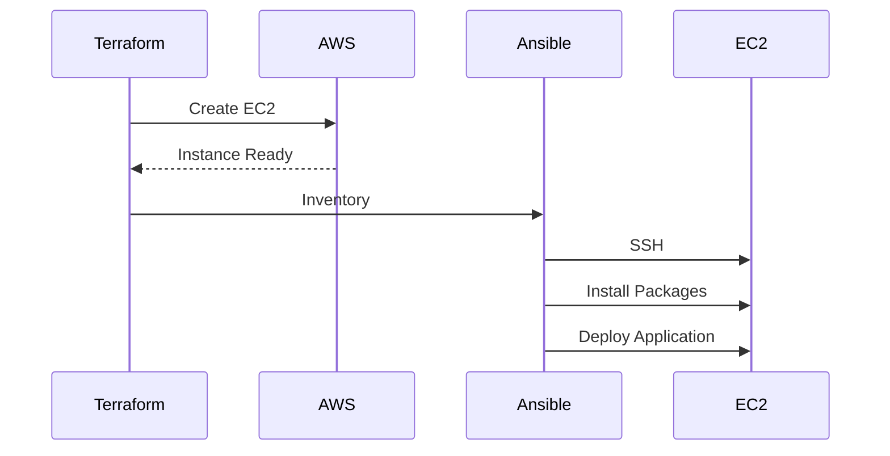
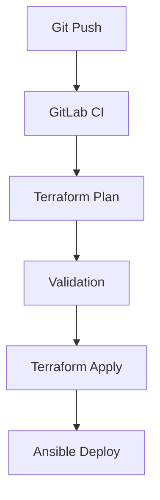
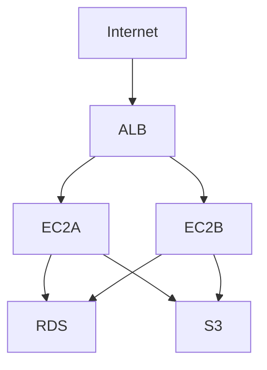
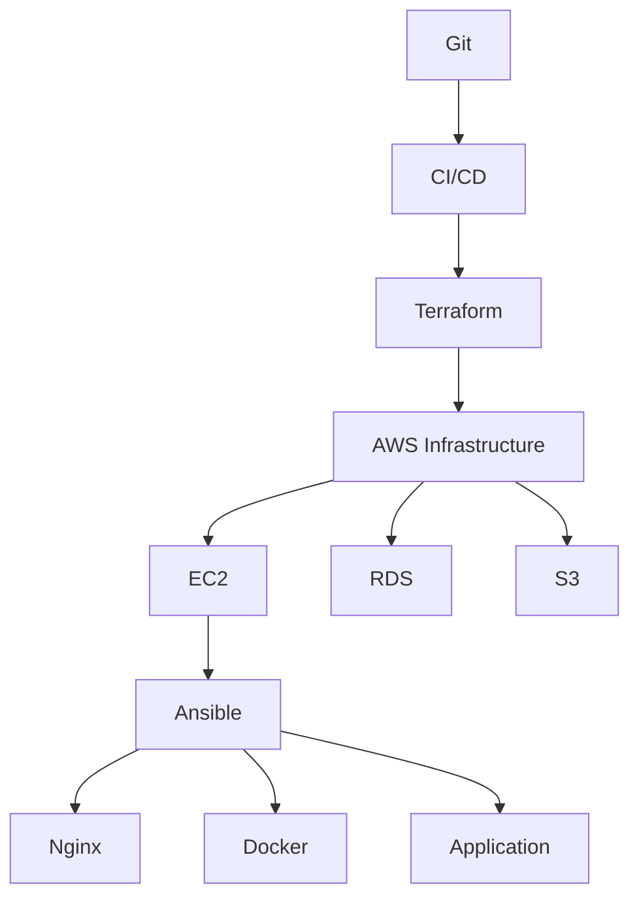

# Cours Magistral : Infrastructure as Code (IaC)
## AWS CloudFormation, Terraform et Ansible

---

# Table des matières

1. Introduction à l'Infrastructure as Code
2. Pourquoi l'IaC est devenue indispensable
3. Les concepts fondamentaux
4. Comparaison CloudFormation vs Terraform vs Ansible
5. AWS CloudFormation en profondeur
6. Terraform en profondeur
7. Ansible en profondeur
8. Workflow DevOps moderne
9. Bonnes pratiques
10. Gestion des environnements
11. Gestion des secrets
12. CI/CD et IaC
13. Architecture complète d'exemple
14. Cas pratique complet
15. Anti-patterns à éviter

---

# 1. Introduction à l'Infrastructure as Code

## Définition

L'Infrastructure as Code (IaC) consiste à décrire l'infrastructure informatique sous forme de code plutôt que de la créer manuellement.

Au lieu de :

```text
Créer une VM via l'interface AWS
Configurer le réseau
Créer un Load Balancer
Configurer la base de données
```

On écrit :

```yaml
Resources:
  MyServer:
    Type: AWS::EC2::Instance
```

ou

```hcl
resource "aws_instance" "web" {
  ami           = "ami-123456"
  instance_type = "t3.micro"
}
```

Puis :

```bash
terraform apply
```

---

# Pourquoi ?

Avant l'IaC :

```text
Administrateur :
    ↓
Clique dans AWS Console
    ↓
Configure les ressources
    ↓
Personne ne sait exactement ce qui a été créé
```

Après l'IaC :

```text
Code Git
    ↓
Review
    ↓
Validation
    ↓
Déploiement automatique
    ↓
Infrastructure reproductible
```

---

# Les bénéfices

## Reproductibilité

Même code :

```text
DEV
TEST
PREPROD
PROD
```

Même résultat.

---

## Versionning

Infrastructure stockée dans Git.

```bash
git log
```

Permet de voir :

- qui a modifié
- quand
- pourquoi

---

## Automatisation

Plus besoin de :

```text
Créer 50 serveurs manuellement
```

Une seule commande :

```bash
terraform apply
```

---

## Réduction des erreurs humaines

Erreur humaine :

```text
Serveur A : 4 Go RAM
Serveur B : 8 Go RAM
Serveur C : oublié...
```

IaC :

```hcl
instance_type = "t3.medium"
```

Toutes les instances identiques.

---

# 2. Les concepts fondamentaux

---

## Infrastructure déclarative

On décrit :

```text
CE QUE l'on veut
```

et non

```text
COMMENT le faire
```

Exemple :

```hcl
resource "aws_s3_bucket" "logs" {
  bucket = "company-logs"
}
```

Terraform décide :

- création
- API AWS
- dépendances

---

## Idempotence

Principe fondamental.

Exécuter :

```bash
terraform apply
```

100 fois

doit produire :

```text
Même résultat
```

---

## State

Le moteur doit savoir :

```text
Ce qui existe
Ce qui doit exister
```

Terraform utilise :

```text
terraform.tfstate
```

---

# 3. Panorama des outils

---

## CloudFormation

Créé par AWS.

Fonctionne uniquement sur AWS.

```text
AWS Native
```

---

## Terraform

Créé par HashiCorp.

Multi-cloud.

```text
AWS
Azure
GCP
Kubernetes
GitHub
Datadog
Cloudflare
```

---

## Ansible

Créé par RedHat.

Configuration Management.

Permet de configurer :

```text
Linux
Windows
Network
Applications
```

---

# Comparaison rapide

| Fonction | CloudFormation | Terraform | Ansible |
|-----------|---------------|------------|----------|
| Provision Infrastructure | Oui | Oui | Limité |
| Multi Cloud | Non | Oui | Oui |
| Configuration Serveurs | Non | Peu | Oui |
| Agent requis | Non | Non | Non |
| AWS natif | Excellent | Très bon | Bon |

---

# Architecture globale



---

# 4. AWS CloudFormation

---

## Fonctionnement



---

## Structure d'un template

```yaml
AWSTemplateFormatVersion: "2010-09-09"

Description: Demo Stack

Resources:

  MyBucket:
    Type: AWS::S3::Bucket
```

---

## Création d'un bucket S3

```yaml
Resources:

  LogsBucket:

    Type: AWS::S3::Bucket

    Properties:
      BucketName: company-logs-bucket
```

---

## Création d'une EC2

```yaml
Resources:

  WebServer:

    Type: AWS::EC2::Instance

    Properties:

      ImageId: ami-123456

      InstanceType: t3.micro
```

---

## Paramètres

```yaml
Parameters:

  InstanceType:

    Type: String

    Default: t3.micro
```

---

Utilisation :

```yaml
InstanceType: !Ref InstanceType
```

---

## Outputs

```yaml
Outputs:

  PublicIP:

    Value: !GetAtt WebServer.PublicIp
```

---

# Déploiement

```bash
aws cloudformation create-stack \
--stack-name demo \
--template-body file://template.yml
```

---

# 5. Terraform

---

## Philosophie

Terraform est devenu le standard du marché.

Architecture :



---

# Installation

```bash
terraform init
```

---

# Provider AWS

```hcl
provider "aws" {

  region = "eu-west-3"
}
```

---

# Bucket S3

```hcl
resource "aws_s3_bucket" "logs" {

  bucket = "company-logs"
}
```

---

# Instance EC2

```hcl
resource "aws_instance" "web" {

  ami = "ami-123456"

  instance_type = "t3.micro"
}
```

---

# Variables

```hcl
variable "instance_type" {

  default = "t3.micro"
}
```

Utilisation :

```hcl
instance_type = var.instance_type
```

---

# Outputs

```hcl
output "public_ip" {

  value = aws_instance.web.public_ip
}
```

---

# Terraform Lifecycle



---

# terraform plan

Très important :

```bash
terraform plan
```

Montre :

```text
+ création
~ modification
- suppression
```

---

# Exemple complet

```hcl
provider "aws" {

  region = "eu-west-3"
}

resource "aws_instance" "web" {

  ami = "ami-123456"

  instance_type = "t3.micro"

  tags = {

    Name = "web-server"
  }
}
```

---

# Modules

Réutilisation.

Structure :

```text
modules/

 ├── ec2
 ├── vpc
 └── rds
```

---

Module :

```hcl
module "vpc" {

  source = "./modules/vpc"

  cidr = "10.0.0.0/16"
}
```

---

# Backend distant

Mauvaise pratique :

```text
terraform.tfstate local
```

Bonne pratique :

```hcl
terraform {
  backend "s3" {

    bucket = "terraform-state"

    key = "prod.tfstate"

    region = "eu-west-3"
  }
}
```

---

# Data Sources

Lire des ressources existantes.

```hcl
data "aws_ami" "ubuntu" {

  most_recent = true

  owners = ["099720109477"]
}
```

---

# 6. Ansible

---

## Rôle

Terraform :

```text
Crée le serveur
```

Ansible :

```text
Configure le serveur
```

---

Architecture :



---

# Inventory

```ini
[web]

192.168.1.10
192.168.1.11
```

---

# Premier Playbook

```yaml
---
- hosts: web

  become: yes

  tasks:

    - name: Installer nginx

      apt:

        name: nginx

        state: present
```

---

Exécution :

```bash
ansible-playbook nginx.yml
```

---

# Service

```yaml
- name: Start nginx

  service:

    name: nginx

    state: started

    enabled: yes
```

---

# Copie de fichier

```yaml
- name: Deploy config

  copy:

    src: nginx.conf

    dest: /etc/nginx/nginx.conf
```

---

# Templates Jinja2

Template :

```jinja2
server_name {{ hostname }};
```

Playbook :

```yaml
- template:

    src: nginx.conf.j2

    dest: /etc/nginx/nginx.conf
```

---

# Variables

```yaml
vars:

  app_port: 8080
```

---

Utilisation :

```yaml
port: "{{ app_port }}"
```

---

# Roles

Structure :

```text
roles/

└── nginx

    ├── tasks
    ├── handlers
    ├── vars
    ├── defaults
    └── templates
```

---

Utilisation :

```yaml
roles:

  - nginx
```

---

# Terraform + Ansible

Workflow classique :



---

# 7. Gestion des environnements

---

Structure recommandée

```text
terraform/

├── modules
│
├── dev
│
├── preprod
│
└── prod
```

---

Variables DEV

```hcl
instance_type = "t3.micro"
```

Variables PROD

```hcl
instance_type = "t3.large"
```

---

# 8. Gestion des secrets

---

Ne jamais faire :

```hcl
password = "Admin123!"
```

---

AWS Secrets Manager :

```hcl
data "aws_secretsmanager_secret_version" "db" {

  secret_id = "database-password"
}
```

---

Ansible Vault :

```bash
ansible-vault encrypt secrets.yml
```

---

# 9. Pipeline CI/CD

---

Architecture moderne



---

Pipeline GitLab

```yaml
stages:

  - validate
  - plan
  - apply

validate:

  script:
    - terraform validate

plan:

  script:
    - terraform plan

apply:

  script:
    - terraform apply -auto-approve
```

---

# 10. Cas réel complet

Objectif :

Créer :

```text
VPC
2 EC2
Load Balancer
RDS
S3
```

---

Architecture



---

Terraform :

```hcl
module "vpc" {

  source = "./modules/vpc"
}

module "alb" {

  source = "./modules/alb"
}

module "ec2" {

  source = "./modules/ec2"
}

module "rds" {

  source = "./modules/rds"
}
```

---

Ansible :

```yaml
- hosts: web

  roles:

    - nginx

    - application

    - monitoring
```

---

# 11. Bonnes pratiques

---

## Toujours utiliser Git

```text
Infrastructure = Code
Code = Git
```

---

## Toujours faire un plan

Terraform :

```bash
terraform plan
```

CloudFormation :

```bash
aws cloudformation create-change-set
```

---

## Utiliser des modules

Éviter :

```text
5000 lignes dans un seul fichier
```

Préférer :

```text
VPC Module
EC2 Module
RDS Module
```

---

## Séparer les environnements

```text
DEV
PREPROD
PROD
```

---

## Chiffrer les secrets

Utiliser :

```text
AWS Secrets Manager
Hashicorp Vault
Ansible Vault
```

---

## Éviter les modifications manuelles

Mauvais :

```text
Terraform
   ↓
Admin modifie AWS Console
```

Résultat :

```text
Configuration Drift
```

---

# 12. Anti-patterns

---

❌ Stocker le tfstate dans Git

❌ Mettre les mots de passe dans les fichiers

❌ Utiliser le compte root AWS

❌ Un seul environnement

❌ Modifier les serveurs à la main

❌ Faire des terraform apply directement en PROD

❌ Ignorer terraform plan

---

# Résumé

## CloudFormation

Utiliser si :

```text
100% AWS
```

Avantages :

```text
AWS natif
Support AWS complet
Pas de dépendance externe
```

---

## Terraform

Utiliser si :

```text
Multi-cloud
Standard du marché
```

Avantages :

```text
Providers nombreux
Modules
Communauté énorme
```

---

## Ansible

Utiliser si :

```text
Configuration des serveurs
Déploiement applicatif
Automatisation système
```

---

# Architecture DevOps moderne recommandée



---

# Règle d'or

Terraform et CloudFormation répondent à :

> "Quels composants d'infrastructure doivent exister ?"

Ansible répond à :

> "Comment ces composants doivent-ils être configurés ?"

En pratique dans une entreprise moderne :

```text
Terraform
    ↓
Provisionne AWS

Ansible
    ↓
Configure Linux

CI/CD
    ↓
Déploie l'application
```

C'est aujourd'hui l'architecture IaC la plus répandue dans les environnements DevOps et Cloud.
