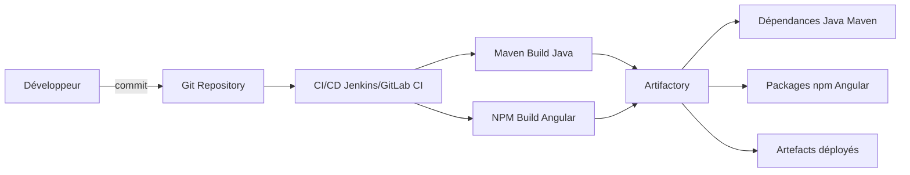
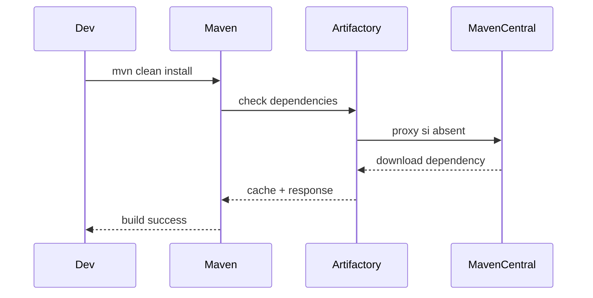
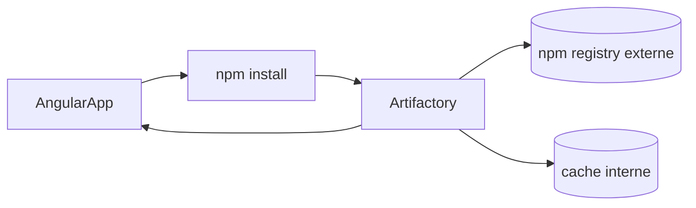
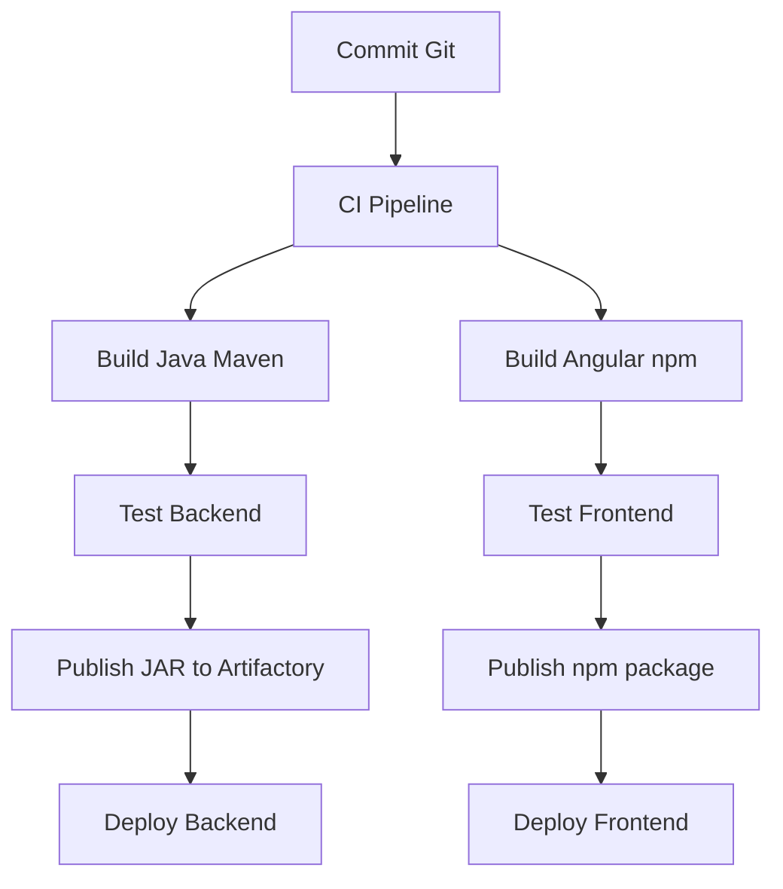
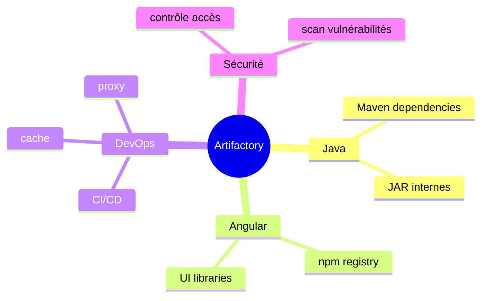

Voici un **tutoriel complet sur JFrog Artifactory** dans un contexte de développement **Java + Angular**, avec des exemples concrets et des diagrammes Mermaid pour visualiser les flux.

---

# 1. À quoi sert Artifactory dans un projet Java + Angular ?

Dans une architecture moderne :

* **Java (backend)** → dépendances Maven / Gradle + artefacts `.jar`
* **Angular (frontend)** → packages npm + build `.js/.css`
* **CI/CD** → build et déploiement automatisés

👉 JFrog Artifactory sert de **point central de stockage des artefacts** :

* dépendances externes (proxy)
* artefacts internes (libs maison)
* packages versionnés (backend + frontend)
* builds CI/CD

---

## 🧠 Schéma global



---

# 2. Concepts clés d’Artifactory

## 📦 Repository types

| Type        | Rôle                             |
| ----------- | -------------------------------- |
| **Local**   | stocke vos artefacts internes    |
| **Remote**  | proxy vers Maven Central / npmjs |
| **Virtual** | agrège local + remote            |

---

## Exemple réel :

* `libs-release-local` → JAR internes Java
* `npm-virtual` → Angular packages + npm registry
* `maven-central-remote` → proxy Maven Central

---

# 3. Cas Java (Maven + Artifactory)

## 🔧 Configuration Maven (`pom.xml`)

```xml
<repositories>
  <repository>
    <id>artifactory</id>
    <url>http://artifactory.mycompany.com/artifactory/libs-release</url>
  </repository>
</repositories>
```

---

## 🔐 Configuration `settings.xml`

```xml
<servers>
  <server>
    <id>artifactory</id>
    <username>my-user</username>
    <password>my-password</password>
  </server>
</servers>
```

---

## 📤 Déploiement d’un JAR interne

```xml
<distributionManagement>
  <repository>
    <id>artifactory</id>
    <url>http://artifactory.mycompany.com/artifactory/libs-release-local</url>
  </repository>
</distributionManagement>
```

Commande :

```bash
mvn clean deploy
```

👉 Résultat :

* ton `.jar` est uploadé dans Artifactory
* versionné automatiquement (ex: `1.2.0`)

---

## 🔁 Flux Maven



---

# 4. Cas Angular (npm + Artifactory)

## ⚙️ Configuration `.npmrc`

```bash
registry=http://artifactory.mycompany.com/artifactory/api/npm/npm-virtual/

always-auth=true

//artifactory.mycompany.com/artifactory/api/npm/npm-virtual/:_authToken=XXXX
```

---

## 📦 Installation dépendances Angular

```bash
npm install
```

👉 Angular ne va plus sur npmjs directement, mais :

```
Angular → Artifactory → npmjs (proxy si besoin)
```

---

## 📤 Publication d’un package Angular interne

Dans `package.json` :

```json
{
  "name": "@mycompany/ui-components",
  "version": "1.0.0",
  "publishConfig": {
    "registry": "http://artifactory.mycompany.com/artifactory/api/npm/npm-local/"
  }
}
```

Commande :

```bash
npm publish
```

---

## 🔁 Flux Angular



---

# 5. Stratégie DevOps complète (Java + Angular)

## 🏗 Pipeline CI/CD typique



---

# 6. Exemple concret : projet réel

## 🧩 Architecture microservice

* Backend Java :

  * `user-service`
  * `order-service`

* Front Angular :

  * `web-app`
  * `admin-dashboard`

---

## 📦 Artifactory structure

```
libs-release-local/
 ├── user-service-1.0.0.jar
 ├── order-service-2.1.0.jar

npm-local/
 ├── @company/ui-components
 ├── @company/admin-theme
```

---

# 7. Bonnes pratiques

## 🔐 Sécurité

* utiliser tokens (pas user/password)
* restreindre accès par repo
* scanner les vulnérabilités (Xray si dispo)

---

## 🧭 Versioning

* Java → SemVer (`1.0.0`)
* Angular → SemVer aussi
* éviter `latest` en production

---

## 🚀 Performance

* utiliser repos virtuals
* activer cache remote
* éviter dépendances directes externes

---

# 8. Cas avancé : partage de librairie Angular interne

## Exemple

Tu crées une librairie UI :

```bash
ng build ui-components
```

Puis publication :

```bash
npm publish dist/ui-components --registry=http://artifactory.../npm-local
```

Utilisation dans un autre projet :

```bash
npm install @mycompany/ui-components
```

---

# 9. Résumé simple




