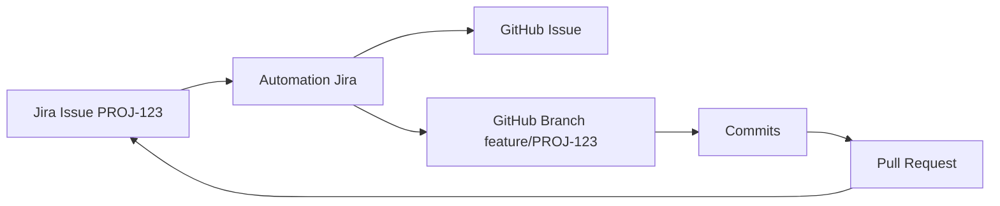

Il existe plusieurs façons de connecter Jira et GitHub selon ce que tu veux automatiser.

## Cas 1 : Voir les issues GitHub dans Jira (intégration standard)

Le plus simple est d'installer l'application officielle de Jira :

1. Va dans ton espace Jira.
2. Ouvre **Apps → Explore more apps**.
3. Recherche **GitHub for Jira** de GitHub.
4. Installe l'application.
5. Connecte ton compte GitHub et sélectionne tes dépôts.

Cette intégration permet notamment :

* Voir les commits, branches et pull requests dans les tickets Jira.
* Afficher les déploiements et les informations CI/CD.
* Lier automatiquement les développements aux tickets en utilisant la clé Jira dans les noms de branches ou les messages de commit.

Exemple :

* Ticket Jira : `PROJ-123`
* Branche GitHub :

```bash
git checkout -b feature/PROJ-123-ajout-authentification
```

* Commit :

```bash
git commit -m "PROJ-123 Ajout du service d'authentification"
```

Jira détectera automatiquement le commit et la branche.

---

## Cas 2 : Créer automatiquement une branche GitHub depuis un ticket Jira

Avec l'intégration officielle, tu peux activer le panneau **Development** dans Jira.

Dans un ticket :

**Development → Create branch**

Jira te propose :

```text
feature/PROJ-123-description
```

La branche est créée directement sur GitHub et liée au ticket.

---

## Cas 3 : Créer automatiquement une Issue GitHub lorsqu'un ticket Jira est créé

Ce n'est pas disponible nativement. Il faut utiliser une automatisation.

### Solution avec l'automatisation Jira

Dans Jira :

**Project settings → Automation → Create rule**

Déclencheur :

```text
Issue created
```

Action :

```text
Send web request
```

Appel de l'API GitHub :

```http
POST https://api.github.com/repos/mon-org/mon-repo/issues
Authorization: Bearer <TOKEN_GITHUB>
Content-Type: application/json
```

Body :

```json
{
  "title": "{{issue.key}} - {{issue.summary}}",
  "body": "{{issue.description}}"
}
```

Résultat :

Jira :

```text
PROJ-123
Créer la gestion des utilisateurs
```

↓

GitHub Issue :

```text
PROJ-123 - Créer la gestion des utilisateurs
```

---

## Cas 4 : Créer automatiquement une branche GitHub lorsqu'un ticket Jira est créé

GitHub ne permet pas de créer des branches via une API simple dédiée, mais on peut le faire via l'API GitHub.

Workflow :

```text
Création ticket Jira
       ↓
Automation Jira
       ↓
Webhook GitHub API
       ↓
Création branche
```

Appel API :

1. Récupérer le SHA de `main`

```http
GET /repos/{owner}/{repo}/git/ref/heads/main
```

2. Créer la branche

```http
POST /repos/{owner}/{repo}/git/refs
```

Body :

```json
{
  "ref": "refs/heads/feature/PROJ-123",
  "sha": "<sha-main>"
}
```

---

# Architecture recommandée



---

# Ce que je te conseille pour un projet de développement

Configuration idéale :

1. Installer l'application officielle GitHub for Jira.
2. Nommer les branches :

```text
feature/PROJ-123-description
bugfix/PROJ-456-correction
hotfix/PROJ-789-fix-prod
```

3. Mettre la clé Jira dans tous les commits :

```bash
git commit -m "PROJ-123 Ajout endpoint de création utilisateur"
```

4. Ajouter une règle d'automatisation Jira :

```text
Issue created
      ↓
Create GitHub Issue
```

5. Utiliser éventuellement un workflow GitHub Actions pour créer automatiquement la branche associée.

Ainsi, un ticket Jira devient le point central, et tout le cycle de développement (branche, commits, PR et déploiements) remonte automatiquement dans Jira.
