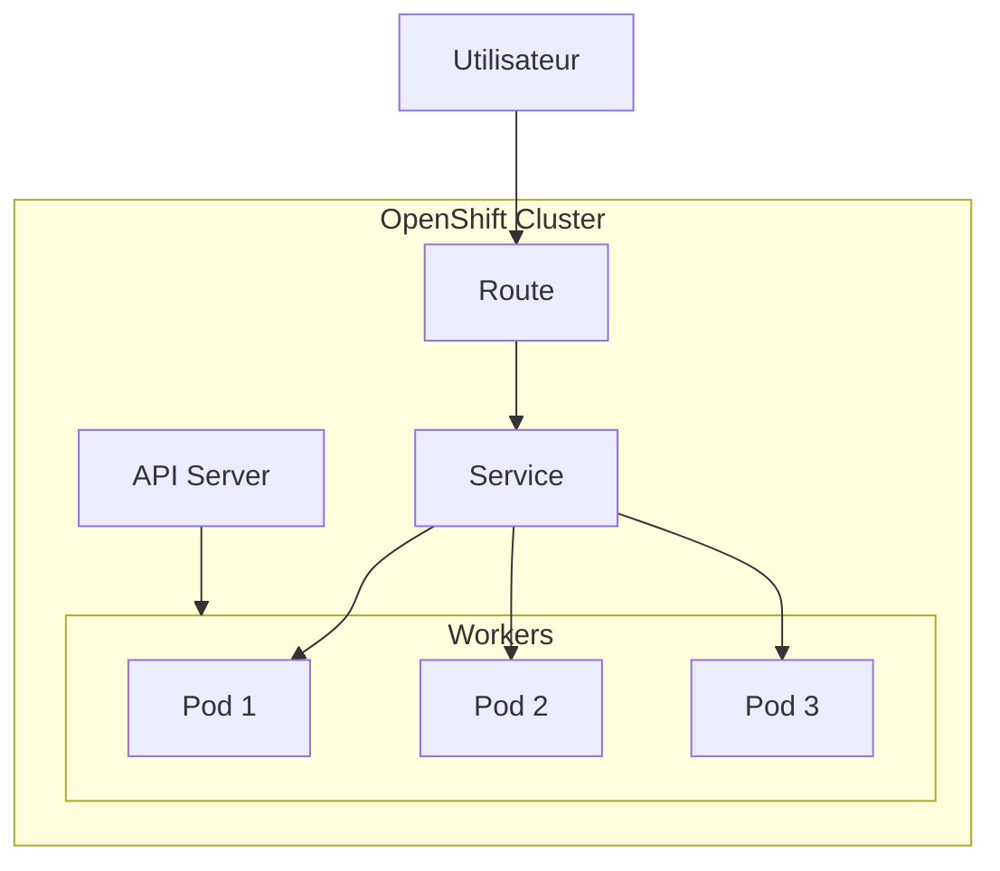
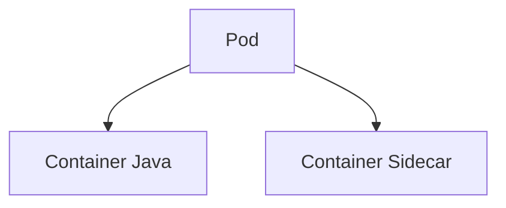
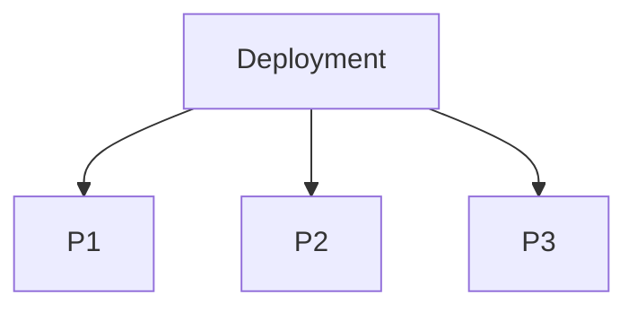
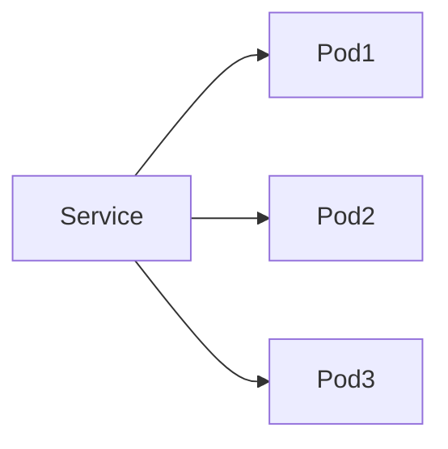
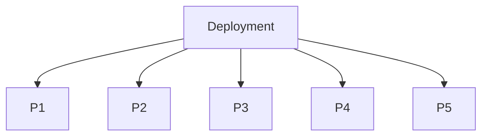
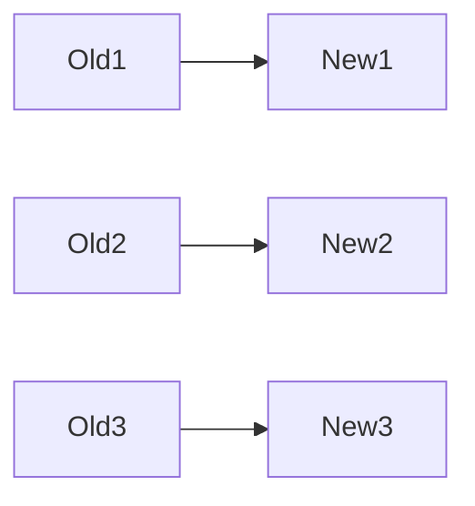
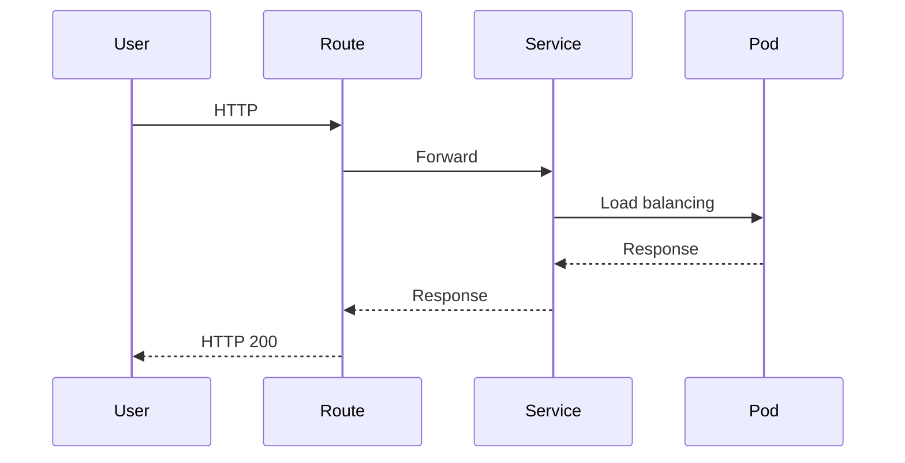
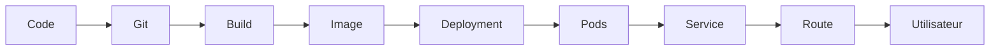

# Tutoriel basique sur OpenShift

Ce tutoriel est une introduction à **OpenShift**, destinée à quelqu'un qui connaît un peu Linux, Docker ou Kubernetes, mais qui débute avec la plateforme.

---

# 1. Qu'est-ce qu'OpenShift ?

**OpenShift** est une plateforme de conteneurs développée par **Red Hat**, basée sur **Kubernetes**.

On peut le voir comme :

> Kubernetes + des outils pour simplifier le déploiement, la sécurité et l'administration des applications.

OpenShift ajoute notamment :

* une interface Web
* une CLI (`oc`)
* une gestion des utilisateurs
* des routes HTTP
* des builds d'images
* une registry intégrée
* des pipelines CI/CD
* des opérateurs

---

# 2. Architecture générale



Le trafic passe généralement :

```
Utilisateur
      ↓
Route
      ↓
Service
      ↓
Pods
```

---

# 3. Les composants principaux

| Objet      | Rôle                                         |
| ---------- | -------------------------------------------- |
| Project    | Espace de travail (namespace Kubernetes)     |
| Pod        | Une ou plusieurs applications conteneurisées |
| Deployment | Gère les Pods                                |
| Service    | Donne une adresse réseau stable              |
| Route      | Expose le service vers Internet              |
| ConfigMap  | Variables de configuration                   |
| Secret     | Informations sensibles                       |
| PVC        | Stockage persistant                          |

---

# 4. Les Projects

Dans OpenShift, on travaille toujours dans un **Project**.

```
Project "dev"

├── Pod
├── Pod
├── Service
├── Route
├── Secret
└── ConfigMap
```

Créer un projet :

```bash
oc new-project demo
```

Lister les projets :

```bash
oc projects
```

Changer de projet :

```bash
oc project demo
```

---

# 5. Les Pods

Un Pod contient un ou plusieurs conteneurs.



Lister les Pods :

```bash
oc get pods
```

Afficher les détails :

```bash
oc describe pod nom-du-pod
```

Voir les logs :

```bash
oc logs nom-du-pod
```

---

# 6. Les Deployments

On ne crée généralement **jamais** un Pod directement.

On crée un **Deployment**.

Le Deployment garantit que le bon nombre de Pods fonctionne.



Créer un Deployment :

```bash
oc create deployment nginx --image=nginx
```

Vérifier :

```bash
oc get deployments
```

---

# 7. Les Services

Les Pods changent régulièrement d'adresse IP.

Le **Service** fournit une adresse stable.



Créer un Service :

```bash
oc expose deployment nginx --port=80
```

Lister :

```bash
oc get svc
```

---

# 8. Les Routes

Kubernetes expose les applications via des Services.

OpenShift ajoute les **Routes**.

Une Route fournit une URL publique.

```
https://mon-app.apps.cluster.com
```

Créer une Route :

```bash
oc expose svc nginx
```

Lister :

```bash
oc get routes
```

---

# 9. Déployer une application

Déployer une image :

```bash
oc new-app nginx
```

OpenShift crée automatiquement :

* Deployment
* Pods
* Service

Ensuite :

```bash
oc expose svc nginx
```

Votre application devient accessible via une URL.

---

# 10. Les ConfigMaps

Les ConfigMaps stockent la configuration.

Exemple :

```yaml
DATABASE_HOST=db
DATABASE_PORT=5432
```

Créer une ConfigMap :

```bash
oc create configmap config \
  --from-literal=MODE=prod
```

Lister :

```bash
oc get configmaps
```

---

# 11. Les Secrets

Les Secrets stockent les données sensibles.

Exemples :

* mots de passe
* certificats
* clés API

Créer un Secret :

```bash
oc create secret generic db-secret \
  --from-literal=password=MonMotDePasse
```

Lister :

```bash
oc get secrets
```

---

# 12. Le stockage

Sans stockage, un Pod perd ses données lorsqu'il est recréé.

On utilise :

```
PVC
↓
Volume
↓
Pod
```

Le PVC (*Persistent Volume Claim*) demande un volume persistant au cluster.

---

# 13. Mettre à l'échelle

Voir le nombre de Pods :

```bash
oc get pods
```

Passer à 5 réplicas :

```bash
oc scale deployment/nginx --replicas=5
```



---

# 14. Mettre à jour une application

Changer l'image :

```bash
oc set image deployment/nginx \
nginx=nginx:latest
```

OpenShift effectue un **Rolling Update**.



Les anciens Pods sont remplacés progressivement.

---

# 15. Commandes essentielles

## Voir les ressources

```bash
oc get all
```

---

## Voir les Pods

```bash
oc get pods
```

---

## Voir les Services

```bash
oc get svc
```

---

## Voir les Routes

```bash
oc get routes
```

---

## Voir les logs

```bash
oc logs pod-name
```

---

## Ouvrir un shell dans un Pod

```bash
oc rsh pod-name
```

---

## Décrire une ressource

```bash
oc describe pod pod-name
```

---

## Supprimer une ressource

```bash
oc delete pod pod-name
```

---

# 16. Cycle de vie d'une requête



---

# 17. Workflow classique



---

# 18. Résumé

```text
Code
  ↓
Image Docker
  ↓
Deployment
  ↓
Pods
  ↓
Service
  ↓
Route
  ↓
Utilisateur
```

---

# 19. À retenir

* **Project** : espace de travail.
* **Pod** : exécute un ou plusieurs conteneurs.
* **Deployment** : gère les Pods et les mises à jour.
* **Service** : fournit une adresse réseau stable.
* **Route** : expose l'application à l'extérieur du cluster.
* **ConfigMap** : stocke la configuration.
* **Secret** : stocke les informations sensibles.
* **PVC** : apporte un stockage persistant.
* La CLI **`oc`** est l'outil principal pour administrer OpenShift.

Une fois ces notions maîtrisées, vous pourrez aborder des sujets plus avancés comme les **Operators**, les **BuildConfigs**, les **Pipelines Tekton**, les **Security Context Constraints (SCC)**, l'**autoscaling (HPA)**, les **Ingress Controllers** et l'observabilité (monitoring et logging).
