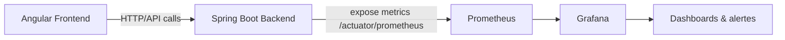
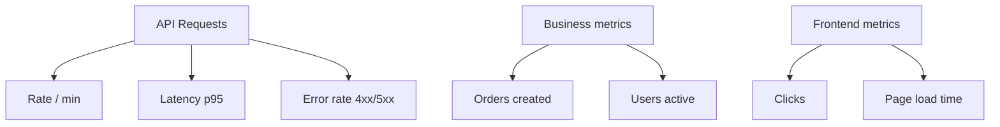
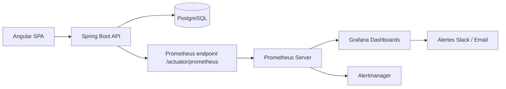

Voici un **tutoriel complet et concret sur Prometheus + Grafana** dans un contexte d’applications **Java (backend Spring Boot)** et **Angular (frontend)**.

L’objectif : comprendre **comment instrumenter, collecter, stocker et visualiser des métriques** de ton application.

---

# 1. Architecture globale (vue d’ensemble)

Dans un projet Java + Angular, on observe généralement ceci :



👉 Idée clé :

* **Spring Boot expose les métriques**
* **Prometheus les scrape (récupère)**
* **Grafana les visualise**

---

# 2. Mise en place côté Java (Spring Boot)

## 2.1 Dépendances Maven

Dans ton `pom.xml` :

```xml
<dependency>
    <groupId>org.springframework.boot</groupId>
    <artifactId>spring-boot-starter-actuator</artifactId>
</dependency>

<dependency>
    <groupId>io.micrometer</groupId>
    <artifactId>micrometer-registry-prometheus</artifactId>
</dependency>
```

---

## 2.2 Configuration application.yml

```yaml
management:
  endpoints:
    web:
      exposure:
        include: health, metrics, prometheus
  endpoint:
    prometheus:
      enabled: true
  metrics:
    export:
      prometheus:
        enabled: true
```

---

## 2.3 Endpoint Prometheus

Une fois lancé :

```
http://localhost:8080/actuator/prometheus
```

Tu verras un flux type :

```
http_server_requests_seconds_count{method="GET",status="200",uri="/api/users"} 120
http_server_requests_seconds_sum{method="GET",status="200",uri="/api/users"} 2.34
```

---

# 3. Ajouter des métriques custom (important en vrai projet)

## Exemple : mesurer un service métier

```java
import io.micrometer.core.instrument.MeterRegistry;
import org.springframework.stereotype.Service;

@Service
public class OrderService {

    private final MeterRegistry meterRegistry;

    public OrderService(MeterRegistry meterRegistry) {
        this.meterRegistry = meterRegistry;
    }

    public void createOrder() {
        // logique métier

        meterRegistry.counter("orders_created_total").increment();
    }
}
```

👉 Résultat dans Prometheus :

```
orders_created_total 15
```

---

## Exemple avancé : timer (durée d’exécution)

```java
import io.micrometer.core.annotation.Timed;

@Timed(value = "order_processing_time", description = "Temps traitement commande")
public void processOrder() {
    // traitement
}
```

---

# 4. Installation de Prometheus

## 4.1 Fichier de config prometheus.yml

```yaml
global:
  scrape_interval: 5s

scrape_configs:
  - job_name: "spring-boot-app"
    metrics_path: "/actuator/prometheus"
    static_configs:
      - targets: ["host.docker.internal:8080"]
```

---

## 4.2 Docker (recommandé)

```bash
docker run -p 9090:9090 \
  -v $(pwd)/prometheus.yml:/etc/prometheus/prometheus.yml \
  prom/prometheus
```

---

## 4.3 Vérification

Accède à :

```
http://localhost:9090
```

Puis teste une requête PromQL :

```promql
orders_created_total
```

---

# 5. Installation de Grafana

## 5.1 Docker

```bash
docker run -d -p 3000:3000 grafana/grafana
```

Accès :

```
http://localhost:3000
```

Login par défaut :

* admin / admin

---

## 5.2 Ajouter Prometheus comme source de données

Dans Grafana :

* Settings → Data Sources
* Add Prometheus
* URL :

```
http://host.docker.internal:9090
```

---

# 6. Création de dashboards Grafana

## Exemple 1 : taux de requêtes HTTP

PromQL :

```promql
rate(http_server_requests_seconds_count[1m])
```

---

## Exemple 2 : latence API

```promql
histogram_quantile(0.95,
  rate(http_server_requests_seconds_bucket[5m])
)
```

👉 Ça donne le **p95 (95% des requêtes)**

---

## Exemple 3 : compteur métier

```promql
orders_created_total
```

---

# 7. Angular : monitoring côté frontend

Angular ne s’expose pas directement à Prometheus, mais on peut :

## Option 1 : envoyer des métriques vers backend

Exemple service Angular :

```ts
@Injectable({ providedIn: 'root' })
export class AnalyticsService {

  constructor(private http: HttpClient) {}

  trackClick(eventName: string) {
    return this.http.post('/api/metrics/click', {
      event: eventName,
      timestamp: Date.now()
    }).subscribe();
  }
}
```

---

## Côté Spring Boot :

```java
@PostMapping("/api/metrics/click")
public void trackClick(@RequestBody ClickEvent event) {
    meterRegistry.counter("frontend_clicks_total",
        "event", event.getEvent()
    ).increment();
}
```

---

## Résultat :

```
frontend_clicks_total{event="button_login"} 42
```

---

# 8. Dashboard complet type (exemple réel)



---

# 9. Bonnes pratiques (très important en prod)

## 9.1 Nommage des métriques

✔ Bon :

```
orders_created_total
http_request_duration_seconds
```

❌ Mauvais :

```
orders
time
data1
```

---

## 9.2 Labels (attention à l’explosion)

```java
counter("orders_total", "status", "SUCCESS");
```

⚠ Attention :
trop de labels = explosion mémoire Prometheus

---

## 9.3 Ne pas exposer trop de métriques

* garder uniquement utile
* éviter debug en prod

---

# 10. Exemple d’architecture complète (réaliste entreprise)



---

# 11. Cas concret d’usage en entreprise

### Exemple réel :

Tu veux surveiller :

* latence API login
* taux d’échec login
* nombre d’utilisateurs connectés

### PromQL utile :

```promql
rate(http_server_requests_seconds_count{uri="/login", status="500"}[5m])
```

👉 détecte les erreurs login

---

# Conclusion

Avec Prometheus + Grafana :

* tu passes d’un simple backend fonctionnel
* à une **application observable en temps réel**

