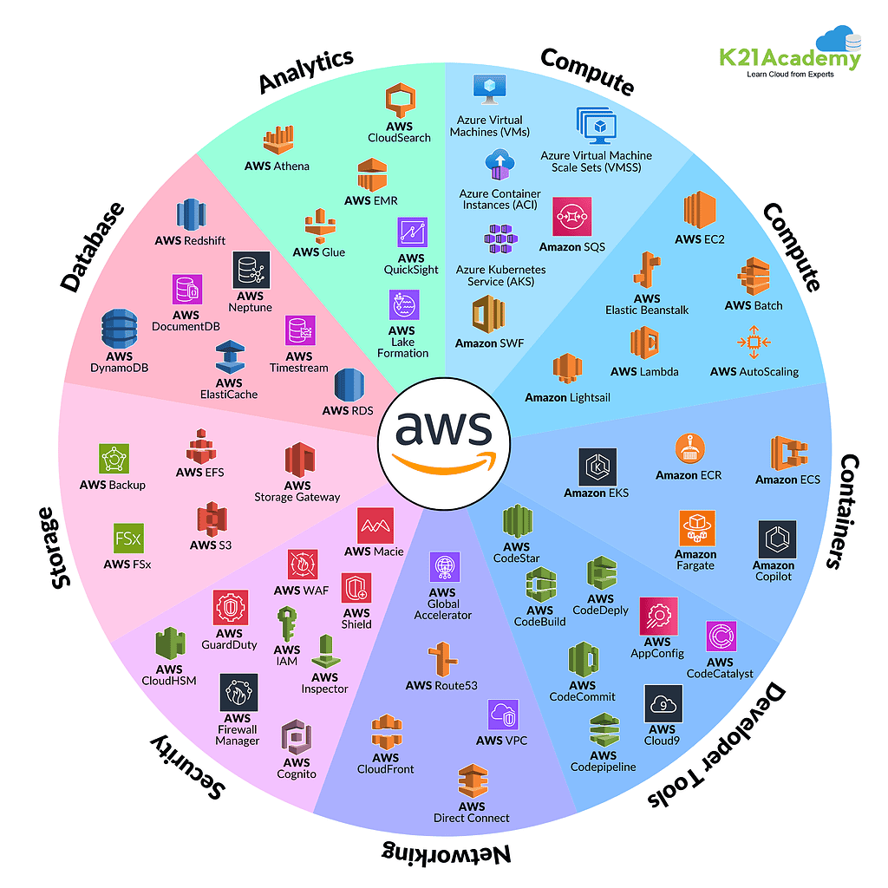
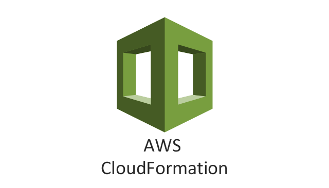
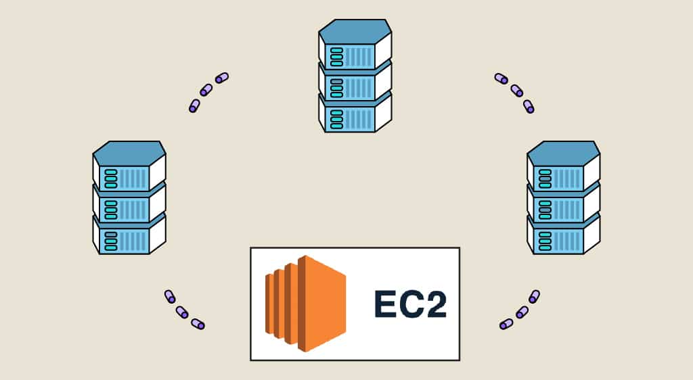
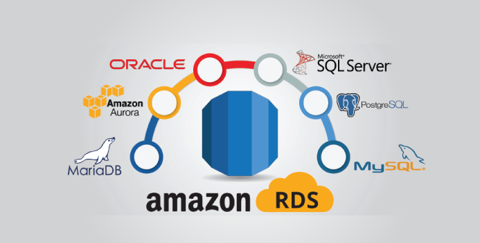
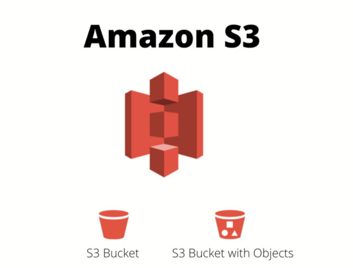
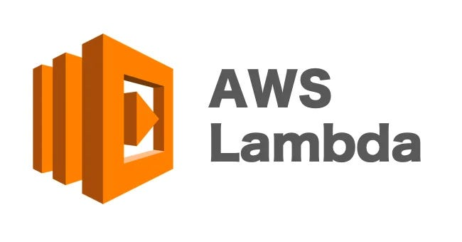

<div align="center">
	
</div>

```
Amazon Web Services (AWS) est la plateforme cloud la plus complète et la plus largement adoptée au monde. 
Elle propose plus de 200 services complets issus de centres de données du monde entier. 
Des millions de clients (dont certaines des startups les plus dynamiques au monde, de très grandes entreprises 
et des agences fédérales de premier plan) utilisent AWS pour réduire leurs coûts, gagner en agilité et innover plus rapidement.
```

# Quelques Services AWS 

## AWS CloudFormation
<div align="center">
	
</div>

```
Accélérez le provisionnement cloud avec l’infrastructure en tant que code
```
```
Avantages : Mise à l'échelle de votre infrastructure dans le monde entier, Extension et gestion de votre infrastructure, 
            Automatisation de la gestion des ressources
Use cases : Gérer l'infrastructure avec DevOps, Mettre à l'échelle des piles de production, Partager les bonnes pratiques
```
## Amazon EC2 (Elastic Compute Cloud)
<div align="center">
	
</div>

```
Capacité de calcul sécurisée et redimensionnable pour pratiquement toutes les charges de travail
EC2 offre la plateforme de calcul la plus variée et la plus complète, avec plus de 750 instances. 
Vous y avez accès au processeur, à la solution de stockage, aux réseaux, au système d’exploitation 
et au modèle d’achat les plus récents pour vous aider à répondre au mieux aux besoins de votre charge de travail
```
```
Avantages : L'engagement SLA (Service Level Agreement), Optimiser les performances et les coûts, Outils de migration AWS
Use cases : Exécuter des applications métier et natives cloud
```

## Amazon RDS
<div align="center">
	
</div>

```
Bases de données relationnelles faciles à gérer et optimisées pour le coût total de possession
C'est un service de base de données relationnelle facile à gérer, optimisé pour le coût total de possession. 
Simple à configurer et à utiliser, le service se met à l’échelle en fonction de la demande. 
RDS automatise les tâches indifférenciées de gestion des bases de données, telles que le provisionnement, la configuration, 
la sauvegarde et l’application de correctifs.
RDS permet aux clients de créer une nouvelle base de données en quelques minutes, et offre la flexibilité nécessaire 
pour personnaliser les bases de données et répondre à leurs besoins grâce à huit moteurs et deux options de déploiement.
```
```
Avantages : Faciles à gérer, choix des moteurs, haute disponibilité, bénéficie d'une expertise opérationnelle
Use cases : Créer des apps web et mobiles, passer aux bases de données gérées, se libérer des bases de données héritées
```

## Amazon S3 (Simple Storage Service)
<div align="center">
	
</div>

```
C'est un service de stockage d’objets qui offre une capacité de mise à l’échelle, une disponibilité des données, 
une sécurité et des performances de pointe. 
Les clients de toutes les tailles et de tous les secteurs stockent, gèrent, 
analysent et protègent n’importe quelle quantité de données
pour la quasi-totalité des cas d’utilisation, tels que les lacs de données 
ainsi que les applications natives cloud et mobiles. 
```
```
Avantages : Capacité de mise à l'échelle, Durabilité et disponibilité, Sécurité et protection des données, 
            Prix le plus bas et performances les plus élevées
Use cases : Créer un lac de données, Sauvegarder et restaurer des données, Archiver les données, IA générative
```

## AWS Lambda
<div align="center">
	
</div>

```
Exécuter du code sans vous soucier des serveurs ou des clusters
AWS Lambda vous permet de vous concentrer uniquement sur votre code, tout en gérant l’ensemble de l’infrastructure, 
ce qui permet d’accélérer le développement, d’améliorer les performances, de renforcer la sécurité et de réduire les coûts
```
```
Avantages : augmenter l'agilité des développeurs, améliorer les performances des applications, 
            contribuer à renforcer la posture de sécurité globale, favoriser la rentabilité
Use cases : Backends web et mobiles interactifs, Traitement des données par lots, Traitement des données en temps réel, 
            IA générative
```
