# Vue d’ensemble : où se place chaque technologie ?

Imagine que tu veux déployer une application web composée :

* d'un frontend React
* d'une API Spring Boot
* d'une base PostgreSQL

Voici comment les technologies s'enchaînent :

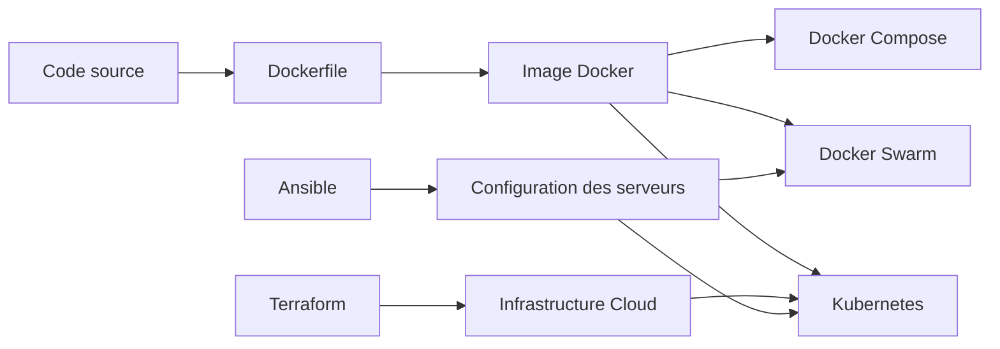

En résumé :

| Technologie    | Rôle                                                    |
| -------------- | ------------------------------------------------------- |
| Docker         | Exécuter une application dans un conteneur              |
| Dockerfile     | Construire une image Docker                             |
| Docker Compose | Lancer plusieurs conteneurs ensemble                    |
| Docker Swarm   | Orchestrer des conteneurs Docker sur plusieurs machines |
| Kubernetes     | Orchestration avancée de conteneurs                     |
| Ansible        | Configurer des serveurs                                 |
| Terraform      | Créer l'infrastructure                                  |

---

# 1. Docker

## Le problème

Avant Docker :

```text
Dev :
→ Ça marche sur ma machine

Prod :
→ Ça ne marche pas
```

Car :

* version Java différente
* dépendances différentes
* système différent

Docker résout cela.

## Concept

Docker encapsule :

```text
Application
+ librairies
+ dépendances
+ configuration
```

dans un conteneur.

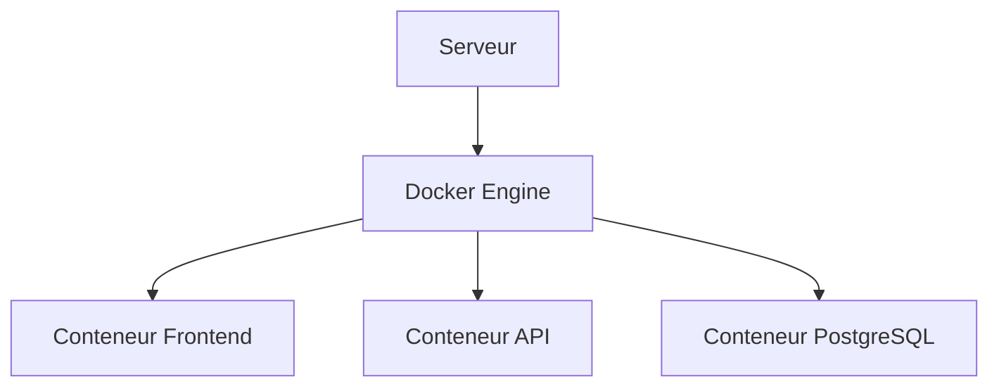

---

## Exemple

Application Java :

```java
public class Main {
    public static void main(String[] args){
        System.out.println("Hello Docker");
    }
}
```

Docker l'exécute dans un environnement isolé.

---

## Commandes principales

Télécharger une image :

```bash
docker pull nginx
```

Lancer un conteneur :

```bash
docker run nginx
```

Voir les conteneurs :

```bash
docker ps
```

Arrêter :

```bash
docker stop container_id
```

---

# 2. Dockerfile

## Le problème

Comment créer sa propre image Docker ?

Réponse : Dockerfile.

C'est la recette de fabrication.

---

## Exemple complet

Application Spring Boot :

```dockerfile
FROM eclipse-temurin:21

WORKDIR /app

COPY target/app.jar app.jar

EXPOSE 8080

CMD ["java","-jar","app.jar"]
```

---

## Explication

### FROM

Image de base.

```dockerfile
FROM eclipse-temurin:21
```

équivaut à :

> "Je pars d'un Linux contenant Java 21"

---

### WORKDIR

```dockerfile
WORKDIR /app
```

équivaut à :

```bash
cd /app
```

---

### COPY

```dockerfile
COPY target/app.jar app.jar
```

copie le fichier dans l'image.

---

### EXPOSE

```dockerfile
EXPOSE 8080
```

Documentation du port utilisé.

---

### CMD

Commande de démarrage :

```dockerfile
CMD ["java","-jar","app.jar"]
```

---

## Construction

Créer l'image :

```bash
docker build -t mon-api .
```

Lancer :

```bash
docker run mon-api
```

---

## Schéma

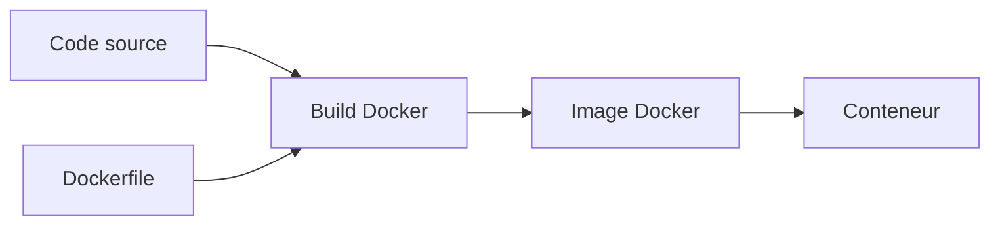

---

# 3. Docker Compose

## Le problème

Une application réelle contient souvent plusieurs services.

Exemple :

```text
Frontend
API
PostgreSQL
Redis
```

Lancer chaque conteneur à la main devient pénible.

---

## Solution

Docker Compose.

Un seul fichier :

```yaml
services:
  frontend:
  api:
  postgres:
  redis:
```

---

## Exemple réel

```yaml
version: "3"

services:

  db:
    image: postgres:16
    environment:
      POSTGRES_DB: app

  api:
    build: .
    ports:
      - "8080:8080"
    depends_on:
      - db

  frontend:
    image: nginx
    ports:
      - "80:80"
```

---

## Démarrage

```bash
docker compose up
```

Arrêt :

```bash
docker compose down
```

---

## Architecture

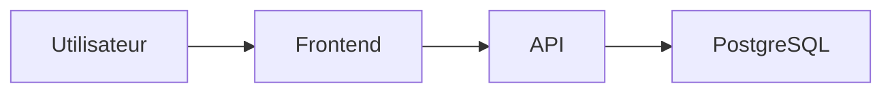

Tous les services sont démarrés ensemble.

---

# 4. Docker Swarm

## Le problème

Docker Compose fonctionne bien sur UNE machine.

Mais si :

* 10 serveurs
* haute disponibilité
* plusieurs réplicas

alors il faut un orchestrateur.

---

## Solution

Docker Swarm.

Cluster de machines Docker.

---

## Architecture

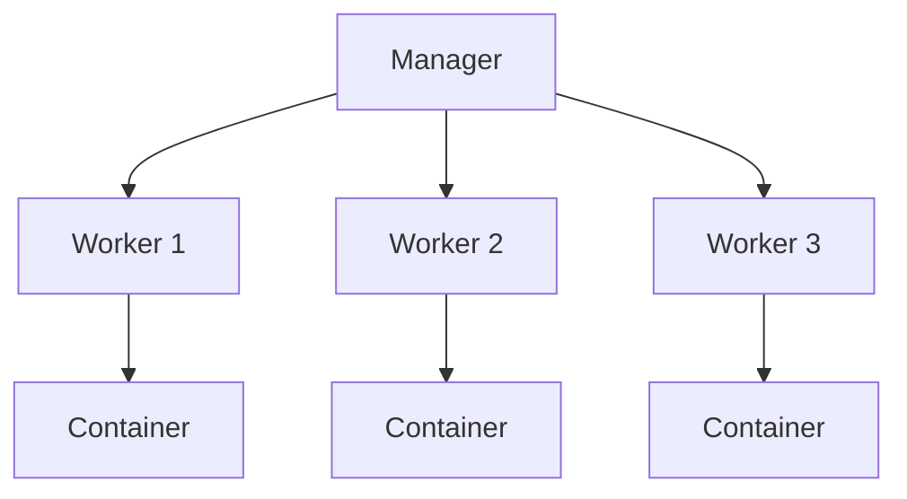

---

## Exemple

Créer le cluster :

```bash
docker swarm init
```

Ajouter un worker :

```bash
docker swarm join ...
```

---

## Déployer

```bash
docker service create \
--replicas 3 \
nginx
```

Résultat :

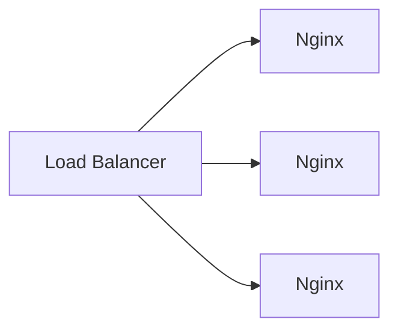

---

## Avantages

* réplication
* failover
* load balancing

---

## Limites

Aujourd'hui Kubernetes domine largement.

Swarm est devenu marginal.

---

# 5. Kubernetes (K8s)

## Le problème

Quand tu gères :

* 50 applications
* 200 conteneurs
* 20 serveurs

Docker seul ne suffit plus.

---

## Kubernetes = orchestrateur de conteneurs

Il décide :

* où lancer les conteneurs
* combien lancer
* comment les remplacer
* comment les mettre à jour

---

## Architecture simplifiée

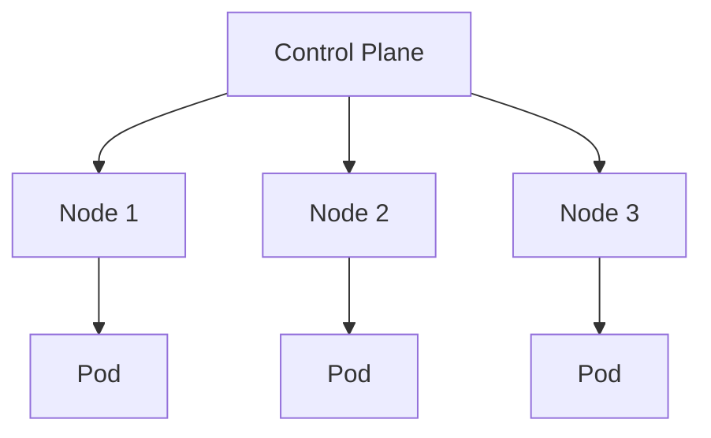

---

## Pod

Un Pod est la plus petite unité Kubernetes.

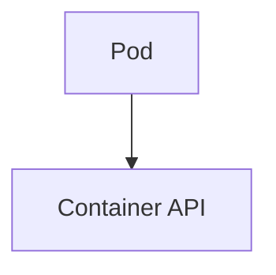

Souvent :

```text
1 Pod = 1 conteneur
```

---

## Deployment

Déclare :

```text
Je veux 3 copies de mon API
```

Exemple :

```yaml
apiVersion: apps/v1
kind: Deployment

spec:
  replicas: 3
```

---

## Service

Expose les Pods.

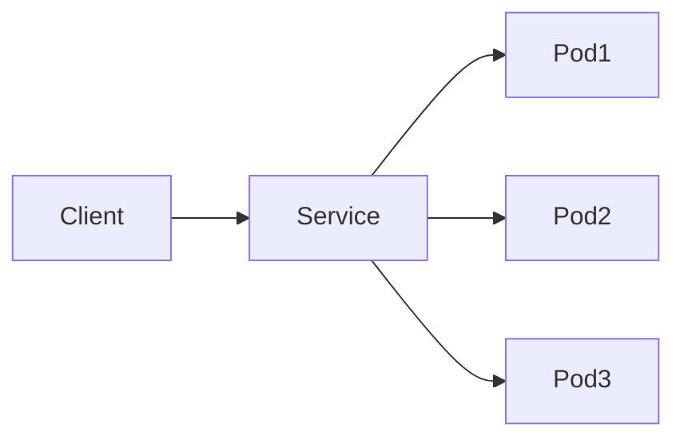

---

## Auto-healing

Pod supprimé ?


Kubernetes recrée automatiquement le Pod.

---

## Rolling Update

Déploiement sans interruption.

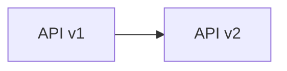

Kubernetes remplace progressivement les instances.

---

## Exemple complet

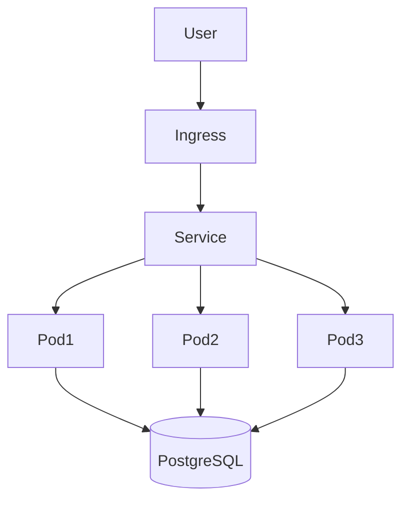

---

# 6. Ansible

## Le problème

Tu as 100 serveurs Linux.

Tu dois installer :

* Docker
* Java
* Nginx

sur chacun.

À la main ?

Impossible.

---

## Solution

Ansible.

Ansible configure les serveurs automatiquement.

---

## Fonctionnement

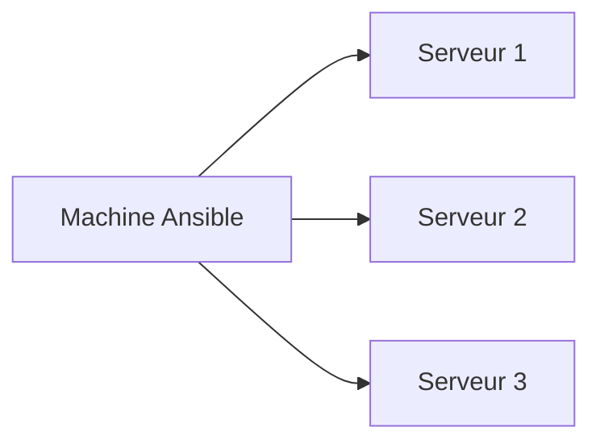

Communication via SSH.

---

## Exemple

Installer Docker :

```yaml
- hosts: servers

  tasks:

  - name: Install Docker
    apt:
      name: docker.io
      state: present
```

---

## Exécution

```bash
ansible-playbook docker.yml
```

---

## Cas réel

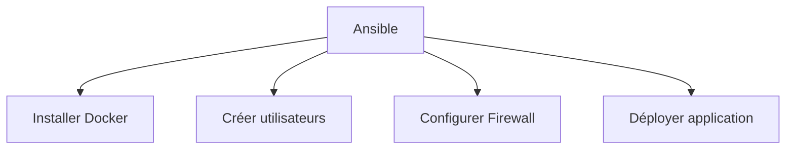

---

# 7. Terraform

## Le problème

Créer à la main :

* VM
* Réseaux
* Bases de données
* Clusters Kubernetes

sur AWS, Azure ou GCP est long et source d'erreurs.

---

## Solution

Terraform

Infrastructure as Code (IaC).

Tu décris l'infrastructure dans un fichier.

Terraform la crée.

---

## Exemple AWS

```hcl
resource "aws_instance" "web" {
  ami           = "ami-123456"
  instance_type = "t3.micro"
}
```

---

## Workflow

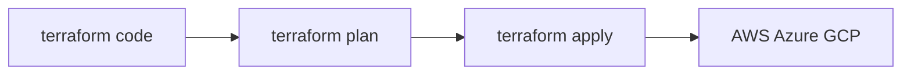

---

## Exemple réel

Terraform crée :

```text
3 VM
1 Load Balancer
1 Base PostgreSQL
1 Cluster Kubernetes
```

---

## Architecture

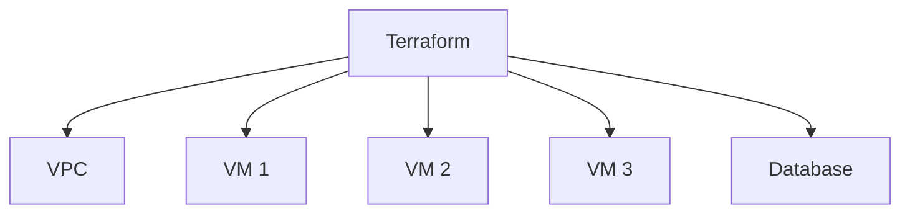

---

# Comment tout cela fonctionne ensemble ?

Exemple DevOps moderne :

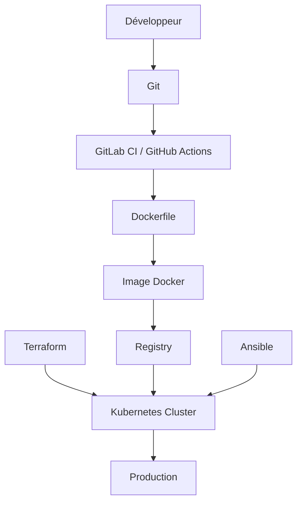

## Étape par étape

### 1

Le développeur écrit le code.

### 2

Le Dockerfile construit l'image.

```text
Code → Image Docker
```

### 3

L'image est stockée dans un registre.

Exemples :

* Docker Hub
* GitHub Container Registry
* Amazon Elastic Container Registry

### 4

Terraform crée :

* VM
* Réseau
* Cluster Kubernetes

### 5

Ansible configure les machines.

### 6

Kubernetes déploie les conteneurs.

### 7

Les utilisateurs accèdent à l'application.

---

# Résumé ultra-court

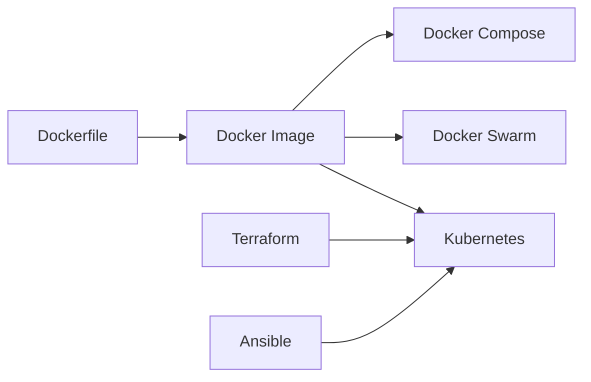

* **Dockerfile** → recette de construction
* **Docker** → exécute les conteneurs
* **Docker Compose** → plusieurs conteneurs sur une machine
* **Docker Swarm** → plusieurs machines Docker
* **Kubernetes** → orchestration industrielle de conteneurs
* **Ansible** → configuration des serveurs
* **Terraform** → création de l'infrastructure

Une manière simple de retenir :

> **Terraform construit les serveurs → Ansible les configure → Docker exécute les applications → Kubernetes les orchestre à grande échelle.**
