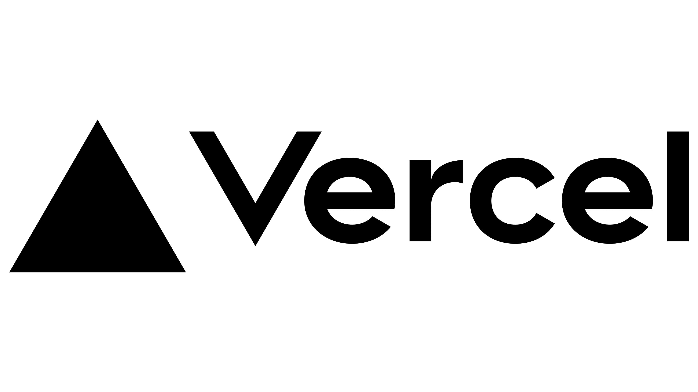

# VERCEL
<div align="center">
	
</div>

Vercel est devenu le standard de l'industrie pour déployer des applications Frontend.

## 1. C'est quoi Vercel ?
Vercel est une plateforme de Cloud Computing (PaaS) optimisée pour le Frontend et le "Serverless".

- **Le Concept :**
Contrairement à un serveur classique (comme un VPS ou un dédié) que tu dois configurer, Vercel automatise tout. <br>
Tu connectes ton GitHub, et à chaque git push, ton site est mis en ligne avec un lien de prévisualisation.

- **Infrastructure Globale :** 
Ton application est déployée sur un CDN (Content Delivery Network). <br>
Cela signifie que le code est copié sur des serveurs partout dans le monde pour être au plus proche de tes utilisateurs.

- **Fonctions Serverless :** 
Vercel peut exécuter du code backend (Node.js, Python, Go) via des fonctions qui ne s'allument que lorsqu'on les appelle (pas de serveur qui tourne 24h/24 pour rien).

### Vercel : Au-delà du simple déploiement
*Quand utiliser Vercel ?*
- Projets Frontend Modernes : Si tu utilises Angular, React, Vue ou Next.js.
- Besoin de Performance : Grâce à son Edge Network, ton site charge très vite partout dans le monde.
- Travail en équipe : Vercel génère une "Preview URL" pour chaque branche Git. Ton testeur ou ton client peut voir les modifs avant qu'elles ne soient fusionnées.
- Projets Perso/Prototypes : C’est gratuit, rapide et gère le HTTPS automatiquement.

*Les limites à connaître (Plan Gratuit / Hobby)*
- Pas de Backend d'état (Stateful) : Tu ne peux pas faire tourner un serveur qui reste allumé (comme Spring Boot). Vercel n'accepte que des "fonctions" éphémères.
- Timeout des fonctions : Sur le plan gratuit, une requête ne peut pas durer plus de 10 secondes. Si ton backend Java met 11 secondes à répondre, Vercel coupera la connexion.
- Usage Commercial Interdit : Le plan "Hobby" est officiellement réservé aux projets personnels. Si tu commences à facturer des clients, ils attendent que tu passes au plan Pro ($20/mois).
- Bande passante : Limitée à 100 GB par mois (ce qui est déjà énorme pour un petit projet).


## 2. Comment configurer ton projet Angular sur Vercel ?
Voici les étapes pour mettre ton interface Angular en ligne :

**Étape 1 :** Préparation du projet<br>
Assure-toi que ton projet Angular est sur un dépôt Git (GitHub, GitLab ou Bitbucket).

**Étape 2 :** Importation sur Vercel<br>
- 1. Connecte-toi sur Vercel.com.
- 2. Clique sur "Add New" > "Project".
- 3. Importe ton dépôt Git.

**Étape 3 :** Paramètres de Build (Automatique)<br>
Vercel détecte normalement qu'il s'agit d'Angular. Vérifie les réglages suivants :
- Framework Preset : Angular
- Build Command : ```ng build```
- Output Directory : ```dist/nom-de-ton-projet``` (Vérifie ce nom dans ton fichier ```angular.json```).

**Étape 4 :** Gestion des routes (Crucial)<br>
Angular est une "Single Page Application" (SPA). Si un utilisateur rafraîchit la page sur ```/dashboard```, <br>
Vercel va chercher un fichier ```dashboard.html``` qui n'existe pas et renvoyer une erreur 404.<br>
Pour corriger cela, crée un fichier ```vercel.json``` à la racine de ton projet Angular :
```json 
{
  "rewrites": [
    { "source": "/(.*)", "destination": "/index.html" }
  ]
}
```

## 3. Connecter Angular à ton Backend Java
C'est ici qu'il faut être vigilant : Vercel ne supporte pas nativement l'exécution de code Java (Spring Boot, Jakarta EE, etc.).
Vercel est conçu pour le monde JavaScript/TypeScript. Pour un projet Java + Angular, tu vas donc adopter une architecture découplée :
La stratégie recommandée :
- 1. Angular (Frontend) : Hébergé sur Vercel.
- 2. Java (Backend/API) : Hébergé sur une plateforme adaptée au Java (comme Heroku, Railway, Render, ou AWS).

Comme ton backend Java sera sur une autre URL (ex: ```https://mon-api-java.herokuapp.com```), tu dois gérer deux points :

**A. Les Variables d'Environnement**<br>
Dans Vercel, va dans les Settings > Environment Variables. Ajoute une variable nommée ```BASE_URL_API``` avec l'URL de ton backend Java.
Dans ton code Angular, utilise cette variable pour tes appels ```HttpClient```.

**B. Le CORS (Cross-Origin Resource Sharing)**<br>
Ton serveur Java doit explicitement autoriser l'URL de ton site Vercel (ex: ```https://mon-projet.vercel.app```) à consommer l'API.
En Spring Boot, cela se fait souvent avec une annotation sur ton Controller :
```java 
@CrossOrigin(origins = "https://mon-projet.vercel.app")
```

## Résumé des avantages

|Fonctionnalité | Bénéfice pour ton projet|
|---------------|-------------------------|
|Déploiements de branche|Chaque "Pull Request" génère un lien unique pour tester tes changements Angular.|
|Vitesse (Edge)|Ton interface Angular charge instantanément grâce au CDN mondial.|
|HTTPS Gratuit|SSL est géré automatiquement pour ton domaine.|
