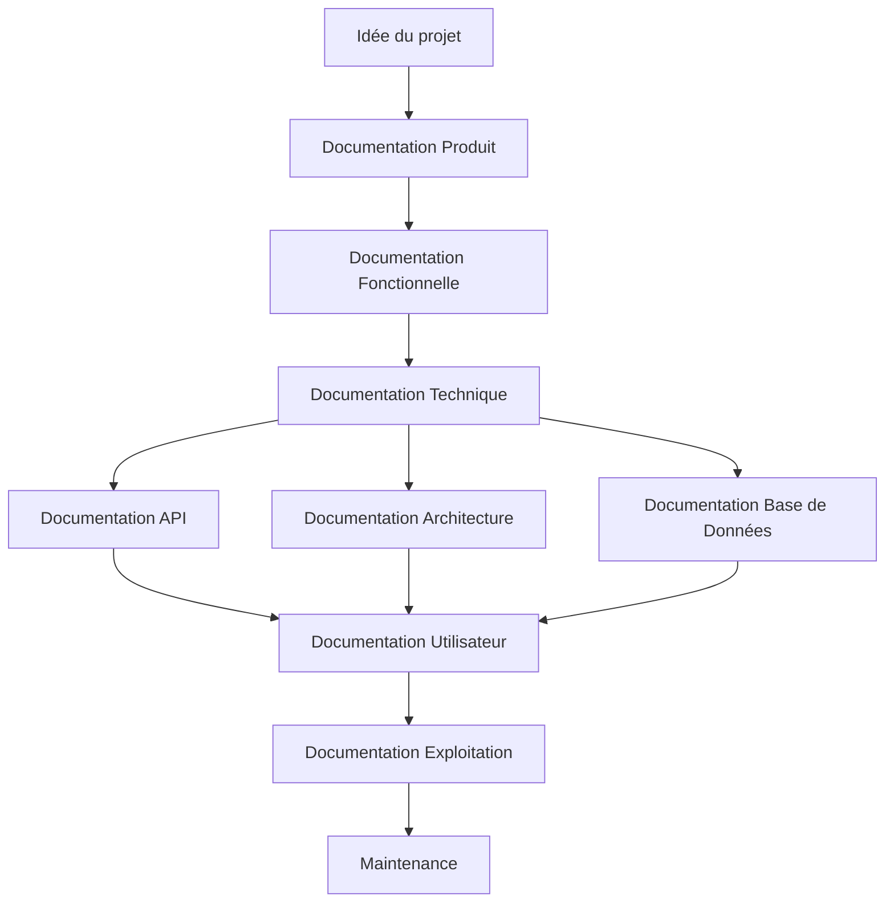
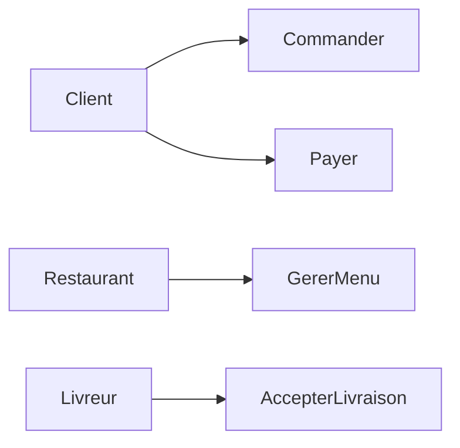
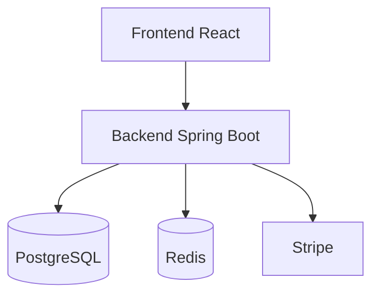
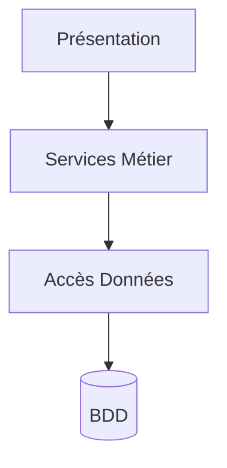
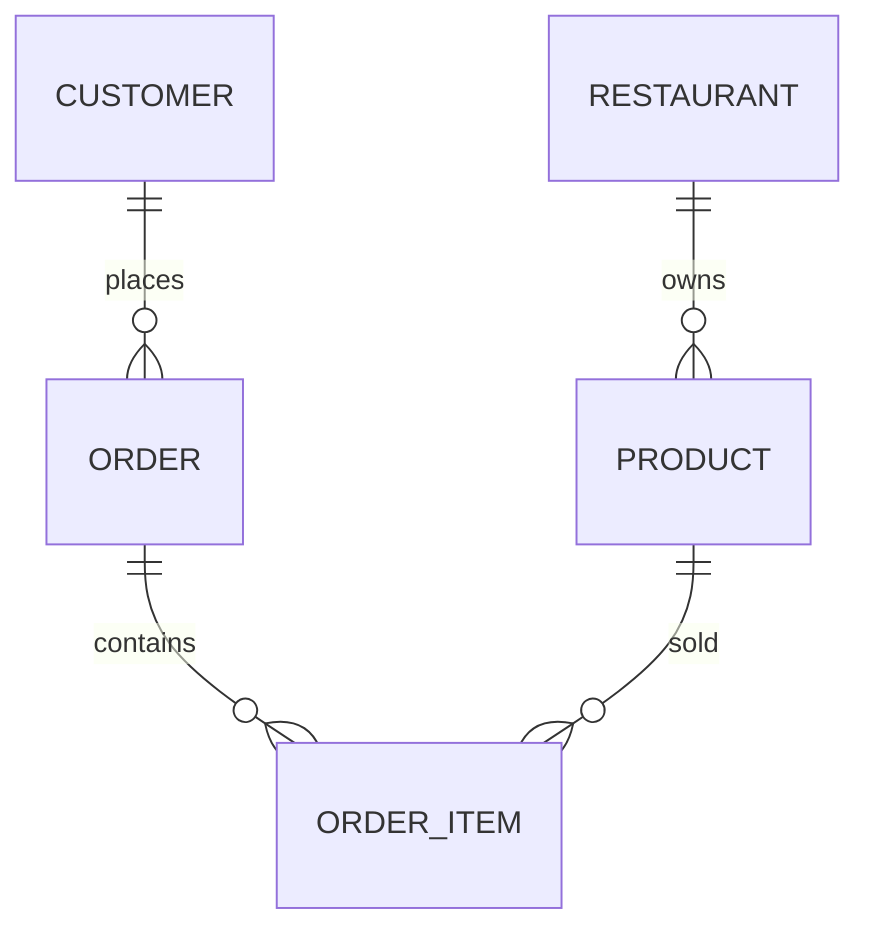
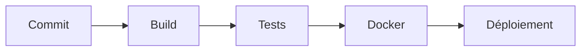
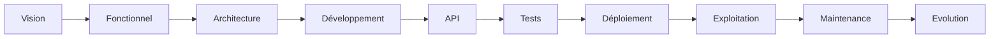

# Tutoriel Complet : La Documentation dans un Projet de Développement Informatique

## Introduction

La documentation est souvent perçue comme une tâche secondaire dans un projet logiciel. Pourtant, elle constitue l'un des piliers de la qualité, de la maintenabilité et de la transmission des connaissances.

Dans ce tutoriel, nous allons suivre un projet fictif de bout en bout :

> **FoodExpress** : une plateforme de livraison de repas permettant aux clients de commander, aux restaurants de gérer leurs menus et aux livreurs d'effectuer les livraisons.

Nous verrons :

1. Les différents types de documentation.
2. Quand les produire.
3. Les outils recommandés.
4. Des exemples concrets.
5. Des diagrammes Mermaid.
6. Une organisation documentaire professionnelle.

---

# Vision Globale de la Documentation



---

# Les Grandes Catégories de Documentation

| Type            | Public cible                   |
| --------------- | ------------------------------ |
| Produit         | Direction, client              |
| Fonctionnelle   | Product Owner, métier          |
| Technique       | Développeurs                   |
| Architecture    | Architectes, développeurs      |
| API             | Développeurs internes/externes |
| Base de données | Développeurs, DBA              |
| Utilisateur     | Clients finaux                 |
| Exploitation    | DevOps, Ops                    |
| Maintenance     | Équipe technique               |

---

# 1. Documentation Produit

## Objectif

Décrire :

* le besoin métier
* les objectifs
* les utilisateurs
* la valeur apportée

## Outils recommandés

| Outil          | Utilisation                 |
| -------------- | --------------------------- |
| Notion         | Documentation collaborative |
| Confluence     | Documentation d'entreprise  |
| Google Docs    | Rapide et simple            |
| Microsoft Loop | Travail collaboratif        |

---

## Exemple FoodExpress

### Problème

Les habitants d'une ville souhaitent commander facilement des repas.

### Solution

FoodExpress permet :

* commande en ligne
* paiement sécurisé
* suivi en temps réel

### Personas

#### Client

* commande un repas

#### Restaurant

* gère son catalogue

#### Livreur

* accepte une livraison

---

## Exemple de structure

```text
1. Vision
2. Objectifs
3. Personas
4. Cas d'usage
5. KPIs
6. Contraintes
```

---

# 2. Documentation Fonctionnelle

## Objectif

Décrire ce que doit faire le logiciel.

Pas de technique.

Uniquement les règles métier.

---

## Outils recommandés

| Outil      | Utilisation           |
| ---------- | --------------------- |
| Confluence | Standard entreprise   |
| Notion     | Startup / PME         |
| Jira       | Lien avec les tickets |
| Miro       | Ateliers métier       |

---

## Exemple

### Cas d'utilisation



---

## User Story

```text
En tant que client

Je veux commander un repas

Afin de me faire livrer à domicile
```

---

## Critères d'acceptation

```text
- Le panier doit contenir au moins un article
- Le paiement doit être validé
- La commande doit être enregistrée
```

---

# 3. Documentation des Exigences

## Objectif

Décrire précisément les besoins.

---

## Outils recommandés

| Outil        | Utilisation     |
| ------------ | --------------- |
| Jira         | User Stories    |
| Azure DevOps | Backlog         |
| Confluence   | Spécifications  |
| ReqView      | Gestion avancée |

---

## Exemple

### Exigence F001

```text
Le client doit pouvoir créer un compte.
```

### Exigence F002

```text
Le client doit pouvoir réinitialiser son mot de passe.
```

### Exigence NF001

```text
Temps de réponse inférieur à 2 secondes.
```

---

# 4. Documentation d'Architecture

## Objectif

Expliquer comment le système est construit.

---

## Outils recommandés

| Outil      | Utilisation         |
| ---------- | ------------------- |
| Mermaid    | Diagrammes dans Git |
| Draw.io    | Gratuit             |
| Lucidchart | Professionnel       |
| PlantUML   | Très populaire      |

---

# Architecture FoodExpress



---

## Architecture en couches



---

# 5. Documentation Technique

## Objectif

Expliquer le code.

---

## Outils recommandés

| Langage    | Outil             |
| ---------- | ----------------- |
| Java       | Javadoc           |
| C#         | XML Documentation |
| Python     | Sphinx            |
| TypeScript | TypeDoc           |
| PHP        | phpDocumentor     |

---

## Exemple Java

```java
/**
 * Crée une commande.
 *
 * @param clientId identifiant client
 * @param panier panier d'achat
 * @return commande créée
 */
public Commande creerCommande(
    Long clientId,
    Panier panier
)
```

---

## Exemple Python

```python
def create_order(customer_id, items):
    """
    Create an order.

    Args:
        customer_id: Customer identifier
        items: Product list

    Returns:
        Created order
    """
```

---

# 6. Documentation API

## Objectif

Permettre à d'autres développeurs d'utiliser l'API.

---

## Outils recommandés

| Outil           | Usage                  |
| --------------- | ---------------------- |
| Swagger/OpenAPI | Référence              |
| Redoc           | Documentation élégante |
| Postman         | Collections            |
| Insomnia        | Tests API              |

---

# Exemple API

## Création d'une commande

### Requête

```http
POST /api/orders
```

### Corps

```json
{
  "customerId": 12,
  "restaurantId": 4,
  "items": [
    {
      "productId": 1,
      "quantity": 2
    }
  ]
}
```

---

### Réponse

```json
{
  "orderId": 152,
  "status": "CREATED"
}
```

---

## Exemple OpenAPI

```yaml
paths:
  /orders:
    post:
      summary: Create order
      responses:
        '201':
          description: Created
```

---

# 7. Documentation de Base de Données

## Objectif

Documenter :

* tables
* relations
* contraintes
* index

---

## Outils recommandés

| Outil        | Usage                  |
| ------------ | ---------------------- |
| DBeaver      | Documentation SQL      |
| DataGrip     | Modélisation           |
| dbdiagram.io | Schémas                |
| SchemaSpy    | Génération automatique |

---

# Modèle de données



---

## Exemple table

### CUSTOMER

| Champ     | Type    |
| --------- | ------- |
| id        | bigint  |
| email     | varchar |
| firstname | varchar |
| lastname  | varchar |

---

## Exemple index

```sql
CREATE INDEX idx_customer_email
ON customer(email);
```

---

# 8. Documentation DevOps

## Objectif

Décrire le déploiement et l'infrastructure.

---

## Outils recommandés

| Outil           | Usage                  |
| --------------- | ---------------------- |
| Terraform       | Infrastructure as Code |
| Kubernetes Docs | Orchestration          |
| Helm            | Déploiement            |
| GitLab Wiki     | Documentation DevOps   |

---

# Pipeline CI/CD



---

## Exemple

```yaml
stages:
  - build
  - test
  - deploy
```

---

# 9. Documentation d'Exploitation

## Objectif

Permettre à l'équipe opérationnelle de gérer la plateforme.

---

## Outils recommandés

| Outil      | Usage                    |
| ---------- | ------------------------ |
| Confluence | Runbooks                 |
| Notion     | Procédures               |
| Git Wiki   | Documentation technique  |
| Markdown   | Documentation versionnée |

---

## Exemple

### Redémarrage

```bash
kubectl rollout restart deployment foodexpress-api
```

---

### Vérification

```bash
kubectl get pods
```

---

# 10. Documentation de Maintenance

## Objectif

Faciliter les évolutions futures.

---

## Outils recommandés

| Outil       | Usage                    |
| ----------- | ------------------------ |
| GitHub Wiki | Historique               |
| ADR         | Décisions d'architecture |
| Markdown    | Simplicité               |
| Confluence  | Centralisation           |

---

## Exemple ADR

### ADR-001

```text
Choix de PostgreSQL

Motif :
- Open Source
- Fiable
- Compatible cloud

Conséquence :
- SQL standard
```

---

# 11. Documentation Utilisateur

## Objectif

Expliquer comment utiliser l'application.

---

## Outils recommandés

| Outil      | Usage                 |
| ---------- | --------------------- |
| Docusaurus | Site documentaire     |
| MkDocs     | Documentation moderne |
| GitBook    | Très populaire        |
| HelpScout  | Base de connaissances |

---

## Exemple

### Créer un compte

1. Cliquer sur "Inscription"
2. Saisir email
3. Choisir un mot de passe
4. Valider

---

### Commander un repas

1. Choisir un restaurant
2. Ajouter des produits
3. Payer
4. Suivre la livraison

---

# 12. Documentation de Tests

## Objectif

Décrire :

* stratégie
* scénarios
* résultats

---

## Outils recommandés

| Outil         | Usage             |
| ------------- | ----------------- |
| TestRail      | Gestion des tests |
| Xray          | Jira              |
| Zephyr        | Tests             |
| Allure Report | Rapports          |

---

## Exemple

### Cas de test

```text
Nom :
Création de commande

Précondition :
Client connecté

Étapes :
1. Ajouter un produit
2. Valider

Résultat attendu :
Commande créée
```

---

# Structure Professionnelle d'un Référentiel Documentaire

```text
docs/
│
├── produit/
│   ├── vision.md
│   ├── personas.md
│
├── fonctionnel/
│   ├── user-stories.md
│   ├── use-cases.md
│
├── architecture/
│   ├── architecture.md
│   ├── diagrams/
│
├── api/
│   ├── openapi.yaml
│
├── database/
│   ├── schema.md
│
├── devops/
│   ├── deployment.md
│
├── tests/
│   ├── strategy.md
│
├── adr/
│   ├── adr-001-postgresql.md
│
└── user-guide/
    ├── getting-started.md
```

---

# Outils Recommandés selon la Taille du Projet

## Startup

```text
Notion
GitHub
Markdown
Swagger
Draw.io
```

---

## PME

```text
Confluence
Jira
Swagger
Docusaurus
PlantUML
```

---

## Grande Entreprise

```text
Confluence
Jira
Azure DevOps
Swagger/OpenAPI
PlantUML
Terraform
Kubernetes
```

---

# Documentation Minimale à Produire Absolument

Pour un projet professionnel moderne :

1. Vision produit
2. User stories
3. Architecture
4. Documentation API
5. Schéma de base de données
6. Guide d'installation
7. Guide de déploiement
8. ADR
9. Guide utilisateur
10. Procédures d'exploitation

---

# Conclusion

Une documentation complète couvre tout le cycle de vie du logiciel :



Les outils les plus utilisés aujourd'hui dans un contexte professionnel sont :

* **Confluence** pour la documentation collaborative.
* **Jira** pour les exigences et les user stories.
* **Markdown + Git** pour la documentation versionnée.
* **Swagger/OpenAPI** pour les API.
* **PlantUML ou Mermaid** pour les diagrammes.
* **Docusaurus ou MkDocs** pour les portails documentaires.
* **ADR** pour tracer les décisions d'architecture.

Une équipe qui documente correctement réduit fortement les coûts de maintenance, accélère l'onboarding des nouveaux développeurs et améliore la qualité globale du produit.
