# Cours Magistral Spring Boot
## Toutes les formes d'applications que l'on peut développer avec Spring Boot

---

# Table des matières

1. Introduction à Spring Boot
2. Architecture de l'écosystème Spring
3. Applications Web MVC
4. APIs REST
5. Microservices
6. Applications Batch
7. Applications de Messaging
8. Applications Event Driven
9. Applications Temps Réel (WebSocket)
10. Applications Serverless
11. Applications Cloud Native
12. Applications Sécurisées
13. Applications de Traitement de Données
14. Applications Réactives (WebFlux)
15. Applications Scheduler
16. Applications Monolithiques
17. Applications distribuées
18. Applications Hexagonales avec Spring Boot
19. Intégration avec Docker & Kubernetes
20. Architecture recommandée en entreprise

---

# 1. Introduction à Spring Boot

Spring Boot est un framework permettant de développer rapidement des applications Java en s'appuyant sur l'écosystème Spring.

Objectifs :

- Réduire la configuration
- Faciliter le démarrage de projets
- Standardiser les architectures
- Favoriser les microservices
- Simplifier le déploiement

---

## Architecture Spring

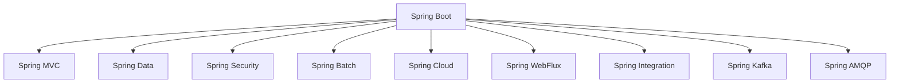

---

# 2. Anatomie d'une application Spring Boot

## Structure minimale

```text
src
 ├── main
 │    ├── java
 │    │     └── com.company
 │    │            ├── controller
 │    │            ├── service
 │    │            ├── repository
 │    │            ├── entity
 │    │            └── config
 │    │
 │    └── resources
 │           ├── application.yml
 │           └── static
 │
 └── test
```

---

## Classe principale

```java
@SpringBootApplication
public class Application {

    public static void main(String[] args) {
        SpringApplication.run(Application.class, args);
    }

}
```

---

# 3. Application Web MVC

Architecture classique :

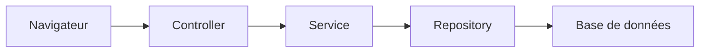

---

## Contrôleur MVC

```java
@Controller
public class HomeController {

    @GetMapping("/")
    public String home(Model model) {

        model.addAttribute("message", "Bienvenue");

        return "home";
    }
}
```

---

## Vue Thymeleaf

```html
<!DOCTYPE html>
<html>
<body>

<h1 th:text="${message}"></h1>

</body>
</html>
```

---

# 4. Applications REST API

Le cas d'utilisation le plus fréquent aujourd'hui.

---

## Architecture

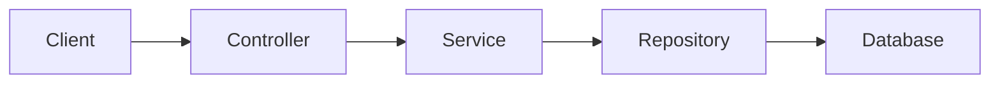

---

## Entité

```java
@Entity
public class User {

    @Id
    @GeneratedValue
    private Long id;

    private String firstname;
    private String lastname;
}
```

---

## Repository

```java
@Repository
public interface UserRepository
        extends JpaRepository<User, Long> {

}
```

---

## Service

```java
@Service
@RequiredArgsConstructor
public class UserService {

    private final UserRepository repository;

    public List<User> findAll() {
        return repository.findAll();
    }

}
```

---

## REST Controller

```java
@RestController
@RequestMapping("/users")
@RequiredArgsConstructor
public class UserController {

    private final UserService service;

    @GetMapping
    public List<User> getUsers() {
        return service.findAll();
    }

}
```

---

# 5. Microservices

Spring Boot est devenu la référence pour les architectures microservices.

---

## Architecture

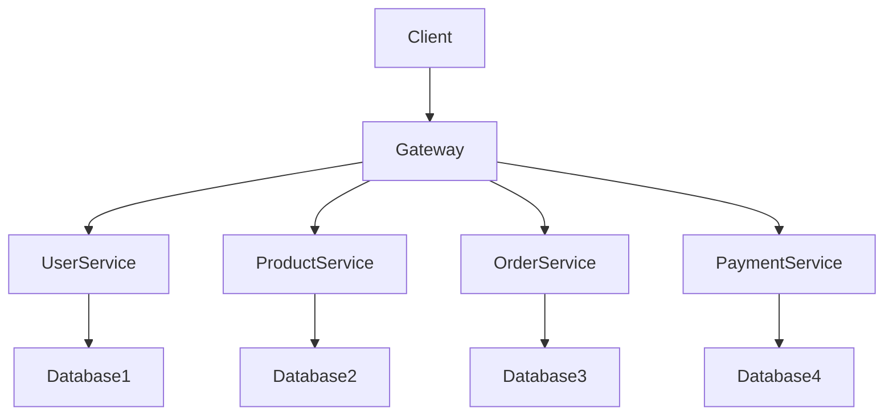

---

## Spring Cloud Gateway

```java
@Bean
RouteLocator customRouteLocator(RouteLocatorBuilder builder) {

    return builder.routes()

            .route("users",
                    r -> r.path("/users/**")
                            .uri("lb://USER-SERVICE"))

            .route("products",
                    r -> r.path("/products/**")
                            .uri("lb://PRODUCT-SERVICE"))

            .build();
}
```

---

# 6. Applications Batch

Utilisation de :

- Spring Batch

Cas d'usage :

- Import CSV
- Export Excel
- Traitement bancaire
- ETL
- Reporting

---

## Architecture Batch

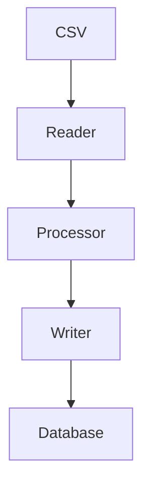

---

## Définition d'un Reader

```java
@Bean
public FlatFileItemReader<Customer> reader() {

    FlatFileItemReader<Customer> reader =
            new FlatFileItemReader<>();

    reader.setResource(
        new ClassPathResource("customers.csv")
    );

    return reader;
}
```

---

## Processor

```java
@Component
public class CustomerProcessor
        implements ItemProcessor<Customer, Customer> {

    @Override
    public Customer process(Customer customer) {

        customer.setLastname(
                customer.getLastname().toUpperCase()
        );

        return customer;
    }
}
```

---

## Writer

```java
@Bean
public JdbcBatchItemWriter<Customer> writer(
        DataSource dataSource) {

    return new JdbcBatchItemWriterBuilder<Customer>()
            .dataSource(dataSource)
            .sql("""
                INSERT INTO CUSTOMER
                VALUES(:id,:firstname,:lastname)
            """)
            .beanMapped()
            .build();
}
```

---

# 7. Applications Scheduler

Traitements planifiés.

---

## Exemple

```java
@EnableScheduling
@Configuration
public class SchedulerConfig {
}
```

---

```java
@Component
public class ReportJob {

    @Scheduled(cron = "0 0 1 * * *")
    public void generateReport() {

        System.out.println("Generation rapport");

    }
}
```

---

# 8. Applications Messaging

Communication asynchrone.

Technologies :

- Kafka
- RabbitMQ
- ActiveMQ

---

## Architecture

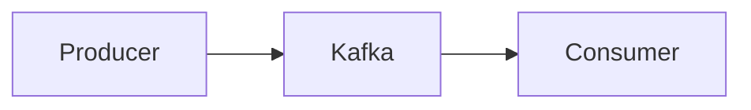

---

## Kafka Producer

```java
@Service
@RequiredArgsConstructor
public class OrderProducer {

    private final KafkaTemplate<String,Object> kafkaTemplate;

    public void publish(Order order) {

        kafkaTemplate.send(
                "orders-topic",
                order
        );
    }
}
```

---

## Kafka Consumer

```java
@Component
public class OrderConsumer {

    @KafkaListener(topics = "orders-topic")
    public void consume(Order order) {

        System.out.println(order);

    }
}
```

---

# 9. Applications Event Driven

Architecture pilotée par les événements.

---

## Event

```java
public class UserCreatedEvent {

    private Long userId;

    public UserCreatedEvent(Long userId) {
        this.userId = userId;
    }
}
```

---

## Publication

```java
publisher.publishEvent(
        new UserCreatedEvent(user.getId())
);
```

---

## Consommation

```java
@Component
public class UserListener {

    @EventListener
    public void handle(UserCreatedEvent event) {

        System.out.println(
                event.getUserId()
        );
    }
}
```

---

# 10. Applications Temps Réel

WebSocket.

---

## Architecture

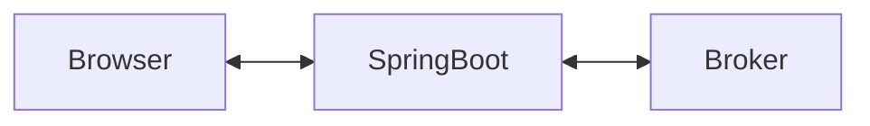

---

## Configuration

```java
@Configuration
@EnableWebSocketMessageBroker
public class WebSocketConfig
        implements WebSocketMessageBrokerConfigurer {

    @Override
    public void registerStompEndpoints(
            StompEndpointRegistry registry) {

        registry.addEndpoint("/ws");
    }
}
```

---

## Controller WebSocket

```java
@Controller
public class ChatController {

    @MessageMapping("/chat")
    @SendTo("/topic/messages")
    public Message chat(Message message) {

        return message;

    }
}
```

---

# 11. Applications Réactives

Spring WebFlux.

---

## Architecture

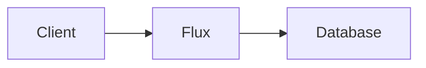

---

## Contrôleur réactif

```java
@RestController
@RequiredArgsConstructor
public class UserController {

    private final UserRepository repository;

    @GetMapping("/users")
    public Flux<User> findAll() {

        return repository.findAll();

    }
}
```

---

## Service réactif

```java
@Service
@RequiredArgsConstructor
public class UserService {

    private final UserRepository repository;

    public Mono<User> save(User user) {

        return repository.save(user);

    }
}
```

---

# 12. Applications Sécurisées

Spring Security.

---

## JWT

Architecture moderne :

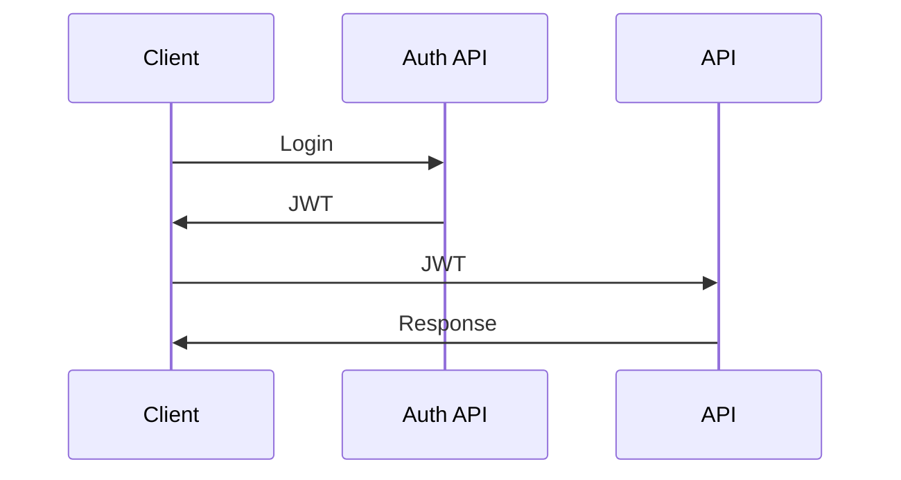

---

## Configuration Security

```java
@Bean
public SecurityFilterChain securityFilterChain(
        HttpSecurity http)
        throws Exception {

    return http

            .csrf(AbstractHttpConfigurer::disable)

            .authorizeHttpRequests(auth ->
                    auth

                    .requestMatchers("/auth/**")
                    .permitAll()

                    .anyRequest()
                    .authenticated()
            )

            .build();
}
```

---

# 13. Applications Cloud Native

Spring Boot + Kubernetes.

---

## Déploiement

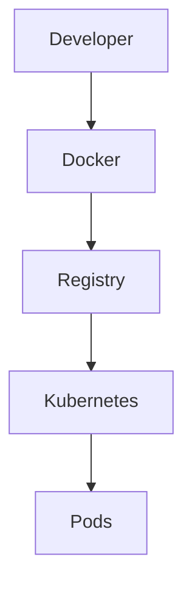

---

## Dockerfile

```dockerfile
FROM eclipse-temurin:21

COPY target/app.jar app.jar

ENTRYPOINT ["java","-jar","app.jar"]
```

---

## Build

```bash
docker build -t user-service .
```

---

# 14. Applications Hexagonales

Architecture moderne fortement recommandée.

---

## Schéma

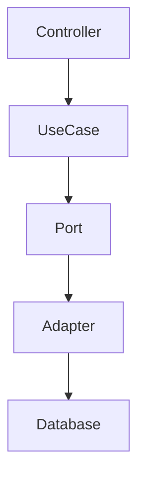

---

## Port

```java
public interface UserPort {

    User save(User user);

}
```

---

## Use Case

```java
@Service
@RequiredArgsConstructor
public class CreateUserUseCase {

    private final UserPort port;

    public User execute(User user) {

        return port.save(user);

    }
}
```

---

## Adapter

```java
@Component
@RequiredArgsConstructor
public class UserAdapter
        implements UserPort {

    private final UserJpaRepository repository;

    @Override
    public User save(User user) {

        return repository.save(user);

    }
}
```

---

# 15. Applications distribuées

Avec :

- Eureka
- Consul
- Spring Cloud

---

Architecture :

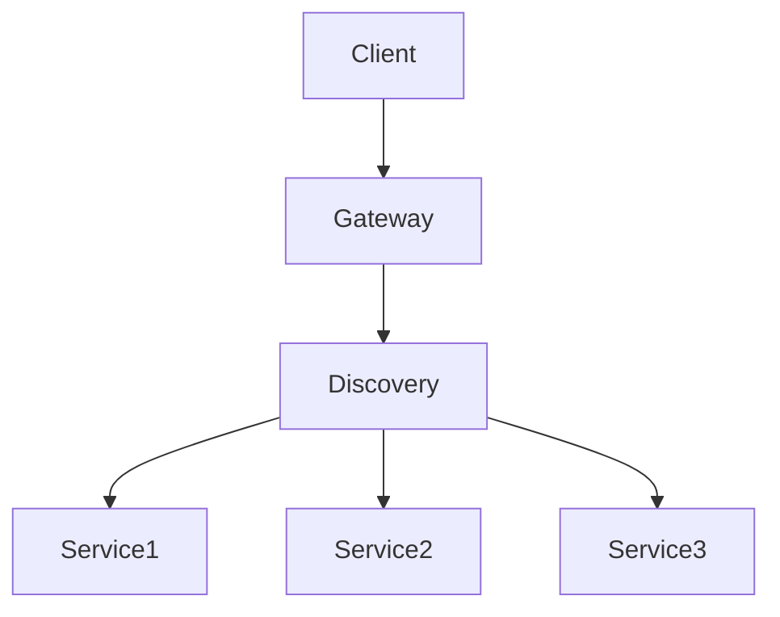

---

# 16. Applications Big Data

Intégration :

- Kafka
- Hadoop
- Spark
- Elasticsearch

---

Exemple Kafka -> Elasticsearch

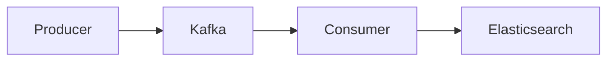

---

# 17. Applications CQRS

Commande et lecture séparées.

---

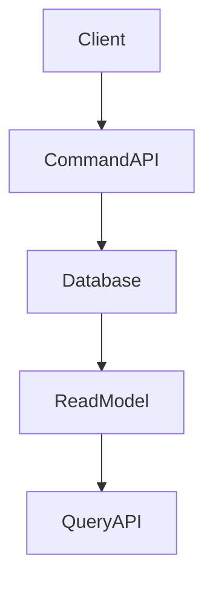

---

# 18. Applications Serverless

Spring Boot peut être déployé sur :

- AWS Lambda
- Azure Functions
- Google Cloud Functions

---

## Handler

```java
public class LambdaHandler
    implements RequestHandler<Input, Output> {

    @Override
    public Output handleRequest(
            Input input,
            Context context) {

        return new Output();

    }
}
```

---

# 19. Applications complètes d'entreprise

Une application moderne combine souvent :

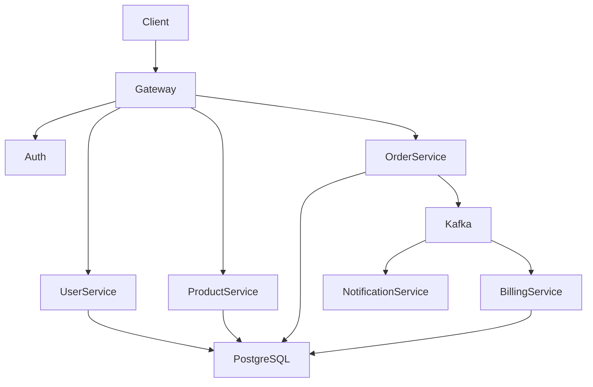

---

# 20. Stack Spring Boot recommandée en entreprise

## Backend REST

- Spring Boot
- Spring MVC
- Spring Data JPA
- PostgreSQL
- Flyway
- Lombok

---

## Sécurité

- Spring Security
- JWT
- OAuth2
- OpenID Connect

---

## Microservices

- Spring Cloud Gateway
- OpenFeign
- Eureka
- Resilience4j

---

## Messaging

- Kafka
- RabbitMQ

---

## Observabilité

- Micrometer
- Prometheus
- Grafana

---

## Cloud

- Docker
- Kubernetes
- Helm

---

# Conclusion

Spring Boot permet de développer pratiquement tous les types d'applications backend modernes :

| Type d'application | Technologie Spring |
|-------------------|-------------------|
| API REST | Spring MVC |
| Microservices | Spring Cloud |
| Batch | Spring Batch |
| Temps réel | WebSocket |
| Messaging | Kafka / AMQP |
| Réactif | WebFlux |
| Sécurisé | Spring Security |
| Scheduler | Spring Scheduling |
| Cloud Native | Spring Cloud + Kubernetes |
| Serverless | Spring Cloud Function |
| Architecture Hexagonale | Spring Boot + Ports/Adapters |
| CQRS | Spring Boot + Event Driven |

Une maîtrise complète de Spring Boot implique la compréhension de toutes ces approches et la capacité de choisir la bonne architecture selon le contexte métier, les contraintes de charge, de maintenabilité et de scalabilité.
