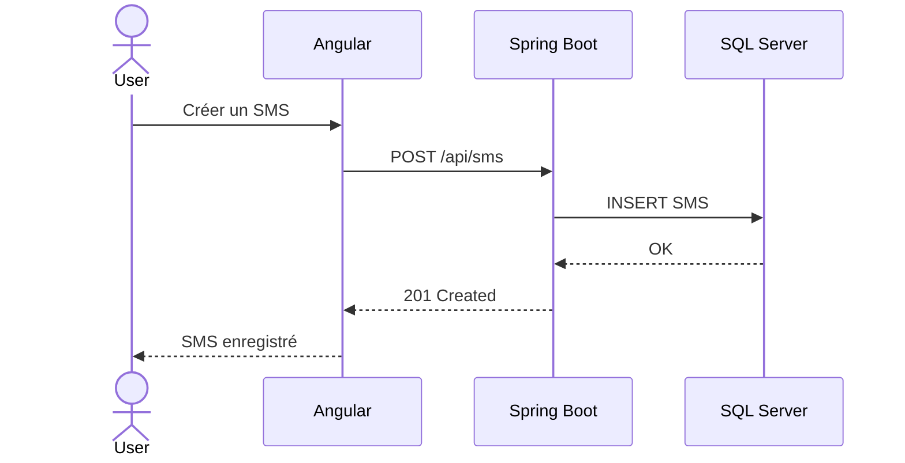
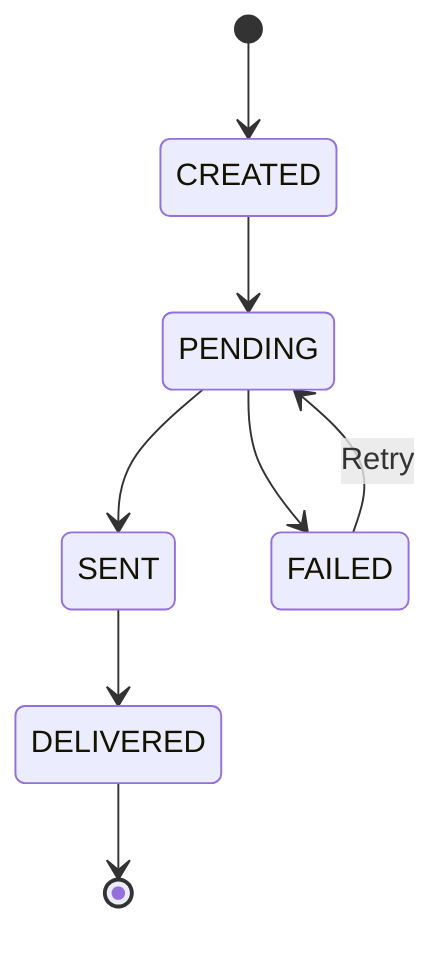
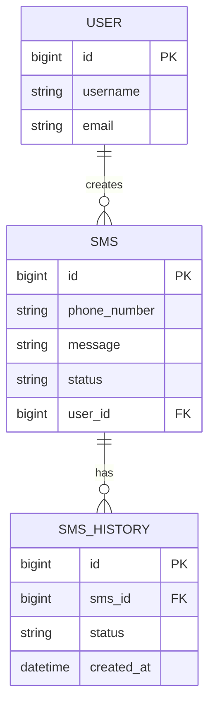
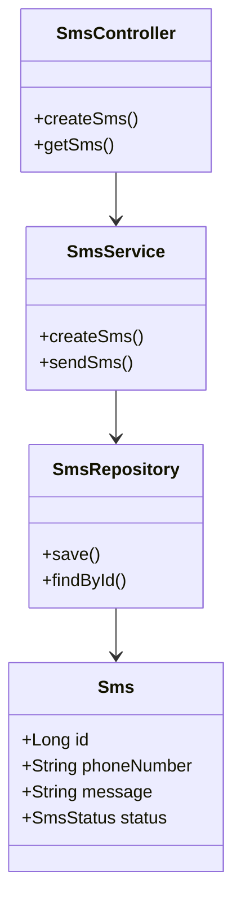
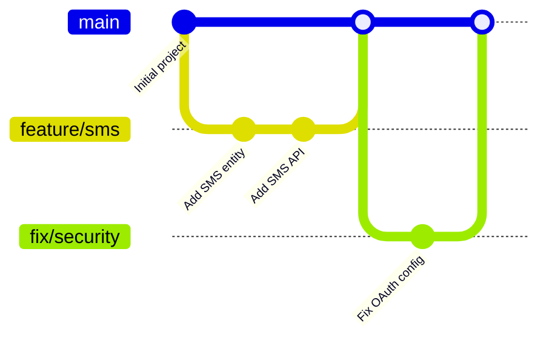
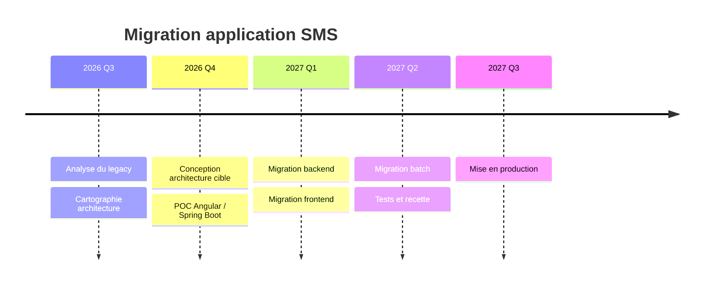

# Diagrammes Mermaid
Mermaid est extrêmement pratique parce que les diagrammes sont du texte versionnable avec Git.

# SVG Animé 

# SVG Animé interactif

# HTML interactif 
avec des : 
- composants cliquables 
- composants dépliables
- animations des flux 
- liens vers docuentation 
- etc.

# Diagramme d'architecture 3D / isométrique
Pour les présentations, une représentation isométrique peut être beaucoup plus attractive.

# Diagrammes de séquence
Une architecture statique montre ce qui existe. Un sequence diagram montre ce qui se passe réellement.

# State diagram 
montre les différents états d’un objet métier.

# ER Diagram 
montre les tables de base de données et leurs relations.

# Data Flow Diagram
Un DFD se concentre davantage sur les données qui circulent.

# Diagramme de déploiement
Il répond à une autre question essentielle :
> Où tourne chaque composant ?

Tu peux y représenter :
- VM ;
- Docker ;
- Kubernetes ;
- reverse proxy ;
- firewall ;
- réseau ;
- ports ;
- load balancer ;
- BDD ;
- stockage ;
- environnements.

---

Voici un exemple très simple de chacun, en **Mermaid**, avec un cas métier cohérent autour d’une application SMS.

1. **Sequence diagram** — montre l’ordre des échanges entre composants.



À utiliser pour montrer un **scénario précis** : connexion, création d’un SMS, envoi, paiement, traitement batch, etc.

2. **State diagram** — montre les différents états d’un objet métier.



Ici, on visualise le cycle de vie d’un SMS :

```text
CREATED
   ↓
PENDING
 ↙     ↘
FAILED  SENT
  ↑      ↓
 Retry DELIVERED
```

Très utile pour les traitements batch, commandes, paiements, workflows métier.

3. **ER Diagram** — montre les tables de base de données et leurs relations.



On comprend rapidement :

```text
USER
  │
  │ 1:N
  ▼
 SMS
  │
  │ 1:N
  ▼
SMS_HISTORY
```

C’est idéal pour documenter SQL Server, PostgreSQL ou toute base relationnelle.

4. **Class diagram** — montre la structure objet du code.



Cela correspond par exemple à une architecture Spring Boot classique :

```text
Controller
    │
    ▼
 Service
    │
    ▼
Repository
    │
    ▼
 Entity
```

Très utile pour documenter un module backend ou expliquer une architecture en couches.

5. **Git graph** — montre l’évolution des branches Git.



Cela représente quelque chose comme :

```text
main
 ●──────────────●────────────●
  \            /            /
   ●────●─────●            /
 feature/sms              /
                          ●
                     fix/security
```

C’est pratique dans une documentation DevOps pour expliquer :

* GitFlow ;
* trunk-based development ;
* branches de feature ;
* branches de release ;
* hotfixes.

6. **Timeline** — montre des événements ou phases dans le temps.



Visuellement, l’idée est :

```text
2026 Q3
   │
   ├── Analyse legacy
   └── Cartographie
          │
2026 Q4
   ├── Architecture cible
   └── POC
          │
2027 Q1
   ├── Backend
   └── Frontend
          │
2027 Q2
   └── Tests / recette
          │
2027 Q3
   └── Production
```

Pour résumer, retiens cette logique :

| Diagramme     | Il montre surtout                  |
| ------------- | ---------------------------------- |
| **Sequence**  | qui appelle qui et dans quel ordre |
| **State**     | les états d’un objet               |
| **ER**        | les tables et relations            |
| **Class**     | les classes et dépendances         |
| **Git graph** | les branches et commits            |
| **Timeline**  | l’évolution dans le temps          |

Dans une documentation d’architecture complète, ils sont très complémentaires : le **C4** donne la vue globale, puis ces diagrammes expliquent le comportement, les données, le code et le cycle de développement.
