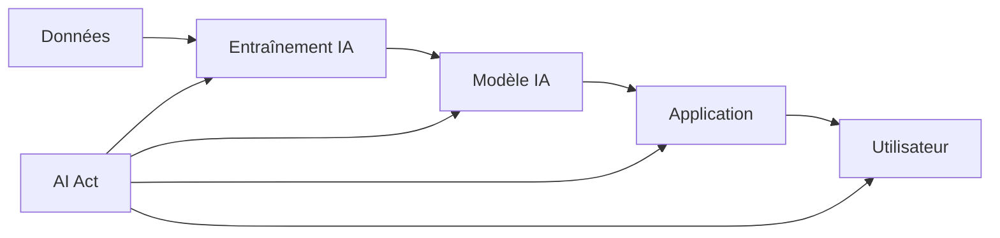
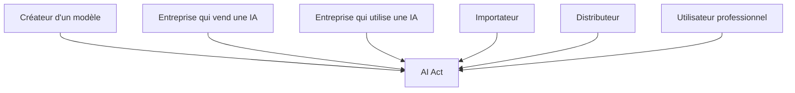
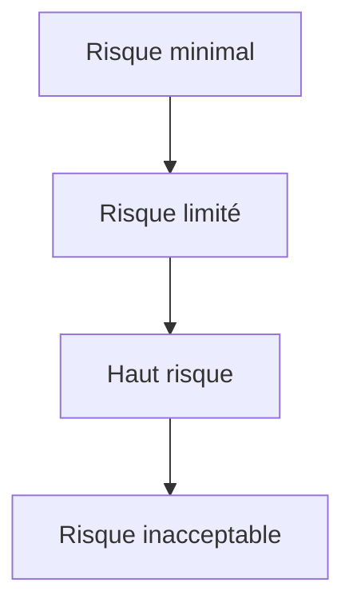
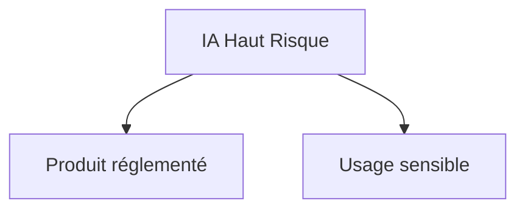
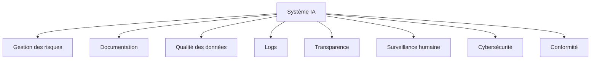
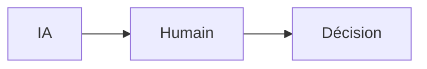
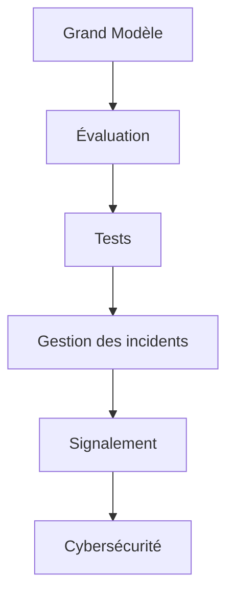
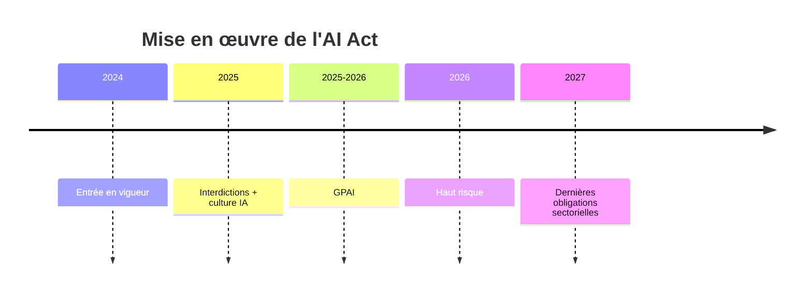
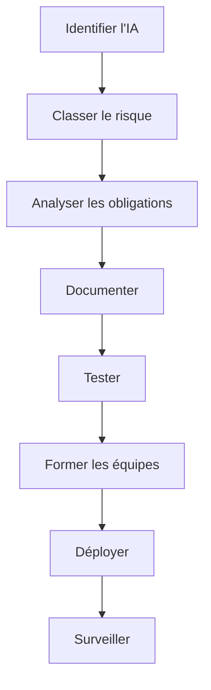
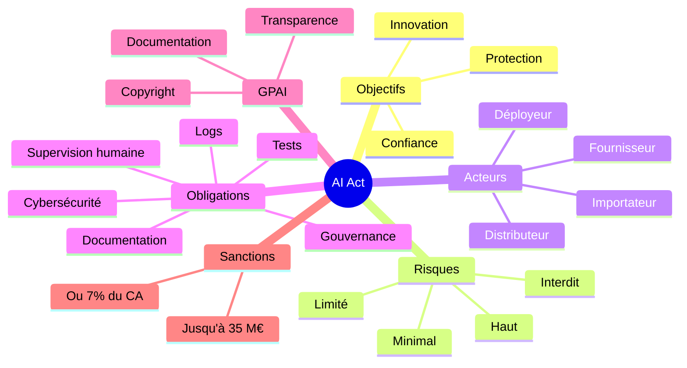

Oui. Voici un **tutoriel complet sur l'AI Act européen** (Règlement (UE) 2024/1689), conçu comme un cours progressif. J'utiliserai des **diagrammes Mermaid** pour rendre les concepts plus faciles à comprendre.

---

# Tutoriel complet : Comprendre l'AI Act Européen

> Niveau : Débutant → Avancé
>
> Temps de lecture : 45 à 90 minutes

---

# Sommaire

1. Pourquoi un AI Act ?
2. Les objectifs
3. Les acteurs concernés
4. Les définitions importantes
5. La classification des risques
6. Les systèmes interdits
7. Les systèmes à haut risque
8. Les obligations des fournisseurs
9. Les obligations des déployeurs
10. Les GPAI (IA Générales)
11. Les modèles présentant un risque systémique
12. Les sanctions
13. Calendrier d'application
14. Comment devenir conforme ?
15. Cas pratiques
16. Checklist finale

---

# 1. Pourquoi un AI Act ?

Avant l'AI Act, chaque pays pouvait réglementer l'IA différemment.

Cela posait plusieurs problèmes :

* manque d'harmonisation
* risques pour les citoyens
* frein à l'innovation
* absence de règles communes

L'Union Européenne a donc créé un règlement unique.

Objectifs :

* protéger les citoyens
* encourager l'innovation
* créer un marché unique
* rendre l'IA digne de confiance

---

# 2. Vision globale



L'AI Act couvre toute la chaîne.

---

# 3. Qui est concerné ?

Presque tout le monde.



Les principaux rôles :

| Acteur       | Rôle                                  |
| ------------ | ------------------------------------- |
| Fournisseur  | développe ou commercialise une IA     |
| Déployeur    | utilise une IA                        |
| Importateur  | importe une IA hors UE                |
| Distributeur | revend une IA                         |
| Représentant | agit au nom d'un fournisseur étranger |

---

# 4. Définition d'un système d'IA

L'AI Act adopte une définition volontairement large.

Un système d'IA est un logiciel capable :

* d'inférer
* de produire des résultats
* de générer des prédictions
* de prendre des décisions
* de produire du contenu

Il peut utiliser :

* Machine Learning
* Deep Learning
* modèles statistiques
* modèles génératifs
* systèmes hybrides

---

# 5. La logique de l'AI Act

Le principe est simple :

> Plus le risque est élevé, plus les obligations sont fortes.



---

# 6. Les 4 niveaux de risque

## Niveau 1 : risque minimal

Exemples :

* filtres anti-spam
* jeux vidéo
* IA météo
* recommandation musicale

Aucune obligation particulière.

---

## Niveau 2 : risque limité

Exemples :

* chatbot
* générateur de texte
* assistant virtuel

Obligation :

l'utilisateur doit savoir qu'il parle à une IA.

Exemple :

> "Vous discutez avec une intelligence artificielle."

---

## Niveau 3 : haut risque

Les obligations deviennent très importantes.

Exemples :

* recrutement
* crédit bancaire
* santé
* justice
* police
* infrastructures

---

## Niveau 4 : risque inacceptable

Ils sont interdits.

---

# 7. Les IA interdites

Certaines pratiques sont simplement prohibées.

Exemples :

## Manipulation

Influencer inconsciemment une personne.

Exemple :

Une IA poussant des enfants à acheter des produits.

---

## Exploitation des personnes vulnérables

Exemple :

Personnes âgées.

Enfants.

Handicap.

---

## Social Scoring

Notation des citoyens.

Exemple :

```text
Citoyen

↓

Score

↓

Accès aux services
```

Interdit.

---

## Catégorisation biométrique sensible

Utiliser la biométrie pour déduire :

* religion
* opinions politiques
* orientation sexuelle
* origine ethnique

Interdit.

---

# 8. Les IA à haut risque

Le cœur de l'AI Act.

Deux catégories.



---

## Produits réglementés

Exemples :

* dispositifs médicaux
* ascenseurs
* véhicules

---

## Domaines sensibles

* éducation
* emploi
* banque
* justice
* immigration
* sécurité

---

# 9. Les obligations du fournisseur

Le fournisseur doit démontrer que son IA est sûre.

Les principales obligations :



---

## Gestion des risques

Il faut identifier :

* erreurs
* biais
* dangers
* mauvaises utilisations

Puis prévoir des mesures correctrices.

---

## Qualité des données

Les données doivent être :

* pertinentes
* représentatives
* suffisamment variées
* documentées

---

## Documentation technique

Elle doit permettre :

* d'auditer
* de comprendre
* de reproduire

---

## Journalisation

Les IA doivent conserver des logs.

Pourquoi ?

* audit
* enquête
* conformité

---

## Surveillance humaine

Une IA ne doit pas être totalement autonome dans les décisions critiques.

Toujours prévoir :



---

# 10. Les obligations du déployeur

Le déployeur est l'entreprise qui utilise l'IA.

Ses obligations :

* utiliser correctement l'IA
* surveiller les résultats
* former les employés
* respecter les instructions du fournisseur
* protéger les données

---

# 11. Les GPAI

GPAI = General Purpose AI.

Exemples :

* OpenAI GPT
* Anthropic Claude
* Google Gemini
* Meta Llama
* Mistral AI Mistral

Ces modèles peuvent servir à :

* écrire
* programmer
* traduire
* résumer
* créer des applications

Ils ont donc un régime spécifique.

---

Les fournisseurs doivent notamment :

* documenter le modèle
* publier un résumé des données d'entraînement (dans les conditions prévues par le règlement)
* respecter les règles de droit d'auteur
* fournir les informations nécessaires aux intégrateurs

---

# 12. Les modèles à risque systémique

Très grands modèles.

Exemple :

Plusieurs centaines de milliards de paramètres.

Ils présentent des risques :

* désinformation
* cyberattaques
* manipulation massive
* risques scientifiques

Ils doivent effectuer :



---

# 13. Les sanctions

Les amendes peuvent atteindre :

* jusqu'à **35 millions d'euros** ou **7 % du chiffre d'affaires mondial annuel** pour certaines violations des interdictions ;
* jusqu'à **15 millions d'euros** ou **3 %** pour certains manquements aux obligations ;
* jusqu'à **7,5 millions d'euros** ou **1,5 %** pour certaines informations inexactes, selon les cas et la taille de l'entreprise.

Les montants applicables dépendent de la nature de l'infraction et des dispositions précises du règlement.

---

# 14. Calendrier d'application



En pratique, les obligations sont introduites progressivement afin de laisser aux acteurs le temps de se mettre en conformité.

---

# 15. Comment devenir conforme ?



---

# 16. Cas pratiques

## Cas 1 : Chatbot RH

Le chatbot répond aux candidats.

→ Risque limité.

Obligation :

Informer clairement que l'utilisateur échange avec une IA.

---

## Cas 2 : IA qui sélectionne les CV

Elle influence une décision de recrutement.

→ Haut risque.

Obligations importantes :

* documentation
* supervision humaine
* gestion des risques
* qualité des données
* traçabilité

---

## Cas 3 : IA de diagnostic médical

Elle aide un médecin.

→ Haut risque.

Le fabricant et le déployeur doivent respecter les exigences renforcées prévues par l'AI Act, en plus des réglementations applicables aux dispositifs médicaux.

---

## Cas 4 : Générateur d'images

Il crée des illustrations.

→ Généralement considéré comme un modèle d'IA à usage général (GPAI) ou une application construite sur un GPAI.

Obligations possibles :

* transparence sur les contenus générés (selon le cas d'usage) ;
* respect des règles relatives au droit d'auteur ;
* documentation pour les intégrateurs.

---

# 17. Résumé visuel



# 18. Checklist de conformité

| Étape                                                                   | À vérifier |
| ----------------------------------------------------------------------- | ---------- |
| Inventorier tous les systèmes d'IA                                      | ☐          |
| Identifier le rôle de votre organisation (fournisseur, déployeur, etc.) | ☐          |
| Classer chaque système selon son niveau de risque                       | ☐          |
| Vérifier qu'aucune pratique interdite n'est utilisée                    | ☐          |
| Réaliser une analyse des risques                                        | ☐          |
| Mettre en place une gouvernance de l'IA                                 | ☐          |
| Documenter les modèles et les jeux de données                           | ☐          |
| Assurer la supervision humaine pour les cas à haut risque               | ☐          |
| Conserver des journaux d'événements (logs)                              | ☐          |
| Former les utilisateurs et les équipes                                  | ☐          |
| Prévoir une surveillance continue après le déploiement                  | ☐          |

## Conclusion

L'AI Act adopte une approche fondée sur le risque : les systèmes présentant peu de risques sont peu contraints, tandis que les usages à fort impact sur les droits fondamentaux ou la sécurité sont soumis à des exigences strictes. Les fournisseurs de modèles d'IA à usage général (GPAI) sont également soumis à des obligations spécifiques, et les modèles présentant un risque systémique font l'objet d'exigences renforcées.

Pour une organisation, la démarche de conformité peut être résumée ainsi :

1. Identifier les systèmes d'IA utilisés ou développés.
2. Déterminer le rôle de l'organisation (fournisseur, déployeur, etc.).
3. Classer chaque système selon son niveau de risque.
4. Appliquer les obligations correspondantes.
5. Mettre en place une gouvernance, une documentation et une surveillance continue.

Cette méthode permet de transformer les exigences du règlement en un processus opérationnel clair et auditable.
