# Les Hooks en Développement Agentique

## Table des matières

1. Introduction
2. Définition des Hooks
3. Pourquoi les Hooks sont essentiels dans les systèmes agentiques
4. Anatomie d'un Hook
5. Cycle de vie d'un agent et points d'injection
6. Typologie complète des Hooks
7. Hooks synchrones vs asynchrones
8. Architecture événementielle et Hooks
9. Hooks dans les frameworks agentiques modernes
10. Patterns avancés
11. Gestion d'état via Hooks
12. Observabilité et instrumentation
13. Sécurité et gouvernance
14. Anti-patterns
15. Étude de cas complète
16. Hooks et systèmes multi-agents
17. Bonnes pratiques industrielles
18. Conclusion

---

# 1. Introduction

Dans le développement logiciel classique, un **hook** est un mécanisme permettant d'insérer un comportement personnalisé à un endroit précis du cycle d'exécution d'un système.

En développement agentique, cette notion devient encore plus importante car :

- les agents possèdent un cycle de vie complexe ;
- ils manipulent des outils ;
- ils exécutent des raisonnements ;
- ils interagissent avec des humains ;
- ils collaborent avec d'autres agents ;
- ils doivent être observables et contrôlables.

Les hooks constituent donc les **points d'extension fondamentaux** de l'architecture agentique.

---

# 2. Définition des Hooks

## Définition générale

Un hook est :

> Un point d'interception permettant à un développeur d'injecter du comportement personnalisé avant, pendant ou après une action effectuée par un agent.

On peut voir un hook comme :

- un écouteur d'événement ;
- un middleware ;
- un point d'extension ;
- une interception programmable.

---

## Analogie

Imaginez un aéroport.

Le voyage d'un passager suit un parcours :

```text
Entrée
 ↓
Enregistrement
 ↓
Contrôle sécurité
 ↓
Embarquement
 ↓
Vol
 ↓
Arrivée
```

À chaque étape, l'aéroport peut appliquer :

- des vérifications ;
- des statistiques ;
- des contrôles.

Les hooks jouent exactement ce rôle dans un système agentique.

---

# 3. Pourquoi les Hooks sont essentiels

Sans hooks :

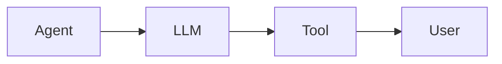

Système rigide.

Avec hooks :

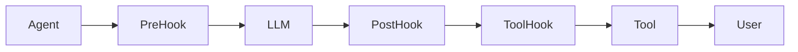

Le système devient :

- extensible ;
- observable ;
- gouvernable ;
- sécurisé.

---

# 4. Anatomie d'un Hook

Un hook possède généralement :

```typescript
interface Hook {
    name: string
    trigger: string
    execute(context): Promise<void>
}
```

---

## Éléments constitutifs

### Trigger

Déclencheur.

Exemples :

```text
before_llm_call
after_llm_call
before_tool
after_tool
before_memory_write
```

---

### Context

Informations disponibles.

```typescript
{
   userMessage,
   agentState,
   toolCall,
   memory,
   metadata
}
```

---

### Action

Ce que réalise le hook.

Exemples :

- logging ;
- validation ;
- enrichissement ;
- monitoring ;
- blocage.

---

# 5. Cycle de vie d'un agent

Un agent moderne suit généralement ce flux :

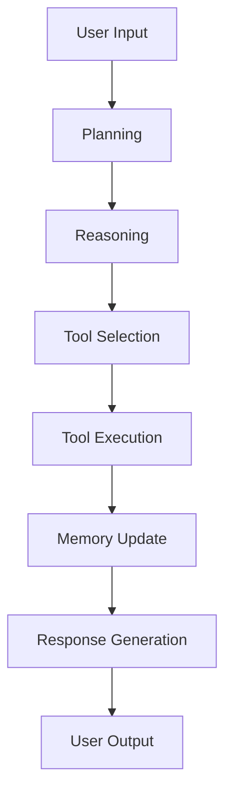

Chaque étape peut exposer des hooks.

---

# 6. Typologie complète des Hooks

## 6.1 Input Hooks

Déclenchés lors de la réception du message.

```text
before_input
after_input
```

Exemple :

```python
def before_input(ctx):
    sanitize_user_text(ctx.message)
```

---

## 6.2 Planning Hooks

Avant la création du plan.

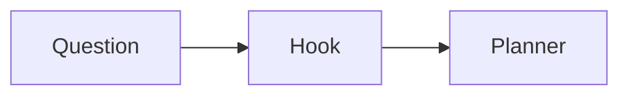

Exemples :

- enrichissement du contexte ;
- récupération mémoire ;
- filtrage.

---

## 6.3 Reasoning Hooks

Pendant le raisonnement.

```text
before_reasoning
after_reasoning
```

Permettent :

- audit ;
- traçabilité ;
- analyse de qualité.

---

## 6.4 Tool Hooks

Les plus courants.

```text
before_tool_call
after_tool_call
on_tool_error
```

---

### Exemple

```python
def before_tool(ctx):
    verify_permissions(ctx.tool)
```

---

## 6.5 Memory Hooks

Avant ou après modification de mémoire.

```text
before_memory_write
after_memory_write
before_memory_read
after_memory_read
```

---

## 6.6 Output Hooks

Dernière étape.

```text
before_response
after_response
```

Utilisation :

- modération ;
- post-traitement ;
- traduction.

---

# 7. Hooks synchrones vs asynchrones

## Hooks synchrones

L'exécution est bloquante.

```mermaid
sequenceDiagram

Agent->>Hook
Hook-->>Agent
Agent->>Tool
```

Avantage :

- contrôle fort.

Inconvénient :

- latence.

---

## Hooks asynchrones

```mermaid
sequenceDiagram

Agent->>Tool

par Hook
Agent->>Logger
end
```

Avantage :

- performance.

Inconvénient :

- moins de garanties.

---

# 8. Architecture événementielle

Les systèmes agentiques modernes sont souvent event-driven.

---

## Modèle

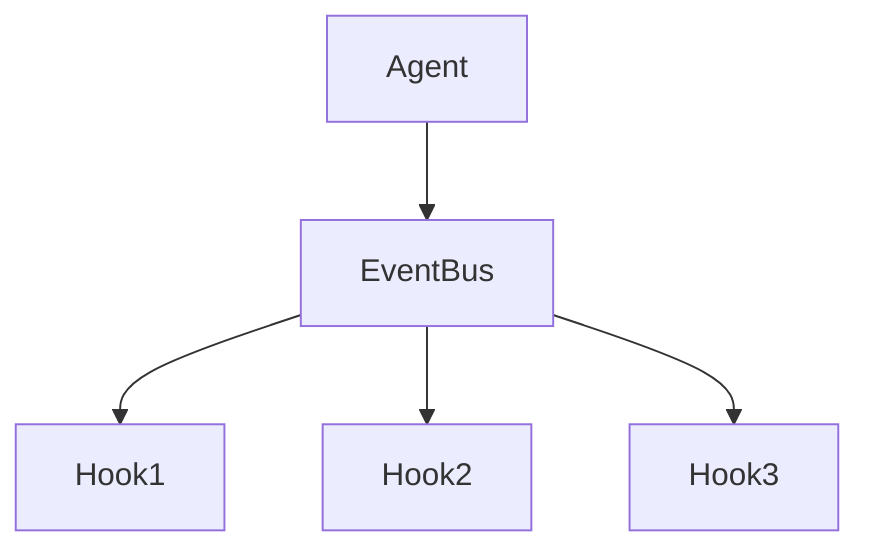

Chaque événement déclenche plusieurs hooks.

---

## Exemple d'événements

```text
message_received
tool_selected
tool_completed
memory_updated
agent_finished
```

---

# 9. Hooks dans les frameworks modernes

---

## LangGraph

Expose des hooks sur :

- nodes ;
- edges ;
- execution lifecycle.

---

## AutoGen

Hooks autour :

- conversations ;
- messages ;
- agents.

---

## CrewAI

Hooks sur :

- task execution ;
- tool execution ;
- crew lifecycle.

---

## OpenAI Agents SDK

Hooks autour :

- runs ;
- tools ;
- handoffs ;
- tracing.

---

# 10. Pattern Middleware

Le hook est souvent implémenté comme un middleware.

---

## Schéma

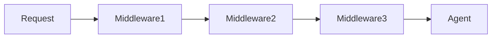

Chaque middleware agit comme un hook.

---

## Exemple

```python
class LoggingMiddleware:

    async def before_tool(self, ctx):
        print(ctx.tool_name)
```

---

# 11. Pattern Pipeline

Chaque hook transforme le contexte.

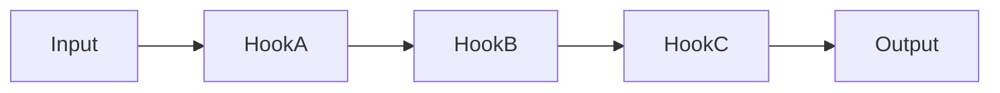

---

Exemple :

```text
Input
 ↓
Sanitization
 ↓
Classification
 ↓
Enrichment
 ↓
Agent
```

---

# 12. Pattern Interceptor

Très utilisé pour les appels LLM.

```mermaid
sequenceDiagram

Agent->>Interceptor

Interceptor->>LLM

LLM-->>Interceptor

Interceptor-->>Agent
```

Permet :

- logging ;
- sécurité ;
- métriques.

---

# 13. Gestion d'état

Les hooks accèdent souvent à l'état global.

```python
context = {
   "memory": {},
   "tools": [],
   "user": {}
}
```

---

## Mutation contrôlée

```python
def before_tool(ctx):
    ctx.state["attempts"] += 1
```

---

## Risque

Plusieurs hooks modifiant :

```text
state.counter
```

peuvent provoquer :

- race conditions ;
- incohérences.

---

# 14. Hooks et Observabilité

Sujet majeur en production.

---

## Logging

```python
def after_tool(ctx):
    logger.info(ctx.result)
```

---

## Tracing

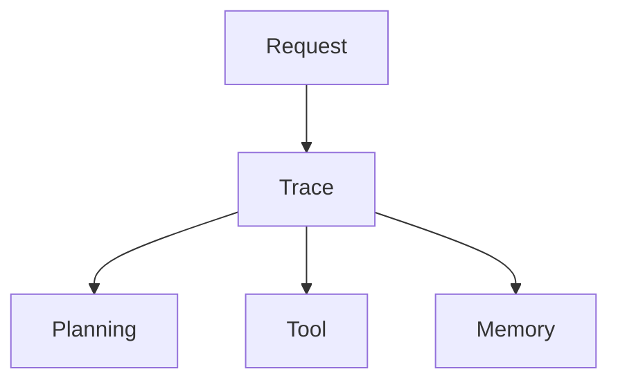

---

## Metrics

Exemples :

```text
tool_latency
token_usage
error_rate
success_rate
```

---

# 15. Hooks de Sécurité

Très utilisés dans les entreprises.

---

## Contrôle des permissions

```python
def before_tool(ctx):

    if not authorized(ctx.user):
        raise PermissionError()
```

---

## Détection de Prompt Injection

```mermaid
graph LR

User Input
--> Security Hook
--> Agent
```

---

## Validation des sorties

```python
def before_response(ctx):
    check_sensitive_data(ctx.response)
```

---

# 16. Hooks de Gouvernance

Particulièrement importants pour les agents autonomes.

---

## Limitation budgétaire

```python
def before_llm_call(ctx):

    if ctx.cost > budget:
        stop()
```

---

## Contrôle de conformité

```python
def before_tool(ctx):

    verify_compliance(ctx)
```

---

# 17. Hooks Multi-Agents

Dans un système multi-agent :

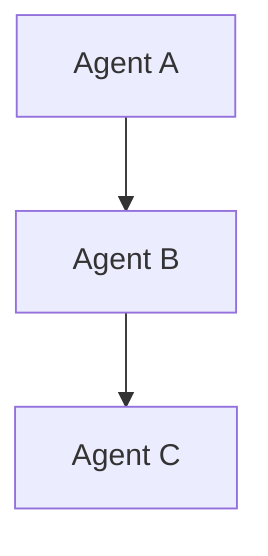

Les hooks peuvent intercepter :

- messages ;
- handoffs ;
- délégations.

---

## Exemple

```text
before_handoff
after_handoff
```

---

# 18. Hooks de Collaboration

```mermaid
sequenceDiagram

AgentA->>Hook

Hook->>Validator

Validator-->>Hook

Hook-->>AgentB
```

Permettent :

- validation ;
- arbitrage ;
- supervision.

---

# 19. Hooks sur les Outils

L'un des usages les plus fréquents.

---

## Avant exécution

```python
before_tool()
```

Objectifs :

- vérification ;
- enrichissement.

---

## Après exécution

```python
after_tool()
```

Objectifs :

- logging ;
- stockage ;
- monitoring.

---

## Gestion d'erreur

```python
on_tool_error()
```

---

# 20. Hooks sur la Mémoire

---

## Lecture

```python
before_memory_read()
```

---

## Écriture

```python
before_memory_write()
```

---

Cas d'usage :

- chiffrement ;
- filtrage ;
- audit.

---

# 21. Hooks et Human-in-the-Loop

Très courant en entreprise.

---

## Architecture

```mermaid
graph LR

Agent
--> Approval Hook

Approval Hook
--> Human

Human
--> Continue
```

---

## Exemple

Une transaction financière importante :

```text
before_payment
```

déclenche une validation humaine.

---

# 22. Hooks Dynamiques

Les hooks peuvent être chargés à chaud.

---

```python
registry.register(hook)
```

---

Architecture :

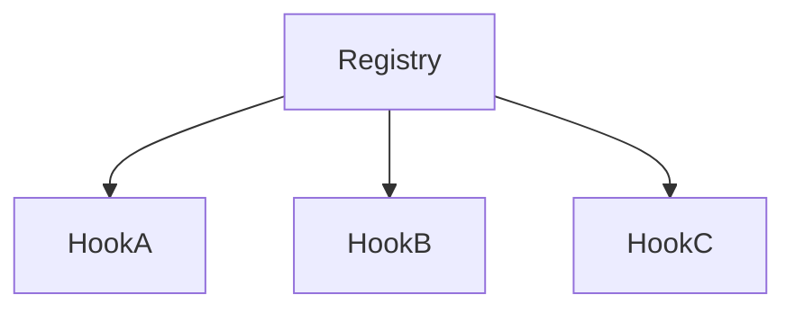

---

# 23. Anti-Patterns

---

## Hook God Object

Un hook qui fait tout.

```python
def giant_hook():
   ...
```

Mauvaise pratique.

---

## Hooks Cachés

Effets de bord invisibles.

```python
before_tool()
```

modifie :

```text
memory
budget
permissions
```

sans documentation.

---

## Hooks en Cascade

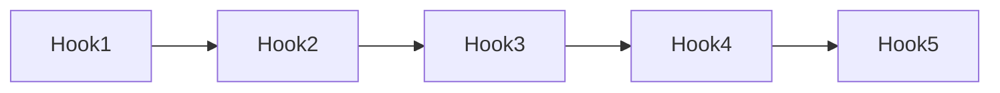

Complexité explosive.

---

# 24. Étude de Cas Complète

Agent de support client.

---

## Flux

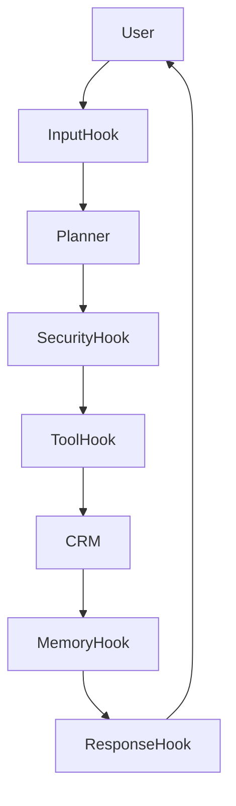

---

## Hooks utilisés

### Input

```text
sanitize()
```

---

### Security

```text
verify_permissions()
```

---

### Tool

```text
log_tool_usage()
```

---

### Memory

```text
store_conversation()
```

---

### Output

```text
moderate_response()
```

---

# 25. Architecture de Référence Industrielle

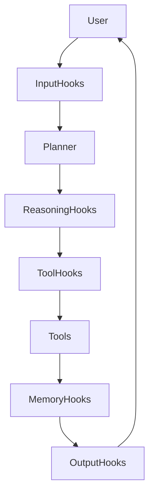

---

# 26. Règles d'Or

## 1. Hooks spécialisés

Un hook = une responsabilité.

---

## 2. Idempotence

Le hook doit pouvoir être relancé.

---

## 3. Observabilité native

Toujours journaliser.

---

## 4. Temps d'exécution faible

Un hook lent ralentit tout l'agent.

---

## 5. Documentation

Toujours documenter :

- trigger ;
- entrées ;
- sorties ;
- effets de bord.

---

## 6. Gestion d'erreurs

Un hook ne doit jamais faire tomber tout le système.

---

# 27. Synthèse Finale

Les hooks constituent le mécanisme central d'extension des architectures agentiques modernes.

Ils permettent :

| Fonction | Apport |
|-----------|---------|
| Sécurité | Validation, permissions |
| Gouvernance | Budgets, conformité |
| Observabilité | Logs, métriques, traces |
| Personnalisation | Comportements métier |
| Mémoire | Contrôle des lectures/écritures |
| Outils | Interception des appels |
| Multi-agent | Contrôle des handoffs |
| Human-in-the-loop | Validation humaine |

Conceptuellement, un hook peut être résumé ainsi :

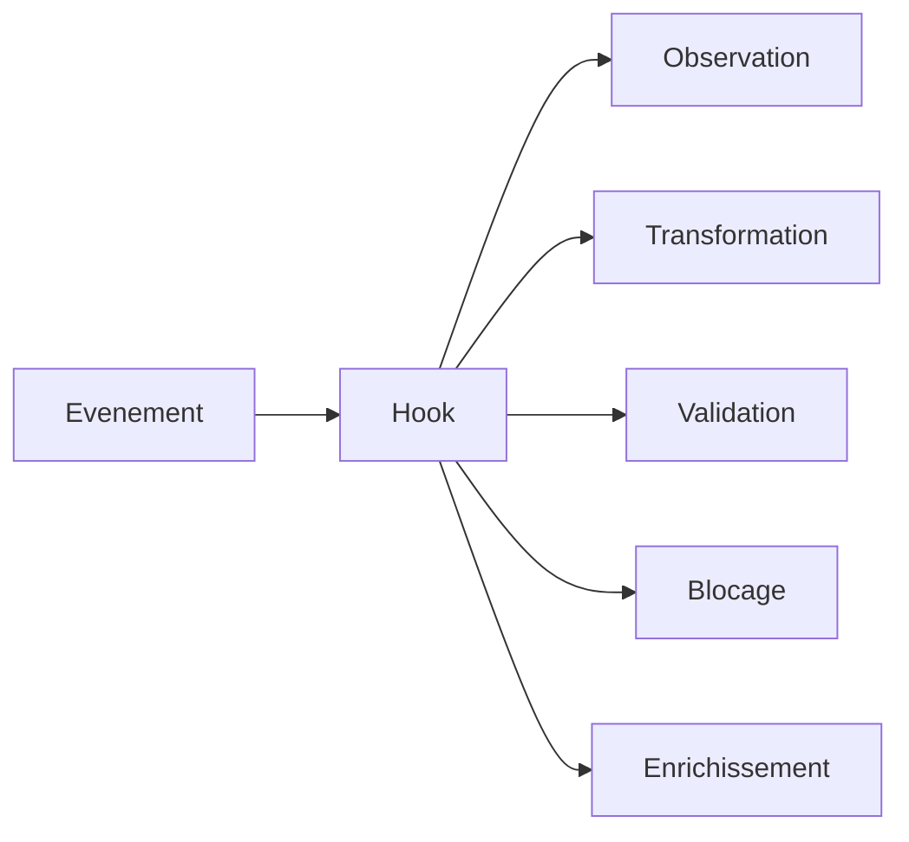

Dans une architecture agentique moderne, les hooks sont l'équivalent du **système nerveux périphérique** : ils permettent d'observer, contrôler, enrichir et sécuriser chaque étape du comportement de l'agent sans modifier son cœur logique.
