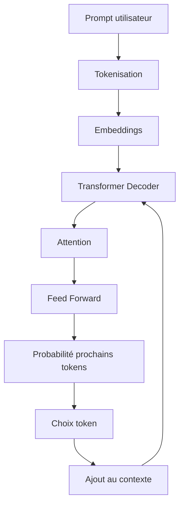
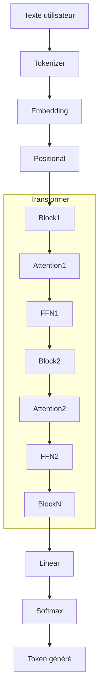

# Tutoriel complet : comprendre l'architecture Transformer en IA

L'architecture **Transformer** est l'une des inventions les plus importantes de l'histoire récente de l'intelligence artificielle. Elle est à la base de la majorité des grands modèles de langage (**LLM**) actuels comme GPT-5.5-mini, Claude, Gemini ou Llama.

Elle a été introduite en 2017 dans l'article scientifique **"Attention Is All You Need"** par des chercheurs de Google.

L'idée centrale :

> Au lieu de lire une phrase mot par mot comme les anciens réseaux neuronaux, un Transformer regarde tous les mots en même temps et apprend quelles relations sont importantes entre eux grâce au mécanisme d'**attention**.

---

# 1. Pourquoi les Transformers ont été inventés ?

Avant les Transformers, les modèles de langage utilisaient principalement :

* RNN (Recurrent Neural Networks)
* LSTM
* GRU

Le fonctionnement était séquentiel :

Phrase :

> "Le chat mange la souris"

Le modèle lisait :

```
Le → chat → mange → la → souris
```

Problèmes :

### 1. Perte du contexte long

Exemple :

> "Le livre posé sur la table près de la fenêtre appartient à Marie parce qu'elle l'a acheté."

Pour comprendre "elle", il faut se souvenir de "Marie" plusieurs mots avant.

Les RNN oubliaient progressivement.

---

### 2. Pas de parallélisation

Un GPU moderne veut traiter beaucoup de données simultanément.

RNN :

```
Mot 1
 |
Mot 2
 |
Mot 3
 |
Mot 4
```

Impossible de calculer Mot 4 avant Mot 3.

---

Transformer :

```
Mot 1
Mot 2
Mot 3
Mot 4

   ↓

Traitement simultané
```

Résultat :

* plus rapide
* scalable
* adapté aux milliards de paramètres

---

# 2. Vue globale d'un Transformer

Architecture générale :

```
                Texte
                  |
                  v
          Tokenisation
                  |
                  v
          Embeddings
                  |
                  v
        Position Encoding
                  |
                  v

        +----------------+
        | Transformer    |
        | Encoder/       |
        | Decoder        |
        +----------------+

                  |
                  v

             Probabilité
                  |
                  v

             Texte généré
```

---

# 3. Étape 1 : Tokenisation

Un modèle IA ne comprend pas directement :

```
Bonjour comment vas-tu ?
```

Il transforme le texte en morceaux appelés **tokens**.

Exemple :

```
"Je mange une pomme"

        ↓

[
Je,
mange,
une,
pomme
]
```

Puis chaque token devient un nombre :

```
Je       → 532
mange    → 8721
une      → 91
pomme    → 6324
```

On obtient :

```
[532,8721,91,6324]
```

---

# 4. Étape 2 : Embeddings

Les nombres seuls ne veulent rien dire.

Le modèle transforme chaque token en vecteur mathématique.

Exemple :

```
pomme

↓

[
0.23,
0.54,
-0.12,
0.87,
...
]
```

Un embedding représente le sens.

Ainsi :

```
roi

proche de :

reine

mais loin de :

voiture
```

Dans un espace multidimensionnel :

```
                 reine
                   *
                  /
                 /
        roi  *
           
                         voiture
                            *
```

---

# 5. Étape 3 : Positional Encoding

Le Transformer traite tous les mots en parallèle.

Mais il ne connaît pas l'ordre.

Ces deux phrases :

```
Le chien mord l'homme
```

et

```
L'homme mord le chien
```

ont les mêmes mots.

Il faut ajouter l'information de position.

On ajoute donc un vecteur de position :

```
Token + Position

chat
 +
position 3

=
vecteur enrichi
```

---

# 6. Le cœur du Transformer : l'Attention

C'est la partie la plus importante.

Le mécanisme d'attention répond à :

> "Quels mots dois-je regarder pour comprendre ce mot ?"

---

Exemple :

Phrase :

> "Le chat mange parce qu'il a faim"

Pour comprendre "il":

Le modèle regarde :

```
Le
chat       ██████████
mange
parce
qu'il
a
faim
```

Il apprend :

```
il → chat
```

---

# 7. Query, Key, Value (QKV)

L'attention utilise trois concepts :

## Query

La question :

> "Qu'est-ce que je cherche ?"

## Key

L'identifiant :

> "Quelle information je possède ?"

## Value

Le contenu réel :

> "Quelle information je transmets ?"

---

Exemple :

Mot :

```
chat
```

Produit :

```
Query(chat)

Key(chat)

Value(chat)
```

Puis comparaison :

```
Query(chat)
       |
       |
       v

Compare avec :

Key(Le)
Key(mange)
Key(souris)

```

Résultat :

```
chat regarde surtout :

chat  90%
souris 70%
mange 40%
Le 10%
```

---

# 8. Formule de l'attention

La formule officielle :

[
Attention(Q,K,V)=softmax(\frac{QK^T}{\sqrt d_k})V
]

Explication :

## Étape 1

Comparer Query et Key :

```
Q × K
```

donne un score.

---

## Étape 2

Normalisation :

```
softmax()
```

transforme :

```
[2,5,1]

↓

[0.04,0.91,0.05]
```

---

## Étape 3

Multiplier par Value :

```
Score × information
```

Résultat :

nouvelle représentation enrichie.

---

# 9. Multi-Head Attention

Un Transformer n'a pas une seule attention.

Il en utilise plusieurs.

Exemple :

Une tête apprend :

```
relations grammaticales
```

Une autre :

```
relations temporelles
```

Une autre :

```
relations sémantiques
```

Architecture :

```
             Input

                |
      +---------+---------+
      |         |         |
      v         v         v

 Attention1 Attention2 Attention3

      |         |         |

      +---------+---------+

              Concat

                |

          Linear Layer

                |

             Output

```

---

# 10. Les blocs Transformer

Un bloc Transformer contient :

```
          Input
            |
            v
 +---------------------+
 | Multi Head Attention|
 +---------------------+
            |
            v
      Add & Normalize
            |
            v
 +---------------------+
 | Feed Forward Network|
 +---------------------+
            |
            v
      Add & Normalize
            |
            v
          Output
```

---

# 11. Feed Forward Network (FFN)

Après l'attention :

Le modèle applique un réseau neuronal classique.

Exemple :

```
Vecteur entrée

[0.2,0.5,0.1]

        |

   Dense Layer

        |

[0.8,0.1,0.9]

```

Son rôle :

* transformer l'information
* apprendre des représentations complexes

---

# 12. Encoder vs Decoder

L'architecture originale Transformer :

```
              Input

                |
                v

        +---------------+
        | Encoder Stack |
        +---------------+

                |

        +---------------+
        | Decoder Stack |
        +---------------+

                |

              Output

```

---

## Encoder

Comprend le texte.

Exemple :

Traduction :

```
Bonjour
```

Encoder comprend :

```
sens = greeting
```

---

## Decoder

Produit le texte.

Exemple :

```
Hello
```

---

# 13. Les modèles modernes : GPT, Claude, Llama

Les LLM actuels utilisent principalement une variante :

## Decoder-only Transformer

Architecture :

```
Texte entrée

     |
     v

+-------------+
| Transformer |
| Decoder x N |
+-------------+

     |
     v

Prochain token
```

Exemple :

Input :

```
La capitale de la France est
```

Le modèle calcule :

```
Paris 92%
Lyon 3%
Rome 1%
```

Puis choisit un token.

---

# 14. Fonctionnement d'un LLM en génération

Exemple :

Prompt :

```
Explique Java Spring Boot
```

Étape 1 :

Tokenisation :

```
Explique
Java
Spring
Boot
```

---

Étape 2 :

Passage dans Transformer :

```
Embedding

↓

Attention

↓

FFN

↓

Probabilités
```

---

Étape 3 :

Prédiction :

```
Java
87%

est
75%

un
60%
```

---

Étape 4 :

Ajout du token :

```
Explique Java Spring Boot est
```

Puis recommence.

---

Diagramme :



---

# 15. Architecture complète d'un GPT moderne



---

# 16. Paramètres importants d'un Transformer

## Nombre de paramètres

Exemples :

| Modèle       |     Paramètres |
| ------------ | -------------: |
| Petit LLM    |     1 milliard |
| Modèle moyen | 7-30 milliards |
| Grand modèle |          100B+ |

---

## Context Window

Nombre de tokens mémorisables.

Exemple :

```
4K tokens
32K tokens
128K tokens
1M tokens
```

Plus grand :

* meilleur raisonnement long
* plus coûteux

---

## Layers

Nombre de blocs Transformer empilés.

Exemple :

```
Input

Layer 1
Layer 2
Layer 3
...
Layer 96

Output
```

Plus de layers = plus de capacité.

---

# 17. Pourquoi les Transformers sont révolutionnaires ?

Avant :

```
IA = lire une phrase
```

Après :

```
IA = comprendre les relations dans un contexte complet
```

Ils permettent :

✅ ChatGPT
✅ traduction automatique
✅ génération de code
✅ assistants IA
✅ agents autonomes
✅ RAG
✅ copilotes développeurs

---

# 18. Lien avec l'IA agentique

Dans les architectures agentiques modernes :

Le Transformer est le **cerveau**.

Autour :

```
             Agent IA

                |
        +---------------+

        LLM Transformer

        +---------------+

          /     |      \

       Mémoire Outils Planification

```

Exemple :

Un agent développeur :

```
Utilisateur
    |
    v
Agent
    |
    v
LLM Transformer
    |
    +---- GitHub API
    |
    +---- Terminal
    |
    +---- Base de données
```

---

# À retenir

| Concept           | Rôle                                 |
| ----------------- | ------------------------------------ |
| Token             | unité de texte                       |
| Embedding         | représentation du sens               |
| Position encoding | ordre des mots                       |
| Attention         | relations entre mots                 |
| QKV               | mécanisme de recherche d'information |
| Multi-head        | plusieurs types de compréhension     |
| FFN               | transformation neuronale             |
| Layer             | bloc Transformer                     |
| Decoder           | génération de texte                  |
| Context window    | mémoire temporaire                   |

---

La phrase clé à retenir :

> **Un Transformer est un réseau neuronal qui apprend à pondérer dynamiquement l'importance de chaque élément d'un contexte grâce à l'attention, permettant aux LLM de comprendre et générer du langage à grande échelle.**
