# Tutoriel Complet sur le Deep Learning

## Table des matières

1. Introduction
2. Intelligence Artificielle, Machine Learning et Deep Learning
3. Fonctionnement d'un neurone artificiel
4. Réseaux de neurones
5. Propagation avant (Forward Propagation)
6. Fonction de coût (Loss Function)
7. Rétropropagation (Backpropagation)
8. Descente de gradient (Gradient Descent)
9. Fonctions d'activation
10. Architectures majeures
11. Préparation des données
12. Entraînement d'un modèle
13. Éviter le surapprentissage (Overfitting)
14. Frameworks populaires
15. Projet complet pas à pas
16. Bonnes pratiques
17. Concepts avancés
18. Feuille de route d'apprentissage

---

# 1. Introduction

Le **Deep Learning** est une branche du **Machine Learning** basée sur des réseaux de neurones artificiels composés de nombreuses couches.

L'objectif est de permettre à une machine d'apprendre automatiquement des représentations complexes à partir des données.

Applications :

* Vision par ordinateur
* Reconnaissance vocale
* Traduction automatique
* Chatbots
* Voitures autonomes
* Génération d'images
* Génération de texte

---

# 2. IA, Machine Learning et Deep Learning

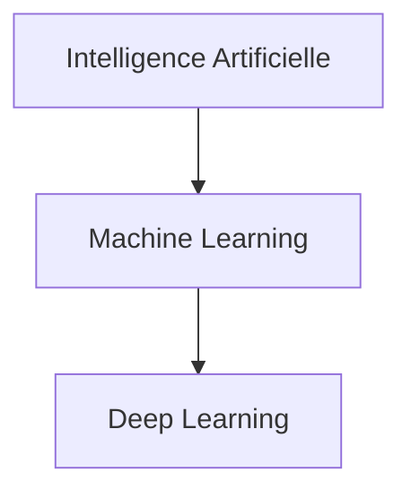

## Intelligence Artificielle

Ensemble des techniques permettant à une machine d'effectuer des tâches nécessitant habituellement l'intelligence humaine.

## Machine Learning

La machine apprend à partir de données sans être explicitement programmée.

## Deep Learning

Utilise des réseaux neuronaux profonds capables d'apprendre automatiquement des caractéristiques complexes.

---

# 3. Le neurone artificiel

Inspiré du cerveau humain.

## Structure

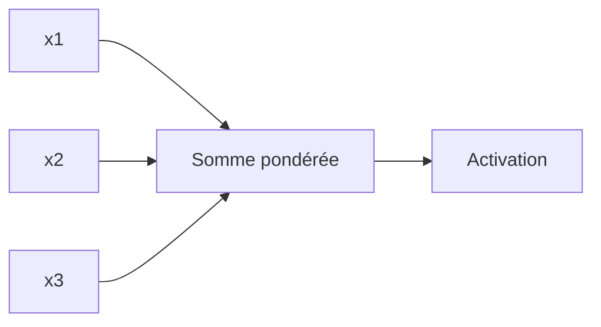

Chaque entrée possède un poids :

[
z = w_1x_1 + w_2x_2 + ... + w_nx_n + b
]

Puis :

[
a = f(z)
]

où :

* (w) = poids
* (b) = biais
* (f) = fonction d'activation

---

# 4. Réseaux de neurones

Un neurone seul est limité.

On combine plusieurs neurones.

## Architecture classique

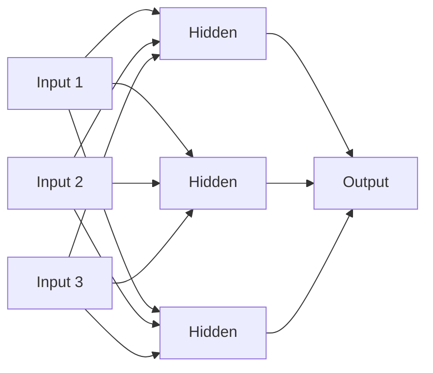

## Types de couches

### Couche d'entrée

Reçoit les données.

### Couches cachées

Apprennent des représentations.

### Couche de sortie

Produit la prédiction finale.

---

# 5. Forward Propagation

La propagation avant consiste à faire passer les données dans le réseau.

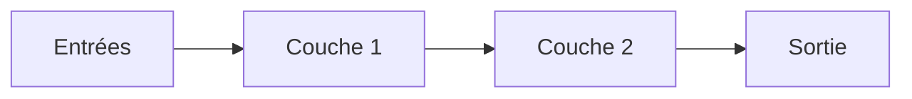

Étapes :

1. Multiplication par les poids
2. Ajout du biais
3. Activation
4. Transmission à la couche suivante

---

# 6. Fonction de coût

Mesure l'erreur du modèle.

## Exemple : Mean Squared Error

[
MSE = \frac{1}{n}\sum (y-\hat y)^2
]

où :

* (y) = vraie valeur
* (\hat y) = prédiction

Plus la perte est faible, meilleur est le modèle.

---

# 7. Backpropagation

La rétropropagation est le mécanisme central du Deep Learning.

Objectif :

> Ajuster les poids afin de réduire l'erreur.

## Processus

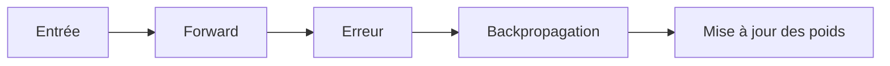

La rétropropagation utilise la règle de dérivation en chaîne :

[
\frac{\partial L}{\partial w}
]

afin de savoir comment chaque poids influence l'erreur.

---

# 8. Descente de gradient

Après avoir calculé les gradients :

[
w = w - \eta \nabla L
]

où :

* (w) = poids
* (\eta) = learning rate
* (\nabla L) = gradient

## Illustration

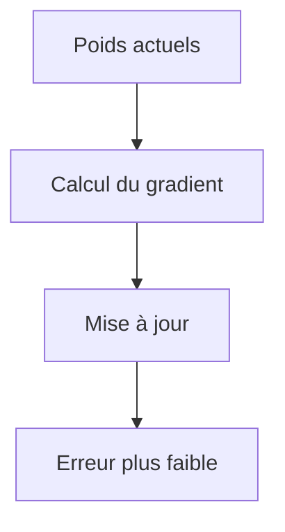

---

# 9. Fonctions d'activation

Sans activation, un réseau profond se comporte comme une simple régression linéaire.

## Sigmoid

[
\sigma(x)=\frac{1}{1+e^{-x}}
]

Sortie :

```
0 → 1
```

Utilisée historiquement.

---

## Tanh

[
tanh(x)
]

Sortie :

```
-1 → 1
```

---

## ReLU

[
ReLU(x)=max(0,x)
]

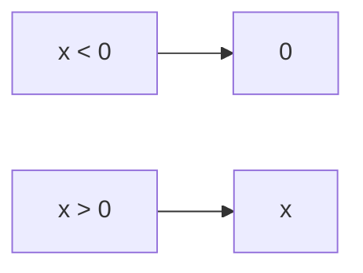

Très utilisée.

Avantages :

* Rapide
* Peu coûteuse
* Réduit le problème du gradient qui disparaît

---

## Leaky ReLU

[
LeakyReLU(x)=max(0.01x,x)
]

Corrige certaines limites de ReLU.

---

## Softmax

Pour la classification multi-classes.

Exemple :

| Classe | Probabilité |
| ------ | ----------- |
| Chat   | 0.80        |
| Chien  | 0.15        |
| Oiseau | 0.05        |

---

# 10. Architectures majeures

## Perceptron Multicouche (MLP)

Pour :

* données tabulaires
* prédictions classiques

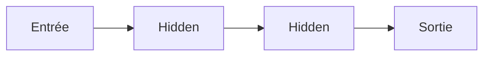

---

## CNN (Convolutional Neural Networks)

Pour les images.

### Principe

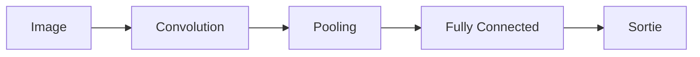

Utilisations :

* Détection d'objets
* Reconnaissance faciale
* Imagerie médicale

---

## RNN (Recurrent Neural Networks)

Pour les séquences.

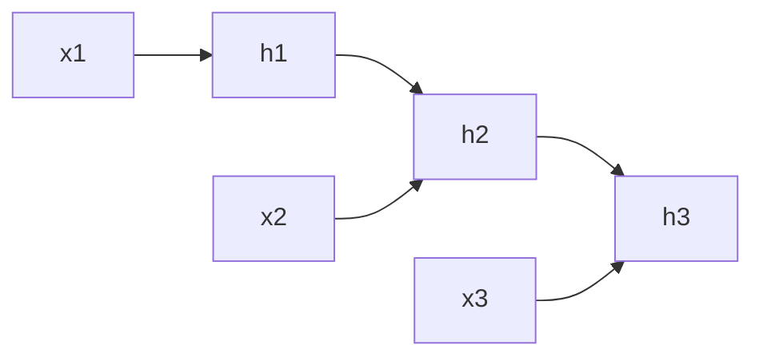

Utilisations :

* Texte
* Séries temporelles

---

## LSTM

Version améliorée des RNN.

Capable de mémoriser des informations sur de longues périodes.

Applications :

* Prévisions financières
* NLP
* Reconnaissance vocale

---

## Transformers

Architecture dominante aujourd'hui.

Utilisée dans :

* GPT
* BERT
* Llama
* Mistral

### Vue simplifiée


---

# 11. L'attention

Concept fondamental des Transformers.

Permet au modèle de se concentrer sur les parties importantes de l'entrée.

Exemple :

Phrase :

> Le chat mange le poisson parce qu'il a faim.

Le modèle doit comprendre que :

"il" → "chat"

---

## Self-Attention

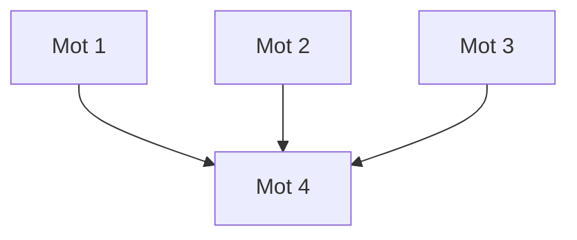

Chaque mot peut regarder les autres mots.

---

# 12. Préparation des données

La qualité des données est souvent plus importante que le modèle.

## Nettoyage

* Suppression des doublons
* Gestion des valeurs manquantes
* Correction des erreurs

## Normalisation

Exemple :

Avant :

| Taille |
| ------ |
| 150    |
| 180    |
| 210    |

Après :

| Taille |
| ------ |
| 0.15   |
| 0.18   |
| 0.21   |

---

## Découpage

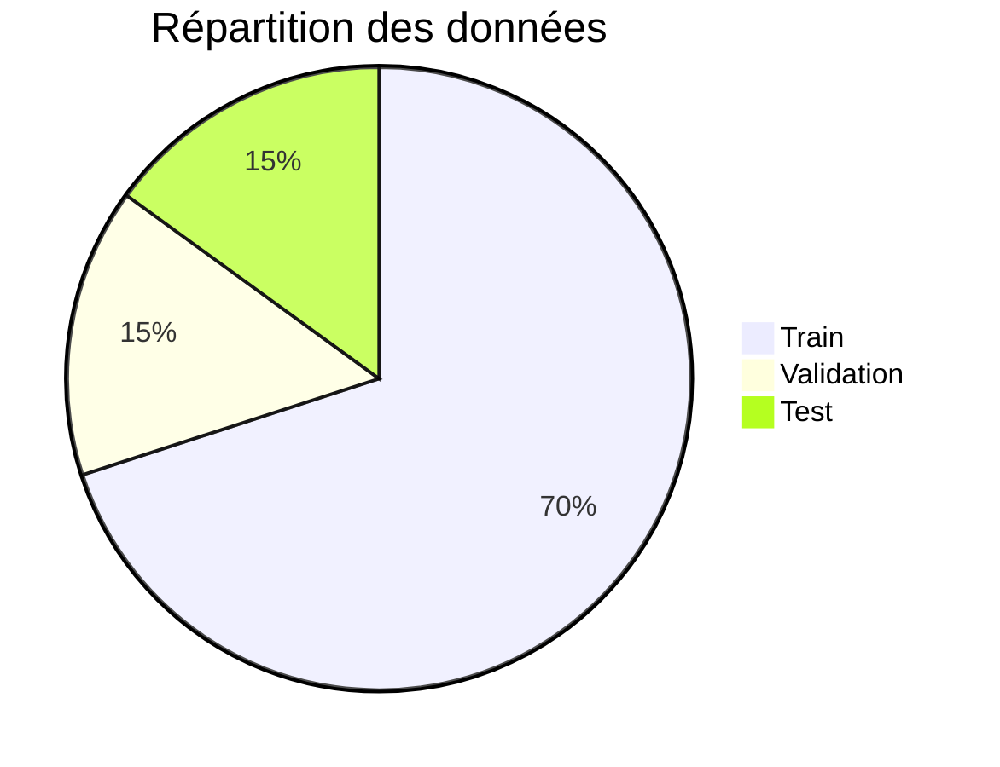

---

# 13. Processus complet d'entraînement

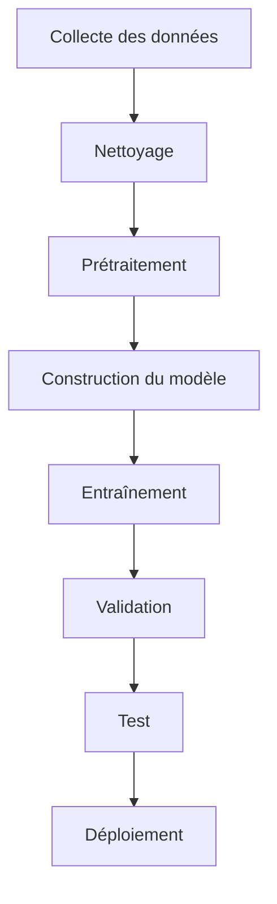

---

# 14. Overfitting et Underfitting

## Underfitting

Le modèle n'apprend pas suffisamment.

```text
Erreur train : élevée
Erreur test  : élevée
```

---

## Overfitting

Le modèle mémorise les données.

```text
Erreur train : faible
Erreur test  : élevée
```

---

## Visualisation

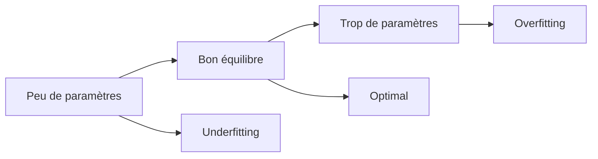

---

# 15. Techniques de régularisation

## Dropout

Désactive aléatoirement certains neurones.

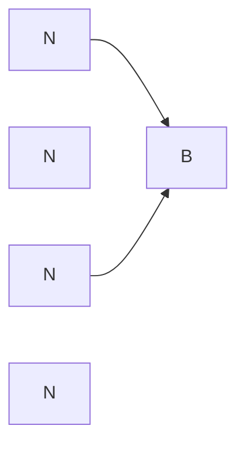

Les neurones A2 et A4 sont temporairement supprimés.

---

## Early Stopping

Arrêt de l'entraînement avant le surapprentissage.

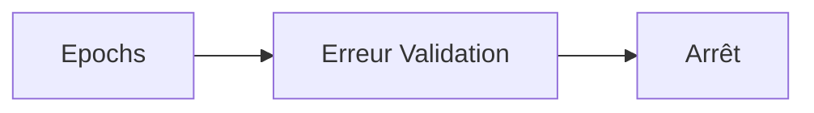

---

## Data Augmentation

Créer artificiellement plus de données.

Images :

* Rotation
* Zoom
* Recadrage
* Inversion

---

# 16. Optimiseurs

## SGD

Stochastic Gradient Descent.

Simple mais parfois lent.

---

## RMSProp

Adapte automatiquement le taux d'apprentissage.

---

## Adam

Le plus utilisé.

Combine :

* Momentum
* RMSProp

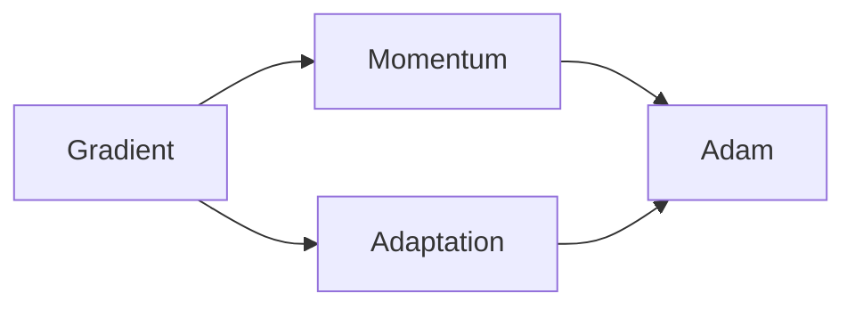

---

# 17. Frameworks modernes

## TensorFlow

Avantages :

* Production
* Scalabilité
* TPU

---

## PyTorch

Le plus populaire dans la recherche.

Avantages :

* Flexible
* Pythonique
* Débogage facile

---

## JAX

Très performant.

Utilisé dans la recherche avancée.

---

# 18. Exemple complet en PyTorch

## Étape 1 : Import

```python
import torch
import torch.nn as nn
```

---

## Étape 2 : Définition du modèle

```python
class Network(nn.Module):

    def __init__(self):
        super().__init__()

        self.net = nn.Sequential(
            nn.Linear(10,64),
            nn.ReLU(),
            nn.Linear(64,32),
            nn.ReLU(),
            nn.Linear(32,1)
        )

    def forward(self,x):
        return self.net(x)
```

---

## Étape 3 : Initialisation

```python
model = Network()

criterion = nn.MSELoss()

optimizer = torch.optim.Adam(
    model.parameters(),
    lr=0.001
)
```

---

## Étape 4 : Boucle d'entraînement

```python
for epoch in range(100):

    optimizer.zero_grad()

    outputs = model(X)

    loss = criterion(outputs, y)

    loss.backward()

    optimizer.step()
```

---

# 19. Deep Learning moderne : LLM

Les grands modèles de langage suivent généralement :

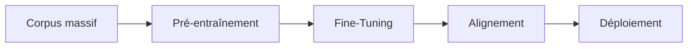

## Pré-entraînement

Le modèle apprend à prédire le mot suivant.

## Fine-Tuning

Adaptation à une tâche spécifique.

## Alignement

Amélioration du comportement et de la qualité des réponses.

---

# 20. Hyperparamètres importants

| Hyperparamètre     | Description             |
| ------------------ | ----------------------- |
| Learning Rate      | Vitesse d'apprentissage |
| Batch Size         | Taille du lot           |
| Epochs             | Nombre de passages      |
| Nombre de couches  | Profondeur              |
| Nombre de neurones | Capacité                |
| Dropout            | Régularisation          |

---

# 21. Erreurs fréquentes

## Learning rate trop élevé

```text
Le modèle diverge.
```

## Learning rate trop faible

```text
L'entraînement devient extrêmement lent.
```

## Données insuffisantes

```text
Le modèle généralise mal.
```

## Données bruitées

```text
Le modèle apprend de mauvaises corrélations.
```

---

# 22. Pipeline complet résumé

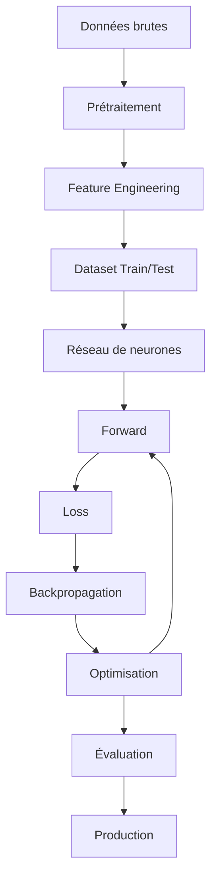

---

# 23. Feuille de route pour devenir expert

## Niveau 1 : Bases

Apprendre :

* Python
* Numpy
* Pandas
* Algèbre linéaire
* Probabilités
* Calcul différentiel

---

## Niveau 2 : Machine Learning

Étudier :

* Régression
* Classification
* Arbres de décision
* Random Forest
* SVM

---

## Niveau 3 : Deep Learning

Maîtriser :

* Réseaux de neurones
* Backpropagation
* CNN
* RNN
* LSTM

---

## Niveau 4 : Deep Learning avancé

Approfondir :

* Transformers
* Attention
* Diffusion Models
* Reinforcement Learning
* LLM

---

## Niveau 5 : Recherche et Production

Compétences :

* PyTorch avancé
* MLOps
* Quantization
* Distillation
* Distributed Training
* GPU Programming

---

# Conclusion

Le Deep Learning repose sur une idée simple : apprendre automatiquement des représentations hiérarchiques à partir de données grâce à des réseaux de neurones profonds. Le cycle fondamental est :

```mermaid
flowchart LR
    A[Données]
    B[Forward]
    C[Erreur]
    D[Backpropagation]
    E[Mise à jour des poids]
    F[Modèle amélioré]

    A --> B
    B --> C
    C --> D
    D --> E
    E --> F
```

En maîtrisant successivement :

1. Les neurones artificiels
2. Les fonctions d'activation
3. La descente de gradient
4. La rétropropagation
5. Les architectures CNN, RNN et Transformers
6. Les techniques d'entraînement modernes

vous disposerez des fondations nécessaires pour comprendre et construire des systèmes de Deep Learning de niveau professionnel.
