# Tutoriel Complet : Embeddings et Recherche Vectorielle

## Table des matières

1. Introduction
2. Qu'est-ce qu'un Embedding ?
3. Comment un modèle génère un Embedding
4. Comprendre l'espace vectoriel
5. Similarité vectorielle
6. Qu'est-ce que la Recherche Vectorielle ?
7. Architecture complète d'un moteur de recherche vectorielle
8. Base de données vectorielle
9. Indexation vectorielle
10. Pipeline complet : de la donnée à la réponse
11. Cas pratique avec exemples
12. Recherche sémantique vs recherche classique
13. RAG (Retrieval-Augmented Generation)
14. Optimisations avancées
15. Choisir un modèle d'embedding
16. Limites et pièges
17. Exemple complet en Python
18. Résumé

---

# 1. Introduction

Les **embeddings** et la **recherche vectorielle** sont aujourd'hui au cœur des systèmes d'IA modernes :

* Chatbots RAG
* Moteurs de recherche sémantique
* Recommandation de produits
* Recherche documentaire
* Similarité d'images
* Détection de doublons
* Moteurs de connaissances

L'idée fondamentale :

> Transformer des données (texte, image, audio, vidéo) en vecteurs numériques permettant de mesurer leur proximité sémantique.

---

# 2. Qu'est-ce qu'un Embedding ?

Un embedding est une représentation numérique dense d'une information.

Par exemple :

```text
"Chat"
```

peut devenir :

```text
[0.12, -0.45, 0.88, 0.31, ...]
```

ou

```text
[-0.76, 0.11, 0.23, 0.54, ...]
```

selon le modèle utilisé.

---

## Intuition

Le modèle apprend à placer les concepts proches dans des zones proches de l'espace vectoriel.

Exemple :

```text
Chat
Chien
Lion
Tigre
```

seront relativement proches.

Alors que :

```text
Chat
Voiture
Base de données
Avion
```

seront éloignés.

---

## Représentation simplifiée

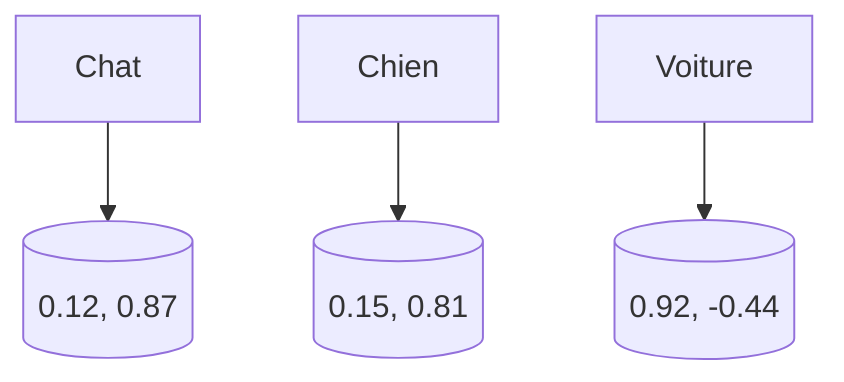

---

# 3. Comment un modèle génère un Embedding

Un modèle de langage possède des milliards de paramètres.

Durant son entraînement il apprend :

* le contexte
* les relations entre mots
* les concepts
* les intentions

Ainsi :

```text
roi - homme + femme ≈ reine
```

est une propriété émergente observée dans certains espaces vectoriels.

---

## Pipeline simplifié


Exemple :

```text
"Le chat dort sur le canapé"
```

↓

```text
[0.82, -0.14, 0.61, ...]
```

---

# 4. Comprendre l'espace vectoriel

Un embedding est un point dans un espace à N dimensions.

Exemples :

* 128 dimensions
* 384 dimensions
* 768 dimensions
* 1536 dimensions
* 3072 dimensions

---

## Visualisation 2D simplifiée

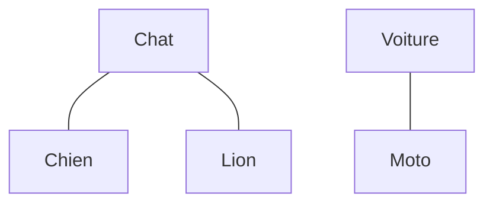

Dans la réalité :

```text
768 dimensions
```

ou davantage.

Impossible à visualiser directement.

---

# 5. Similarité vectorielle

Le but principal :

> mesurer la proximité entre deux vecteurs.

---

## Distance Euclidienne

Formule :

```text
d(A,B)=√((x2-x1)^2 + (y2-y1)^2)
```

---

## Cosine Similarity

La plus utilisée.

Formule :

```text
cos(θ) = A·B / (||A|| ||B||)
```

Résultat :

```text
1.0   = identique
0.8   = très proche
0.5   = moyennement proche
0.0   = sans relation
-1.0  = opposé
```

---

## Exemple

Question :

```text
Comment nourrir un chat ?
```

Document A :

```text
Guide alimentaire pour chats
```

Score :

```text
0.93
```

Document B :

```text
Réparation moteur diesel
```

Score :

```text
0.12
```

Le document A sera sélectionné.

---

# 6. Qu'est-ce que la Recherche Vectorielle ?

La recherche vectorielle consiste à :

1. Convertir les documents en embeddings
2. Convertir la requête en embedding
3. Trouver les vecteurs les plus proches

---

## Schéma général

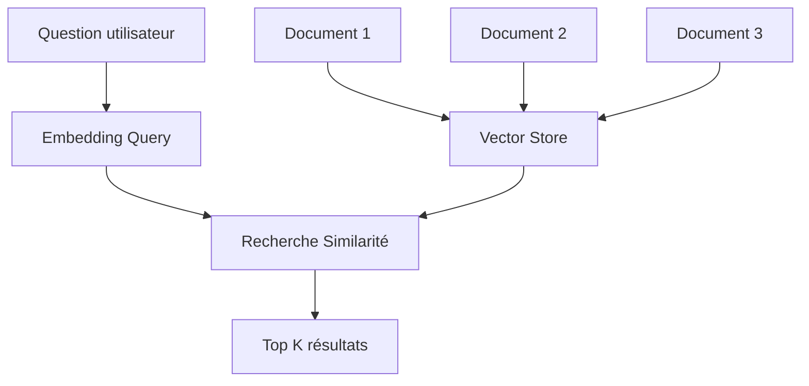

---

# 7. Architecture complète d'un moteur de recherche vectorielle

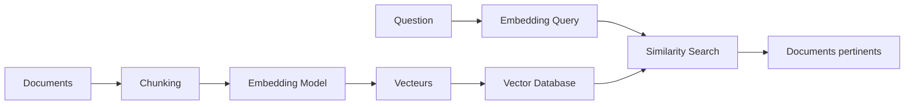

---

# 8. Base de données vectorielle

Une base vectorielle stocke :

```text
Vecteur
+
Métadonnées
+
Document original
```

Exemple :

```json
{
  "id": "doc_42",
  "embedding": [0.12, 0.33, ...],
  "title": "Guide Chat",
  "category": "animaux"
}
```

---

## Bases populaires

| Solution              | Type        |
| --------------------- | ----------- |
| Pinecone              | SaaS        |
| Weaviate              | Open Source |
| Qdrant                | Open Source |
| Milvus                | Open Source |
| Chroma                | Léger       |
| Elasticsearch Vector  | Hybride     |
| PostgreSQL + pgvector | SQL         |

---

# 9. Indexation vectorielle

Problème :

Imaginons :

```text
100 millions de documents
```

Comparer chaque vecteur serait extrêmement lent.

---

## Recherche exhaustive

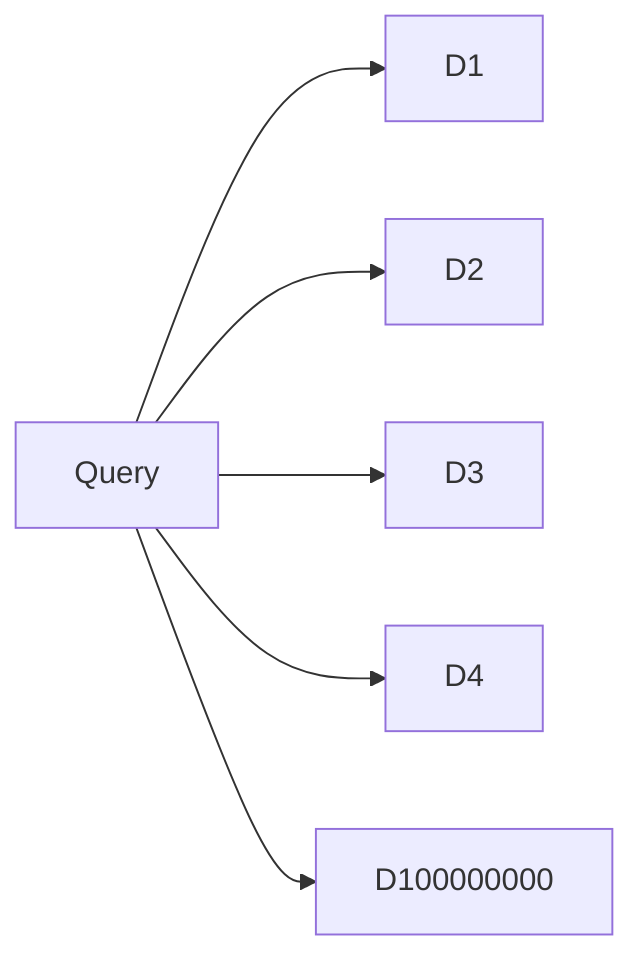

Complexité :

```text
O(N)
```

---

## Approximate Nearest Neighbor (ANN)

La plupart des systèmes utilisent ANN.

Objectif :

```text
99% précision
+
100x plus rapide
```

---

## HNSW

Algorithme extrêmement populaire.

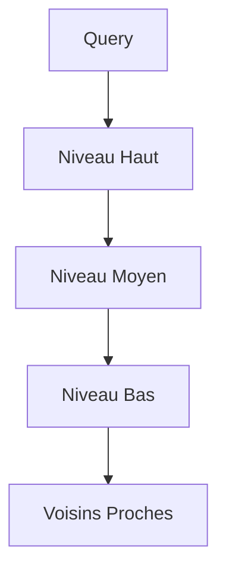

---

# 10. Pipeline complet

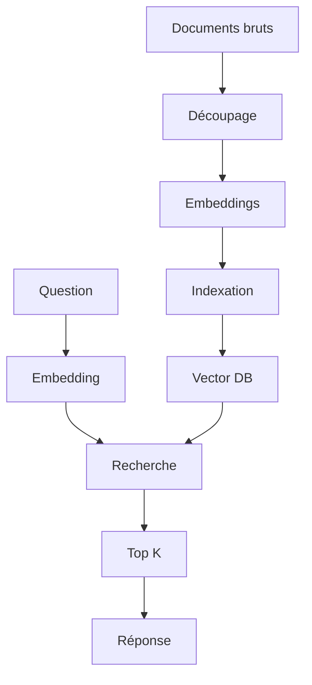

---

# 11. Cas pratique

Supposons une FAQ :

```text
Comment réinitialiser mon mot de passe ?
```

```text
Comment modifier mon email ?
```

```text
Comment supprimer mon compte ?
```

---

## Indexation

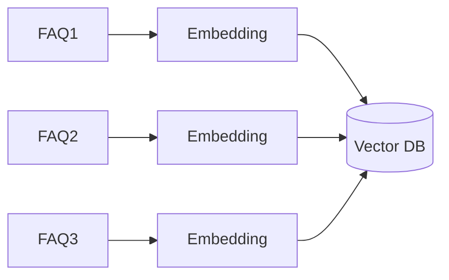

---

## Recherche

Question :

```text
J'ai oublié mon mot de passe
```

Embedding :

```text
Qv
```

Recherche :

```text
Qv ↔ FAQ1 = 0.94
Qv ↔ FAQ2 = 0.21
Qv ↔ FAQ3 = 0.11
```

Résultat :

```text
FAQ1
```

---

# 12. Recherche sémantique vs recherche classique

## Recherche par mots-clés

Question :

```text
automobile
```

Document :

```text
voiture
```

Résultat :

```text
Aucune correspondance
```

possible.

---

## Recherche vectorielle

Le modèle comprend :

```text
automobile ≈ voiture
```

Donc :

```text
Correspondance trouvée
```

---

## Comparaison

| Critère              | Mots-clés | Vectorielle |
| -------------------- | --------- | ----------- |
| Synonymes            | Faible    | Excellent   |
| Contexte             | Non       | Oui         |
| Sens                 | Non       | Oui         |
| Multilingue          | Limité    | Très bon    |
| Recherche sémantique | Non       | Oui         |

---

# 13. RAG (Retrieval-Augmented Generation)

Le RAG combine :

```text
LLM
+
Recherche vectorielle
```

---

## Architecture

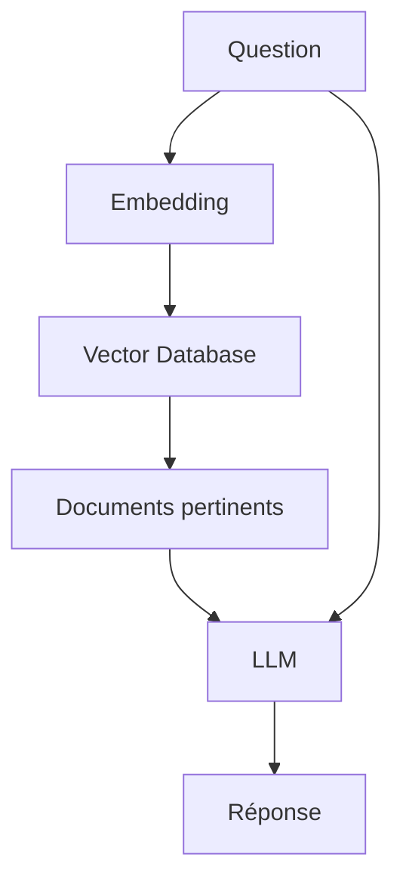

---

## Pourquoi ?

Un LLM seul :

```text
Connaissance figée
```

Un RAG :

```text
Connaissance actualisable
```

---

# 14. Optimisations avancées

## Chunking

Mauvais :

```text
Document entier
```

Bon :

```text
Paragraphes
```

ou

```text
300-800 tokens
```

---

## Overlap

Exemple :

```text
Chunk 1
[1......500]

Chunk 2
[450......950]
```

Cela évite de perdre du contexte.

---

## Hybrid Search

Combinaison :

```text
BM25
+
Vector Search
```

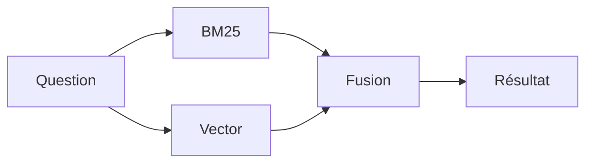

---

# 15. Choisir un modèle d'embedding

Critères :

* précision
* vitesse
* coût
* dimensions
* multilingue

---

## Exemples

| Modèle                        | Dimensions |
| ----------------------------- | ---------- |
| BGE Small                     | 384        |
| BGE Base                      | 768        |
| E5 Large                      | 1024       |
| OpenAI text-embedding-3-small | 1536       |
| OpenAI text-embedding-3-large | 3072       |

---

# 16. Limites et pièges

## Chunk trop gros

Problème :

```text
Bruit
```

---

## Chunk trop petit

Problème :

```text
Perte de contexte
```

---

## Mauvais embeddings

Conséquence :

```text
Recherche incohérente
```

---

## Absence de reranking

Le Top-K peut contenir :

```text
Documents presque pertinents
```

On ajoute alors :

```text
Retriever
+
Reranker
```

---

# 17. Exemple complet en Python

## Installation

```bash
pip install sentence-transformers qdrant-client
```

---

## Création des embeddings

```python
from sentence_transformers import SentenceTransformer

model = SentenceTransformer("BAAI/bge-small-en")

documents = [
    "Le chat dort",
    "Le chien court",
    "La voiture roule"
]

embeddings = model.encode(documents)

print(embeddings.shape)
```

---

## Recherche

```python
query = "félin domestique"

query_embedding = model.encode(query)
```

---

## Similarité cosinus

```python
from sklearn.metrics.pairwise import cosine_similarity

scores = cosine_similarity(
    [query_embedding],
    embeddings
)

print(scores)
```

---

## Résultat

```text
Le chat dort
```

sera probablement le document le plus proche.

---

# 18. Résumé

## Ce qu'il faut retenir

### Embedding

Transforme :

```text
Texte
↓
Vecteur
```

---

### Recherche Vectorielle

Trouve :

```text
Vecteurs similaires
```

---

### Pipeline complet

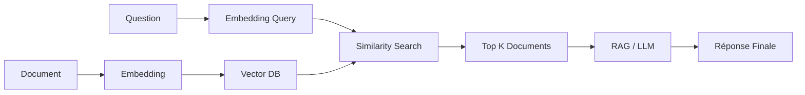

---

## Architecture moderne utilisée dans les applications IA

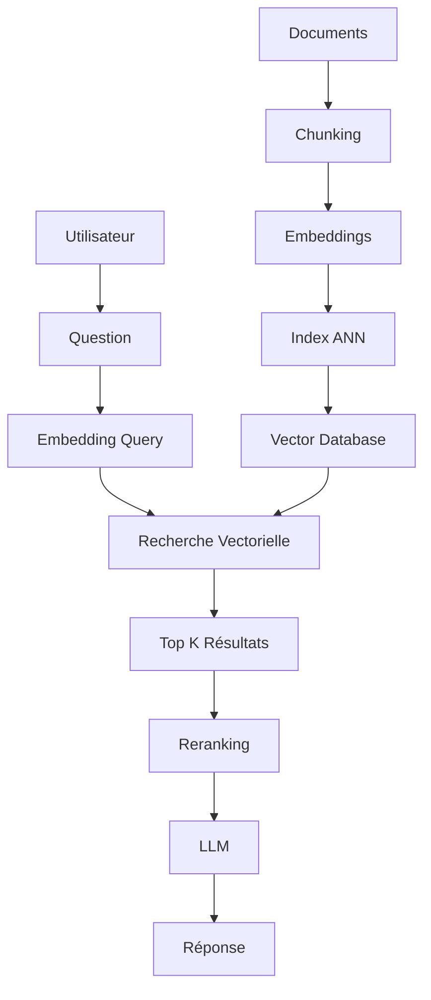

Cette architecture constitue aujourd'hui la base de la plupart des systèmes RAG, assistants IA d'entreprise, moteurs de recherche sémantiques et plateformes de gestion de connaissances modernes.
