# Le Machine Learning

## Table des matières

1. Introduction au Machine Learning
2. Les grands types d'apprentissage
3. Le pipeline complet d'un projet ML
4. Les données : le carburant du Machine Learning
5. Prétraitement des données
6. Apprentissage supervisé
7. Apprentissage non supervisé
8. Apprentissage par renforcement
9. Évaluation des modèles
10. Surapprentissage et sous-apprentissage
11. Sélection et optimisation des modèles
12. Réseaux de neurones et Deep Learning
13. Mise en production (MLOps)
14. Projet complet pas à pas
15. Bonnes pratiques
16. Ressources pour aller plus loin

---

# 1. Introduction au Machine Learning

## Définition

Le **Machine Learning (ML)** est une branche de l'intelligence artificielle qui permet à une machine d'apprendre automatiquement à partir de données sans être explicitement programmée pour chaque tâche.

Au lieu d'écrire :

```text
SI âge > 18 ALORS adulte
SINON enfant
```

on fournit des exemples :

```text
Age  Statut
22   Adulte
35   Adulte
10   Enfant
15   Enfant
```

La machine apprend elle-même la règle.

---

## Vision globale

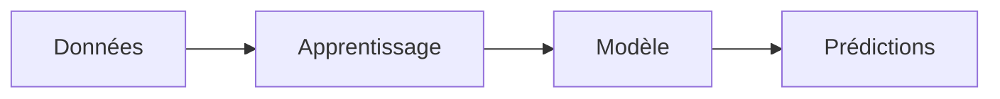

---

## Exemples d'applications

| Domaine   | Exemple                    |
| --------- | -------------------------- |
| Finance   | Détection de fraude        |
| Santé     | Diagnostic médical         |
| Marketing | Recommandation de produits |
| Vision    | Reconnaissance d'images    |
| NLP       | Traduction automatique     |
| Industrie | Maintenance prédictive     |

---

# 2. Les grands types d'apprentissage

Le Machine Learning se divise principalement en trois catégories.

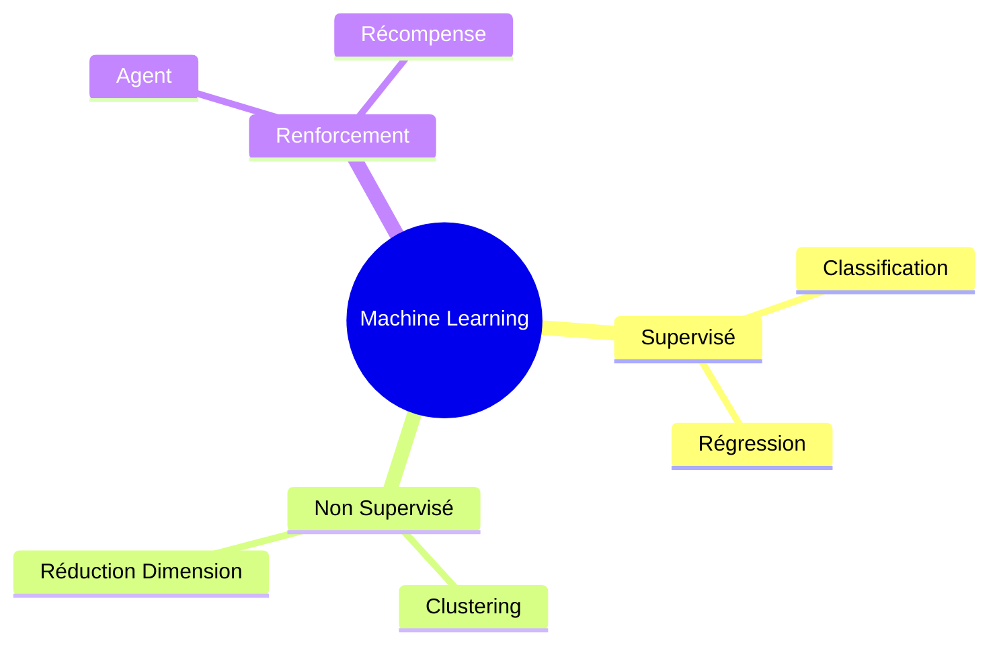

---

# 3. Le pipeline complet d'un projet ML

Un projet ML suit généralement ce cycle.

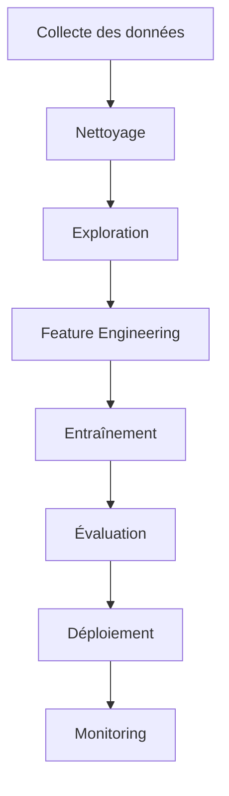

---

## Description des étapes

### 1. Collecte

Sources :

* Bases SQL
* APIs
* Fichiers CSV
* IoT
* Logs

### 2. Nettoyage

Suppression :

* Valeurs manquantes
* Doublons
* Erreurs

### 3. Analyse exploratoire

Objectif :

* Comprendre les données
* Identifier les tendances
* Détecter les anomalies

### 4. Création de variables

Transformation des données brutes en variables utiles.

Exemple :

```text
Date naissance → Age
```

---

# 4. Les données : le carburant du Machine Learning

## Structure classique

```text
ID | Age | Salaire | Achat
1  | 25  | 30000   | Oui
2  | 50  | 80000   | Oui
3  | 20  | 15000   | Non
```

---

## Terminologie

### Features

Variables d'entrée.

Exemples :

```text
Age
Salaire
Ville
```

### Target

Variable à prédire.

```text
Achat
```

---

## Matrice X et vecteur y

```text
X = Features

[
 Age Salaire
 25  30000
 50  80000
]

y = Target

[
 Oui
 Oui
]
```

---

# 5. Prétraitement des données

## Gestion des valeurs manquantes

### Suppression

```python
df.dropna()
```

### Remplacement

```python
df["age"].fillna(df["age"].mean())
```

---

## Encodage des variables catégorielles

Avant :

```text
Couleur
Rouge
Bleu
Vert
```

Après :

```text
Rouge = 0
Bleu = 1
Vert = 2
```

ou

```text
Rouge Bleu Vert
1     0    0
0     1    0
0     0    1
```

---

## Normalisation

Certaines variables dominent les autres.

Avant :

```text
Age = 20
Salaire = 100000
```

Après normalisation :

```text
Age = 0.2
Salaire = 0.4
```

---

## Standardisation

Formule :

```math
z = (x - μ) / σ
```

---

# 6. Apprentissage supervisé

## Principe

On dispose :

* des entrées
* des réponses attendues

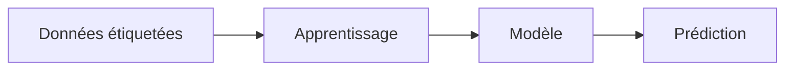

---

## Classification

Prédire une catégorie.

Exemples :

* Spam / Non spam
* Malade / Sain
* Achat / Pas achat

---

### Régression Logistique

Malgré son nom :

```text
Classification
```

Produit une probabilité.

```math
P(y=1)=1/(1+e^-z)
```

---

### Arbres de décision

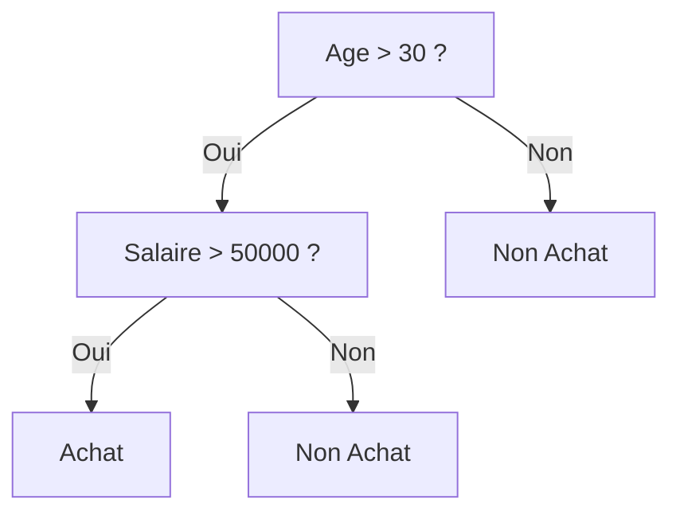

---

### Random Forest

Principe :

```text
Beaucoup d'arbres
+
Vote majoritaire
```

Avantages :

* Robuste
* Bonne performance
* Peu de réglages

---

### Support Vector Machine (SVM)

Cherche l'hyperplan qui sépare le mieux les classes.

```text
Classe A | Hyperplan | Classe B
```

---

## Régression

Prédire une valeur numérique.

Exemples :

* Prix maison
* Température
* Chiffre d'affaires

---

### Régression linéaire

Équation :

```math
y = ax + b
```

---

### Représentation

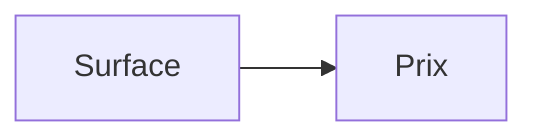

Plus généralement :

```math
y = b + w1x1 + w2x2 + ... + wnxn
```

---

# 7. Apprentissage non supervisé

## Principe

Pas d'étiquette.

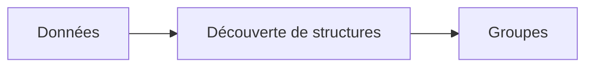

---

## Clustering

But :

```text
Regrouper des éléments similaires
```

---

### K-Means

Étapes :

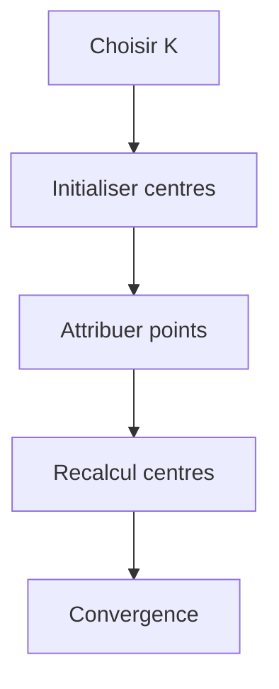

---

### Exemple

Clients :

```text
Jeunes sportifs
Familles
Retraités
```

---

## Réduction de dimension

Quand il y a trop de variables.

Exemple :

```text
100 variables
↓
5 variables
```

---

### PCA

Analyse en composantes principales.

Objectif :

```text
Conserver le maximum d'information
avec moins de dimensions
```

---

# 8. Apprentissage par renforcement

## Concept

Un agent agit dans un environnement.

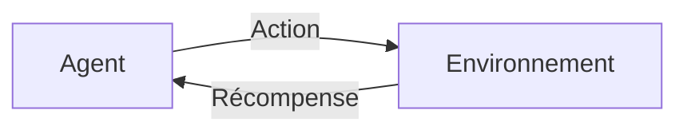

---

## Exemple

Jeu vidéo.

```text
Action correcte = +10
Action mauvaise = -5
```

L'agent apprend à maximiser sa récompense.

---

## Concepts clés

| Élément | Description |
| ------- | ----------- |
| Agent   | Apprenant   |
| État    | Situation   |
| Action  | Décision    |
| Reward  | Récompense  |
| Policy  | Stratégie   |

---

# 9. Évaluation des modèles

## Découpage des données

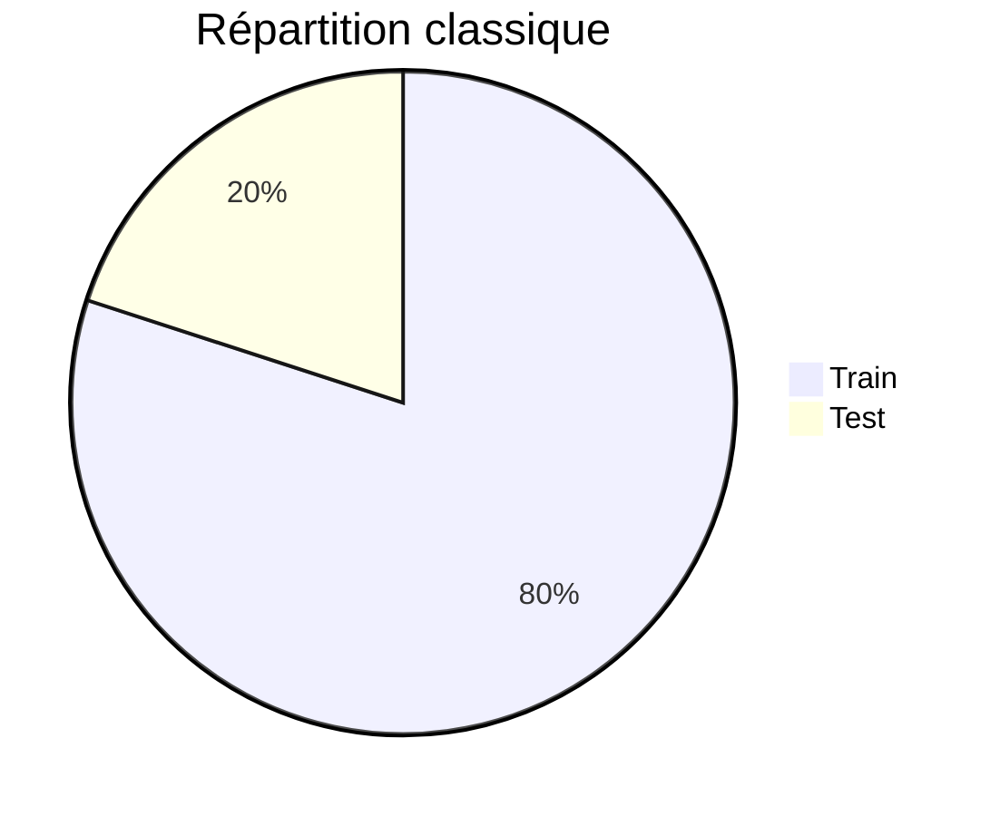

---

## Classification

### Matrice de confusion

```text
                Réel
             Pos  Neg

Pred Pos      TP   FP
Pred Neg      FN   TN
```

---

### Accuracy

```math
(TP + TN) / Total
```

---

### Precision

```math
TP / (TP + FP)
```

---

### Recall

```math
TP / (TP + FN)
```

---

### F1-Score

```math
2 * Precision * Recall
----------------------
 Precision + Recall
```

---

## Régression

### MAE

```math
|y - ŷ|
```

---

### MSE

```math
(y - ŷ)^2
```

---

### RMSE

```math
√MSE
```

---

### R²

```math
1 - (Erreur modèle / Erreur moyenne)
```

---

# 10. Surapprentissage et sous-apprentissage

## Underfitting

Le modèle est trop simple.

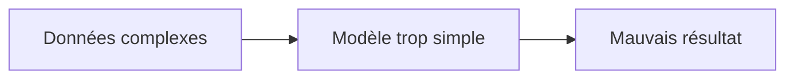

---

## Overfitting

Le modèle mémorise les données.

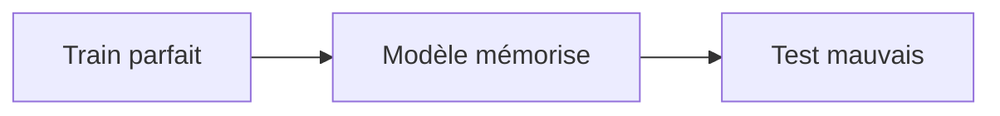

---

## Illustration

```text
Train Accuracy = 99%
Test Accuracy  = 70%
```

➡ Overfitting

---

## Solutions

* Plus de données
* Régularisation
* Dropout
* Validation croisée
* Réduction de complexité

---

# 11. Sélection et optimisation des modèles

## Validation croisée

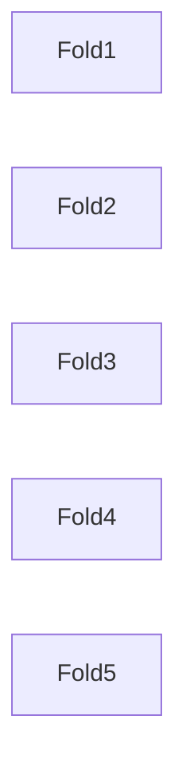

Chaque partie devient tour à tour :

```text
Test
```

et le reste :

```text
Train
```

---

## Hyperparamètres

Exemples :

```text
Random Forest
 ├── n_estimators
 ├── max_depth
 └── min_samples_split
```

---

## Grid Search

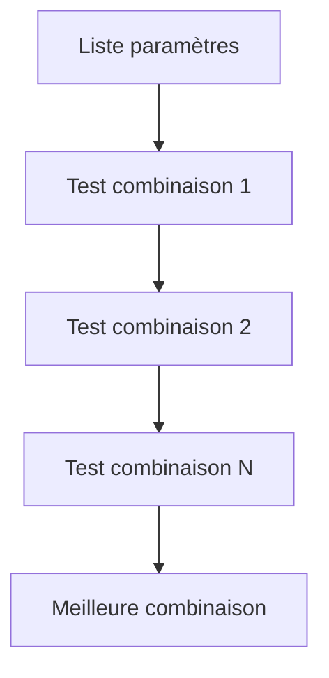

---

# 12. Réseaux de neurones et Deep Learning

## Inspiration biologique

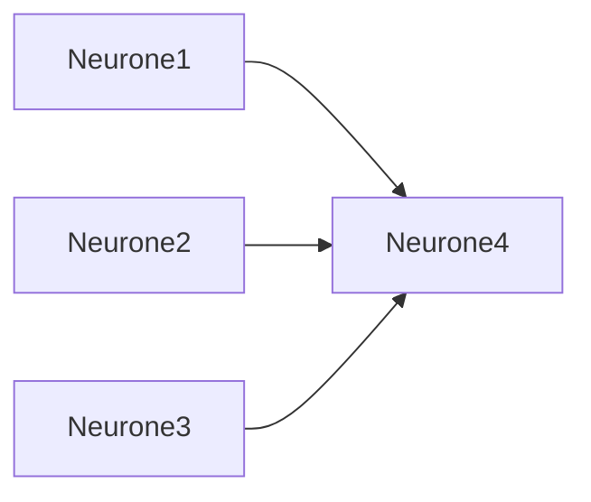

---

## Structure

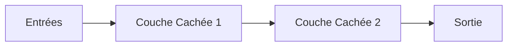

---

## Neurone artificiel

```math
y = f(w1x1 + w2x2 + b)
```

---

## Fonction d'activation

### Sigmoid

```math
1/(1+e^-x)
```

### ReLU

```math
max(0,x)
```

### Tanh

```math
tanh(x)
```

---

## Propagation avant

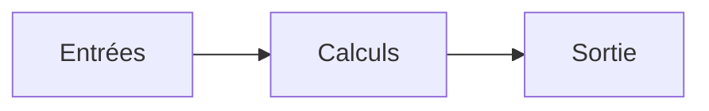

---

## Rétropropagation

```mermaid
flowchart LR

Erreur --> Gradient --> Mise à jour poids
```

---

## Deep Learning

Réseau profond :

```text
2 couches = Réseau classique
50 couches = Deep Learning
```

---

## Architectures importantes

### CNN

Pour les images.

```text
Image
 ↓
Convolution
 ↓
Pooling
 ↓
Classification
```

---

### RNN

Pour les séquences.

Exemples :

* Texte
* Audio
* Séries temporelles

---

### Transformers

Base des modèles modernes.

Exemples :

* LLM
* Traduction
* Chatbots

Concept principal :

```text
Attention Mechanism
```

---

# 13. Mise en production (MLOps)

## Architecture

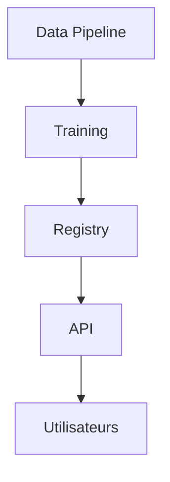

---

## Monitoring

Surveiller :

* Latence
* Précision
* Drift des données
* Disponibilité

---

## Data Drift

Lorsque les données réelles changent.

```text
Train : clients 2023
Production : clients 2026
```

Le modèle devient moins performant.

---

# 14. Projet complet pas à pas

## Cas : prédire le prix d'une maison

### Données

```text
Surface
Nombre pièces
Quartier
Age bâtiment
```

---

### Étape 1

Collecte :

```text
10000 maisons
```

---

### Étape 2

Nettoyage :

```text
Suppression doublons
Gestion valeurs manquantes
```

---

### Étape 3

Analyse

Questions :

* Quelle variable influence le prix ?
* Existe-t-il des anomalies ?

---

### Étape 4

Prétraitement

```text
Normalisation
Encodage
```

---

### Étape 5

Découpage

```text
80% train
20% test
```

---

### Étape 6

Entraînement

Exemples :

```text
Régression linéaire
Random Forest
XGBoost
```

---

### Étape 7

Évaluation

Mesures :

```text
MAE
RMSE
R²
```

---

### Étape 8

Déploiement

```mermaid
flowchart LR

Utilisateur
--> API
--> Modèle
--> Prix prédit
```

---

# 15. Bonnes pratiques

## 1. Comprendre le problème métier

Avant le modèle :

```text
Comprendre le besoin
```

---

## 2. Nettoyer les données

Règle :

```text
Garbage In
Garbage Out
```

---

## 3. Commencer simple

Toujours tester :

* Régression linéaire
* Arbre simple

Avant :

* Deep Learning
* Architectures complexes

---

## 4. Mesurer correctement

Choisir la bonne métrique.

Exemple :

```text
Détection cancer
→ Recall prioritaire
```

---

## 5. Éviter les fuites de données

Ne jamais utiliser dans l'entraînement :

```text
Informations du futur
```

---

## 6. Reproductibilité

Conserver :

* Version des données
* Code
* Paramètres
* Modèles

---

# 16. Résumé visuel global

```mermaid
flowchart TD

A[Collecte Données]
--> B[Nettoyage]

B --> C[Analyse]

C --> D[Feature Engineering]

D --> E[Train/Test Split]

E --> F[Entraînement Modèle]

F --> G[Évaluation]

G --> H[Optimisation]

H --> I[Déploiement]

I --> J[Monitoring]
```

---

# Fiche Mémo

## Types de Machine Learning

| Type          | But       |
| ------------- | --------- |
| Supervisé     | Prédire   |
| Non Supervisé | Découvrir |
| Renforcement  | Décider   |

---

## Algorithmes populaires

| Catégorie      | Algorithmes                             |
| -------------- | --------------------------------------- |
| Classification | Logistic Regression, SVM, Random Forest |
| Régression     | Linear Regression, XGBoost              |
| Clustering     | K-Means, DBSCAN                         |
| Deep Learning  | CNN, RNN, Transformers                  |

---

## Métriques importantes

| Classification | Régression |
| -------------- | ---------- |
| Accuracy       | MAE        |
| Precision      | MSE        |
| Recall         | RMSE       |
| F1 Score       | R²         |

---

## Formule mentale du Machine Learning

```text
Données
+
Prétraitement
+
Algorithme
+
Évaluation
+
Amélioration continue
=
Machine Learning performant
```

---

# Conclusion

Le Machine Learning consiste à apprendre automatiquement des modèles à partir de données afin de réaliser des prédictions ou découvrir des structures cachées. Un projet ML réussi repose généralement davantage sur la qualité des données, la compréhension du problème et l'évaluation rigoureuse que sur le choix d'un algorithme complexe. Les étapes fondamentales sont :

1. Collecter les données.
2. Les nettoyer et les préparer.
3. Choisir un algorithme adapté.
4. Entraîner le modèle.
5. Évaluer ses performances.
6. Déployer et surveiller le système en production.

Une fois ces bases maîtrisées, il devient naturel d'aborder des sujets plus avancés comme le Deep Learning, les Transformers, l'apprentissage par renforcement et le MLOps.
