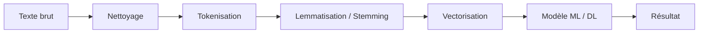
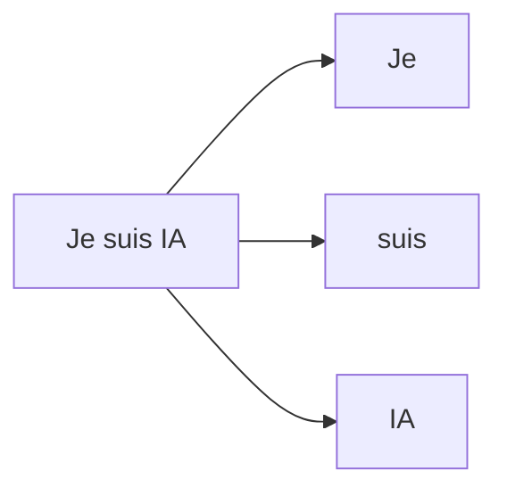
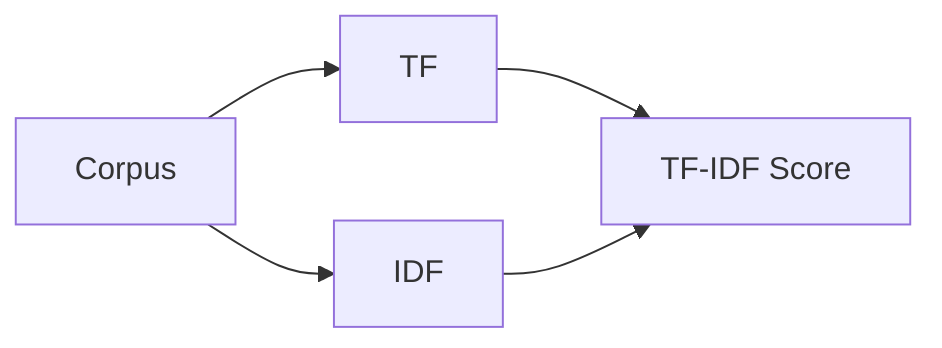
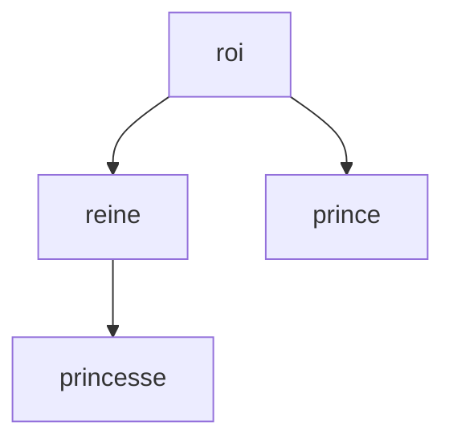
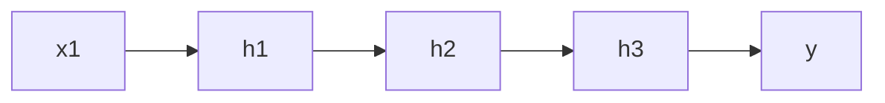
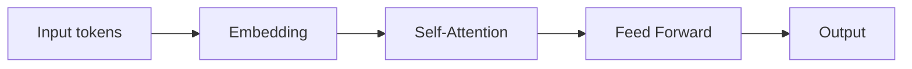
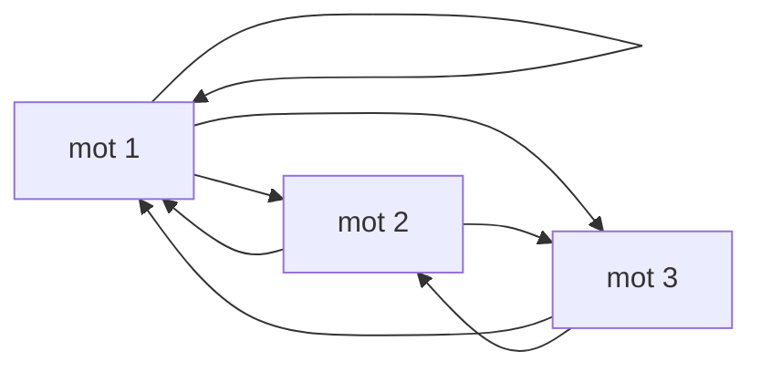
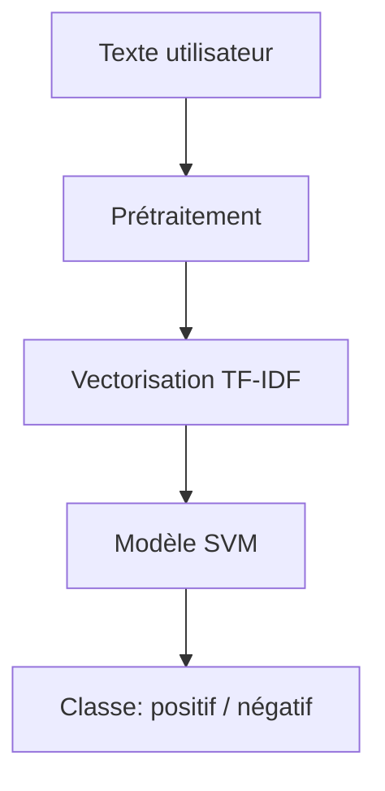

# Tutoriel complet sur le NLP (Natural Language Processing) en IA

## 1. Introduction au NLP

Le **NLP (Natural Language Processing)** est une branche de l’intelligence artificielle qui permet aux machines de comprendre, analyser, générer et manipuler le langage humain (texte et parole).

Il est utilisé dans :

* Chatbots (ex : assistants virtuels)
* Traduction automatique
* Analyse de sentiments
* Moteurs de recherche
* Résumé automatique de textes

---

## 2. Pipeline général du NLP

Le traitement du langage naturel suit généralement une chaîne de traitement.



---

## 3. Étapes de prétraitement du texte

### 3.1 Nettoyage (Text Cleaning)

Objectif : supprimer le bruit.

Exemples :

* Suppression des ponctuations
* Passage en minuscules
* Suppression des caractères spéciaux
* Suppression des stopwords

```text
Texte brut : "Bonjour!!! Je suis EN IA :)"
Texte nettoyé : "bonjour je suis en ia"
```

---

### 3.2 Tokenisation

Découper le texte en unités (tokens).

* Mot par mot
* Phrase par phrase



---

### 3.3 Stopwords

Les stopwords sont des mots très fréquents mais peu informatifs :

* le
* la
* est
* de
* et

Exemple :

```text
"Je suis en train d'apprendre le NLP"
→ "apprendre NLP"
```

---

### 3.4 Stemming et Lemmatisation

#### Stemming

Réduction brute des mots à leur racine.

Exemple :

* manger → mang
* mangé → mang

#### Lemmatisation

Réduction grammaticale correcte.

Exemple :

* manger → manger
* mangé → manger

---

## 4. Représentation du texte (Vectorisation)

Les modèles ne comprennent pas le texte brut, il faut le transformer en nombres.

---

### 4.1 Bag of Words (BoW)

Compte les occurrences de mots.

| texte        | je | aime | IA |
| ------------ | -- | ---- | -- |
| "je aime IA" | 1  | 1    | 1  |

Limite : ignore l’ordre des mots.

---

### 4.2 TF-IDF

Mesure l’importance d’un mot dans un document.

* TF : fréquence du mot
* IDF : rareté du mot dans le corpus



---

### 4.3 Word Embeddings

Représentation dense des mots dans un espace vectoriel.

Exemples :

* Word2Vec
* GloVe
* FastText

Idée :

> Les mots similaires sont proches dans l’espace vectoriel.



---

## 5. Modèles NLP

---

### 5.1 Modèles classiques (Machine Learning)

* Naive Bayes
* SVM
* Logistic Regression

Utilisés avec BoW ou TF-IDF.

---

### 5.2 Réseaux de neurones (Deep Learning)

#### RNN (Recurrent Neural Network)

Adapté aux séquences.



Problème : difficulté avec longues séquences.

---

#### LSTM / GRU

Améliorations des RNN pour gérer les longues dépendances.

---

### 5.3 Transformers (état de l’art)

Architecture révolutionnaire basée sur l’attention.



---

## 6. Mécanisme d’Attention

L’attention permet au modèle de se concentrer sur les mots importants.

Exemple :

> "Le chat que j’ai vu hier était noir"

Le modèle doit relier "chat" à "noir".

---

## 7. Self-Attention (Transformers)

Chaque mot regarde tous les autres mots.



---

## 8. Applications du NLP

### 8.1 Classification de texte

* Spam detection
* Analyse de sentiment

### 8.2 Traduction automatique

* Français → Anglais

### 8.3 Chatbots

* Support client
* Assistants IA

### 8.4 Résumé automatique

* Extraction ou génération

---

## 9. Exemple simple de pipeline NLP



---

## 10. Limites du NLP

* Ambiguïté du langage
* Ironie / sarcasme
* Contexte long difficile à capturer
* Biais dans les données

---

## 11. Conclusion

Le NLP combine :

* linguistique
* statistiques
* deep learning

Les Transformers représentent aujourd’hui la base des modèles modernes (comme les LLM).

---

## 12. Pour aller plus loin

Tu peux explorer :

* Hugging Face Transformers
* spaCy
* NLTK
* BERT / GPT architectures
