# Le Prompt Engineering

## Maîtriser l'art de communiquer avec les modèles de langage (LLM)

**Niveau :** Débutant à Avancé  
**Durée estimée de lecture :** 2 à 3 heures  
**Prérequis :** Connaissances de base en IA générative

---

# Table des matières

1. Introduction au Prompt Engineering
2. Comprendre le fonctionnement des LLM
3. Anatomie d'un prompt
4. Les techniques fondamentales
5. Les techniques avancées
6. Architecture des prompts complexes
7. Frameworks de prompting
8. Évaluation et optimisation
9. Cas d'usage professionnels
10. Bonnes pratiques et anti-patterns
11. Futur du Prompt Engineering

---

# 1. Introduction au Prompt Engineering

## Définition

Le **Prompt Engineering** est la discipline consistant à concevoir, structurer et optimiser les instructions fournies à une intelligence artificielle afin d'obtenir des résultats précis, fiables et reproductibles.

### Définition académique

> Le Prompt Engineering est l'art et la science de formuler des entrées textuelles permettant de guider efficacement le comportement d'un modèle d'intelligence artificielle générative.

---

## Pourquoi le Prompt Engineering est-il important ?

Considérez cette analogie :

```text
Un LLM est comme un expert universel :

❌ Mauvaise question → Mauvaise réponse
✅ Bonne question → Bonne réponse
🚀 Excellente question → Réponse exceptionnelle
```

### Impact sur la qualité des résultats

| Qualité du prompt | Qualité de la réponse |
|-------------------|----------------------|
| Faible | 20-40% |
| Correct | 50-70% |
| Structuré | 70-90% |
| Expert | 90-99% |

---

## Objectifs du Prompt Engineering

Le prompt engineering vise à :

- Réduire l'ambiguïté
- Augmenter la précision
- Contrôler le format de sortie
- Améliorer la cohérence
- Réduire les hallucinations
- Automatiser des tâches complexes

---

# 2. Comprendre le fonctionnement des LLM

## Architecture simplifiée

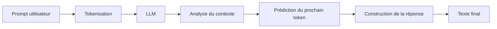

---

## Comment un LLM "réfléchit"

Contrairement à l'humain :

❌ Il ne raisonne pas comme un cerveau humain.

✅ Il prédit statistiquement la suite la plus probable.

---

### Processus interne simplifié

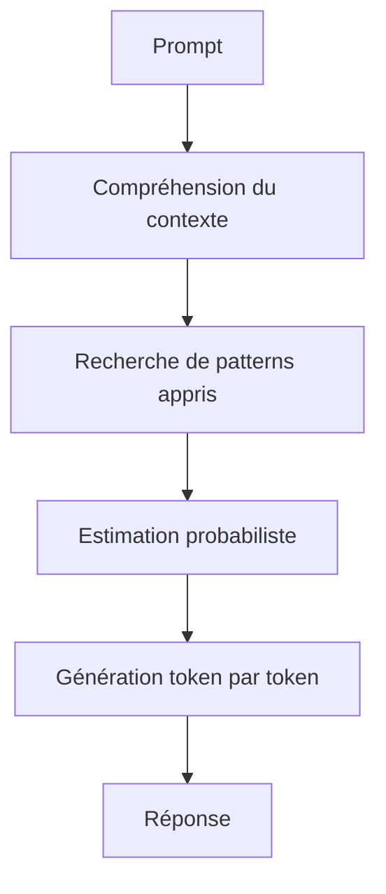

---

## Importance du contexte

Le contexte est la mémoire temporaire du modèle.

```text
Contexte =

Instructions système
+
Conversation précédente
+
Prompt actuel
```

Plus le contexte est clair, meilleure sera la réponse.

---

# 3. Anatomie d'un Prompt

Un prompt performant contient généralement plusieurs composants.

## Structure générale

```text
[ROLE]

[TÂCHE]

[CONTEXTE]

[CONTRAINTES]

[FORMAT DE SORTIE]

[EXEMPLES]
```

---

## Exemple simple

### Mauvais prompt

```text
Parle-moi de Python.
```

---

### Bon prompt

```text
Tu es professeur d'informatique.

Explique le langage Python à un étudiant débutant.

Concentre-toi sur :
- Les variables
- Les fonctions
- Les boucles

Limite la réponse à 500 mots.

Utilise des exemples simples.
```

---

## Décomposition

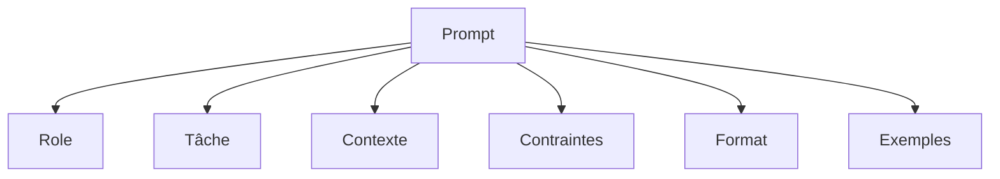

---

# 4. Les Techniques Fondamentales

# 4.1 Zero-Shot Prompting

Le modèle reçoit uniquement l'instruction.

## Exemple

```text
Traduis ce texte en anglais :

Bonjour, comment allez-vous ?
```

---

## Schéma

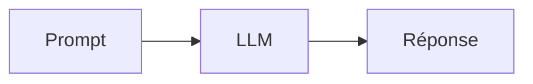

---

## Avantages

- Rapide
- Simple
- Peu coûteux

## Inconvénients

- Résultats parfois variables

---

# 4.2 One-Shot Prompting

Un exemple est fourni.

```text
Exemple :

Chat → Cat
Chien → Dog

Maintenant :

Maison →
```

Réponse :

```text
House
```

---

# 4.3 Few-Shot Prompting

Plusieurs exemples sont fournis.

```text
Exemple 1
Input : Rouge
Output : Red

Exemple 2
Input : Bleu
Output : Blue

Exemple 3
Input : Vert
Output : Green

Input : Jaune
Output :
```

---

## Schéma

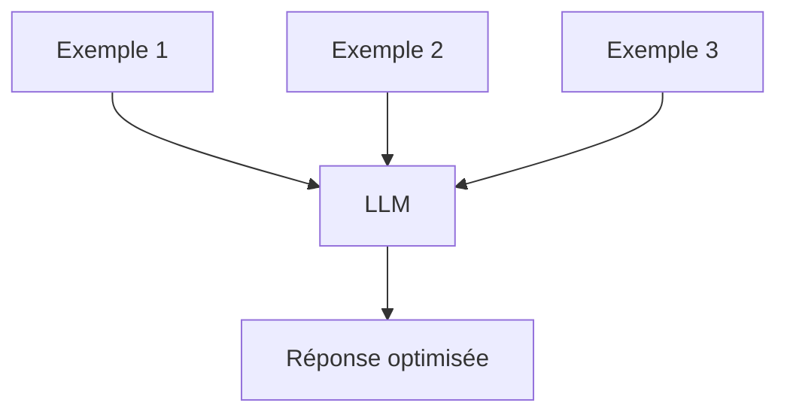

---

# 5. Techniques Avancées

# 5.1 Chain of Thought (CoT)

Le modèle est invité à raisonner étape par étape.

---

## Sans CoT

```text
Combien font 17 × 24 ?
```

---

## Avec CoT

```text
Résous ce problème étape par étape :

17 × 24
```

---

### Schéma

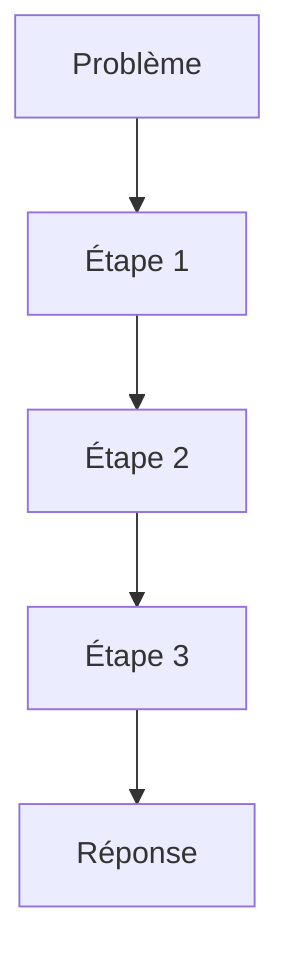

---

## Pourquoi ça fonctionne ?

Le modèle :

- Décompose le problème
- Réduit les erreurs
- Améliore la précision

---

# 5.2 Self-Consistency

Générer plusieurs raisonnements puis choisir le plus cohérent.

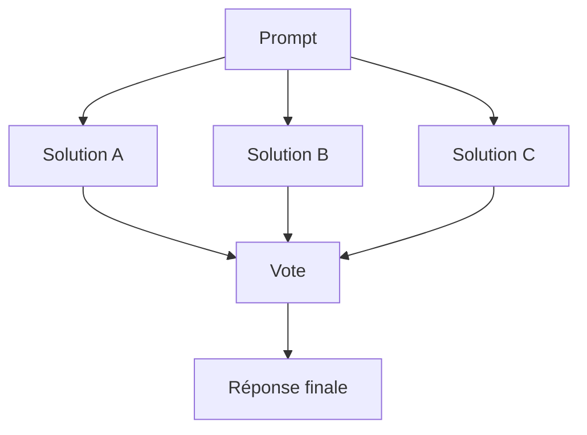

---

# 5.3 Tree of Thoughts (ToT)

Exploration de plusieurs chemins de raisonnement.

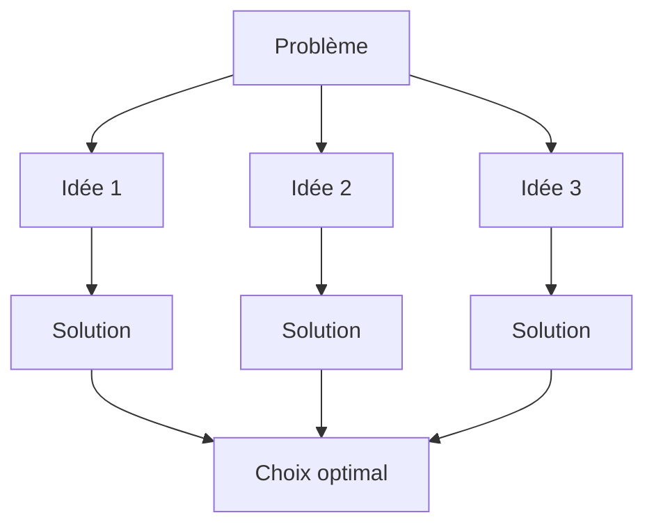

---

# 5.4 ReAct

Reason + Act

Le modèle alterne :

1. Réflexion
2. Action
3. Observation

---

```text
Thought:
Je dois chercher une information.

Action:
Recherche web

Observation:
Résultat trouvé

Thought:
Je peux répondre.
```

---

# 6. Architecture des Prompts Complexes

## Pattern professionnel

```text
ROLE

OBJECTIF

CONTEXTE

DONNÉES

RÈGLES

FORMAT

CRITÈRES DE QUALITÉ
```

---

## Exemple entreprise

```text
Tu es consultant senior en stratégie.

Objectif :
Analyser ce marché.

Contexte :
Entreprise SaaS B2B.

Données :
...

Contraintes :
- Maximum 1000 mots
- Ton professionnel

Format :
SWOT + recommandations

Critères :
Analyse rigoureuse.
```

---

## Architecture visuelle

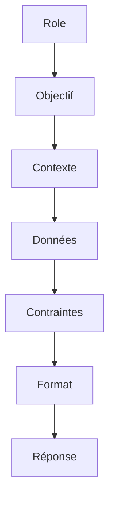

---

# 7. Frameworks de Prompting

# Framework RTF

## Role

Qui est le modèle ?

## Task

Que doit-il faire ?

## Format

Comment répondre ?

---

```text
Role :
Expert marketing

Task :
Créer une campagne

Format :
Tableau
```

---

# Framework CRISPE

## C

Capacity

## R

Role

## I

Insight

## S

Statement

## P

Personality

## E

Experiment

---

# Framework COAST

## Context

## Objective

## Actions

## Scenario

## Task

---

Exemple :

```text
Context :
Entreprise e-commerce

Objective :
Augmenter les ventes

Actions :
Proposer 5 idées

Scenario :
Budget limité

Task :
Créer un plan d'action
```

---

# 8. Évaluation et Optimisation

## Cycle d'amélioration

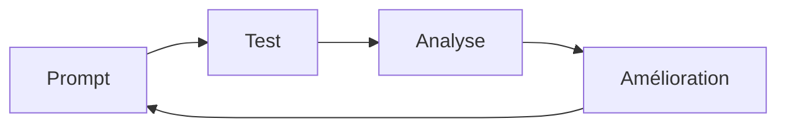

---

## Métriques

### Précision

Le résultat est-il correct ?

### Pertinence

Répond-il à la question ?

### Complétude

Répond-il entièrement ?

### Robustesse

Fonctionne-t-il sur plusieurs cas ?

---

# 9. Cas d'Usage Professionnels

# Développement logiciel

```text
Tu es développeur senior Python.

Analyse ce code.

Identifie :
- Bugs
- Failles de sécurité
- Optimisations

Retourne :
1. Diagnostic
2. Correction
3. Justification
```

---

# Analyse de données

```text
Tu es Data Scientist.

Analyse ce dataset.

Produis :

- Insights
- Corrélations
- Recommandations

Format markdown.
```

---

# Marketing

```text
Tu es expert marketing digital.

Crée une campagne LinkedIn.

Cible :
DSI de PME

Objectif :
Lead generation

Format :
Tableau.
```

---

# Recherche

```text
Agis comme un chercheur universitaire.

Analyse ces publications.

Produis :

- Synthèse
- Consensus
- Désaccords
- Pistes futures
```

---

# 10. Bonnes Pratiques

## 1. Être spécifique

### Mauvais

```text
Écris un article.
```

### Bon

```text
Écris un article de 1000 mots
sur l'IA générative destiné
à des dirigeants de PME.
```

---

## 2. Donner un rôle

```text
Tu es avocat spécialisé
en droit des contrats.
```

---

## 3. Définir le format

```text
Réponds sous forme de tableau.
```

---

## 4. Fournir des exemples

```text
Voici le style attendu :

Exemple :
...
```

---

## 5. Décomposer les tâches

```text
Étape 1 : Analyse

Étape 2 : Synthèse

Étape 3 : Recommandation
```

---

# 11. Anti-Patterns

## Prompt vague

```text
Fais quelque chose sur l'IA.
```

---

## Instructions contradictoires

```text
Sois détaillé.

Réponds en 2 phrases.
```

---

## Trop de contraintes inutiles

```text
500 règles différentes
pour une tâche simple.
```

---

## Absence de contexte

```text
Analyse ceci.
```

Sans fournir le contenu.

---

# Prompt Engineering pour les LLM modernes

## Hiérarchie des instructions

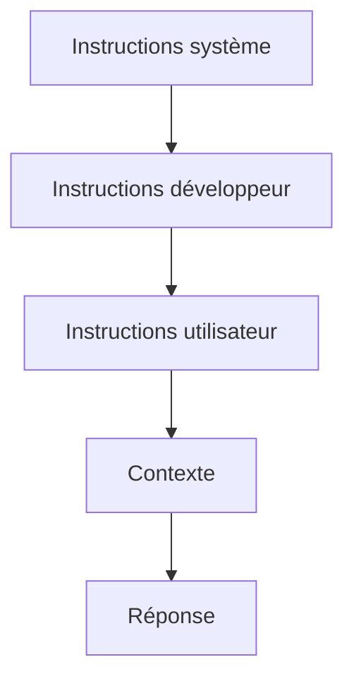

Les niveaux supérieurs ont priorité.

---

# Meta Prompting

Le modèle crée lui-même le meilleur prompt.

Exemple :

```text
Crée le meilleur prompt possible
pour analyser une stratégie
marketing B2B SaaS.
```

---

# Prompt Chaining

Chaînage de plusieurs prompts.


---

# Agentic Prompting

Le modèle agit comme un agent autonome.

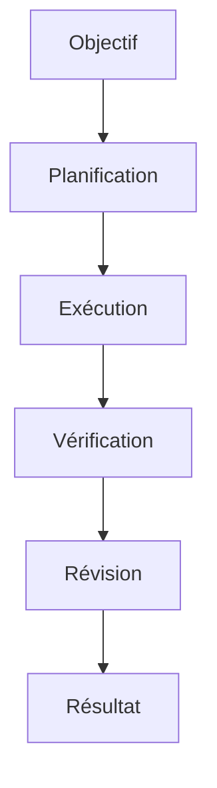

---

# Checklist du Prompt Expert

Avant d'envoyer un prompt :

- [ ] Le rôle est défini
- [ ] L'objectif est clair
- [ ] Le contexte est fourni
- [ ] Les contraintes sont explicites
- [ ] Le format est défini
- [ ] Des exemples sont ajoutés
- [ ] Les critères de qualité sont précisés

---

# Template Universel de Prompt Engineering

```text
# ROLE

Tu es [expert].

# OBJECTIF

Réaliser [tâche].

# CONTEXTE

[Contexte détaillé]

# DONNÉES

[Données disponibles]

# CONTRAINTES

- ...
- ...
- ...

# FORMAT DE SORTIE

[Format exact attendu]

# CRITÈRES DE QUALITÉ

- Précision
- Exhaustivité
- Cohérence

# INSTRUCTIONS SUPPLÉMENTAIRES

Réfléchis étape par étape.

Vérifie tes conclusions avant de répondre.
```

---

# Conclusion

Le Prompt Engineering repose sur un principe simple :

```text
Qualité du résultat
=
Qualité des instructions
```

Les meilleurs prompts combinent :

✓ Contexte riche  
✓ Objectifs explicites  
✓ Contraintes claires  
✓ Exemples pertinents  
✓ Format défini  
✓ Vérification du raisonnement  

À mesure que les modèles deviennent plus puissants, le Prompt Engineering évolue d'un simple art de rédaction vers une véritable discipline d'ingénierie de l'interaction homme-IA.
