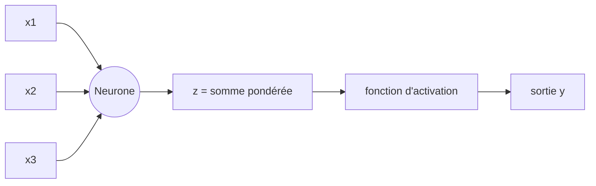
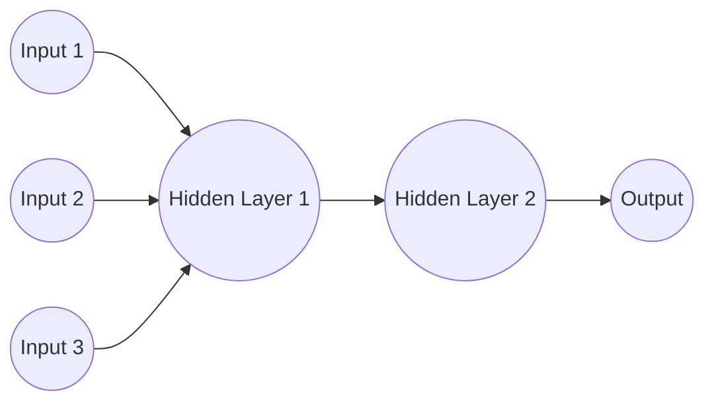
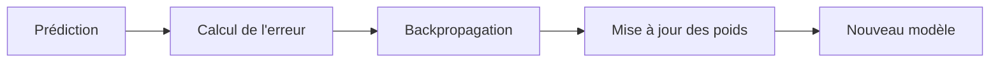
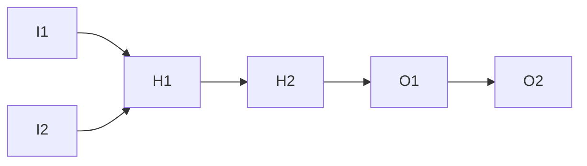
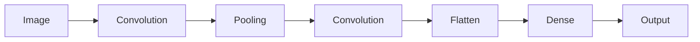
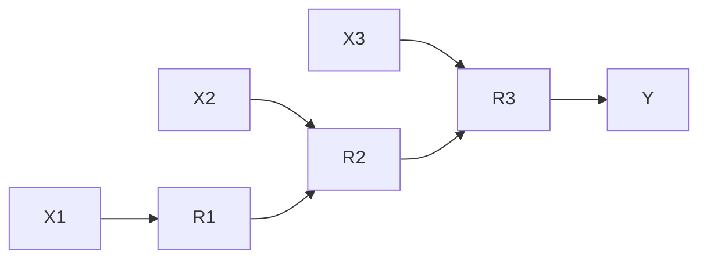
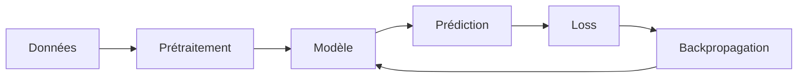

# Tutoriel complet sur les réseaux de neurones

## 1. Introduction

Un **réseau de neurones artificiel** est un modèle de calcul inspiré du cerveau humain. Il est composé d’unités simples appelées **neurones**, organisées en couches, capables d’apprendre des relations complexes à partir de données.

On les utilise notamment pour :

* la reconnaissance d’images
* le traitement du langage naturel
* la prédiction de séries temporelles
* les systèmes de recommandation

---

## 2. Le neurone artificiel

Un neurone artificiel reçoit des entrées, applique des poids, ajoute un biais, puis passe le résultat dans une fonction d’activation.

### Schéma

### Formule mathématique

[
z = \sum_{i=1}^{n} w_i x_i + b
]

[
y = f(z)
]

* (w_i) : poids
* (x_i) : entrées
* (b) : biais
* (f) : fonction d’activation

---

## 3. Les fonctions d’activation

Elles introduisent de la **non-linéarité**, essentielle pour apprendre des relations complexes.

### Exemples

* **Sigmoïde** :
  [
  f(x) = \frac{1}{1 + e^{-x}}
  ]

* **ReLU (Rectified Linear Unit)** :
  [
  f(x) = \max(0, x)
  ]

* **Tanh** :
  [
  f(x) = \tanh(x)
  ]

---

## 4. Architecture d’un réseau de neurones

Un réseau est composé de plusieurs couches :

* **Couche d’entrée**
* **Couches cachées**
* **Couche de sortie**

### Diagramme

---

## 5. Propagation avant (Forward Propagation)

C’est le processus de calcul de la sortie à partir des entrées.

### Étapes

1. Les données entrent dans le réseau
2. Chaque couche applique :

   * somme pondérée
   * biais
   * fonction d’activation
3. On obtient une prédiction finale

---

## 6. Fonction de coût (Loss Function)

Elle mesure l’erreur entre la prédiction et la vérité.

### Exemple : Erreur quadratique moyenne (MSE)

[
L = \frac{1}{n} \sum (y_{vrai} - y_{pred})^2
]

---

## 7. Rétropropagation (Backpropagation)

C’est l’algorithme qui permet au réseau d’apprendre en ajustant les poids.

### Idée principale

On calcule le gradient de l’erreur et on corrige les poids dans le sens qui réduit cette erreur.

### Diagramme

---

## 8. Descente de gradient

C’est la méthode utilisée pour minimiser la fonction de coût.

### Formule

[
w := w - \eta \cdot \frac{\partial L}{\partial w}
]

* ( \eta ) : taux d’apprentissage
* ( L ) : fonction de perte

---

## 9. Types de réseaux de neurones

### 9.1 Perceptron multicouche (MLP)

Réseau classique entièrement connecté.

---

### 9.2 Réseaux convolutifs (CNN)

Utilisés pour les images.

---

### 9.3 Réseaux récurrents (RNN)

Utilisés pour les séquences (texte, séries temporelles).

---

## 10. Problèmes fréquents

### 10.1 Overfitting (surapprentissage)

Le modèle mémorise les données au lieu de généraliser.

Solutions :

* régularisation (L1/L2)
* dropout
* plus de données

### 10.2 Underfitting

Le modèle est trop simple pour apprendre les données.

Solutions :

* augmenter la complexité du réseau
* entraîner plus longtemps

---

## 11. Optimisation moderne

Algorithmes populaires :

* SGD (Stochastic Gradient Descent)
* Adam
* RMSProp

Adam est souvent utilisé car il est stable et rapide.

---

## 12. Pipeline d’apprentissage complet

---

## 13. Résumé

Un réseau de neurones fonctionne comme une chaîne de transformations mathématiques apprenant à :

* transformer des entrées
* minimiser une erreur
* ajuster ses paramètres automatiquement

---

## 14. Pour aller plus loin

Sujets avancés :

* Transformers
* Attention mechanism
* Deep Reinforcement Learning
* Autoencoders
* GANs (Generative Adversarial Networks)
