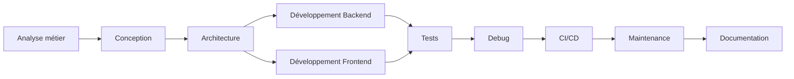
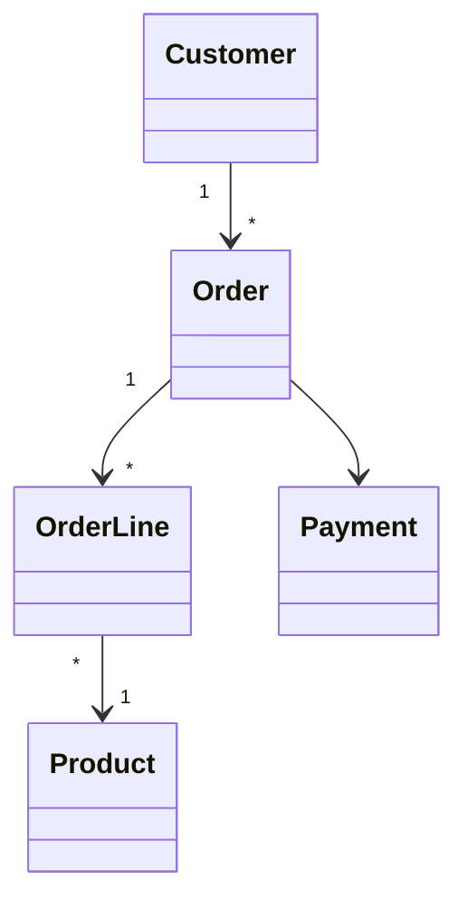
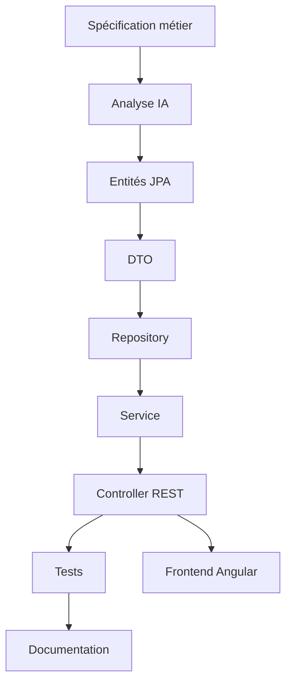
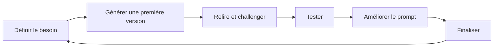

Oui. Pour un développeur **Fullstack Java + Angular**, l'IA n'est pas seulement un assistant qui génère du code. Elle peut intervenir **dans tout le cycle de développement** : conception, architecture, développement, tests, debugging, documentation, DevOps, sécurité et maintenance.

Le plus grand changement est qu'un développeur passe progressivement d'un rôle de **codeur** à un rôle de **pilote de l'IA**.

---

# Le cycle complet d'un projet avec l'IA



À **chaque étape**, l'IA apporte des gains importants.

---

# 1. Comprendre le besoin métier

Avant même de coder.

Exemple :

Le Product Owner écrit :

> Les utilisateurs peuvent créer des commandes. Une commande peut être validée, annulée ou livrée.

L'IA peut produire automatiquement :

* les User Stories
* les cas d'utilisation
* les règles métier
* les scénarios de tests
* les diagrammes UML

Exemple de prompt :

> Tu es architecte logiciel.
> Analyse cette spécification et liste :
>
> * les entités
> * les relations
> * les règles métier
> * les API REST nécessaires.

---

Réponse attendue :

```
Entities

Customer

Order

Product

OrderLine

Payment
```

Puis

```
Rules

Une commande validée ne peut plus être modifiée.

Une commande annulée rembourse automatiquement le paiement.

Une commande doit contenir au moins une ligne.
```

Avant même d'écrire une ligne de Java, on possède déjà une vision claire.

---

# 2. Générer le modèle de données

À partir des besoins.

Exemple :

Prompt

> Génère les entités Spring Boot JPA pour ce domaine.

L'IA produit :

```java
@Entity
public class Order {

    @Id
    @GeneratedValue
    private Long id;

    private LocalDateTime createdAt;

    @Enumerated(EnumType.STRING)
    private OrderStatus status;

    @ManyToOne
    private Customer customer;

}
```

Puis

```
Customer

Product

OrderLine

Invoice

Payment
```

En quelques secondes.

---

# 3. Génération des diagrammes UML

L'IA produit automatiquement des diagrammes Mermaid.

Exemple :



Très utile lors des revues d'architecture.

---

# 4. Générer l'architecture Spring Boot

Prompt

> Génère une architecture hexagonale Spring Boot.

Résultat :

```
controller/

service/

domain/

repository/

entity/

mapper/

dto/

config/

exception/

security/
```

Puis les interfaces :

```
OrderService

OrderRepository

OrderMapper

OrderController
```

---

# 5. Génération des DTO

L'IA produit :

```java
public record OrderDto(

Long id,

String customer,

LocalDate date,

List<OrderLineDto> lines

){}
```

Puis les mappers MapStruct.

---

# 6. Génération des Controllers REST

Exemple :

```java
@RestController
@RequestMapping("/orders")
public class OrderController {

@GetMapping

@PostMapping

@DeleteMapping

@PutMapping

}
```

Avec :

* Swagger
* Validation
* gestion des erreurs

---

# 7. Générer les Repository JPA

Exemple

```java
public interface OrderRepository extends JpaRepository<Order,Long>{

List<Order> findByStatus(OrderStatus status);

}
```

Puis les Specifications.

Puis Criteria API.

Puis QueryDSL.

---

# 8. Générer la logique métier

L'IA sait produire un service complet.

Avant

```
Valider une commande

Calculer le montant

Appliquer une remise

Déclencher un paiement

Envoyer un mail

Créer une facture
```

Après

```java
@Transactional
public Order validate(Long id){

...

}
```

Avec toutes les règles métier.

---

# 9. Angular

L'IA excelle.

Exemple :

Prompt

> Génère une application Angular standalone avec Material.

Elle produit :

```
pages/

components/

services/

guards/

interceptors/

signals/

models/

pipes/
```

Puis :

```
OrderComponent

OrderService

OrderModel

OrderResolver

OrderGuard
```

---

# 10. Générer les composants Angular

Exemple

```typescript
@Component({

standalone:true

})
```

Puis automatiquement

HTML

CSS

TypeScript

Tests

---

# 11. Générer les formulaires

Prompt

> Génère un formulaire Angular Reactive Forms avec validation.

Résultat :

```
Nom obligatoire

Email valide

Téléphone optionnel

Date obligatoire
```

Puis

```
Validators.required

Validators.email

Validators.pattern()
```

---

# 12. Générer les appels HTTP

```typescript
getOrders(){

return this.http.get<Order[]>("/api/orders");

}
```

Puis

```
POST

PUT

DELETE

PATCH
```

---

# 13. Génération des tests unitaires Java

Exemple

```java
@Test

void should_validate_order(){

}
```

Puis

Mockito

JUnit

AssertJ

MockMvc

---

# 14. Génération des tests Angular

L'IA produit

```
Karma

Jasmine

Jest

Cypress

Playwright
```

---

# 15. Génération de jeux de données

Prompt

> Génère 500 clients fictifs.

Résultat

```
SQL

CSV

JSON

Liquibase

Flyway
```

Très utile.

---

# 16. Débogage intelligent

Tu colles simplement une stacktrace.

Exemple

```
LazyInitializationException
```

L'IA explique :

Pourquoi

Où

Comment corriger

Quelles alternatives existent

---

# 17. Analyse de performances

Elle peut analyser :

```
EXPLAIN SQL

Hibernate

GC

Heap

CPU

Memory
```

Puis proposer :

```
Index

Pagination

Cache

Batch

Fetch Join
```

---

# 18. Sécurité

L'IA détecte :

```
Injection SQL

XSS

CSRF

JWT mal configuré

Secrets Git

Passwords
```

Puis propose les corrections.

---

# 19. Docker

Prompt

> Dockerise cette application.

Résultat

```
Dockerfile

docker-compose.yml

nginx

postgres

redis

rabbitmq
```

---

# 20. Kubernetes

Elle génère :

```
Deployment

Ingress

ConfigMap

Secret

Service

HorizontalPodAutoscaler
```

---

# 21. Pipeline GitLab

Exemple

```yaml
build

test

sonarqube

docker

deploy
```

---

# 22. Documentation automatique

À partir du code.

Elle génère :

```
README

Swagger

Architecture

Diagrammes

Guide utilisateur
```

---

# 23. Migration de versions

Très utile.

Exemple

```
Java 17 -> Java 21

Spring Boot 2 -> 3

Angular 15 -> 20
```

L'IA identifie :

API supprimées

Imports

Annotations

Configuration

---

# 24. Refactoring

Exemple

Avant

```
Classe de 1800 lignes
```

Après

```
12 classes

Interfaces

Services

Strategy

Factory

Facade
```

Elle applique automatiquement des patrons de conception.

---

# 25. Revue de code

Tu colles une Pull Request.

Elle détecte :

* duplication
* complexité cyclomatique
* violation des principes SOLID
* dette technique
* problèmes de lisibilité
* risques de concurrence (thread safety)
* manque de tests

Elle propose ensuite un plan d'amélioration argumenté.

---

# Cas d'usage avancé : construire un module complet

Imaginons la fonctionnalité **Gestion des commandes**.



En pratique, tu peux guider l'IA étape par étape :

1. Décrire le besoin métier.
2. Générer les entités et leurs relations.
3. Créer les migrations SQL.
4. Générer les DTO et les mappers.
5. Implémenter les repositories et services.
6. Exposer les API REST documentées avec OpenAPI.
7. Générer le client Angular (services, modèles, composants).
8. Produire les tests unitaires, d'intégration et end-to-end.
9. Générer la documentation technique et les diagrammes.

L'intervention humaine reste essentielle pour valider les choix d'architecture, les règles métier et la qualité du code.

# Les meilleurs prompts pour un développeur Java/Angular

* **Architecte** : « Agis comme un architecte logiciel senior et propose une architecture hexagonale adaptée à ce besoin, avec les compromis de chaque choix. »
* **Backend** : « Génère une API Spring Boot 3.5 avec Java 21, validation Bean Validation, MapStruct, Spring Data JPA, gestion centralisée des exceptions et documentation OpenAPI. »
* **Frontend** : « Crée une application Angular standalone utilisant les Signals, les Reactive Forms, Angular Material et des composants réutilisables. »
* **Tests** : « Écris des tests JUnit 5 et Mockito couvrant les cas nominaux, les cas limites et les erreurs, avec une couverture d'au moins 90 %. »
* **Performance** : « Analyse ce code et identifie les problèmes de performance, les accès inutiles à la base, les allocations mémoire excessives et les optimisations possibles. »
* **Revue de code** : « Réalise une revue de code comme un Tech Lead : lisibilité, SOLID, sécurité, performances, maintenabilité et conformité aux bonnes pratiques Java/Angular. »

## Une méthode de travail efficace avec l'IA

Pour obtenir des résultats de grande qualité, il est utile de suivre un cycle itératif :



L'idée n'est pas de demander « génère-moi toute l'application », mais de travailler par incréments : une fonctionnalité, un service, un composant ou une API à la fois. Cela permet de conserver la maîtrise de l'architecture, d'obtenir un code plus cohérent et de réduire les erreurs.

En maîtrisant cette approche, un développeur Fullstack Java/Angular peut utiliser l'IA comme un véritable **pair programmer**, capable d'accélérer la production, d'améliorer la qualité du code, de faciliter la documentation et les tests, tout en laissant au développeur les décisions de conception, les arbitrages techniques et la validation finale.
