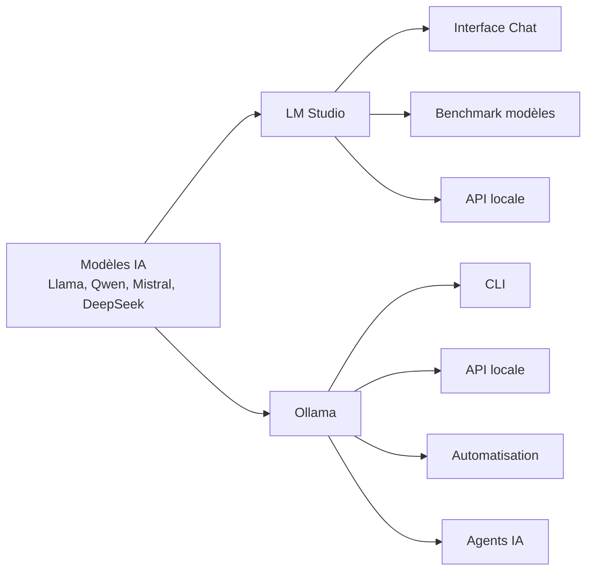
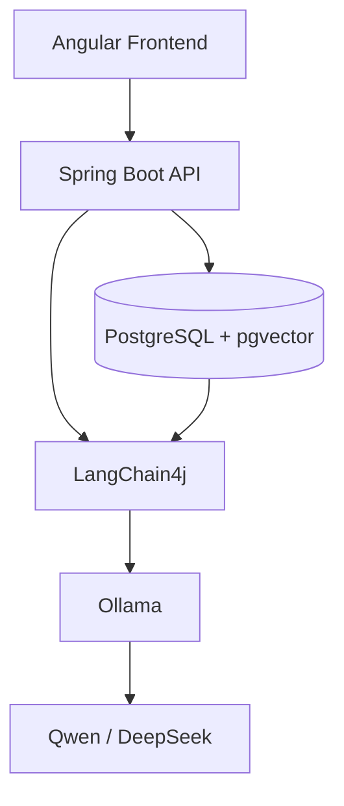

LM Studio et Ollama ont le même objectif général : **faire tourner des modèles d'IA localement sur votre machine**, mais leur philosophie est différente.

En résumé :

* **LM Studio = interface graphique pour tester et utiliser des LLM locaux**
* **Ollama = moteur en ligne de commande pour intégrer des LLM locaux dans des applications et workflows**

---

## Vue d'ensemble



---

# 1) LM Studio : le "ChatGPT local"

LM Studio est pensé pour l'utilisateur qui veut :

* télécharger un modèle ;
* discuter avec lui ;
* tester ses performances ;
* comparer plusieurs modèles.

Exemple :

Vous installez :

```
Qwen3-14B
```

Vous ouvrez LM Studio :

```
Utilisateur :
Explique-moi ce code Java

IA :
Voici l'explication...
```

L'interface ressemble beaucoup à une application ChatGPT.

---

## Fonctionnement LM Studio

```text
┌─────────────────────┐
│      LM Studio      │
│                     │
│  Chat Interface     │
│  Model Manager      │
│  API Server         │
└─────────┬───────────┘
          |
          |
┌─────────▼─────────┐
│  Llama / Qwen     │
│  Mistral / DeepSeek│
└───────────────────┘
```

Il utilise principalement des modèles au format :

* GGUF
* quantifiés pour tourner sur PC

---

# 2) Ollama : le Docker des modèles IA

Ollama est davantage pensé pour les développeurs.

Son approche :

```bash
ollama run qwen3
```

et le modèle démarre.

Exemple :

```bash
ollama pull llama3

ollama run llama3
```

Puis :

```bash
curl http://localhost:11434/api/chat
```

Votre application peut appeler le modèle.

---

Architecture Ollama :

```text
Application Spring Boot
          |
          |
          v
  http://localhost:11434
          |
          |
       Ollama
          |
          |
    Qwen / Llama
```

---

# Comparaison complète

| Critère                | LM Studio    | Ollama        |
| ---------------------- | ------------ | ------------- |
| Interface graphique    | ✅ Excellente | ❌ Non         |
| Ligne de commande      | ⚠️ Limitée   | ✅ Excellente  |
| Installation           | Très simple  | Très simple   |
| Gestion modèles        | ⭐⭐⭐⭐⭐        | ⭐⭐⭐⭐          |
| API locale             | ✅ Oui        | ✅ Oui         |
| Automatisation         | ⚠️ Moyenne   | ⭐⭐⭐⭐⭐         |
| Scripts CI/CD          | ❌ Peu adapté | ✅ Très adapté |
| Agents IA              | Possible     | Excellent     |
| Développement logiciel | Moyen        | Excellent     |
| Utilisation serveur    | Moyen        | Excellent     |

---

# Exemple concret avec Spring Boot

## Avec LM Studio

Vous démarrez :

```
LM Studio
    |
    └── Serveur API
          |
          └── localhost:1234
```

Votre application :

```java
WebClient.post()
    .uri("http://localhost:1234/v1/chat/completions")
```

---

## Avec Ollama

Vous démarrez :

```bash
ollama serve
```

Votre application :

```java
WebClient.post()
    .uri("http://localhost:11434/api/chat")
```

---

# Gestion des modèles

## LM Studio

Vous cherchez dans une interface :

```
Models

✓ Qwen3-8B
✓ DeepSeek-R1
✓ Mistral-7B
```

Vous cliquez → télécharger.

---

## Ollama

Vous utilisez :

```bash
ollama pull qwen3

ollama pull mistral

ollama list
```

Exemple :

```bash
NAME              SIZE

qwen3:14b         9 GB
llama3:8b         5 GB
deepseek-r1       8 GB
```

---

# Pour un développeur Fullstack Java Angular + IA agentique

Vu vos sujets récents (Claude Code, OpenCode, agents IA, RAG, automatisation), Ollama est souvent plus intéressant.

Une stack moderne :



Exemple :

* Angular → interface chatbot
* Spring Boot → API métier
* LangChain4j → orchestration IA
* Ollama → modèle local
* PostgreSQL pgvector → mémoire RAG

---

# Quand choisir lequel ?

## Choisissez LM Studio si :

✅ Vous voulez découvrir les LLM locaux
✅ Vous aimez une interface graphique
✅ Vous voulez comparer des modèles
✅ Vous faites des tests ponctuels
✅ Vous n'avez pas envie de configurer

---

## Choisissez Ollama si :

✅ Vous développez des applications IA
✅ Vous créez des agents autonomes
✅ Vous utilisez OpenCode / LangChain / LangGraph
✅ Vous voulez automatiser
✅ Vous voulez intégrer l'IA dans Spring Boot

---

## Pour votre profil, la combinaison idéale :

```
LM Studio
    ↓
Tester les modèles
Choisir le meilleur LLM

Ollama
    ↓
Industrialiser
Créer des agents
Brancher vos applications
```

Un workflow très utilisé en 2026 chez les développeurs IA est :

**LM Studio pour le laboratoire → Ollama pour la production locale → OpenCode/Claude Code pour l'agent de développement.**
