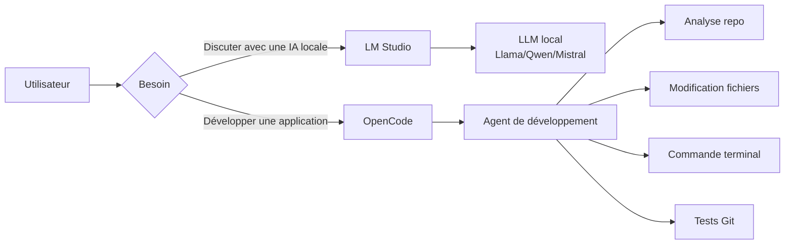
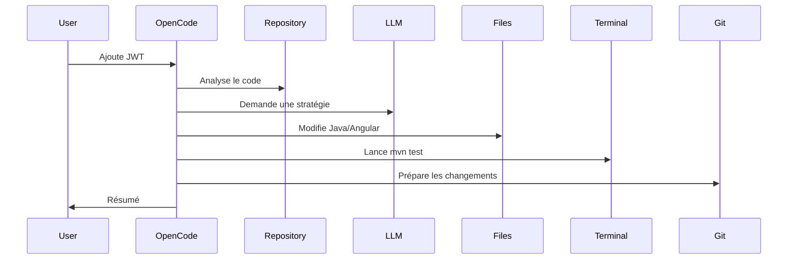
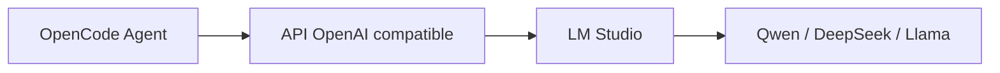

La différence principale est que **LM Studio et OpenCode ne jouent pas dans la même catégorie**.

* **LM Studio = un moteur pour faire tourner des modèles IA localement**
* **OpenCode = un agent IA pour développer du code dans un projet**

Ils peuvent d'ailleurs fonctionner ensemble. ([OpenCode][1])

---

## Vue simple



---

# 1) LM Studio : faire tourner un cerveau IA

LM Studio est comparable à un **ChatGPT local**.

Son rôle :

* télécharger des modèles ;
* les exécuter sur votre GPU/CPU ;
* exposer une API locale ;
* tester différents LLM.

Exemple :

Vous téléchargez :

```
Qwen3-14B
```

Puis vous discutez :

```
Vous :
Explique-moi ce code Spring Boot

LM Studio :
Voici l'analyse...
```

Architecture :

```text
Votre PC
 |
 | 
 +-- LM Studio
        |
        +-- Qwen
        +-- Llama
        +-- Mistral
```

LM Studio ne connaît pas votre projet.
Il ne sait pas :

* lire votre repository Git ;
* créer une branche ;
* modifier 50 fichiers ;
* lancer Maven ;
* corriger les tests.

Il fournit seulement le modèle IA.

---

# 2) OpenCode : un développeur IA autonome

OpenCode est un **AI coding agent** open source. Il fonctionne dans votre terminal/IDE et peut travailler directement avec votre code. ([OpenCode][1])

Exemple :

Vous êtes dans :

```
mon-projet-spring-angular/
```

Vous demandez :

> Ajoute une authentification JWT avec refresh token

OpenCode peut :



Il agit comme un développeur junior/senior assisté.

Il peut :

✅ lire le projet
✅ comprendre l'architecture
✅ modifier les fichiers
✅ créer des composants Angular
✅ écrire des services Spring Boot
✅ lancer les tests
✅ analyser les erreurs
✅ travailler avec Git

([GitHub][2])

---

# Comparaison directe

|                               | LM Studio               | OpenCode                    |
| ----------------------------- | ----------------------- | --------------------------- |
| Catégorie                     | LLM local               | Agent IA développeur        |
| Objectif                      | Faire tourner un modèle | Construire/modifier du code |
| Interface                     | Chat graphique          | Terminal/IDE                |
| Comprend un repo Git          | ❌                       | ✅                           |
| Modifie des fichiers          | ❌                       | ✅                           |
| Lance des commandes           | ❌                       | ✅                           |
| Utilise plusieurs agents      | ❌                       | ✅                           |
| Peut utiliser un modèle local | ✅                       | ✅                           |
| Remplace Claude Code          | ❌                       | ✅                           |

---

# Comment ils peuvent fonctionner ensemble ?

C'est là que ça devient intéressant.

Vous pouvez avoir :



Exemple :

* OpenCode = le développeur
* LM Studio = le cerveau local

Vous demandez :

```
OpenCode :
Crée un CRUD Spring Boot Customer

        |
        v

LM Studio :
raisonne avec Qwen local

        |
        v

OpenCode :
modifie les fichiers
lance les tests
```

---

# Dans votre contexte Fullstack Java Angular

Votre stack :

* Java 21
* Spring Boot
* Angular 21
* PostgreSQL
* Docker
* AWS
* GitLab CI

Une stack IA locale intéressante :

```
                 ┌──────────────┐
                 │   OpenCode   │
                 │ Agent coding │
                 └──────┬───────┘
                        |
                        |
                 ┌──────▼───────┐
                 │  LM Studio   │
                 │  Qwen / Llama│
                 └──────┬───────┘
                        |
             ┌──────────▼──────────┐
             │     GPU local       │
             └─────────────────────┘
```

Cas d'usage :

### Génération de backend

Prompt :

```
Analyse mon architecture Spring Boot.
Ajoute un module paiement avec :
- Entity
- Repository
- Service
- Controller
- Tests
```

---

### Refactoring

```
Analyse ce service Java.
Applique les principes SOLID.
Réduis la complexité.
Ajoute les tests unitaires.
```

---

### Documentation

```
Génère le README technique.
Explique l'architecture microservices.
Crée les diagrammes Mermaid.
```

---

# OpenCode vs Claude Code vs Codex

Dans l'écosystème agentique actuel :

| Outil        | Positionnement                        |
| ------------ | ------------------------------------- |
| Claude Code  | Agent très puissant orienté Anthropic |
| OpenAI Codex | Agent orienté modèles OpenAI          |
| OpenCode     | Agent open source multi-modèles       |
| LM Studio    | Serveur de modèles locaux             |

OpenCode se distingue surtout par son approche **provider-agnostic** : il peut utiliser différents fournisseurs et même des modèles locaux. ([GitHub][2])

---

## Mon conseil pour votre profil

Vu que vous explorez :

* Claude Code,
* agents IA,
* skills,
* automatisation,
* projets Spring Boot/Angular,

je ferais :

```
Développement quotidien :
Claude Code ou OpenCode
        |
        |
Modèle puissant :
Claude / GPT

Expérimentation locale :
LM Studio
        |
        |
Qwen / DeepSeek
```

LM Studio est votre **laboratoire de modèles**.
OpenCode est votre **collaborateur développeur IA**.

[1]: https://opencode.ai/?utm_source=chatgpt.com "OpenCode | The open source AI coding agent"
[2]: https://github.com/sst/opencode?utm_source=chatgpt.com "GitHub - anomalyco/opencode: The open source coding agent. · GitHub"
