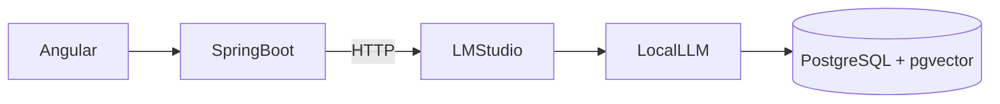

LM Studio est une application de bureau qui permet de **télécharger, exécuter et utiliser des modèles de langage (LLM) localement sur votre ordinateur**, sans dépendre d'une API cloud comme ChatGPT ou Claude.


## À quoi sert LM Studio ?

### 1. Exécuter des modèles d'IA en local

Vous pouvez télécharger et lancer des modèles comme :

* Llama 3
* Qwen
* Mistral
* Gemma
* DeepSeek-R1

Exemple : vous pouvez discuter avec un modèle directement sur votre PC, même sans connexion Internet.

---

### 2. Préserver la confidentialité des données

Toutes les requêtes restent sur votre machine :

```text
Votre application
      ↓
LM Studio
      ↓
Modèle local
```

Aucune donnée n'est envoyée vers des serveurs externes.

C'est particulièrement utile si vous travaillez sur :

* du code propriétaire ;
* des documents confidentiels ;
* des données d'entreprise.

---

### 3. Fournir une API locale compatible OpenAI

LM Studio peut démarrer un serveur local :

```text
http://localhost:1234/v1
```

Votre application peut alors appeler le modèle comme si elle utilisait l'API OpenAI :

```java
POST http://localhost:1234/v1/chat/completions
```

Par exemple, une application Spring Boot peut consommer un LLM local sans payer d'API externe.

---

### 4. Tester plusieurs modèles facilement

Vous pouvez comparer rapidement différents modèles :

```text
Qwen3-8B      → très bon rapport qualité/vitesse
Mistral-7B    → rapide et léger
DeepSeek-R1   → excellent raisonnement
Llama 3.3     → très polyvalent
```

Idéal pour l'expérimentation et le prototypage.

---

### 5. Développer des applications IA locales

Pour un développeur Java/Angular comme vous, LM Studio peut servir à créer :

* un assistant de génération de code ;
* un chatbot interne d'entreprise ;
* un système RAG sur vos documents ;
* un copilote pour vos projets Spring Boot ;
* un agent autonome connecté à vos outils.

Architecture typique :



---

## LM Studio vs Ollama

| Critère                     | LM Studio     | Ollama            |
| --------------------------- | ------------- | ----------------- |
| Interface graphique         | ✅ Oui         | ❌ Non             |
| Téléchargement de modèles   | ✅ Très simple | ✅ Simple          |
| API locale                  | ✅ Oui         | ✅ Oui             |
| Gestion avancée des modèles | ✅ Oui         | ⚠️ Plus technique |
| Automatisation/CLI          | ⚠️ Limitée    | ✅ Excellente      |
| Utilisation avec agents IA  | ✅ Possible    | ✅ Excellente      |

---

## Quand utiliser LM Studio ?

**Choisissez LM Studio si :**

* vous débutez avec les LLM locaux ;
* vous voulez une interface graphique simple ;
* vous souhaitez tester rapidement plusieurs modèles ;
* vous développez un prototype IA sur votre PC.

**Choisissez Ollama si :**

* vous faites beaucoup d'automatisation ;
* vous développez des agents IA ou des workflows DevOps ;
* vous aimez travailler en ligne de commande ;
* vous intégrez les modèles dans des scripts et applications.

Pour votre profil de développeur Fullstack Java/Angular, une approche très efficace est souvent :

```text
LM Studio → exploration et benchmarking des modèles
Ollama    → intégration dans vos applications et agents IA
```

Les deux peuvent même être installés simultanément sur la même machine.
