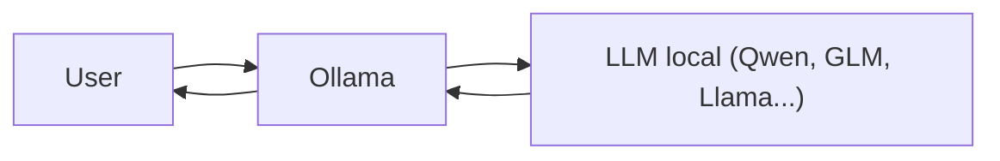
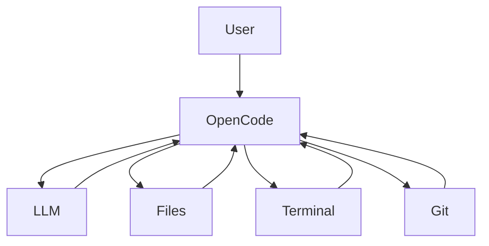
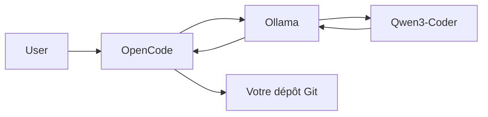

## Vue d'ensemble

OpenCode et Ollama sont complémentaires mais n'ont pas du tout le même rôle.

* **Ollama** = moteur d'exécution de modèles IA en local
* **OpenCode** = agent de développement qui utilise un LLM pour coder, modifier des fichiers et exécuter des commandes

On peut d'ailleurs utiliser **OpenCode avec Ollama**.

---

## Analogie simple

Imagine un atelier de menuiserie :

* **Ollama** = le moteur électrique qui alimente les machines
* **OpenCode** = l'ouvrier qui prend des décisions, utilise les outils et construit le meuble

L'un fournit l'intelligence du modèle, l'autre l'orchestre pour accomplir des tâches de développement.

---

## Ollama

### Rôle

Permet de télécharger et d'exécuter des modèles de langage localement :

* GLM-5
* Qwen3
* Gemma
* Llama
* DeepSeek
* Mistral
* etc.

### Architecture



### Ce qu'Ollama sait faire

✅ Exposer une API locale (`localhost:11434`)

✅ Télécharger des modèles

✅ Gérer le chargement mémoire des modèles

✅ Exécuter des inférences

### Ce qu'Ollama ne fait pas

❌ Modifier des fichiers

❌ Créer des branches Git

❌ Exécuter des commandes shell de manière autonome

❌ Agir comme un agent de développement

---

## OpenCode

### Rôle

OpenCode est un agent de développement dans le terminal capable de :

* lire le code d'un projet ;
* modifier des fichiers ;
* lancer des commandes ;
* créer des commits ;
* raisonner sur plusieurs étapes ;
* utiliser différents fournisseurs de modèles.

### Architecture



---

## Ce qu'OpenCode sait faire

✅ Explorer un dépôt Git

✅ Générer du code

✅ Refactoriser

✅ Exécuter des tests

✅ Créer des commits

✅ Utiliser plusieurs modèles :

* OpenAI
* Anthropic
* Gemini
* Ollama
* OpenRouter
* modèles locaux

---

## Ce qu'OpenCode ne fait pas

❌ Héberger des modèles

❌ Télécharger des LLM

❌ Fournir un moteur d'inférence

Il dépend d'un fournisseur de modèles.

---

# Utilisation ensemble

C'est souvent une excellente combinaison.



Exemple :

```bash
# Lancer Ollama
ollama serve

# Télécharger un modèle
ollama pull qwen3-coder:30b

# Configurer OpenCode
provider = "ollama"
model = "qwen3-coder:30b"

# Démarrer l'agent
opencode
```

---

# Cas d'usage pour un développeur Java/Angular

### Ollama seul

```text
Question → Modèle local → Réponse
```

Exemple :

* expliquer une erreur Spring Boot ;
* générer une requête SQL ;
* écrire une regex.

---

### OpenCode + Ollama

```text
Demande :
"Ajoute Redis dans mon microservice,
mets à jour le Docker Compose,
crée les tests et le README."

↓

OpenCode :
1. analyse le dépôt
2. modifie plusieurs fichiers
3. lance les tests
4. corrige les erreurs
5. propose un commit
```

---

# Comparatif

| Critère                                   | Ollama | OpenCode |
| ----------------------------------------- | ------ | -------- |
| Exécute un LLM local                      | ✅      | ❌        |
| Télécharge des modèles                    | ✅      | ❌        |
| API locale                                | ✅      | ❌        |
| Modifie du code                           | ❌      | ✅        |
| Exécute des commandes terminal            | ❌      | ✅        |
| Manipule Git                              | ❌      | ✅        |
| Fonctionne avec plusieurs fournisseurs IA | ❌      | ✅        |
| Peut utiliser Ollama                      | —      | ✅        |

---

# Pour ton profil de développeur Fullstack Java/Angular

Je te recommande :

```text
OpenCode (agent)
        ↓
Ollama (runtime local)
        ↓
Qwen3-Coder ou GLM-5.2
        ↓
Projet Spring Boot + Angular
```

Tu obtiens :

* un environnement 100 % local ;
* pas d'envoi de code vers un cloud externe ;
* des coûts quasi nuls après téléchargement des modèles ;
* un agent capable de coder, refactoriser et automatiser de nombreuses tâches sur tes projets Java, Angular et AWS.
