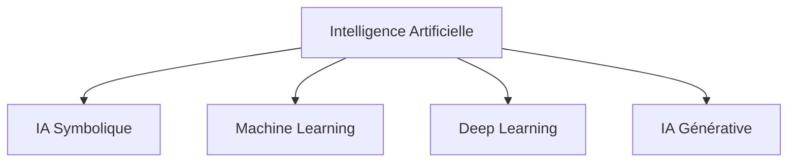
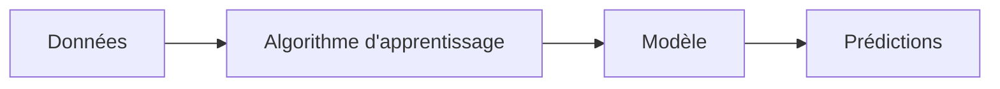
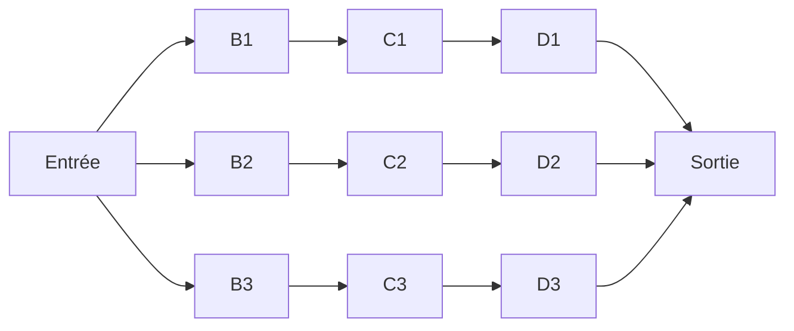
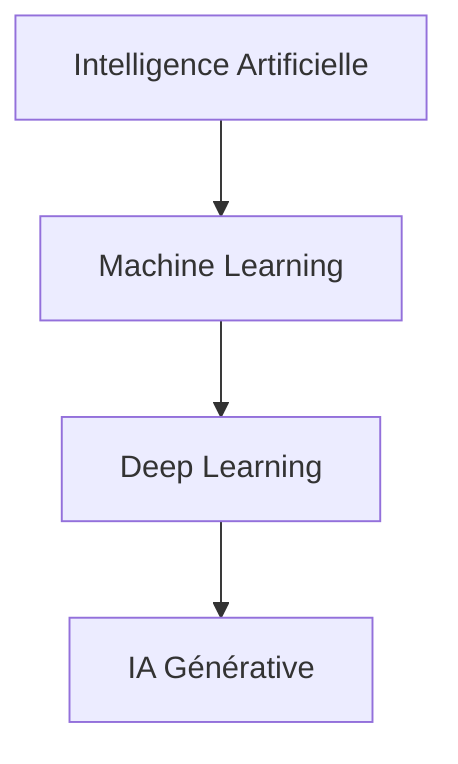
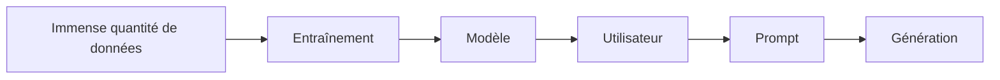
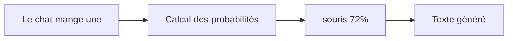
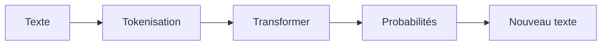
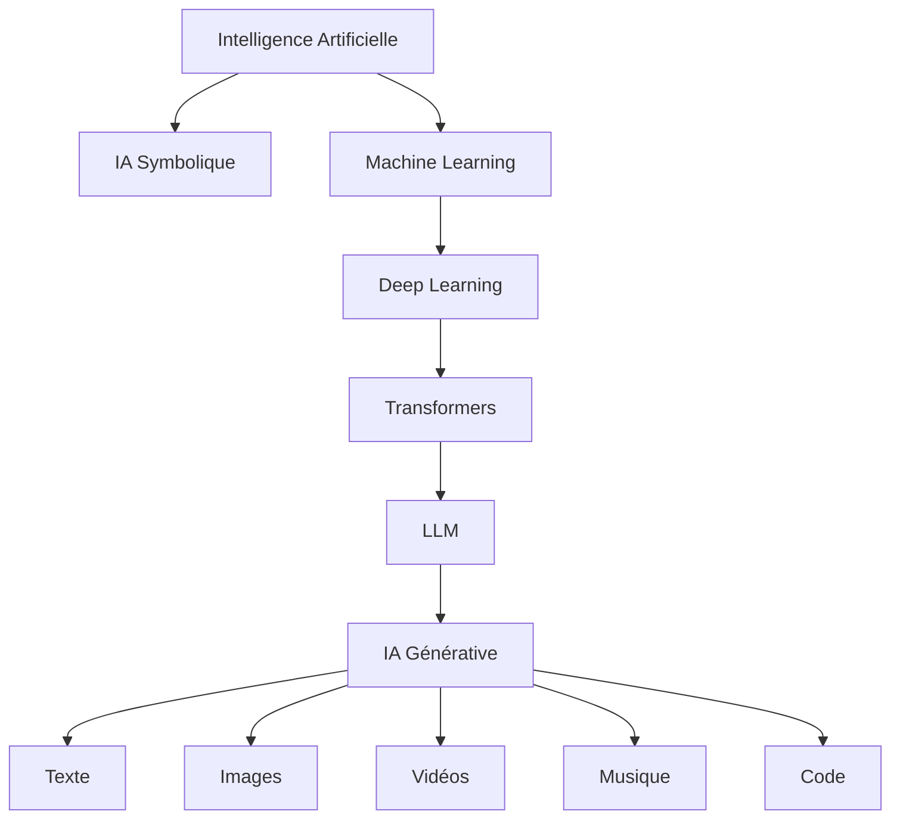

# Tutoriel complet : Comprendre l'Intelligence Artificielle et les IA génératives

> **Objectif :** À la fin de ce tutoriel, vous comprendrez :
>
> * ce qu'est l'Intelligence Artificielle (IA),
> * les différents types d'IA,
> * le fonctionnement des IA génératives comme ChatGPT,
> * leurs applications,
> * leurs limites,
> * les concepts importants à connaître.

---

# Chapitre 1 – Qu'est-ce que l'Intelligence Artificielle ?

## Définition

L'**Intelligence Artificielle (IA)** est une discipline de l'informatique qui consiste à créer des systèmes capables d'effectuer des tâches qui nécessitent normalement une intelligence humaine.

Ces tâches incluent par exemple :

* reconnaître des objets
* comprendre un texte
* traduire une langue
* conduire une voiture
* jouer aux échecs
* diagnostiquer une maladie
* écrire du texte
* créer des images

L'objectif n'est pas forcément de reproduire exactement le cerveau humain, mais de résoudre des problèmes complexes de manière automatique.

---

# Une vision globale



L'IA générative n'est donc **qu'une branche** de l'intelligence artificielle.

---

# Chapitre 2 – Les grandes familles d'IA

## 1. IA Symbolique

C'est la première forme d'IA (années 1950-1980).

Elle fonctionne grâce à des règles écrites par des humains.

Exemple :

```
SI température > 39°C
ET toux
ALORS suspicion de grippe
```

On appelle cela un **système expert**.

### Avantages

* très explicable
* facile à contrôler

### Inconvénients

* impossible d'écrire des millions de règles
* peu adaptable

---

## 2. Machine Learning

Le Machine Learning (apprentissage automatique) consiste à **laisser l'ordinateur apprendre les règles lui-même** à partir des données.

Au lieu d'écrire :

```
SI ...
ALORS ...
```

On fournit des milliers d'exemples.

Exemple :

```
Photo -> Chat

Photo -> Chien

Photo -> Chat

Photo -> Chat

Photo -> Chien
```

L'ordinateur découvre progressivement les caractéristiques qui distinguent un chat d'un chien.

---

### Schéma



---

# 3. Deep Learning

Le Deep Learning est un sous-domaine du Machine Learning.

Il utilise des **réseaux de neurones artificiels** comportant de nombreuses couches.

---

## Pourquoi "Deep" ?

Parce que le réseau contient beaucoup de couches cachées.



Chaque couche apprend des caractéristiques de plus en plus complexes.

Par exemple pour reconnaître un visage :

Couche 1 :

* lignes

Couche 2 :

* contours

Couche 3 :

* yeux

Couche 4 :

* nez

Couche 5 :

* visage complet

---

# Chapitre 3 – Où se place l'IA générative ?

L'IA générative est une branche du Deep Learning.



---

# Qu'est-ce qu'une IA générative ?

Une IA générative est capable de **créer du contenu inédit**.

Elle ne se contente pas de classifier ou reconnaître.

Elle peut produire :

* du texte
* des images
* de la musique
* de la vidéo
* du code
* des voix
* des modèles 3D

---

Exemples :

Entrée :

> "Écris une histoire de pirates."

Sortie :

Une histoire entièrement nouvelle.

---

Entrée :

> "Dessine un dragon futuriste."

Sortie :

Une image qui n'existait pas auparavant.

---

# Chapitre 4 – Les différents types d'IA génératives

## IA de texte

Exemples :

* ChatGPT
* Claude
* Gemini

Entrée :

```
Explique la physique quantique
```

Sortie :

Un texte.

---

## IA d'image

Exemples :

* DALL·E
* Midjourney
* Stable Diffusion

Entrée :

```
Un chat astronaute sur Mars
```

Sortie :

Une image.

---

## IA de musique

Exemples :

* Suno
* Udio

Entrée :

```
Une chanson rock des années 80
```

Sortie :

Une musique.

---

## IA de vidéo

Exemples :

* Sora
* Veo

Entrée :

```
Un volcan vu par un drone
```

Sortie :

Une vidéo.

---

# Chapitre 5 – Comment fonctionne une IA générative ?

Voici le principe général.



---

## Étape 1 : L'entraînement

Le modèle lit des milliards d'exemples.

Par exemple :

```
Bonjour

Comment allez-vous ?

Paris est la capitale de la France.

Le Soleil est une étoile.

...
```

Petit à petit, il apprend les relations entre les mots.

---

## Étape 2 : L'apprentissage

Le modèle essaie de prédire le mot suivant.

Exemple :

```
Le chat mange une ...

```

Il calcule des probabilités.

```
souris : 72 %

croquette : 18 %

voiture : 0,001 %

ordinateur : 0,0002 %
```

Puis il choisit le mot le plus probable (ou un mot parmi les plus probables selon les paramètres de génération).

---

## Schéma



---

# Chapitre 6 – Les Transformers

La majorité des IA génératives modernes utilisent une architecture appelée **Transformer**.

Cette architecture est devenue la référence pour le traitement du langage et sert aussi dans d'autres domaines (vision, audio, multimodalité).

Son innovation majeure est le mécanisme d'**attention**, qui permet au modèle de déterminer quelles parties d'un texte sont les plus importantes pour comprendre ou générer le mot suivant.

Exemple :

```
Le chien poursuit le chat.
Il est très rapide.
```

Pour comprendre à qui correspond **"Il"**, le modèle examine le contexte précédent et attribue plus d'importance aux mots les plus pertinents.

---

## Schéma simplifié



---

# Chapitre 7 – Les Tokens

Une IA ne lit pas directement des mots.

Elle lit des **tokens**.

Exemple :

```
Bonjour tout le monde
```

peut devenir :

```
Bon
jour
tout
le
monde
```

ou une autre découpe selon le modèle utilisé.

Chaque token est transformé en nombre.

```
1534

987

456

...
```

Les réseaux de neurones manipulent ensuite ces représentations numériques.

---

# Chapitre 8 – Le Prompt

Le prompt est l'instruction donnée à l'IA.

Exemple :

```
Explique les trous noirs
```

ou

```
Résume ce document
```

ou

```
Écris un code Python
```

Plus un prompt est précis, plus les réponses ont de chances d'être adaptées au besoin.

---

# Chapitre 9 – Les limites des IA génératives

Une IA générative n'est pas infaillible.

Elle peut :

* inventer des informations (hallucinations)
* reproduire des biais présents dans les données d'entraînement
* se tromper dans un raisonnement complexe
* manquer d'informations récentes si elle n'est pas connectée à des sources actualisées
* générer des réponses très convaincantes mais incorrectes

C'est pourquoi il est important de vérifier les informations lorsqu'elles ont un impact important (santé, droit, finances, etc.).

---

# Chapitre 10 – Les applications

Les IA génératives sont utilisées dans de nombreux domaines :

| Domaine       | Utilisation                                                    |
| ------------- | -------------------------------------------------------------- |
| Développement | Génération de code                                             |
| Éducation     | Explications, exercices                                        |
| Santé         | Assistance documentaire et synthèse (sous supervision humaine) |
| Marketing     | Création de contenu                                            |
| Design        | Génération d'images                                            |
| Jeux vidéo    | Dialogues, scénarios                                           |
| Musique       | Composition                                                    |
| Cinéma        | Storyboards, effets visuels                                    |
| Entreprises   | Automatisation documentaire, assistance aux employés           |

---

# Chapitre 11 – Comparaison des différents types d'IA

| Type d'IA        | Fonction principale                             | Exemple                       |
| ---------------- | ----------------------------------------------- | ----------------------------- |
| IA Symbolique    | Appliquer des règles écrites                    | Système expert                |
| Machine Learning | Apprendre à partir des données                  | Détection de spam             |
| Deep Learning    | Apprendre avec des réseaux de neurones profonds | Reconnaissance d'images       |
| IA Générative    | Produire de nouveaux contenus                   | ChatGPT, générateurs d'images |

---

# Chapitre 12 – Comment tout cela s'articule ?



---

# À retenir

* **L'Intelligence Artificielle** est le domaine général qui vise à créer des systèmes capables de réaliser des tâches nécessitant habituellement des capacités cognitives humaines.
* **L'IA symbolique** fonctionne avec des règles définies par des experts.
* **Le Machine Learning** apprend automatiquement des modèles à partir des données.
* **Le Deep Learning** utilise des réseaux de neurones profonds pour résoudre des problèmes complexes.
* **L'IA générative** est une spécialisation du Deep Learning qui crée du contenu original (texte, image, audio, vidéo ou code).
* Les modèles de langage modernes (LLM) reposent principalement sur l'architecture **Transformer**, qui utilise le mécanisme d'attention pour comprendre le contexte.
* Les résultats d'une IA générative dépendent de la qualité du prompt, des données d'entraînement et des capacités du modèle. Ils doivent être utilisés avec discernement, notamment pour les sujets sensibles ou à fort enjeu.

Ce tutoriel constitue une base solide pour comprendre le paysage actuel de l'intelligence artificielle et le rôle particulier des IA génératives dans cet écosystème.
