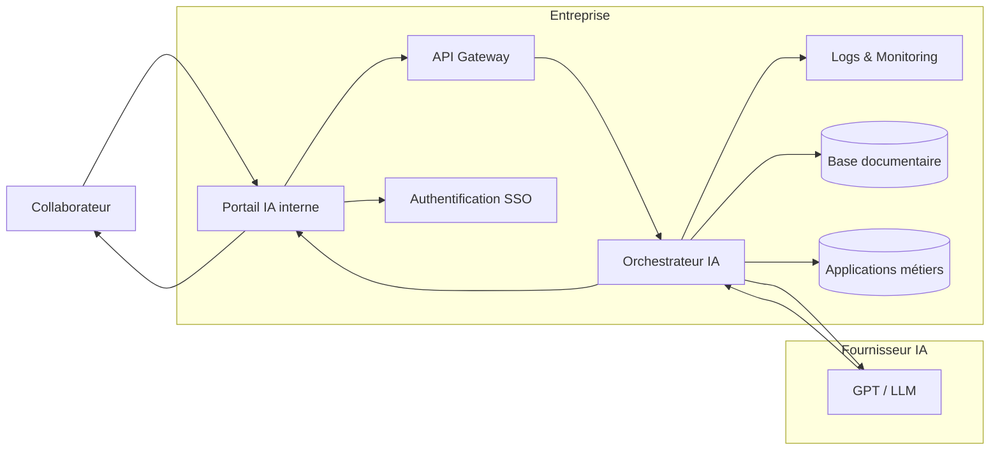
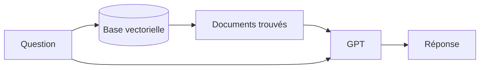
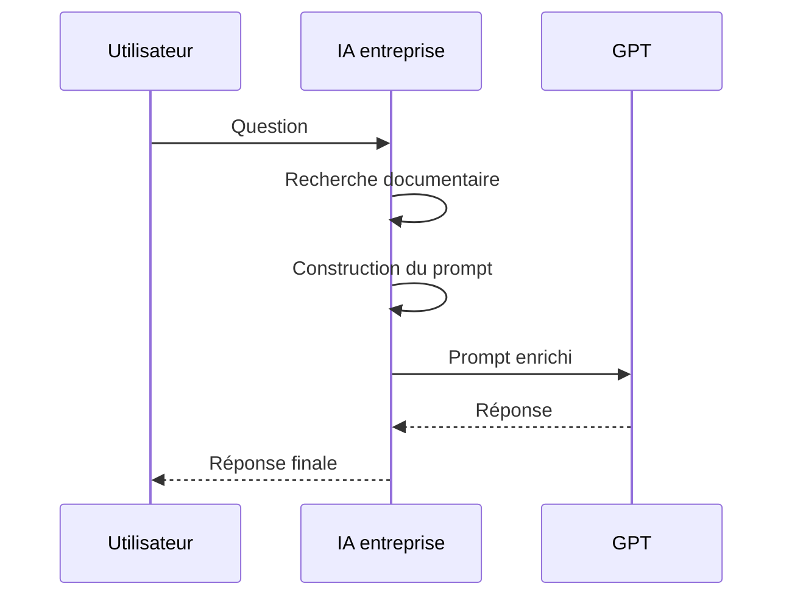
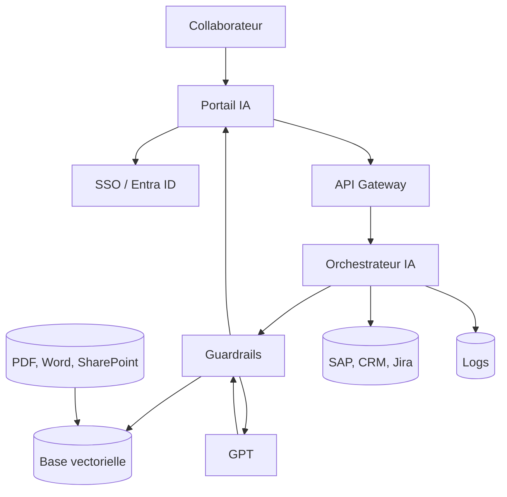
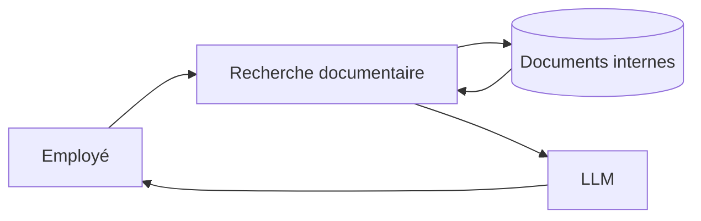
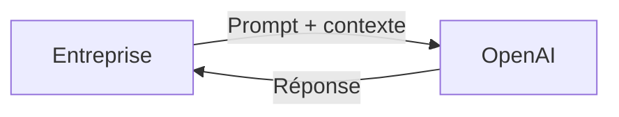
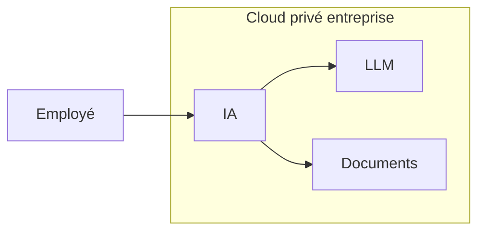
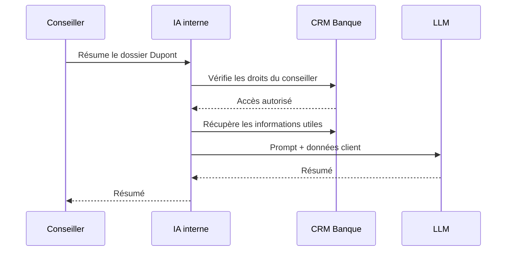

Lorsqu'une entreprise décide de proposer une IA interne basée sur un grand modèle de langage (LLM) comme GPT d'OpenAI, elle ne donne presque jamais un accès direct à ChatGPT. En pratique, elle construit une **plateforme d'IA d'entreprise** qui sert d'intermédiaire entre les collaborateurs et le modèle.

L'objectif est de répondre à plusieurs besoins :

* protéger les données de l'entreprise ;
* contrôler les accès et les coûts ;
* intégrer les outils internes (SharePoint, Jira, SAP, CRM, bases documentaires, etc.) ;
* tracer les usages ;
* empêcher certaines fuites d'information.

## Vue d'ensemble

L'architecture ressemble souvent à ceci :



Le collaborateur ne communique **jamais directement** avec GPT. Toute la logique passe par les composants internes.

---

# 1. Le portail IA

Le salarié ouvre une application web ressemblant à ChatGPT.

Par exemple :

```
https://ia.monentreprise.com
```

Cette interface est développée par l'entreprise.

Elle peut proposer :

* un chat
* plusieurs assistants spécialisés
* des recherches documentaires
* des agents métiers
* des workflows

Par exemple :

```
--------------------------------
Assistant RH

Que puis-je faire ?

> Comment poser un congé parental ?

--------------------------------
```

---

# 2. Authentification

Avant toute chose, l'utilisateur est identifié.

Généralement via :

* Microsoft Entra ID
* Active Directory
* Okta
* Google Workspace

Ainsi le système sait :

```
Utilisateur :
    Martin

Service :
    Finance

Pays :
    France

Rôle :
    Manager
```

Cela permet d'appliquer des droits.

Exemple :

```
Martin
↓

peut accéder :

✓ Procédures Finance

✗ Documents RH confidentiels
```

---

# 3. API Gateway

Toutes les requêtes passent ensuite par une Gateway.

Son rôle :

* authentifier
* limiter le débit
* appliquer des politiques de sécurité
* mesurer les coûts
* enregistrer les appels

Elle ressemble à un filtre.

```text
Utilisateur

↓

Gateway

↓

LLM
```

---

# 4. L'orchestrateur IA

C'est probablement la partie la plus importante.

Il décide :

* quel modèle utiliser
* quelles données récupérer
* quel prompt construire
* quelles règles appliquer

Il peut par exemple faire :

```
Si question RH

↓

utiliser les documents RH

Sinon

↓

utiliser les documents Finance
```

ou

```
Question courte

↓

GPT-4o mini

Question complexe

↓

GPT-5
```

L'utilisateur ne voit rien de cette logique.

---

# 5. Le RAG (Retrieval-Augmented Generation)

C'est aujourd'hui le fonctionnement le plus répandu.

Sans RAG :

```
Utilisateur

↓

GPT

↓

Réponse basée uniquement
sur ses connaissances générales
```

Avec RAG :



Supposons que le collaborateur demande :

> Quelle est la politique de remboursement des déplacements ?

Le système :

1. cherche le document PDF correspondant ;
2. extrait les passages utiles ;
3. les ajoute au prompt ;
4. GPT répond uniquement avec ces informations.

Le modèle ne "connaît" pas la politique interne : on la lui fournit à chaque requête.

---

# 6. La base vectorielle

Les documents de l'entreprise sont transformés en représentations numériques (embeddings).

Schéma simplifié :

```text
PDF RH

↓

Découpage

↓

Paragraphes

↓

Embeddings

↓

Base vectorielle
```

Lorsqu'une question arrive :

```
Question

↓

Embedding

↓

Recherche des passages similaires

↓

Top 5 documents

↓

GPT
```

Ainsi GPT reçoit seulement les informations pertinentes.

---

# 7. Construction du prompt

L'utilisateur écrit :

> Puis-je télétravailler depuis l'Espagne ?

Le système construit en réalité quelque chose comme :

```text
SYSTEM

Tu es l'assistant RH de l'entreprise.

Ne réponds qu'à partir des documents fournis.

Si tu ne trouves pas la réponse,
dis-le.

---

Contexte :

Document RH page 12

(...)

Document Mobilité page 3

(...)

---

Question utilisateur :

Puis-je télétravailler depuis l'Espagne ?
```

Le collaborateur ne voit jamais ce prompt.

---

# 8. Appel au modèle GPT

L'orchestrateur envoie ensuite le prompt à l'API du fournisseur.



---

# 9. Les garde-fous (Guardrails)

Avant d'envoyer la question :

```
Question

↓

Détection données sensibles

↓

Suppression éventuelle

↓

GPT
```

Après la réponse :

```
Réponse GPT

↓

Vérification

↓

Filtrage

↓

Utilisateur
```

Par exemple :

```
Utilisateur

↓

"Donne-moi les salaires de tous les employés"

↓

Bloqué
```

Ou :

```
GPT produit une réponse

↓

Vérification

↓

La réponse contient une donnée confidentielle

↓

Refus
```

---

# 10. Les connecteurs

L'IA peut interroger directement des applications internes.

Exemple :

```mermaid
flowchart LR

GPT

↓

ORCH[Orchestrateur]

ORCH --> SAP
ORCH --> Salesforce
ORCH --> Jira
ORCH --> SharePoint
ORCH --> Confluence
ORCH --> Base SQL
```

Le modèle ne lit pas directement ces systèmes. L'orchestrateur exécute des requêtes autorisées et fournit les résultats au modèle.

Par exemple :

```
Utilisateur

↓

Quel est le chiffre d'affaires du trimestre ?

↓

Orchestrateur

↓

SAP

↓

42 M€

↓

GPT rédige une réponse
```

Le modèle met alors en forme les données récupérées.

---

# 11. Les journaux et la supervision

L'entreprise conserve généralement des informations telles que :

* nombre de requêtes ;
* temps de réponse ;
* coût estimé ;
* modèle utilisé ;
* éventuelles erreurs.

Exemple :

| Heure | Utilisateur | Modèle | Tokens | Coût   |
| ----- | ----------- | ------ | ------ | ------ |
| 10:15 | Alice       | GPT    | 3 500  | 0,09 € |
| 10:17 | Bob         | GPT    | 950    | 0,02 € |

Selon la politique de l'entreprise et du fournisseur, le contenu des conversations peut être journalisé de manière limitée, anonymisé ou ne pas être conservé.

---

# 12. Plusieurs modèles peuvent coexister

L'orchestrateur peut choisir entre plusieurs modèles selon les besoins.

```mermaid
flowchart TD

Question

↓

Orchestrateur

↓

{Quel besoin ?}

--> |Rapide| GPT-mini

--> |Complexe| GPT

--> |Code| Modèle spécialisé

--> |Vision| Modèle multimodal
```

Le collaborateur utilise une seule interface, mais plusieurs modèles peuvent être sollicités en arrière-plan.

---

# 13. Une architecture typique complète



## Qui fait quoi ?

| Composant             | Rôle principal                                                                              |
| --------------------- | ------------------------------------------------------------------------------------------- |
| **Portail IA**        | Interface utilisée par les collaborateurs.                                                  |
| **SSO / IAM**         | Authentifie l'utilisateur et récupère ses droits.                                           |
| **API Gateway**       | Contrôle les appels, applique des quotas, centralise les accès.                             |
| **Orchestrateur**     | Coordonne le traitement, choisit le modèle, appelle les connecteurs et construit le prompt. |
| **Base vectorielle**  | Retrouve les documents pertinents grâce aux embeddings (RAG).                               |
| **Connecteurs**       | Accèdent aux applications internes (ERP, CRM, bases de données, etc.).                      |
| **LLM (GPT)**         | Génère le texte à partir de la question et du contexte fourni.                              |
| **Guardrails**        | Appliquent les règles de sécurité, filtrent les entrées et les sorties.                     |
| **Logs & Monitoring** | Suivent l'utilisation, les performances et les coûts.                                       |

### En résumé

Dans une architecture d'entreprise moderne, **GPT n'est qu'un composant parmi d'autres**. La valeur ajoutée réside surtout dans la couche construite autour du modèle : authentification, gouvernance, récupération des connaissances internes (RAG), connecteurs vers les applications métier, garde-fous et supervision. Cette couche permet d'offrir une IA adaptée au contexte de l'entreprise tout en respectant ses exigences de sécurité, de conformité et de contrôle des accès.

La réponse est **oui, mais sous conditions**. Le fait qu'une IA soit "interne" ne signifie pas automatiquement qu'elle est autorisée à traiter toutes les données sensibles ou confidentielles. Tout dépend de son architecture, des contrats avec le fournisseur du modèle, et de la gouvernance mise en place.

On peut distinguer quatre niveaux.

| Type de données                                                               | Peut être utilisé ? | Conditions                                                                        |
| ----------------------------------------------------------------------------- | ------------------- | --------------------------------------------------------------------------------- |
| Documents internes (procédures, documentation, wiki)                          | ✅ Généralement oui  | Contrôle des accès et RAG                                                         |
| Données confidentielles (contrats, stratégie, résultats financiers)           | ✅ Souvent oui       | Chiffrement, contrôle d'accès, journalisation                                     |
| Données personnelles (RH, clients)                                            | ✅ Avec précautions  | Respect du RGPD, minimisation des données, habilitations                          |
| Données très sensibles (secret industriel, défense, informations classifiées) | ⚠️ Dépend fortement | Souvent limité à des modèles auto-hébergés ou à des environnements très sécurisés |

## Pourquoi cela peut être autorisé ?

Le point important est que, dans une architecture d'entreprise, les données restent généralement **sous le contrôle de l'entreprise**.

Par exemple :



Dans ce scénario :

* les documents restent sur l'infrastructure de l'entreprise ;
* seuls les extraits utiles sont transmis au modèle ;
* l'utilisateur ne peut consulter que les documents auxquels il est déjà autorisé à accéder.

---

## Mais les données partent-elles quand même chez le fournisseur du modèle ?

Cela dépend du mode de déploiement.

### Cas 1 : API cloud (le plus courant)



Le prompt (question + extraits de documents) est envoyé au fournisseur du modèle.

Cela peut sembler inquiétant, mais les offres destinées aux entreprises prévoient généralement des garanties contractuelles, par exemple :

* les données ne sont pas utilisées pour entraîner les modèles ;
* elles restent la propriété du client ;
* elles sont conservées selon des durées définies ou non conservées selon la configuration ;
* les échanges sont chiffrés.

C'est ce qui permet à de nombreuses grandes entreprises d'utiliser des modèles hébergés tout en respectant leurs exigences de conformité.

---

### Cas 2 : Modèle hébergé dans le cloud privé de l'entreprise

Certaines organisations déploient le modèle dans leur propre environnement cloud.



Les données ne quittent pas l'environnement contrôlé par l'entreprise.

---

### Cas 3 : Modèle entièrement sur site (on-premise)

Pour les secteurs les plus sensibles (défense, certains organismes publics, recherche, industrie), le modèle peut être exécuté sur les serveurs de l'organisation.

```mermaid
flowchart LR

Employé --> Serveurs internes

subgraph Datacenter entreprise

LLM
Documents
Applications

end
```

Aucune donnée ne sort de l'infrastructure.

---

# Le véritable risque n'est souvent pas le modèle

En pratique, les incidents proviennent fréquemment de mauvaises configurations.

Par exemple :

```text
Paul (Service Finance)

↓

Pose une question

↓

Le système récupère un document RH

↓

Paul voit des informations
qu'il n'aurait jamais dû voir
```

Ce problème est généralement lié à une mauvaise gestion des droits d'accès dans le système de recherche documentaire (RAG), pas au modèle lui-même.

---

# Les entreprises mettent donc des garde-fous

Avant d'autoriser des données sensibles, elles mettent souvent en place :

* **Gestion des identités (SSO)** : chaque utilisateur est identifié.
* **Contrôle d'accès** : seuls les documents autorisés sont consultables.
* **Chiffrement** : des données en transit et au repos.
* **Journalisation** : les accès et les actions sont tracés.
* **Masquage de données** : certaines informations (numéros de carte, identifiants, etc.) peuvent être supprimées ou anonymisées avant d'être envoyées au modèle.
* **Politiques d'usage** : certains types de données restent interdits, même avec une IA interne.

---

# Un exemple concret

Imaginons une banque.

Un conseiller demande :

> « Fais-moi un résumé du dossier du client Dupont. »

Le système pourrait fonctionner ainsi :



Si le conseiller n'a pas les droits nécessaires, le CRM renvoie un refus et le modèle ne reçoit jamais les données.

## En résumé

Une IA interne peut tout à fait traiter des données confidentielles, voire sensibles, **à condition que l'architecture et la gouvernance soient conçues pour cela**. Le caractère "interne" ne suffit pas à lui seul : il faut des contrôles d'accès robustes, des garanties contractuelles avec le fournisseur du modèle lorsqu'il est hébergé dans le cloud, des mécanismes de sécurité (chiffrement, journalisation, filtrage) et le respect des obligations réglementaires comme le RGPD pour les données personnelles. Les organisations les plus sensibles choisissent parfois des modèles déployés dans un cloud privé ou entièrement sur leur propre infrastructure afin de réduire encore davantage les risques liés à la circulation des données.

