Avec 7 ans d'expérience en Java/Angular, une épouse et deux jeunes enfants, tu es dans une situation idéale pour utiliser l'IA non seulement comme assistant, mais comme **multiplicateur de temps**.

Je vais te proposer des automatisations à fort ROI :

* 👨‍💻 Professionnel (gain de productivité)
* 💰 Revenus complémentaires
* 🏠 Personnel / famille
* 📚 Formation continue

Pour chaque cas :

* Objectif
* Diagramme Mermaid
* Stack recommandée

---

# 1. Génération automatique de documentation technique

## Problème

Les documentations sont souvent oubliées.

L'IA peut analyser :

* Code Java
* API Spring Boot
* Front Angular
* Commits Git

et générer automatiquement :

* ADR
* Documentation API
* Changelog
* Diagrammes

## Architecture

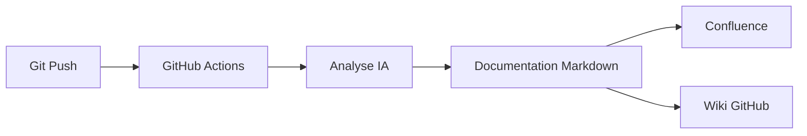

## Outils

* GitHub Actions
* OpenAI API
* LangChain
* Spring AI
* Confluence API
* Mermaid

---

# 2. Revue de code IA avant Pull Request

## Objectif

Recevoir un feedback avant même qu'un collègue relise.

## Architecture

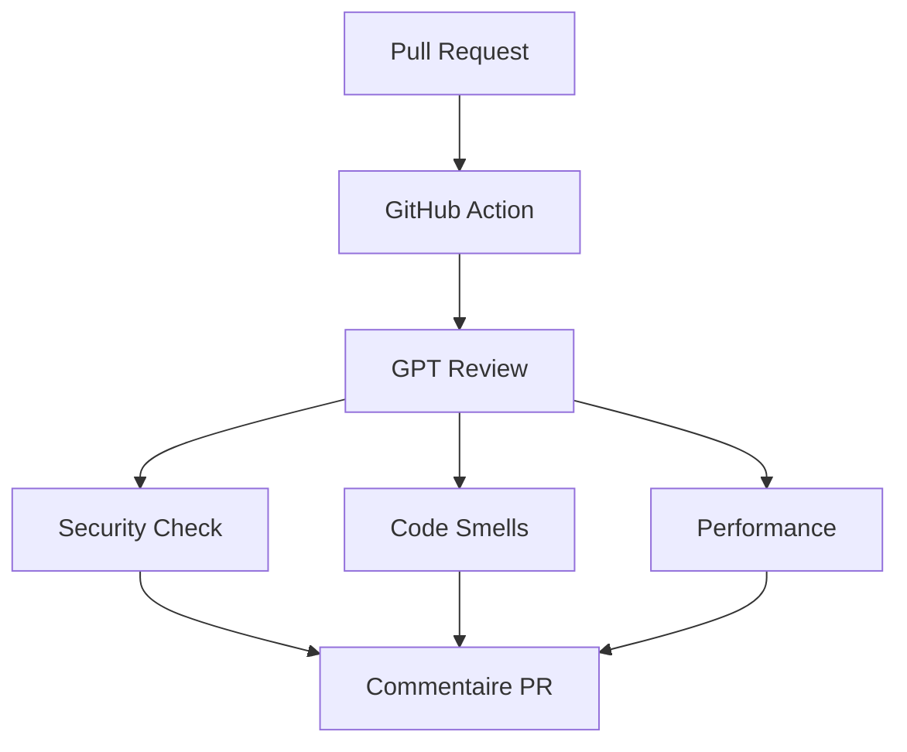

## Outils

* GitHub
* SonarQube
* OpenAI
* Spring AI
* Claude Code
* Cursor

---

# 3. Génération automatique des tests

## Objectif

Créer automatiquement :

* JUnit
* Mockito
* Cypress
* Playwright

## Architecture

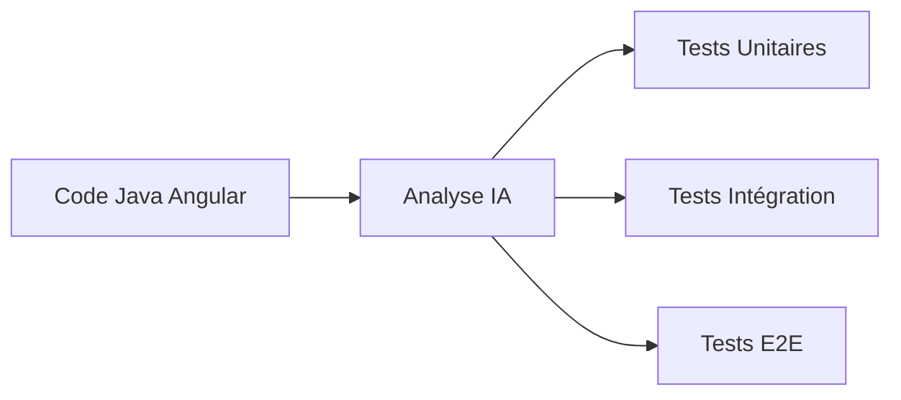

## Outils

* OpenAI
* Spring AI
* Testcontainers
* JUnit 5
* Playwright

---

# 4. Assistant IA privé sur ton code source

Très puissant pour un dev senior.

Tu peux discuter avec tout ton SI :

* backend
* frontend
* microservices
* documentation

## Architecture

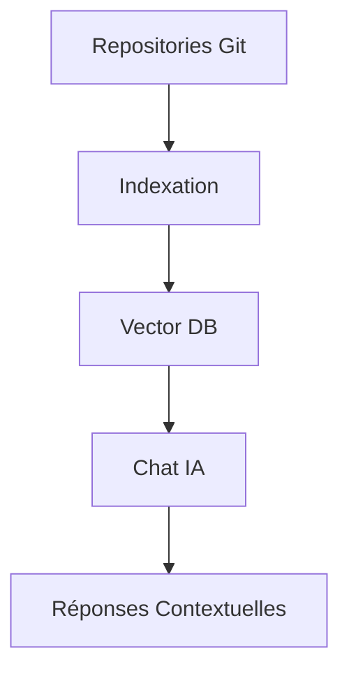

## Outils

* Spring AI
* Ollama
* Qdrant
* PostgreSQL pgvector
* OpenWebUI
* LangChain

---

# 5. Génération automatique de tickets Jira

## Objectif

Transformer une discussion Teams en ticket Jira.

## Architecture

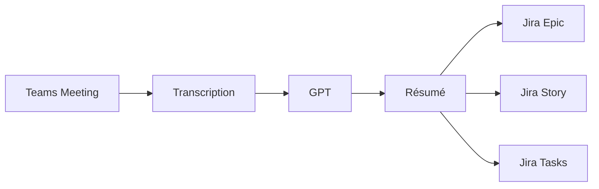

## Outils

* Teams
* Whisper
* OpenAI
* Jira API
* n8n

---

# 6. Veille technologique automatique

## Objectif

Recevoir chaque matin :

* Java
* Spring
* Angular
* IA
* Cloud

résumés en 5 minutes.

## Architecture

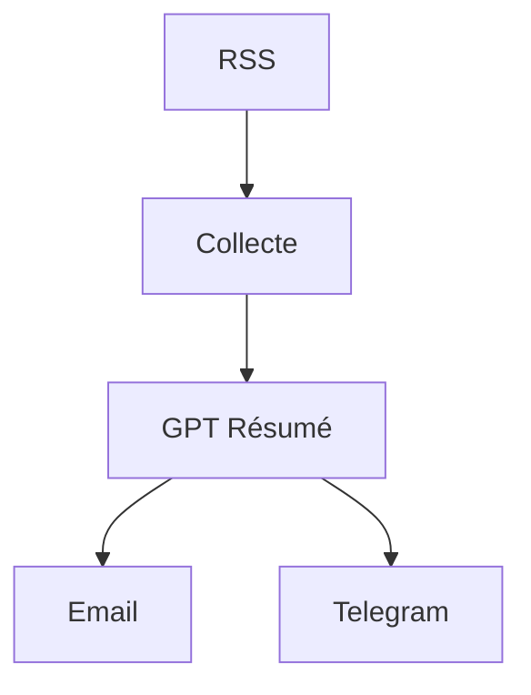

## Outils

* Feedly
* RSS
* n8n
* OpenAI
* Telegram

---

# 7. Génération automatique de revenus via contenu tech

Tu peux monétiser ton expertise.

## Architecture

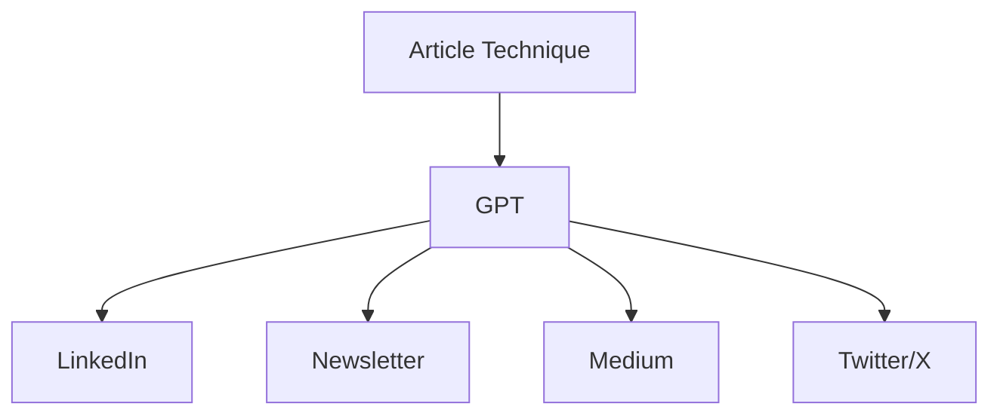

## Outils

* Notion
* OpenAI
* Buffer
* Zapier
* LinkedIn API

---

# 8. Gestion intelligente des finances familiales

Avec 2 enfants, c'est probablement un des plus gros gains.

## Architecture

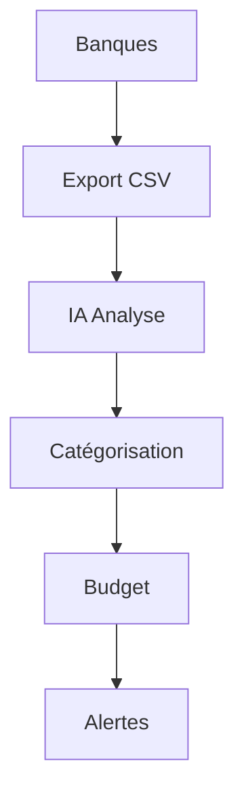

## Outils

* Bankin
* Linxo
* Excel
* GPT
* n8n

---

# 9. Assistant familial

Centraliser :

* rendez-vous
* école
* crèche
* médecin
* courses

## Architecture

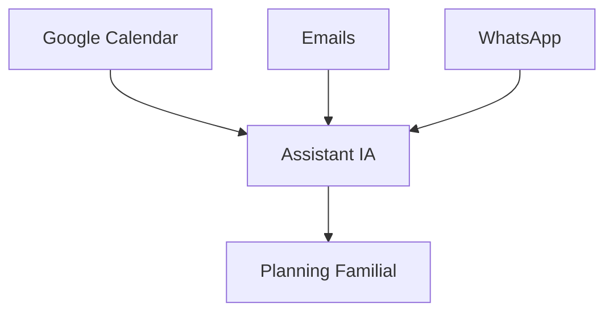

## Outils

* Google Calendar
* Gmail
* n8n
* OpenAI
* Telegram Bot

---

# 10. Génération automatique des listes de courses

## Architecture

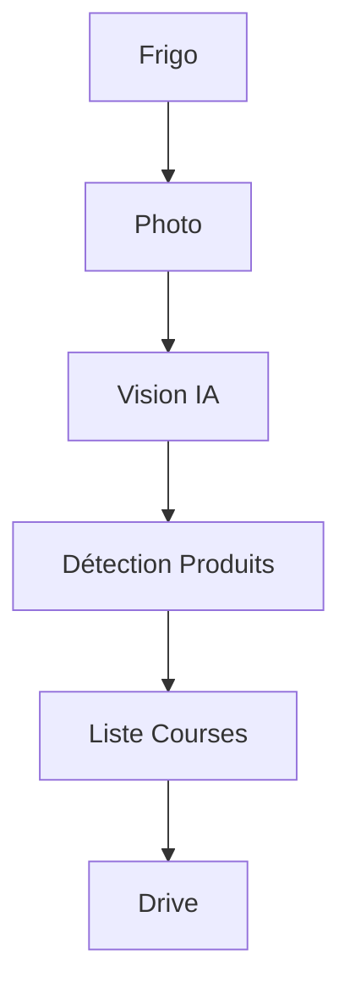

## Outils

* GPT Vision
* OpenAI
* Google Keep
* Todoist
* n8n

---

# 11. Assistant immobilier (investissement)

Si tu envisages un investissement locatif.

## Architecture

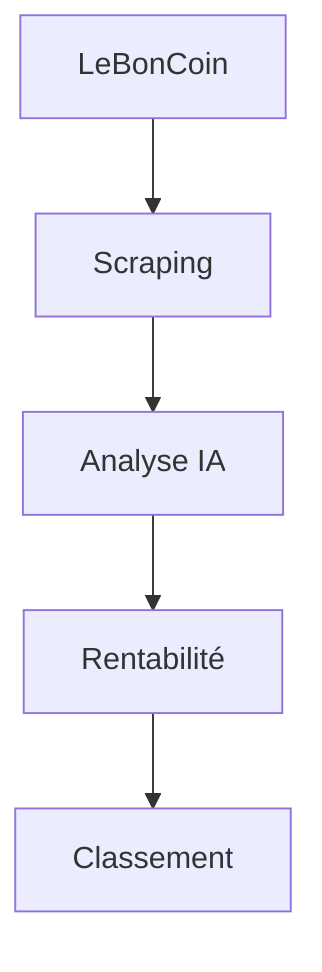

## Outils

* Playwright
* Spring Boot
* GPT
* PostgreSQL

---

# 12. Préparation automatique des entretiens techniques

## Architecture

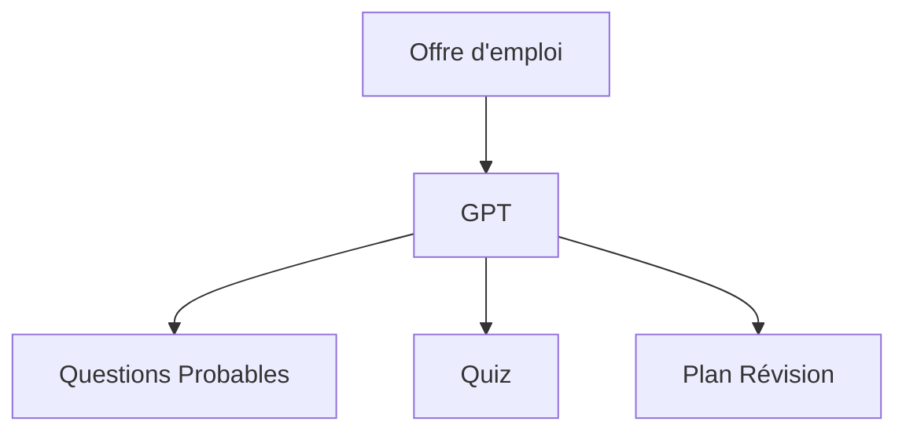

## Outils

* ChatGPT
* Claude
* Perplexity
* Notion

---

# 13. Système "Second Brain" IA

C'est probablement l'automatisation la plus rentable sur 10 ans.

Tout ce que tu apprends est mémorisé :

* articles
* vidéos
* idées
* architecture
* finances
* famille

et devient interrogeable.

## Architecture

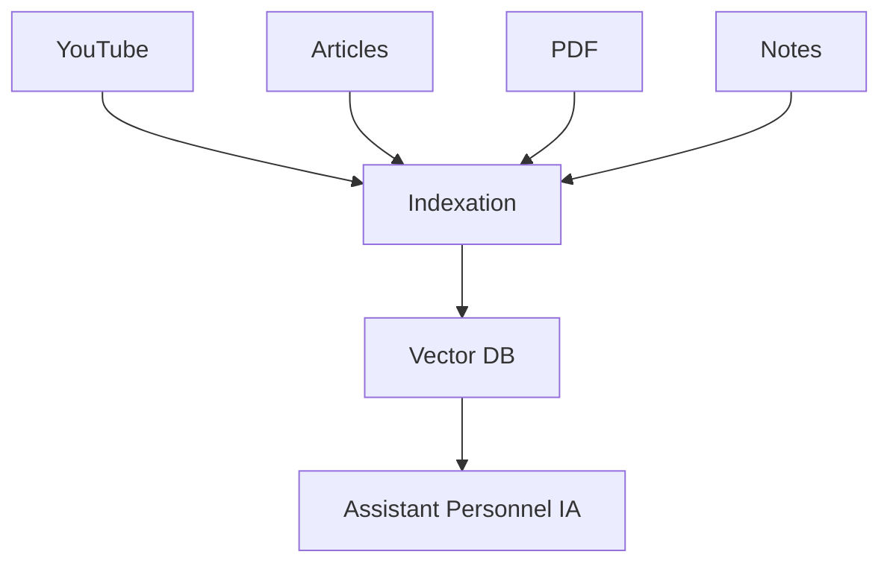

## Outils

* Obsidian
* OpenWebUI
* Qdrant
* Ollama
* Spring AI

---

# Mon top 5 si j'étais à ta place

Ordre de priorité en tant que développeur Java/Angular avec 2 enfants :

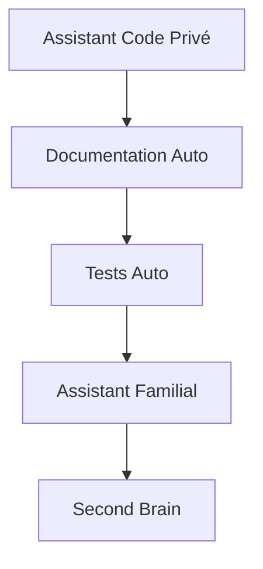

1. Assistant IA sur ton code (RAG privé)
2. Documentation automatique
3. Génération de tests
4. Assistant familial
5. Second Brain personnel

Ces 5 projets sont réalisables en quelques week-ends et te feront gagner plusieurs heures par semaine tout en renforçant tes compétences IA, ce qui est très valorisé sur le marché des développeurs seniors.
