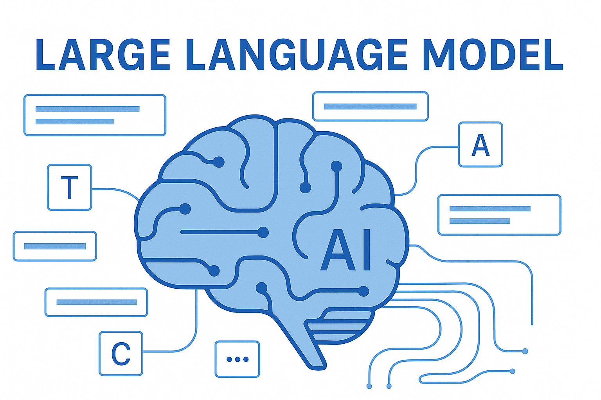

# LLM
Les LLM (Large Language Models) sont un type de modèle d’intelligence artificielle conçu pour comprendre <br>
et générer du langage humain. Ils sont au cœur de nombreux outils modernes comme les chatbots, <br>
les assistants virtuels ou les systèmes de génération de texte.

<div align="center">
	
</div>

# 1. <ins>Qu’est-ce qu’un LLM ?</ins>
Un LLM est un modèle d’IA entraîné sur d’énormes quantités de texte (livres, articles, sites web, code, etc.) afin d’apprendre les structures du langage.<br>
Son objectif principal est de prédire le mot suivant dans une phrase. <br>
En répétant ce processus, il peut produire des réponses complètes, écrire des textes ou répondre à des questions.<br>
La plupart des LLM modernes reposent sur l’architecture appelée ```Transformer architecture```, 
introduite dans l’article ```Attention Is All You Need```.

# 2. <ins>Comment fonctionne un LLM ?</ins>
Le fonctionnement peut être résumé en plusieurs étapes :
## 1. Tokenisation
Le texte est découpé en petits morceaux appelés tokens (mots, syllabes ou caractères).

Exemple :
```
"Les chats mangent du poisson"
→ ["Les", "chats", "mangent", "du", "poisson"]
```

## 2. Apprentissage statistique
Pendant l’entraînement, le modèle apprend :
- les relations entre les mots
- la grammaire
- le contexte
- certains faits du monde

Il ajuste des millions ou milliards de paramètres.

## 3. Génération
Quand on pose une question, le modèle :
- 1.analyse le texte
- 2.calcule les probabilités des mots possibles
- 3.choisit le mot le plus probable
- 4.répète le processus

# 3. <ins>Exemples de LLM connus</ins>
Quelques modèles célèbres :
- GPT‑4
- LLaMA
- PaLM
- Claude

Ces modèles peuvent contenir des dizaines ou centaines de milliards de paramètres.

# 4. <ins>Ce que les LLM savent faire</ins>
Ils sont capables de :
- répondre à des questions
- traduire des langues
- résumer des documents
- générer du code
- écrire des articles ou des histoires
- analyser des données textuelles

Par exemple, des assistants comme ChatGPT utilisent un LLM pour discuter avec les utilisateurs.

# 5. <ins>Limites des LLM</ins>
Malgré leur puissance, ils ont plusieurs limites :<br>
❌ peuvent inventer des informations (hallucinations)<br>
❌ ne comprennent pas réellement comme un humain<br>
❌ dépendent fortement des données d’entraînement<br>
❌ peuvent avoir des biais<br>

# 6. <ins>Pourquoi ils sont importants</ins>
Les LLM sont une avancée majeure car ils permettent :
- des interfaces naturelles avec les machines
- l’automatisation de tâches intellectuelles
- le développement d’agents et d’assistants intelligents

Ils sont aujourd’hui un pilier de l’IA générative.

# 7. <ins>Fonctionnement token</ins>
Pour comprendre les LLM (Large Language Models), il faut imaginer une machine qui ne lit pas des lettres, mais qui calcule des probabilités statistiques sur des morceaux de texte.
Voici comment cela fonctionne, de la découpe du texte à l'épuisement de ton "crédit" de jetons.

## 1. C'est quoi un "Token" ?
Un LLM ne voit pas le mot "anticonstitutionnellement" comme un seul bloc. Il le découpe en unités appelées tokens.
- La règle d'or : En moyenne, 1 000 tokens ≈ 750 mots (en anglais/français).
- Un token peut être un mot entier (pour les mots courts comme "chat"), une syllabe, ou même un seul caractère pour les symboles complexes.
- Pourquoi ? Transformer le texte en nombres (IDs de tokens) permet au modèle de faire des calculs mathématiques rapides plutôt que de la manipulation de texte pure.

## 2. Comment fonctionne le modèle (Le moteur)
Les LLM reposent sur une architecture appelée Transformer. Le processus se déroule en deux étapes :
- L'étape de compréhension (Prefill) : Tu envoies ta question (le prompt). Le modèle "lit" tout d'un coup, analyse les relations entre chaque token (grâce à un mécanisme appelé Attention) et crée une carte de compréhension de ta demande.
- L'étape de génération (Decode) : Le modèle ne répond pas d'un bloc. Il prédit le prochain token le plus probable en fonction de tout ce qui précède. Une fois ce token généré, il le rajoute à la suite et recommence pour prédire le suivant. C'est pour cela que tu vois le texte s'afficher mot après mot.

## 3. Comment sont "épuisés" les tokens ?
Quand on parle d'épuisement des tokens, on fait généralement référence à deux limites distinctes :

### A. La Fenêtre de Contexte (La "mémoire vive")
Chaque modèle a une limite de tokens qu'il peut "garder en tête" en même temps (ex: 128 000 tokens pour GPT-4o, 2 millions pour Gemini 1.5 Pro).
- L'épuisement : Si ta conversation devient trop longue, le modèle commence à "oublier" le début. Pour continuer à répondre, il doit supprimer les tokens les plus anciens de sa mémoire pour faire de la place aux nouveaux.

### B. La Consommation (Le "portefeuille")
Si tu utilises une API ou un abonnement avec des quotas, les tokens sont consommés de deux façons :
- Tokens d'Entrée (Prompt) : Chaque mot que tu écris, mais aussi tout l'historique de la conversation que l'application renvoie au modèle à chaque nouveau message pour qu'il garde le contexte.
- Tokens de Sortie (Completion) : Chaque mot que l'IA génère en réponse.<br>
Le piège : Dans une longue discussion, le 10ème message coûte beaucoup plus cher que le 1er, car pour répondre au 10ème, l'IA doit "re-consommer" les 9 messages précédents pour comprendre de quoi vous parlez.

## En résumé
- Le fonctionnement : C'est une calculatrice géante qui prédit statistiquement le morceau de mot suivant.
- L'épuisement : Soit la mémoire du modèle est pleine (il oublie le début), soit ton quota payant est consommé par l'accumulation des messages échangés.