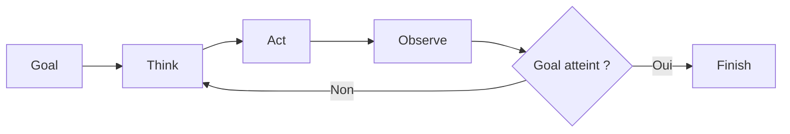
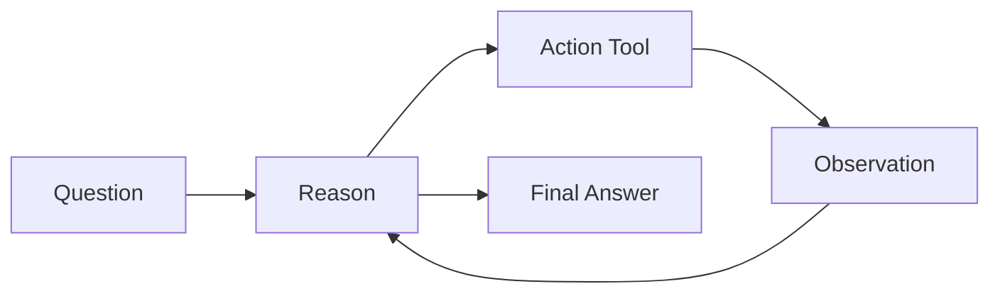
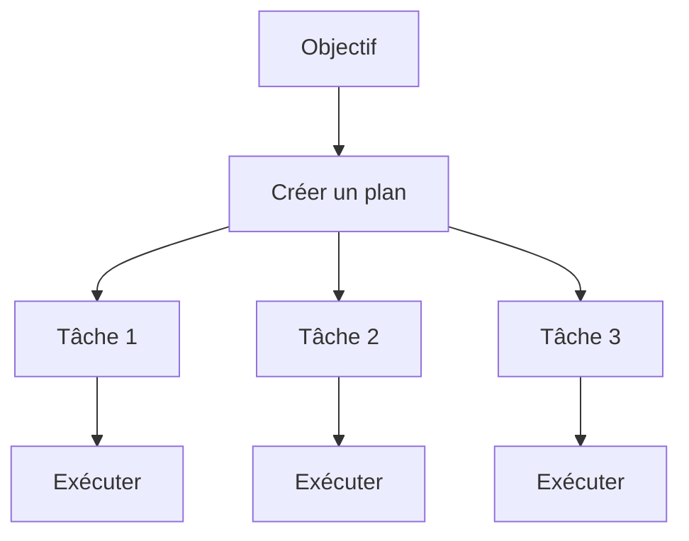
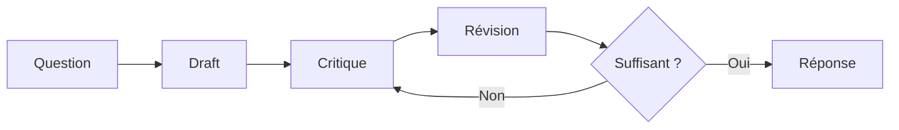
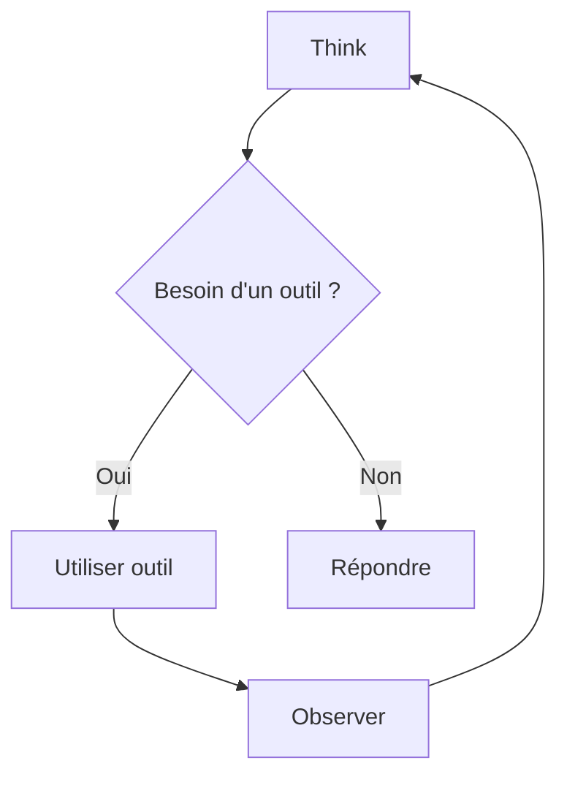
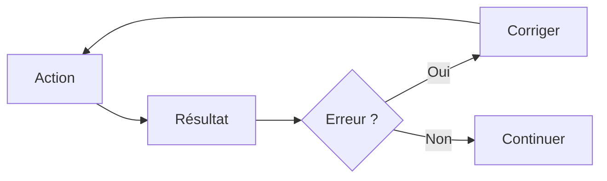
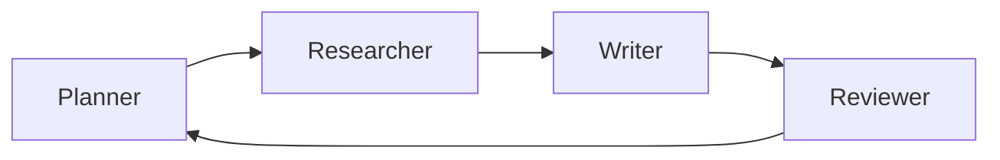
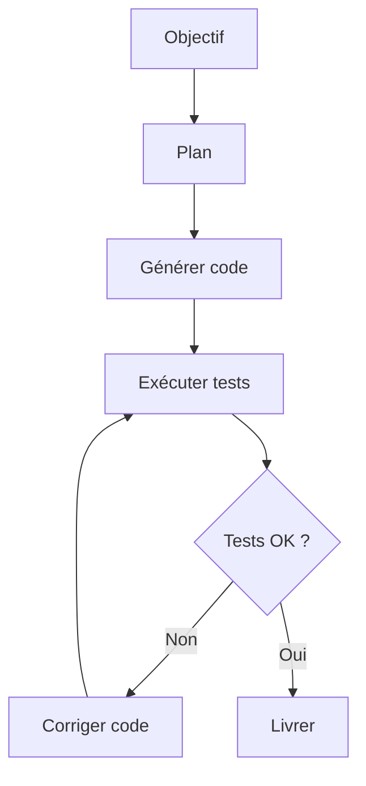
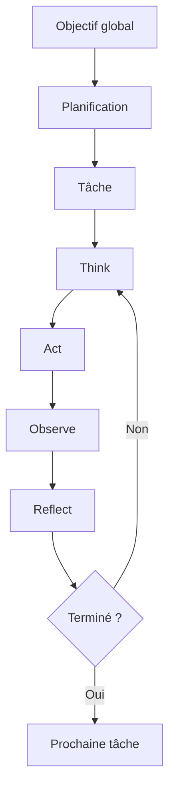

# Tutoriel : Comprendre les Loops en Développement Agentique

Dans le développement logiciel classique, un programme suit généralement un flux simple :

```text
Entrée → Traitement → Sortie
```

Un système agentique fonctionne différemment. Il est **cyclique**. L'agent observe, réfléchit, agit, évalue les résultats puis recommence jusqu'à atteindre son objectif.

Ces boucles (loops) sont au cœur des agents modernes comme ceux construits avec des frameworks tels que :

* LangChain
* LangGraph
* AutoGen
* CrewAI

---

# Pourquoi les loops existent-elles ?

Un LLM seul est essentiellement une fonction :

```python
output = llm(prompt)
```

Mais un agent doit :

1. comprendre un objectif ;
2. décider quoi faire ;
3. utiliser des outils ;
4. observer les résultats ;
5. éventuellement corriger sa stratégie ;
6. recommencer.

Sans boucle, l'agent ne peut ni s'adapter ni raisonner de manière itérative.

---

# La boucle agentique fondamentale



On appelle souvent cette architecture :

**Think → Act → Observe**

ou encore :

**Reason → Act → Reflect**

---

# Exemple concret : Agent de réservation de voyage

L'utilisateur dit :

> Trouve-moi un vol Paris-Tokyo en dessous de 900 €.

L'agent exécute :

### Itération 1

#### Think

```text
Je dois chercher des vols Paris-Tokyo.
```

#### Act

```python
search_flights(
    departure="Paris",
    destination="Tokyo"
)
```

#### Observe

```json
[
  {"price": 1240},
  {"price": 1180},
  {"price": 1050}
]
```

#### Réflexion

```text
Aucun vol sous 900€.
Je vais élargir la recherche.
```

---

### Itération 2

#### Act

```python
search_flights(
    departure="Paris",
    destination="Tokyo",
    dates_flexibles=True
)
```

#### Observe

```json
[
  {"price": 860}
]
```

#### Réflexion

```text
Objectif atteint.
```

L'agent s'arrête.

---

# Pseudo-code de cette boucle

```python
goal = "Trouver un vol < 900€"

while True:

    thought = think(goal)

    action = choose_action(thought)

    observation = execute(action)

    if goal_satisfied(observation):
        break
```

C'est la structure de quasiment tous les agents modernes.

---

# Loop ReAct (Reason + Act)

Le pattern le plus célèbre est ReAct :



Exemple :

Utilisateur :

> Quelle est la population de Lyon ?

### Tour 1

Reason :

```text
Je dois rechercher cette information.
```

Action :

```python
search("population Lyon")
```

Observation :

```text
Environ 530 000 habitants.
```

Reason :

```text
J'ai obtenu l'information.
```

Réponse finale :

```text
Lyon compte environ 530 000 habitants.
```

---

# Loop de planification (Plan-and-Execute)

Certains problèmes sont trop complexes pour être résolus en une seule boucle.

Exemple :

> Organise un lancement produit.

L'agent crée un plan.



Plan :

1. Étude de marché
2. Définition du pricing
3. Création de la campagne marketing
4. Préparation du lancement

Pseudo-code :

```python
plan = planner(goal)

for task in plan:
    execute(task)
```

---

# Loop de réflexion (Reflection Loop)

Les agents avancés peuvent critiquer leurs propres réponses.

Exemple :



Exemple :

Utilisateur :

> Écris une documentation API.

L'agent :

### Draft

Produit une première documentation.

### Critique

```text
Il manque les exemples de requêtes.
```

### Révision

Ajoute :

```http
POST /users
```

### Nouvelle critique

```text
Il manque les codes d'erreur.
```

### Révision

Ajoute :

```http
400 Bad Request
401 Unauthorized
500 Internal Server Error
```

Puis l'agent s'arrête.

---

# Loop Tool-Use

La plupart des agents passent leur temps dans cette boucle.



Exemple :

Question :

> Quelle est la météo à Tokyo et convertis-la en Fahrenheit ?

L'agent :

### Boucle 1

```python
weather("Tokyo")
```

Observation :

```text
22°C
```

### Boucle 2

```python
celsius_to_fahrenheit(22)
```

Observation :

```text
71.6°F
```

Réponse finale :

```text
22°C (71.6°F)
```

---

# Loop de correction d'erreur

Les agents robustes savent réessayer.



Exemple :

```python
query_database()
```

Erreur :

```text
ConnectionTimeout
```

L'agent :

```python
sleep(2)
reconnect()
query_database()
```

Ce pattern est extrêmement fréquent dans les agents de production.

---

# Loop Multi-Agent

Plusieurs agents collaborent.



Exemple :

### Planner

Décompose la tâche.

### Researcher

Cherche les informations.

### Writer

Rédige le document.

### Reviewer

Vérifie la qualité.

Si la qualité est insuffisante :

```text
Reviewer → Planner
```

Une nouvelle itération démarre.

---

# Exemple complet : Agent de génération de code

Objectif :

> Crée une API REST avec authentification JWT.



Pseudo-code :

```python
goal = "API JWT"

plan = planner(goal)

while True:

    code = generate_code(plan)

    result = run_tests(code)

    if result.success:
        break

    code = fix(code, result.errors)
```

Cette boucle est exactement celle utilisée par de nombreux assistants de programmation agentiques.

---

# Comment reconnaître une vraie architecture agentique ?

Si votre système contient seulement :

```python
prompt -> llm -> réponse
```

ce n'est pas vraiment un agent.

Un système devient agentique lorsqu'il possède au moins une boucle de ce type :

```text
Objectif
↓
Réflexion
↓
Action
↓
Observation
↓
Décision
↓
Nouvelle itération éventuelle
```

En pratique, les agents modernes combinent souvent plusieurs loops imbriquées :



On peut voir le développement agentique comme un ensemble de **boucles de décision récursives** : l'agent pense, agit, apprend de ses observations et réitère jusqu'à satisfaction de l'objectif. C'est cette capacité de boucle et d'adaptation qui distingue fondamentalement un agent d'un simple appel à un LLM.
