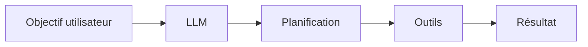
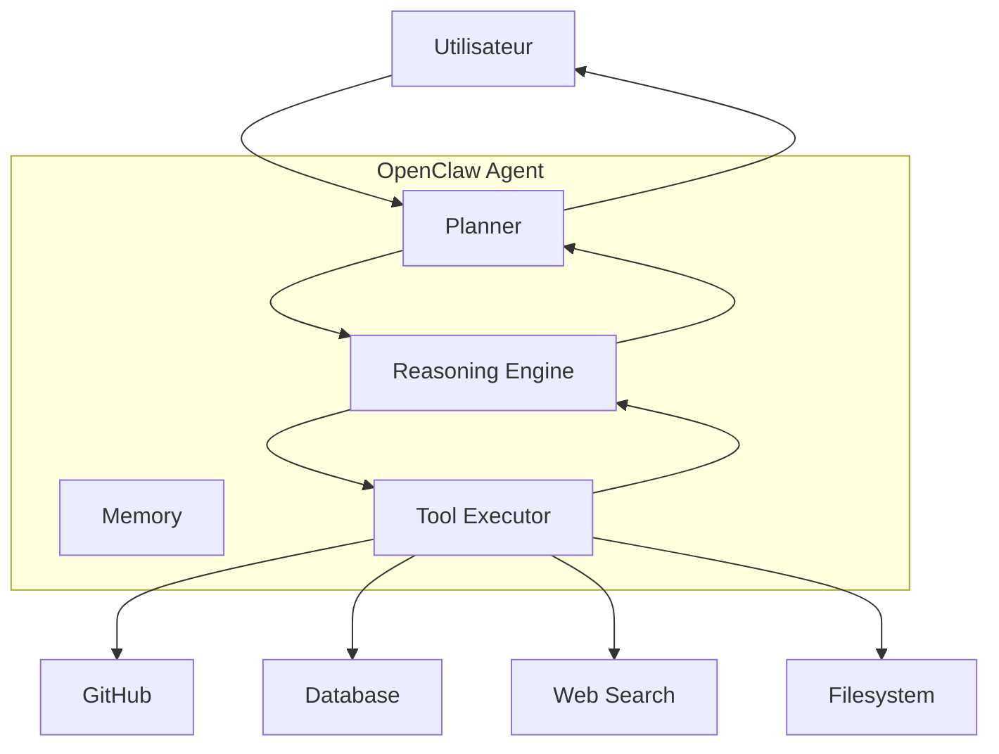
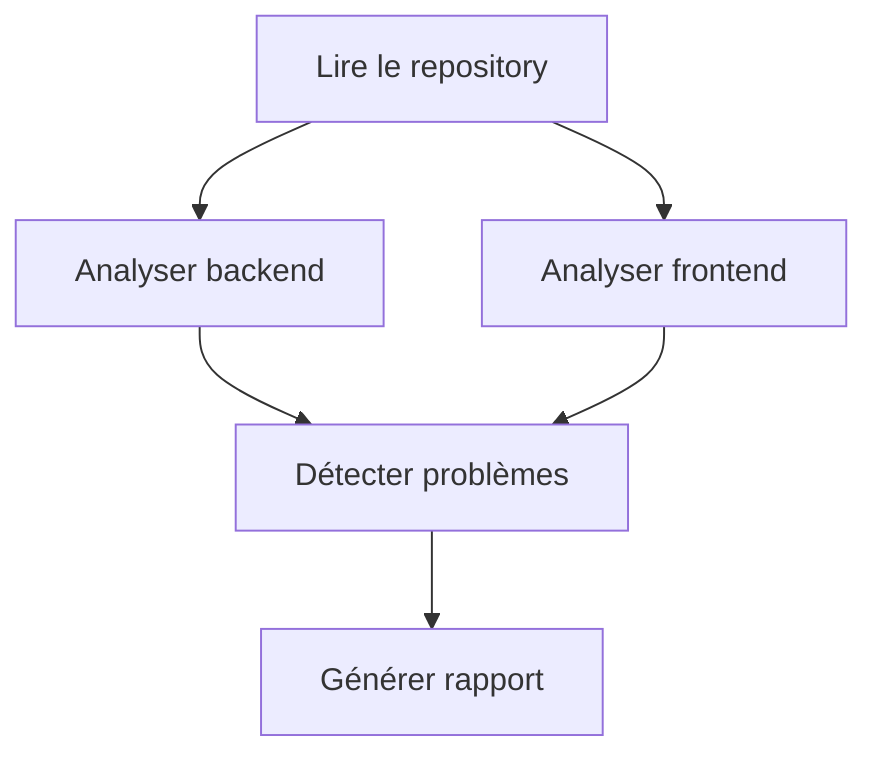
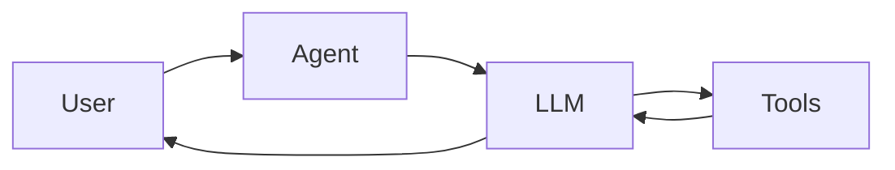
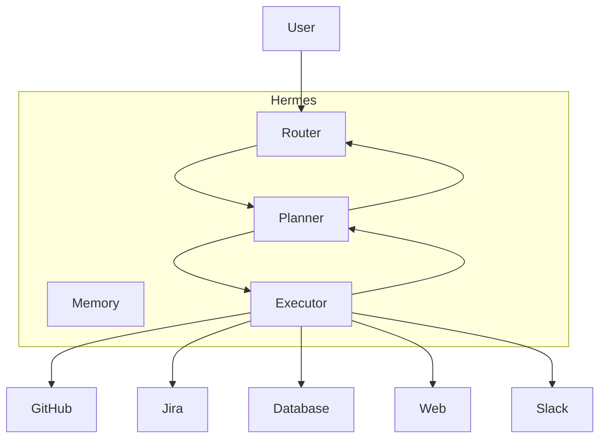
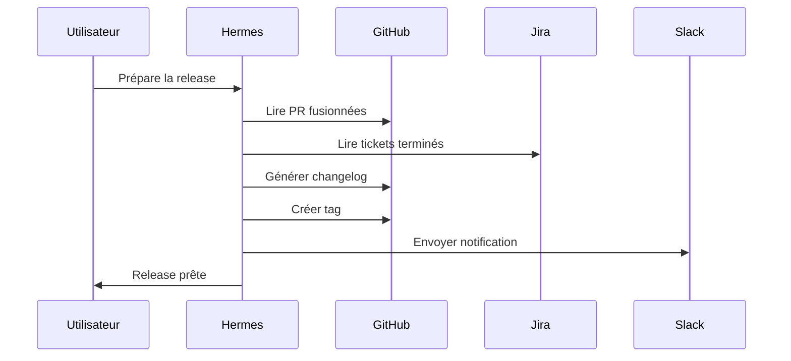
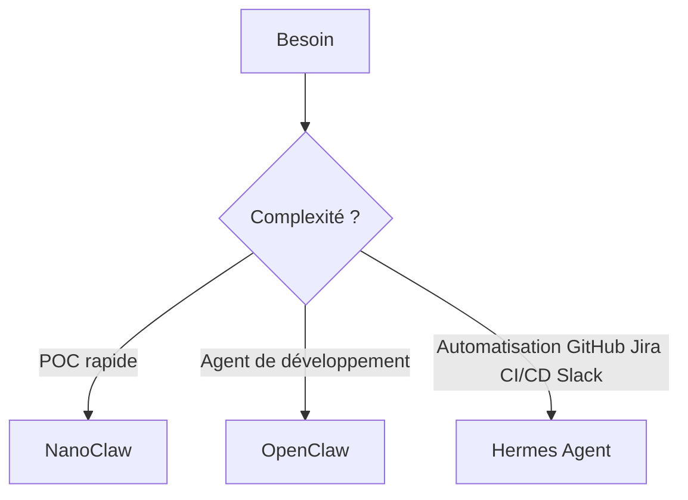

# Tutoriel complet : OpenClaw, NanoClaw et Hermes Agent dans l'IA agentique

Ces trois outils appartiennent à l'écosystème des **agents IA autonomes**. Leur objectif est de permettre à un LLM (comme GPT, Claude ou Gemini) de :

1. comprendre un objectif ;
2. planifier des actions ;
3. utiliser des outils ;
4. exécuter des tâches de manière semi-autonome ou autonome ;
5. apprendre de ses erreurs et recommencer si nécessaire.

On peut les voir comme différents niveaux de sophistication :

```text
NanoClaw  →  OpenClaw  →  Hermes Agent
Minimaliste     Agent généraliste      Agent orienté workflow complexe
```

---

# 1. Avant de commencer : qu'est-ce qu'un agent IA ?

Un agent IA est généralement composé de 5 briques :



Exemple :

**Prompt :**

> Analyse mon dépôt GitHub et crée les issues manquantes.

L'agent doit :

1. comprendre la demande ;
2. explorer le dépôt ;
3. analyser le code ;
4. identifier les manques ;
5. créer les issues.

Un simple chatbot ne sait pas faire cela de manière autonome.

Un agent IA, oui.

---

# 2. OpenClaw

[OpenClaw GitHub](https://github.com/openclaw/openclaw?utm_source=chatgpt.com)

## Qu'est-ce qu'OpenClaw ?

OpenClaw est un framework open source permettant de construire des agents IA capables :

* d'utiliser des outils ;
* de raisonner étape par étape ;
* de planifier ;
* d'exécuter des actions ;
* d'interagir avec des fichiers, APIs et systèmes externes.

L'idée est similaire à :

* [LangChain](https://www.langchain.com?utm_source=chatgpt.com)
* [LangGraph](https://www.langchain.com/langgraph?utm_source=chatgpt.com)
* [OpenAI Agents SDK](https://openai.github.io/openai-agents-python/?utm_source=chatgpt.com)

mais avec une approche fortement orientée :

* agents autonomes ;
* orchestration ;
* tool calling ;
* boucles de raisonnement.

---

# Architecture d'OpenClaw



---

# Concepts principaux d'OpenClaw

## 1. Agent

L'agent est l'entité principale.

Exemple :

```python
agent.run(
    "Analyse mon application Spring Boot"
)
```

L'agent va :

* lire le code ;
* raisonner ;
* utiliser ses outils ;
* produire un résultat.

---

## 2. Tools

Un tool est une capacité externe.

Exemples :

```text
read_file()
search_web()
execute_command()
github_create_issue()
```

L'agent choisit lui-même le bon outil.

---

## 3. Planning

L'agent découpe une tâche complexe.

Exemple :

```text
Objectif :
Créer la documentation de mon API.

Plan :

1. Scanner le projet
2. Détecter les endpoints
3. Générer OpenAPI
4. Écrire le README
```

---

## 4. Memory

L'agent conserve du contexte.

Exemple :

```text
Projet :
Spring Boot 4
Java 21
PostgreSQL
```

Lors des étapes suivantes, il réutilise ces informations.

---

# Exemple concret : Fullstack Java Angular

Prompt :

```text
Analyse mon projet et propose des optimisations.
```

L'agent :



Rapport possible :

* endpoints sans pagination ;
* absence de cache Redis ;
* composants Angular trop volumineux ;
* manque de tests ;
* Dockerfile non optimisé.

---

# Cas d'usage OpenClaw

### Développement

* revue de code ;
* génération de documentation ;
* création d'issues GitHub ;
* génération de tests.

### DevOps

* analyse CI/CD ;
* déploiement ;
* surveillance logs.

### Productivité

* génération de tickets Jira ;
* rédaction de comptes-rendus ;
* automatisation documentaire.

---

# 3. NanoClaw

[NanoClaw GitHub](https://github.com/openclaw/nanoclaw?utm_source=chatgpt.com)

## Qu'est-ce que NanoClaw ?

NanoClaw est une version ultra légère d'un framework agentique.

L'objectif est :

> Construire un agent en très peu de code.

Il est pensé pour :

* expérimenter ;
* apprendre ;
* créer de petits assistants ;
* prototyper rapidement.

---

# Philosophie de NanoClaw

```text
Simplicité
+
Peu d'abstraction
+
Faible empreinte mémoire
=
Agent rapide à développer
```

---

# Architecture NanoClaw



Contrairement à OpenClaw :

* moins de composants ;
* moins de couches ;
* moins de mémoire ;
* moins d'orchestration.

---

# Exemple

Prompt :

```text
Explique-moi les erreurs de mon build Maven.
```

L'agent :

```text
1. Lire le log
2. Identifier l'erreur
3. Chercher une solution
4. Répondre
```

---

# Exemple de mini agent Dev

```python
agent.run(
    """
    Lis ce pom.xml
    Détecte les dépendances obsolètes
    Propose des mises à jour
    """
)
```

---

# Cas d'usage NanoClaw

## Assistant de développeur

```text
Question
↓
Analyse
↓
Réponse
```

---

## Générateur de commandes Git

```text
"Je veux fusionner ma branche"

↓

git fetch
git checkout main
git pull
git merge feature
```

---

## Assistant Docker

```text
"Pourquoi mon container ne démarre pas ?"

↓

lecture logs
↓
analyse
↓
solution
```

---

# Quand utiliser NanoClaw ?

Utilisez NanoClaw si vous voulez :

✅ apprendre l'IA agentique ;

✅ créer rapidement un POC ;

✅ construire un agent simple ;

✅ éviter une architecture complexe.

---

# Quand éviter NanoClaw ?

❌ workflows très complexes ;

❌ agents multiples ;

❌ mémoire avancée ;

❌ orchestrations importantes.

---

# 4. Hermes Agent

Le nom Hermes fait référence au messager des dieux dans la mythologie grecque.

Dans le monde de l'IA agentique, Hermes Agent désigne généralement une architecture orientée :

* communication ;
* orchestration ;
* exécution de tâches ;
* coordination d'outils et parfois d'agents multiples.

---

# Architecture Hermes



---

# Composants

## Router

Décide :

* quel outil utiliser ;
* quel agent appeler ;
* dans quel ordre.

---

## Planner

Décompose les tâches.

Exemple :

```text
Créer une release.

1. Vérifier les PR
2. Générer le changelog
3. Créer le tag
4. Publier la release
5. Notifier Slack
```

---

## Memory

Conserve :

* préférences ;
* état courant ;
* historique.

---

## Executor

Exécute :

* GitHub ;
* Jira ;
* APIs ;
* Shell ;
* bases de données.

---

# Exemple concret pour ton métier de développeur Fullstack Java Angular

Prompt :

```text
Prépare ma prochaine release.
```

Hermes pourrait :



---

# Cas d'usage Hermes Agent

## CI/CD autonome

```text
Commit
↓
Analyse
↓
Tests
↓
Déploiement
↓
Monitoring
↓
Rollback éventuel
```

---

## Gestion de projet

```text
GitHub
↓
Hermes
↓
Jira
↓
Slack
↓
Documentation
```

---

## Veille technologique

```text
Web
↓
Analyse IA
↓
Résumé
↓
Telegram
↓
Obsidian
```

C'est exactement le type de workflow dont tu parlais récemment pour recevoir chaque lundi les tendances de l'IA agentique.

---

# Comparaison globale

| Critère                | NanoClaw    | OpenClaw | Hermes Agent |
| ---------------------- | ----------- | -------- | ------------ |
| Courbe d'apprentissage | Très faible | Moyenne  | Élevée       |
| Tool Calling           | Oui         | Oui      | Oui          |
| Planning               | Basique     | Avancé   | Très avancé  |
| Mémoire                | Limitée     | Oui      | Oui          |
| Multi-agent            | Non         | Possible | Oui          |
| Workflows complexes    | Non         | Oui      | Excellent    |
| Production             | POC         | Oui      | Oui          |
| DevOps                 | Moyen       | Bon      | Excellent    |

---

# Que choisir en tant que développeur Fullstack Java Angular ?



---

# Recommandation pour ton profil

Étant donné que tu es développeur **Java/Spring Boot + Angular + AWS + DevOps**, une progression pertinente serait :

```text
1. NanoClaw
      ↓
2. OpenClaw
      ↓
3. Hermes Agent
      ↓
4. Construction de ton propre agent DevOps
```

Projet concret :

```text
HermesDevAgent

Tous les matins :

→ analyse GitHub
→ détecte les PR bloquées
→ récupère les tickets Jira
→ génère un rapport
→ envoie le résumé sur Telegram
→ archive dans Obsidian
→ propose les prochaines tâches
```

Ce type d'agent constitue un excellent projet portfolio pour démontrer des compétences en IA agentique, orchestration d'agents, Java, APIs, AWS et automatisation DevOps.
