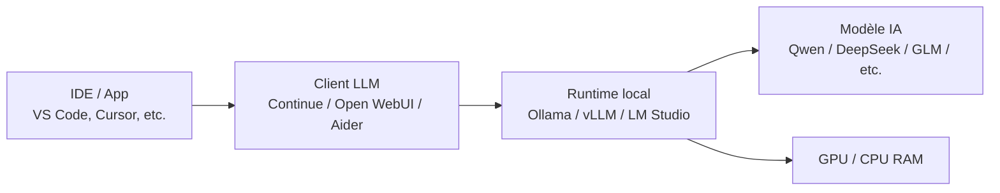
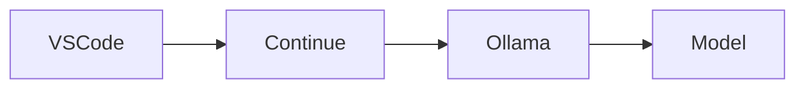
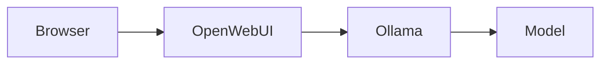
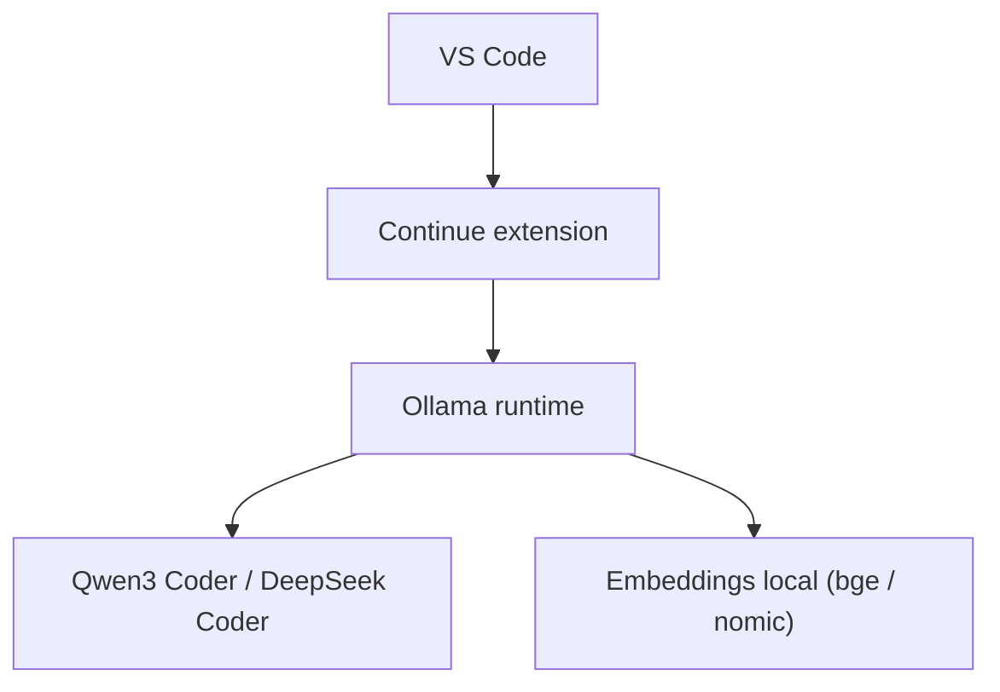
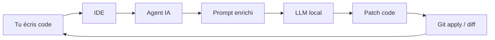
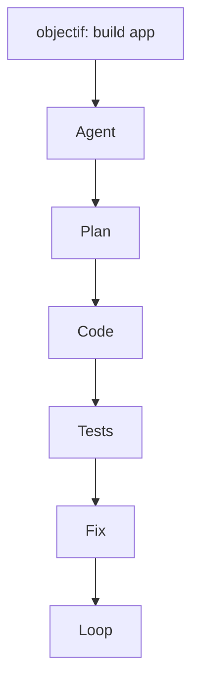

Si l'objectif est le **développement logiciel (génération de code, refactoring, debugging, agents de développement)**, le paysage des modèles open source / open weights a beaucoup évolué en juin 2026. Les écarts avec les meilleurs modèles propriétaires se sont fortement réduits, notamment sur les benchmarks de génie logiciel. ([BentoML][1])

Voici les modèles que je recommande.

| Modèle            | Excellent pour                               | Local | Niveau |
| ----------------- | -------------------------------------------- | ----- | ------ |
| DeepSeek V4 Pro   | développement complexe, architecture, agents | ✅     | ⭐⭐⭐⭐⭐  |
| GLM-5.x           | projets longs, raisonnement, refactoring     | ✅     | ⭐⭐⭐⭐⭐  |
| Kimi K2.6         | agents autonomes, gros contexte              | ✅     | ⭐⭐⭐⭐☆  |
| Qwen3 Coder Next  | IDE, vitesse, GPU modestes                   | ✅     | ⭐⭐⭐⭐☆  |
| DeepSeek V4 Flash | génération rapide et économique              | ✅     | ⭐⭐⭐⭐☆  |
| Gemma 3/4         | petits serveurs, fine-tuning                 | ✅     | ⭐⭐⭐☆☆  |

### 1. DeepSeek V4 Pro

Le meilleur choix général aujourd'hui.

Points forts :

* excellente qualité de code ;
* très bon sur les gros projets ;
* contexte très long ;
* très performant sur les benchmarks de programmation.

Idéal pour :

* backend ;
* frontend ;
* Rust ;
* Go ;
* Python ;
* C++ ;
* Java.

Si je devais auto-héberger un seul modèle aujourd'hui, ce serait probablement celui-ci. ([BentoML][1])

---

### 2. GLM-5.x

Très impressionnant pour les tâches d'ingénierie logicielle longues.

Il excelle sur :

* refactoring massif ;
* recherche de bugs ;
* compréhension de grandes bases de code ;
* raisonnement multi-fichiers.

Plusieurs comparatifs le placent parmi les meilleurs modèles open weights pour le développement. ([Kilo][2])

---

### 3. Kimi K2.6

Excellent si tu utilises :

* Claude Code-like workflows ;
* agents ;
* MCP ;
* automatisation complète.

Très bon pour :

* écrire plusieurs fichiers ;
* suivre un plan complexe ;
* utiliser des outils.

([Kilo][2])

---

### 4. Qwen3 Coder Next

Le meilleur rapport performance/ressources.

Avantages :

* rapide ;
* fonctionne bien localement ;
* parfait avec :

  * Ollama
  * LM Studio
  * Open WebUI
  * Continue.dev

Excellent choix avec une seule carte graphique. ([Kilo][2])

---

### 5. DeepSeek V4 Flash

Pour :

* génération rapide ;
* CI/CD ;
* auto-complétion ;
* revue de code.

Il est beaucoup moins coûteux que la version Pro tout en restant très performant. ([pioneer.ai][3])

---

## Si tu développes avec un IDE

En juin 2026, les combinaisons les plus populaires sont :

* **Cursor** + DeepSeek V4 Pro
* **VS Code** + Continue + Qwen3 Coder
* **OpenHands** + GLM-5
* **Aider** + DeepSeek
* **Claude Code** avec un backend open-weight via API ou hébergé localement

Les agents open source gagnent rapidement en maturité, notamment pour les workflows autonomes. ([TechRadar][4])

## Si tu veux tout faire tourner localement

Selon le matériel :

* **24 Go de VRAM** : Qwen3 Coder, Gemma, petites variantes DeepSeek.
* **48–80 Go de VRAM** : DeepSeek V4 Flash, GLM-5 en versions adaptées.
* **Serveur multi-GPU (≥160 Go de VRAM)** : DeepSeek V4 Pro, GLM-5, Kimi K2.6 pour une expérience proche des meilleurs services cloud. ([Kilo][2])

## Mon classement (juin 2026)

1. 🥇 DeepSeek V4 Pro
2. 🥈 GLM-5.x
3. 🥉 Kimi K2.6
4. Qwen3 Coder Next
5. DeepSeek V4 Flash
6. Gemma 3/4
7. Mistral (selon la variante)
8. Llama (toujours solide, mais moins compétitif en génération de code face aux leaders récents) ([Taskade][5])

Pour un développeur en 2026, une pile très performante est : **VS Code + Continue + DeepSeek V4 Pro (API ou auto-hébergé)** pour les tâches exigeantes, complétée par **Qwen3 Coder Next** en local pour les itérations rapides.

[1]: https://www.bentoml.com/blog/navigating-the-world-of-open-source-large-language-models?utm_source=chatgpt.com "The Best Open-Source LLMs in 2026"
[2]: https://kilo.ai/open-source-models?utm_source=chatgpt.com "Best Open-Source & Open-Weight Coding Models (2026)"
[3]: https://pioneer.ai/blog/how-to-choose-the-best-coding-models-in-2026?utm_source=chatgpt.com "How to Choose the Best Coding Models (2026 Edition)"
[4]: https://www.techradar.com/pro/how-to-automate-workflows-using-open-source-ai-agents?utm_source=chatgpt.com "How to automate workflows using open-source AI agents"
[5]: https://www.taskade.com/blog/open-source-llms?utm_source=chatgpt.com "9 Best Open-Source AI LLMs in 2026, Ranked for Real Work"

# Utilisation en Local
Oui. Je vais te montrer **comment utiliser des modèles open source en local pour le développement**, avec une vue claire de l’architecture + les outils concrets.

---

# 🧠 1. Vue d’ensemble (comment ça marche en local)

Quand tu fais tourner un LLM en local, tu as toujours cette architecture :



👉 En résumé :

* ton IDE envoie une requête
* un outil intermediaire (client)
* un moteur d’inférence exécute le modèle
* ton GPU calcule les tokens

---

# ⚙️ 2. Les 3 façons principales de faire tourner un modèle en local

## 🥇 Option A — Ultra simple : **Ollama**

👉 Le plus utilisé en 2026 pour dev local.

### ✔️ Avantages

* installation facile
* API locale automatique
* compatible VS Code, Cursor, Open WebUI
* très stable

### 🔧 Installation

```bash
curl -fsSL https://ollama.com/install.sh | sh
```

### ▶️ Lancer un modèle

```bash
ollama run qwen3-coder
```

ou

```bash
ollama run deepseek-coder
```

### 🌐 API locale

Ollama expose automatiquement :

```
http://localhost:11434
```

---

## 🥈 Option B — Interface dev + IA : **LM Studio**

👉 parfait si tu veux une interface type “ChatGPT local”

### ✔️ Avantages

* GUI simple
* téléchargement modèles intégré
* serveur API local

### Utilisation

1. installer LM Studio
2. télécharger modèle (GGUF)
3. activer “Local Server”
4. utiliser API OpenAI-compatible

---

## 🥉 Option C — Pro / scalable : **vLLM**

👉 utilisé pour les gros modèles type DeepSeek V4 / GLM-5

### ✔️ Avantages

* très rapide (batching)
* GPU optimisé
* production ready

### Exemple lancement

```bash
python -m vllm.entrypoints.openai.api_server \
  --model deepseek-ai/deepseek-coder
```

---

# 🧩 3. Les outils côté développement (important)

## 💻 IDE + plugins

### VS Code + Continue (très populaire)

* complet
* multi-modèles
* connecte Ollama / API locale



---

### Cursor (plus “agent dev”)

* IA intégrée
* fonctionne avec endpoint local ou cloud

---

### Aider (CLI dev assistant)

Très puissant pour coder directement dans un repo :

```bash
aider --model ollama/qwen3-coder
```

---

### Open WebUI (type ChatGPT local)



---

# 🧱 4. Stack recommandé (simple et efficace)

## 🔥 Setup idéal DEV local en 2026



---

# 🧠 5. Choix des modèles selon matériel

## 💻 Laptop / 16–24 GB RAM

* Qwen3 Coder (7B / 14B quantized)
* DeepSeek coder small
* Gemma coder light

👉 runtime : Ollama / LM Studio

---

## 🖥️ GPU 24–48 GB

* Qwen3 32B
* DeepSeek Coder large
* GLM-5 small variants

👉 runtime : Ollama + CUDA / vLLM léger

---

## 🏢 Serveur 80GB+

* DeepSeek V4 Pro
* GLM-5 full
* Kimi K2.6

👉 runtime : vLLM / SGLang

---

# 🔄 6. Pipeline complet dev (très concret)



👉 C’est exactement comme un “pair programmer automatisé”.

---

# 🚀 7. Exemple concret (setup en 10 minutes)

## Étapes :

### 1. Installer Ollama

```bash
curl -fsSL https://ollama.com/install.sh | sh
```

### 2. Lancer modèle dev

```bash
ollama run qwen3-coder
```

### 3. Installer VS Code extension

* Continue.dev

### 4. Configurer :

```json
{
  "model": "ollama/qwen3-coder"
}
```

### 5. Coder directement :

* refactor
* debug
* génération de fonctions
* tests

---

# 🧩 8. Bonus : mode agent autonome

Avec Aider ou OpenHands :



👉 le modèle modifie directement ton repo Git

---

# 🧠 Conclusion simple

Si tu veux aller droit au but :

* **Débutant local dev IA** → Ollama + Qwen3 Coder + VS Code
* **Dev avancé** → Continue + Ollama + DeepSeek
* **Agent autonome** → Aider / OpenHands
* **Perf max serveur** → vLLM + DeepSeek V4 / GLM-5

---

Si tu veux, je peux te faire :

* un **setup exact selon ton PC (RAM/GPU)**
* un **docker-compose complet prêt à lancer**
* ou un **stack “type Cursor open source” 100% local**

