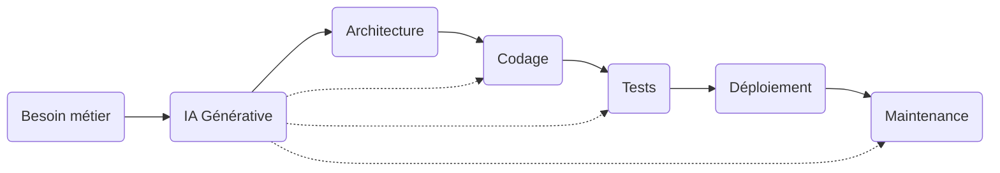
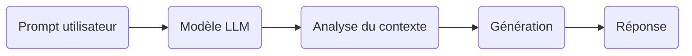
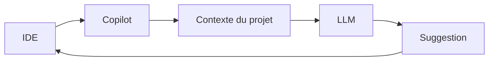
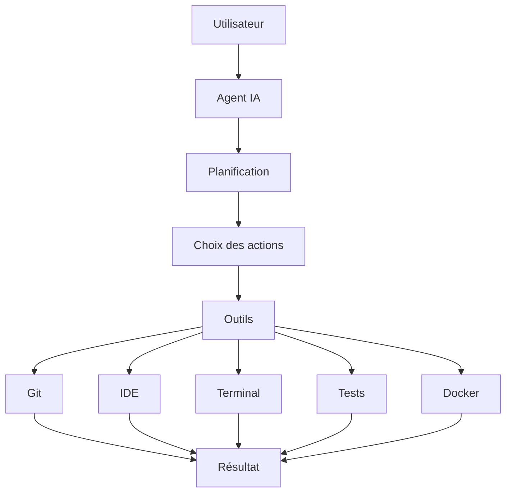
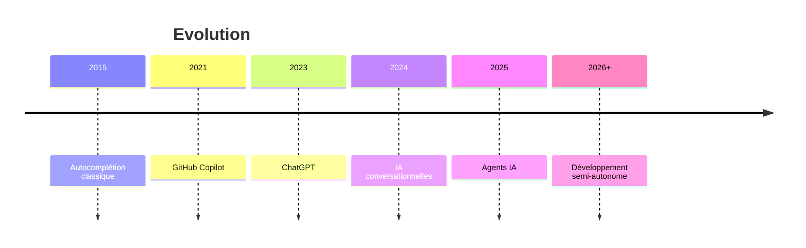
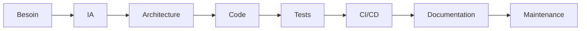

# L'IA au cœur du développement applicatif

## Tutoriel complet pour une présentation

> **Objectif :** comprendre comment l'IA transforme le développement logiciel, quels outils utiliser, leurs avantages, leurs limites et comment le métier de développeur évolue.

---

# Plan de la présentation

1. Pourquoi l'IA révolutionne le développement logiciel
2. Comprendre les IA génératives
3. GitHub Copilot
4. Les agents IA
5. Comparaison des différents outils
6. Cas d'usage
7. Gains et limites
8. Bonnes pratiques
9. L'évolution du développement logiciel
10. Le développeur de demain
11. Perspectives

---

# 1. Pourquoi l'IA révolutionne le développement ?

Pendant des décennies, le développement logiciel consistait essentiellement à :

```
Besoin
   ↓
Analyse
   ↓
Conception
   ↓
Codage
   ↓
Tests
   ↓
Déploiement
```

Aujourd'hui, l'IA intervient à presque toutes les étapes.



L'IA devient un **coéquipier** du développeur.

---

# 2. Les IA génératives

## Définition

Une IA générative est un modèle capable de produire :

* du texte
* du code
* des images
* des documents
* des schémas
* des tests
* des explications

à partir d'un simple prompt.

Exemples :

* ChatGPT
* Claude
* Gemini
* Mistral
* DeepSeek

---

## Fonctionnement simplifié



Le modèle ne "comprend" pas réellement le code.

Il prédit le mot (ou le token) suivant le plus probable.

---

# Cas d'usage des IA génératives

## Génération de code

Exemple :

```
Créer une API REST Spring Boot avec CRUD.
```

L'IA génère :

* contrôleurs
* services
* repositories
* DTO
* documentation

---

## Documentation

Transformer ceci :

```java
public int calcul(int a,int b){
return a+b;
}
```

en

```
Cette méthode additionne deux nombres.
```

---

## Migration

Exemple :

```
Convertir ce projet Java 8 vers Java 21
```

---

## Revue de code

L'IA détecte :

* duplications
* mauvaises pratiques
* dette technique
* complexité

---

## Génération de tests

Elle produit :

* tests unitaires
* tests d'intégration
* mocks

---

## Explication d'un code legacy

```
Explique-moi cette méthode de 500 lignes.
```

---

# Avantages

✅ Très rapide

✅ Accessible

✅ Polyvalente

✅ Excellente pédagogie

---

# Limites

❌ Hallucinations

❌ Peut inventer des API

❌ Ne connaît pas forcément votre projet

❌ Ne remplace pas un architecte

❌ Peut produire du code peu maintenable

---

# 3. GitHub Copilot

GitHub Copilot est un assistant intégré directement dans l'IDE.

Il travaille **dans le contexte du projet**.

Exemple :

Vous commencez à écrire :

```java
public class UserService
```

Il propose immédiatement :

* méthodes
* tests
* commentaires
* appels API

---

## Fonctionnement



---

# Cas d'usage Copilot

## Complétion de code

Vous tapez :

```java
for(
```

Il complète.

---

## Génération de méthodes

Vous écrivez :

```java
// calculer la TVA
```

Il génère la méthode.

---

## Création de tests

À partir d'une classe existante.

---

## Refactoring

Transformer :

```
if imbriqués
```

en

```
switch
```

ou

```
pattern matching
```

---

## Documentation

Création automatique de JavaDoc.

---

# Gains

Très gros gain sur :

* code répétitif
* boilerplate
* DTO
* Mapper
* Repository

Gain moyen :

30 à 60 %

selon les études et les usages.

---

# Limites

Il ne connaît pas toujours :

* les règles métier
* les contraintes de sécurité
* les dépendances internes

Il faut toujours relire.

---

# 4. Les agents IA

C'est la grande évolution actuelle.

Une IA générative répond.

Un agent agit.

---

## Définition

Un agent IA peut :

* réfléchir
* planifier
* utiliser des outils
* appeler des API
* modifier plusieurs fichiers
* lancer des tests
* corriger ses erreurs

---

## Architecture



---

# Exemple concret

Demande :

```
Ajoute l'authentification OAuth2 à mon projet.
```

Un agent peut :

* analyser le projet
* identifier Spring Security
* modifier le pom.xml
* créer la configuration
* ajouter les contrôleurs
* créer les tests
* lancer Maven
* corriger les erreurs

sans intervention humaine.

---

# Cas d'usage

## Migration complète

Java 8 → Java 21

---

## Création d'une feature

```
Créer la gestion des commandes.
```

L'agent :

* crée les tables
* API
* DTO
* services
* tests

---

## Refactoring global

Renommer une architecture entière.

---

## Audit

Détecter :

* failles
* dette
* duplication

---

## Génération d'application

Prompt :

```
Créer une application de gestion d'hôpital.
```

L'agent produit :

* architecture
* code
* documentation
* CI/CD

---

# Gains

Très gros gain.

On ne parle plus de quelques lignes.

Mais de fonctionnalités entières.

---

# Limites

Très coûteux

Plus lent

Demande de la supervision

Peut casser le projet

Toujours besoin de validation humaine

---

# Comparaison

| Critère                    | IA générative | Copilot | Agent IA |
| -------------------------- | ------------- | ------- | -------- |
| Génère du texte            | ✅             | Peu     | Oui      |
| Génère du code             | ✅             | ✅       | ✅        |
| Connaît le projet          | Peu           | Oui     | Oui      |
| Modifie plusieurs fichiers | Non           | Peu     | Oui      |
| Lance les tests            | Non           | Non     | Oui      |
| Corrige automatiquement    | Non           | Peu     | Oui      |
| Utilise des outils         | Non           | Peu     | Oui      |
| Autonomie                  | Faible        | Moyenne | Forte    |

---

# Évolution de l'IA dans le développement



---

# Où intervient l'IA ?



---

# Les bonnes pratiques

## Toujours vérifier

L'IA peut produire :

* des bugs
* des failles
* des erreurs

---

## Utiliser des prompts précis

Mauvais :

```
Fais-moi une API.
```

Bon :

```
Créer une API REST Spring Boot 3 Java 21 utilisant PostgreSQL, JPA, JWT, avec architecture hexagonale et tests JUnit.
```

---

## Toujours relire

L'IA n'est pas responsable.

Le développeur l'est.

---

## Ne jamais envoyer

* mots de passe
* données clients
* secrets
* informations sensibles

---

## Garder une architecture cohérente

L'IA peut produire :

* plusieurs styles
* plusieurs conventions

Le développeur garde la cohérence.

---

# Les risques

## Hallucinations

API inexistantes

Bibliothèques inventées

Fonctions fictives

---

## Dette technique

L'IA peut produire :

* beaucoup de code
* parfois de mauvaise qualité

---

## Dépendance

Le développeur doit continuer :

* à comprendre
* à concevoir
* à tester

---

# Le développeur du futur

Aujourd'hui :

```
80 % code
20 % conception
```

Demain :

```
30 % code

70 %

- conception
- architecture
- validation
- sécurité
- prompts
- pilotage des IA
```

---

```mermaid
flowchart TD

Développeur

↓

Définition du besoin

↓

Agent IA

↓

Production

↓

Validation humaine

↓

Déploiement
```

---

# Les nouvelles compétences

Le développeur devra maîtriser :

* Architecture
* Cloud
* Sécurité
* IA
* Prompt Engineering
* Relecture de code IA
* Gouvernance
* Data

Le métier devient plus stratégique.

---

# Perspectives

Dans les prochaines années :

* Les agents développeront des fonctionnalités complètes.
* Les revues de code seront largement automatisées.
* Les tests et les migrations seront générés de bout en bout.
* L'IA assistera aussi les architectes et les chefs de projet.
* Les équipes évolueront vers un modèle où un développeur pilote plusieurs agents spécialisés.

L'enjeu ne sera plus uniquement de **savoir coder**, mais de **savoir concevoir, guider, contrôler et intégrer le travail produit par les IA**.

---

# Conclusion

L'IA ne remplace pas le développeur, elle transforme son rôle.

* **Les IA génératives** sont des assistants de création : elles produisent du texte, du code, de la documentation et des explications à partir d'instructions en langage naturel.
* **GitHub Copilot** est un copilote intégré à l'environnement de développement : il accélère l'écriture du code grâce au contexte du projet et aux suggestions en temps réel.
* **Les agents IA** vont plus loin : ils planifient, utilisent des outils (terminal, Git, tests, CI/CD), modifient plusieurs fichiers et peuvent réaliser des tâches complexes de manière semi-autonome.

Le développeur de demain sera moins un « producteur de lignes de code » qu'un **architecte, superviseur et orchestrateur** d'agents intelligents. Ses compétences clés porteront davantage sur la compréhension du métier, l'architecture logicielle, la sécurité, la qualité et la capacité à collaborer efficacement avec l'IA. Les entreprises qui sauront combiner expertise humaine et intelligence artificielle gagneront en productivité tout en conservant la maîtrise de la qualité et de la gouvernance de leurs applications.
