# Tuto complet : les frameworks d'agents runtime (OpenClaw, Hermes Agent, et architectures similaires)

Les frameworks d'agents runtime représentent la nouvelle génération d'applications IA. Contrairement à un simple chatbot qui répond à une question puis s'arrête, un agent runtime est capable de :

* planifier des actions
* utiliser des outils
* naviguer sur le web
* exécuter du code
* maintenir un état
* collaborer avec d'autres agents
* fonctionner en continu

Des projets comme [OpenClaw](https://github.com/claw-project/openclaw?utm_source=chatgpt.com), [Hermes Agent](https://github.com/NousResearch/Hermes-Agent?utm_source=chatgpt.com), [LangGraph](https://langchain.com/langgraph?utm_source=chatgpt.com), [AutoGen](https://microsoft.github.io/autogen/?utm_source=chatgpt.com) ou [CrewAI](https://www.crewai.com?utm_source=chatgpt.com) reposent sur les mêmes principes fondamentaux.

---

# 1. Qu'est-ce qu'un runtime d'agents ?

Un runtime est l'environnement qui exécute les agents.

Sans runtime :

```text
Utilisateur
      ↓
     LLM
      ↓
 Réponse
```

Avec runtime :

```text
Utilisateur
      ↓
 Runtime Agent
      ↓
 ┌───────────────┐
 │ LLM           │
 │ Mémoire       │
 │ Outils        │
 │ Planification │
 │ Exécution     │
 └───────────────┘
      ↓
 Résultat
```

Le runtime devient l'orchestrateur.

---

# 2. Architecture générale

Diagramme classique :

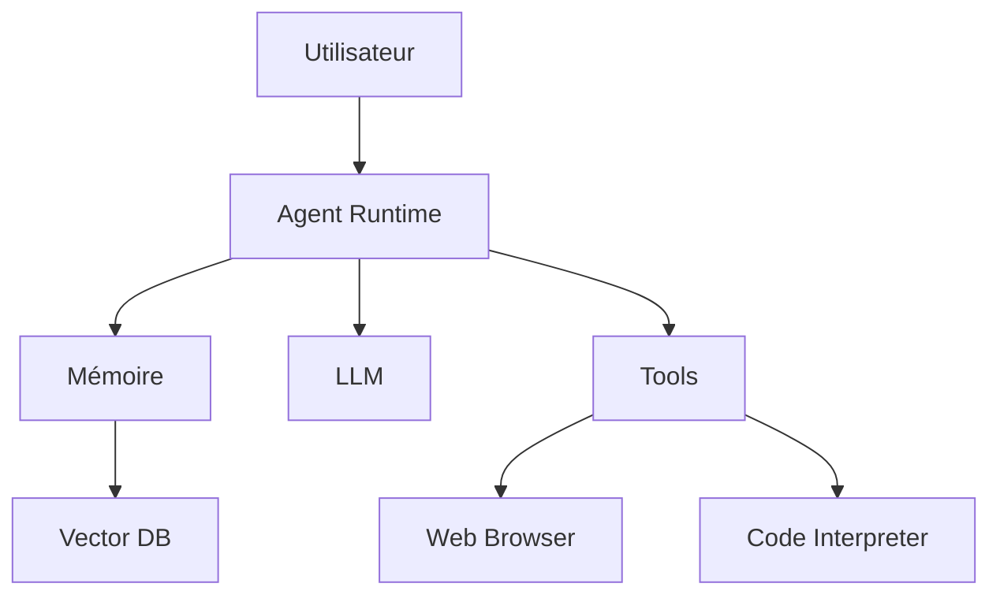

L'agent ne fait pas tout lui-même.

Il délègue :

* raisonnement → LLM
* stockage → mémoire
* actions → outils
* recherche → navigateur

---

# 3. Cycle de vie d'un agent moderne

La plupart des frameworks utilisent une boucle :

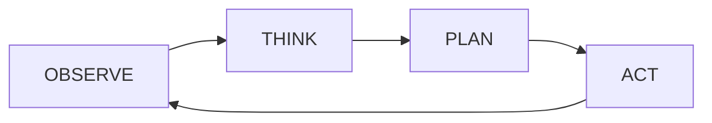

ou :

```text
Observe
Think
Act
Reflect
Repeat
```

C'est ce qu'on appelle souvent :

* ReAct Pattern
* Agent Loop
* Agentic Workflow

---

# 4. Pattern ReAct

ReAct = Reason + Act

Exemple :

Utilisateur :

```text
Trouve les 3 meilleurs hôtels à Tokyo.
```

L'agent produit :

```text
Thought:
Je dois rechercher des hôtels.

Action:
search_hotels("Tokyo")

Observation:
Résultats obtenus.

Thought:
Je peux maintenant comparer.

Action:
rank_hotels()

Observation:
Classement terminé.

Final Answer:
...
```

Diagramme :

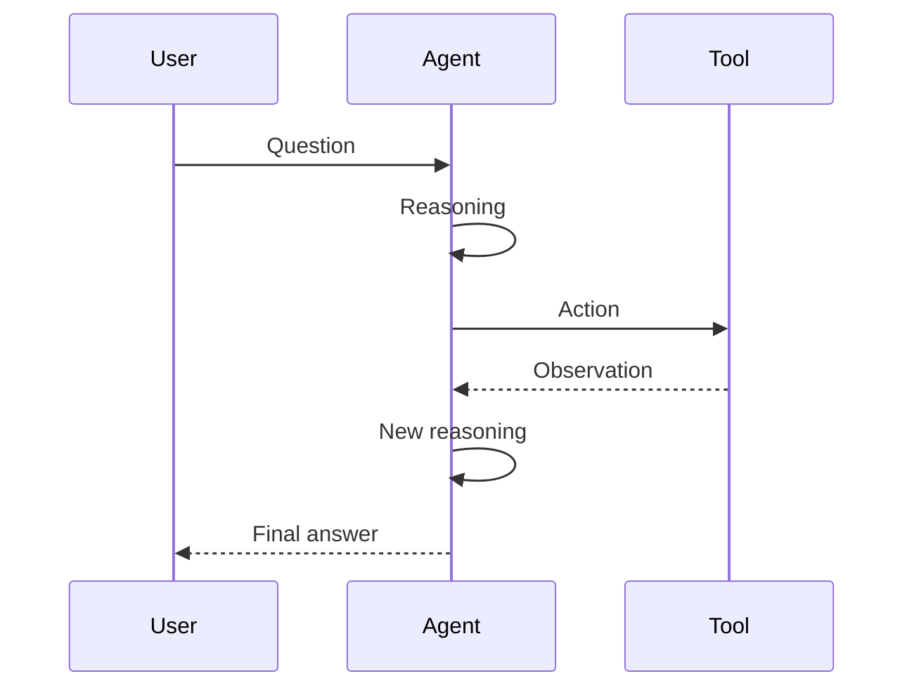

C'est le cœur d'OpenClaw, Hermes Agent et LangGraph.

---

# 5. OpenClaw

OpenClaw est inspiré des architectures de type :

* Claude Computer Use
* Operator
* Browser Agents

Son objectif :

> permettre à un LLM de contrôler un ordinateur.

Architecture :

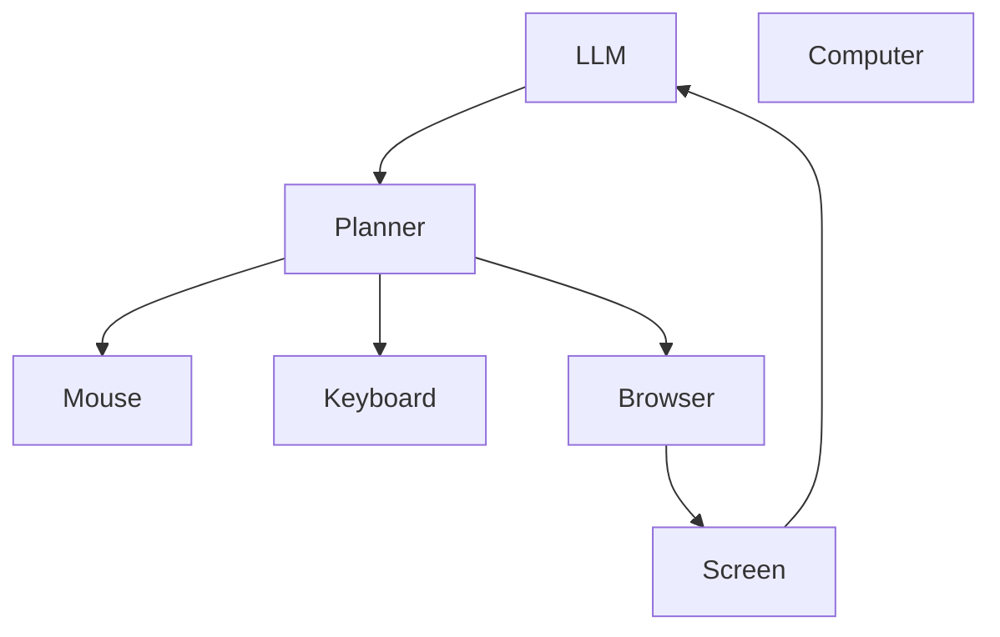

Cycle :

1. capture écran
2. analyse vision
3. raisonnement
4. clic
5. nouvelle capture

Boucle continue.

---

# 6. Comment OpenClaw "voit"

L'écran est transformé en image.

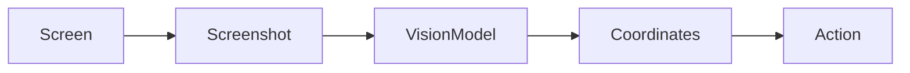

Exemple :

```text
Bouton Login détecté

x=420
y=270

Action:
click(420,270)
```

On parle souvent de :

* GUI Agent
* Computer Use Agent
* Desktop Agent

---

# 7. Hermes Agent

Projet de Nous Research.

Objectif :

Créer un agent autonome piloté par les modèles Hermes.

Architecture simplifiée :

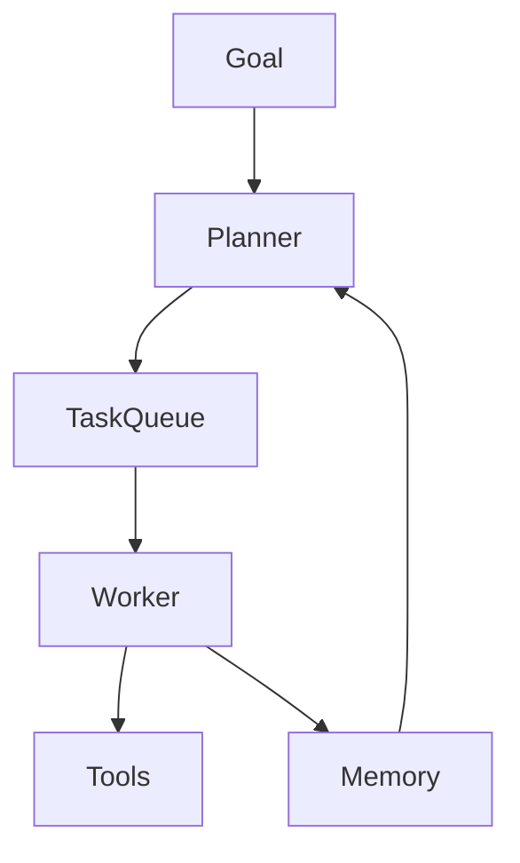

Différence importante :

Hermes met davantage l'accent sur :

* planification
* décomposition des tâches
* mémoire
* autonomie

---

# 8. Planification hiérarchique

Les agents modernes utilisent souvent une structure :

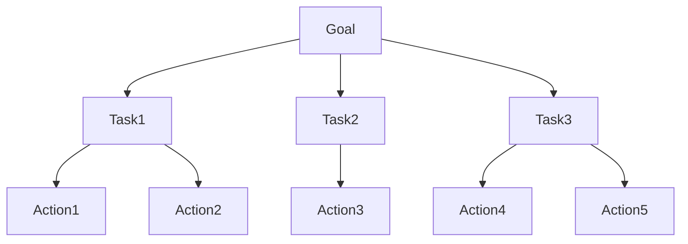

Exemple :

Objectif :

```text
Créer un rapport concurrentiel.
```

Le planner génère :

```text
1. Trouver concurrents
2. Analyser produits
3. Comparer prix
4. Générer rapport
```

Puis les workers exécutent.

---

# 9. Multi-Agent Systems

De nombreux runtimes utilisent plusieurs agents.

Architecture :

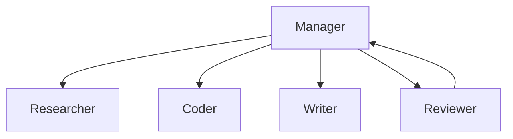

Chaque agent possède :

* rôle
* outils
* mémoire

Exemple :

Researcher :

```text
Recherche web
```

Coder :

```text
Analyse code
```

Writer :

```text
Rédaction
```

---

# 10. Architecture AutoGen

Dans AutoGen :

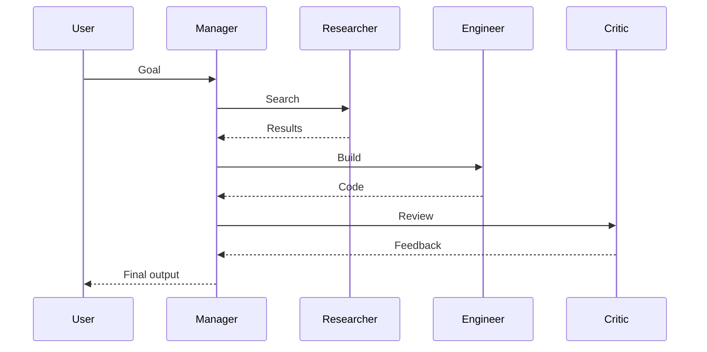

C'est un des modèles les plus influents actuellement.

---

# 11. Mémoire des agents

Sans mémoire :

```text
Question
Réponse
Fin
```

Avec mémoire :

```text
Question
Réponse

Mémoire mise à jour

Question suivante
```

Architecture :

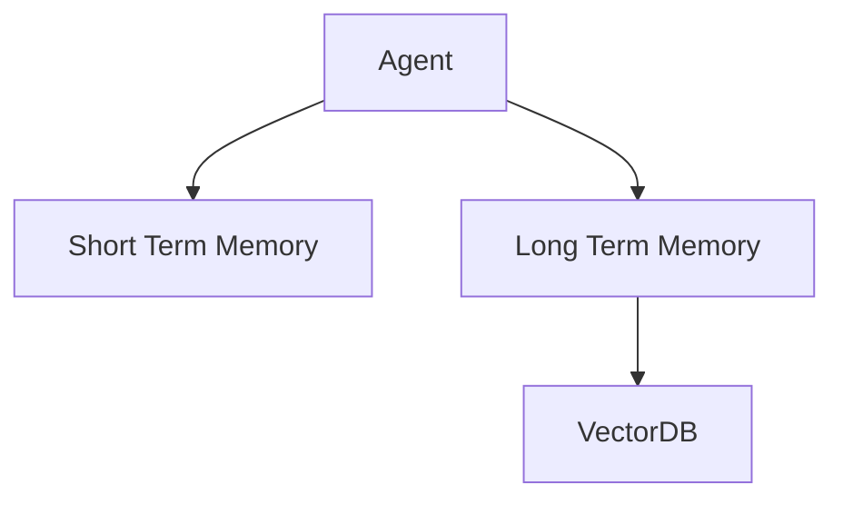

---

# 12. Types de mémoire

## Court terme

Conversation actuelle.

```text
Contexte du prompt
```

---

## Long terme

Historique persistant.

```text
Préférences utilisateur
Projets
Documents
```

---

## Mémoire vectorielle

Recherche sémantique.

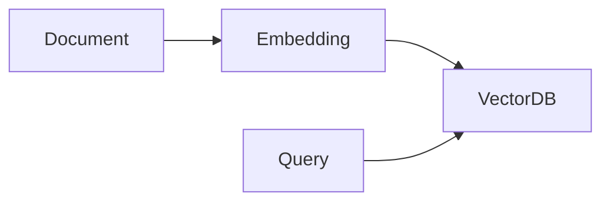

Technologies :

* [Qdrant](https://qdrant.tech?utm_source=chatgpt.com)
* [Weaviate](https://weaviate.io?utm_source=chatgpt.com)
* [Pinecone](https://www.pinecone.io?utm_source=chatgpt.com)
* [ChromaDB](https://www.trychroma.com?utm_source=chatgpt.com)

---

# 13. Tool Calling

Le runtime expose des outils.

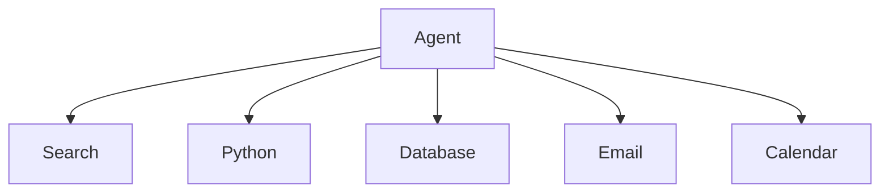

Exemple :

```json
{
  "tool":"search_web",
  "args":{
     "query":"OpenClaw github"
  }
}
```

Puis :

```json
{
  "result":"..."
}
```

---

# 14. Runtime Event Loop

Tous les grands frameworks utilisent une boucle proche de celle-ci :

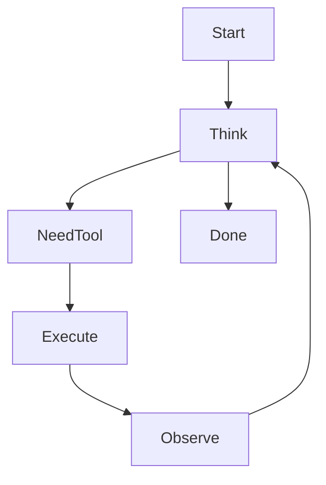

Pseudo-code :

```python
while not done:

    thought = llm(context)

    if thought.tool:
        result = run_tool()
        context += result

    else:
        done = True
```

---

# 15. Runtime distribué

Les architectures avancées utilisent plusieurs workers.

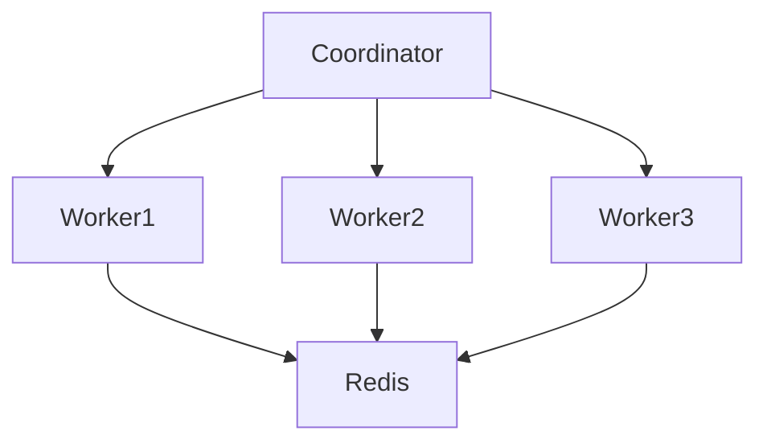

Stack fréquente :

* Redis
* Kafka
* RabbitMQ
* PostgreSQL

---

# 16. Architecture "Computer Use"

La tendance 2025-2026.

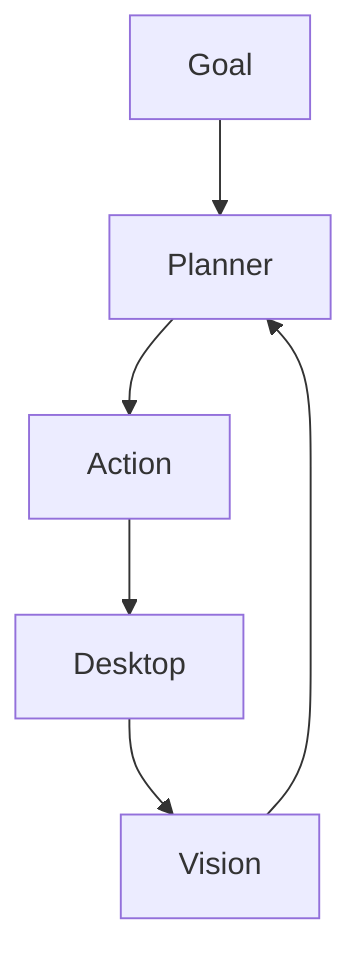

Principe :

```text
Voir
Réfléchir
Cliquer
Observer
Recommencer
```

C'est exactement la philosophie d'OpenClaw.

---

# 17. Comparaison des principaux frameworks

| Framework    | Multi-Agent | Tool Calling | Mémoire | GUI Control | Runtime avancé |
| ------------ | ----------- | ------------ | ------- | ----------- | -------------- |
| OpenClaw     | Moyen       | Oui          | Oui     | Excellent   | Oui            |
| Hermes Agent | Oui         | Oui          | Oui     | Non         | Oui            |
| LangGraph    | Excellent   | Oui          | Oui     | Non         | Excellent      |
| AutoGen      | Excellent   | Oui          | Oui     | Non         | Excellent      |
| CrewAI       | Excellent   | Oui          | Oui     | Non         | Bon            |

---

# 18. Architecture moderne recommandée (2026)

Si tu veux construire un agent de niveau production aujourd'hui :

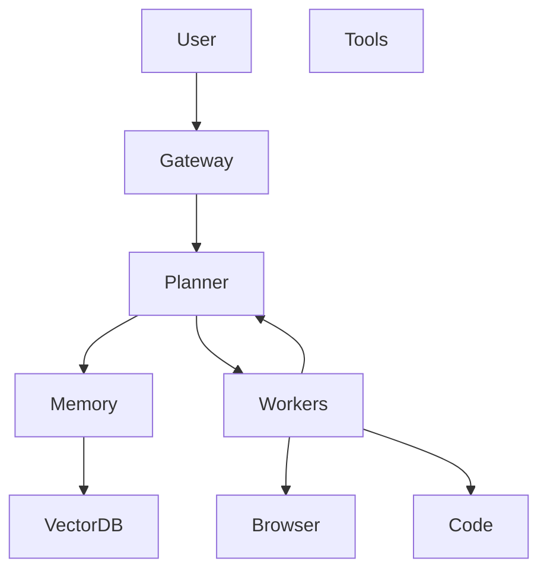

Stack typique :

* modèle : [OpenAI Platform](https://platform.openai.com?utm_source=chatgpt.com) ou [Anthropic](https://www.anthropic.com?utm_source=chatgpt.com)
* orchestration : [LangGraph](https://langchain.com/langgraph?utm_source=chatgpt.com)
* mémoire : [Qdrant](https://qdrant.tech?utm_source=chatgpt.com)
* queue : [Redis](https://redis.io?utm_source=chatgpt.com)
* observabilité : [LangSmith](https://www.langchain.com/langsmith?utm_source=chatgpt.com)
* navigateur : [Playwright](https://playwright.dev?utm_source=chatgpt.com)

---

# Conclusion

Les frameworks comme OpenClaw, Hermes Agent, LangGraph ou AutoGen partagent tous le même modèle mental :

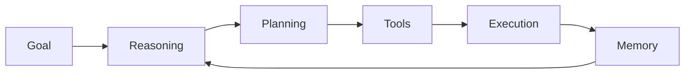

La différence entre eux ne réside pas vraiment dans le LLM utilisé, mais dans la qualité de :

1. l'orchestration
2. la mémoire
3. la planification
4. l'exécution d'outils
5. la gestion des erreurs
6. la collaboration multi-agents

C'est cette couche de runtime qui transforme un simple modèle de langage en véritable système agentique autonome.
