# Les algorithmes de tri
Les algorithmes de tri servent à organiser des données (souvent un tableau) 
dans un certain ordre, généralement croissant ou décroissant. 
En Java, ils sont très utilisés pour manipuler des listes, optimiser des recherches ou préparer des données.

# 1. <ins>Tri à bulles (Bubble Sort)</ins>
<div align="left">
	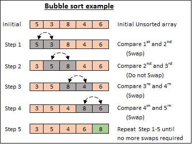
	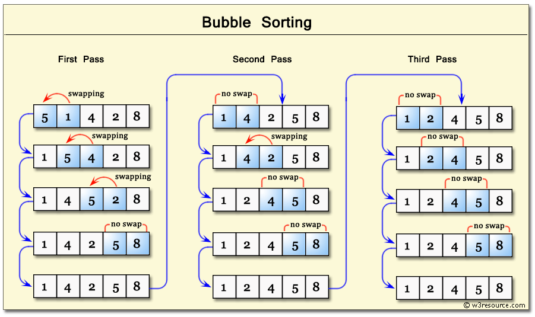
	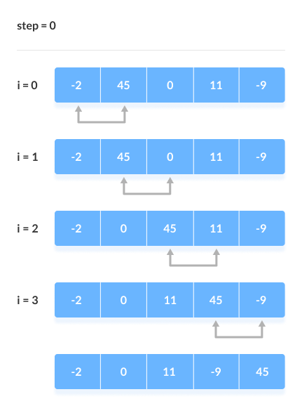
	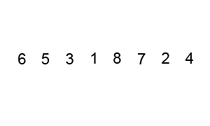
</div>

### Principe
On parcourt le tableau et on compare deux éléments voisins.<br>
S'ils sont dans le mauvais ordre, on les échange.<br>
Les plus grandes valeurs remontent vers la fin comme des bulles.

### Complexité
- Moyen : O(n²)
- Pire : O(n²)
- Mémoire : O(1)

### Code Java
```java 
public class BubbleSort {

    public static void bubbleSort(int[] array) {
        int n = array.length;
        boolean swapped;

        for (int i = 0; i < n - 1; i++) {
            swapped = false;

            for (int j = 0; j < n - i - 1; j++) {

                if (array[j] > array[j + 1]) {

                    int temp = array[j];
                    array[j] = array[j + 1];
                    array[j + 1] = temp;

                    swapped = true;
                }
            }

            if (!swapped) break;
        }
    }
}
```

# 2. <ins>Tri par insertion (Insertion Sort)</ins>
<div align="left">
	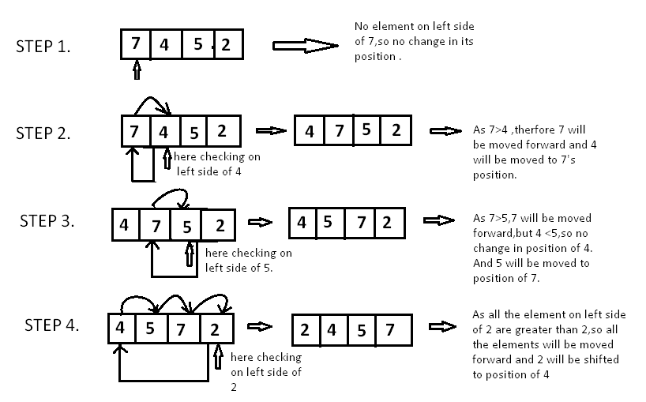
	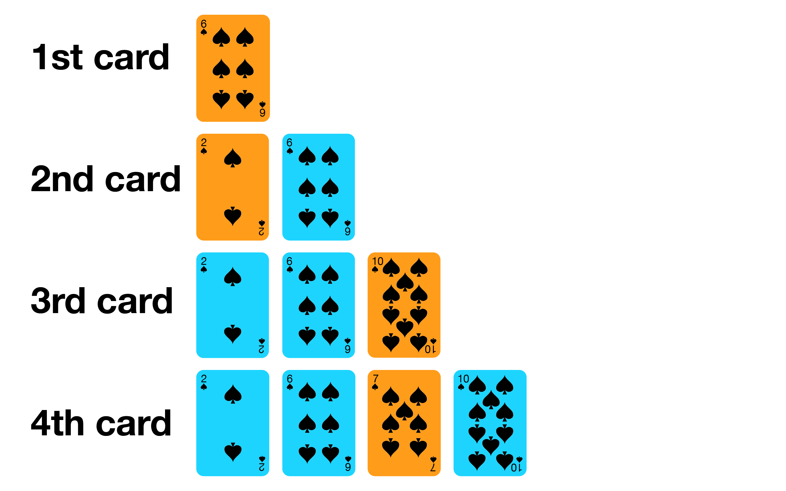
	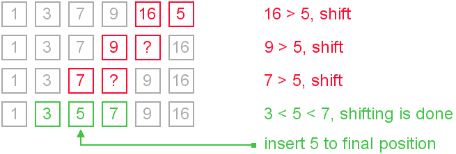
	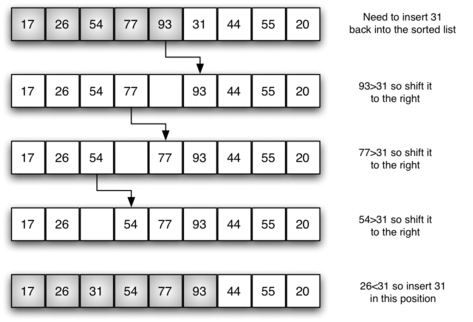
</div>

### Principe
Comme lorsqu’on trie des cartes dans sa main.<br>
On prend un élément et on l’insère au bon endroit dans la partie déjà triée.

### Complexité
- Meilleur cas : O(n)
- Moyen : O(n²)

### Code Java
```java 
public class InsertionSort {

    public static void insertionSort(int[] array) {

        for (int i = 1; i < array.length; i++) {

            int key = array[i];
            int j = i - 1;

            while (j >= 0 && array[j] > key) {
                array[j + 1] = array[j];
                j--;
            }

            array[j + 1] = key;
        }
    }
}
```

# 3. <ins>Tri par sélection (Selection Sort)</ins>
<div align="left">
	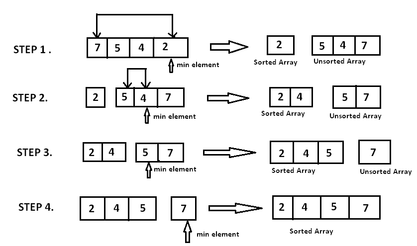
	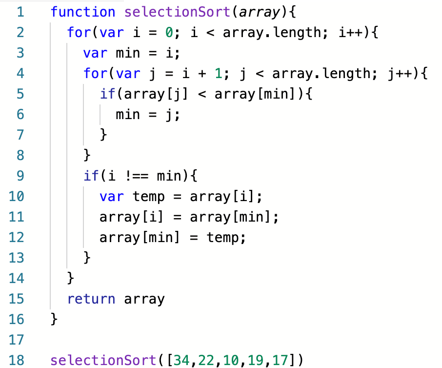
	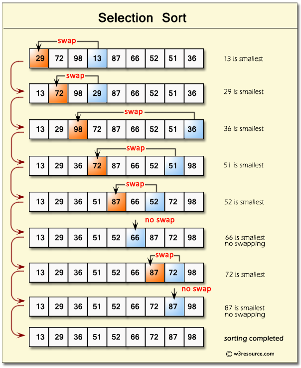
</div>

### Principe
On cherche le plus petit élément et on le met au début.<br>
Puis on recommence avec le reste du tableau.

### Complexité
- Toujours O(n²)

### Code Java
```java 
public class SelectionSort {

    public static void selectionSort(int[] array) {

        for (int i = 0; i < array.length - 1; i++) {

            int minIndex = i;

            for (int j = i + 1; j < array.length; j++) {

                if (array[j] < array[minIndex]) {
                    minIndex = j;
                }
            }

            int temp = array[minIndex];
            array[minIndex] = array[i];
            array[i] = temp;
        }
    }
}
```

# 4. <ins>Tri fusion (Merge Sort)</ins>
<div align="left">
	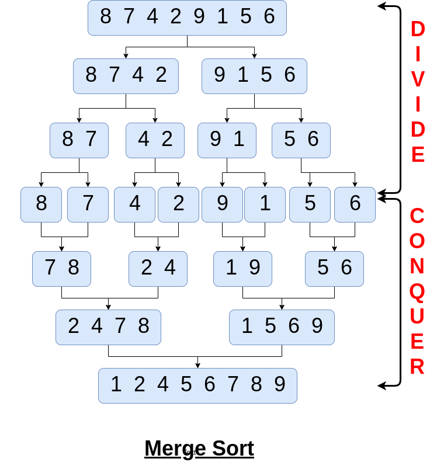
	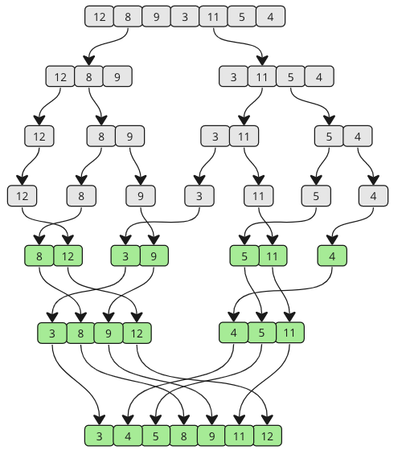
	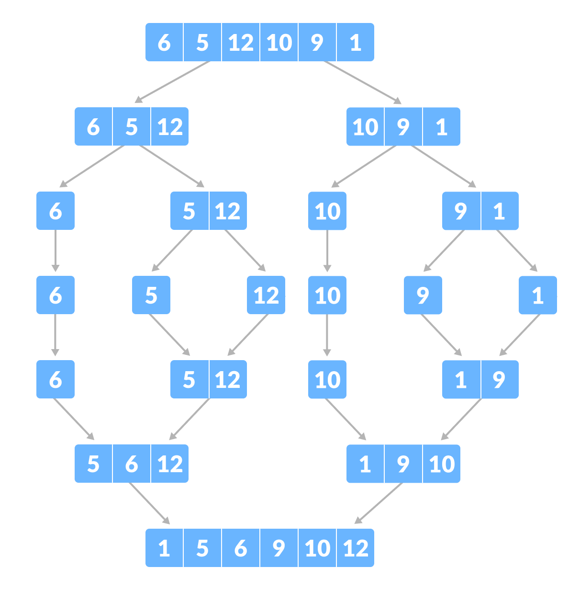
	
</div>

### Principe
Algorithme diviser pour régner :
- 1.Diviser le tableau en deux
- 2.Trier chaque partie
- 3.Fusionner les deux tableaux triés

### Complexité
- O(n log n) (très performant)
- nécessite de la mémoire supplémentaire

### Code Java
```java 
public class MergeSort {

    public static void mergeSort(int[] array, int left, int right) {

        if (left < right) {

            int mid = (left + right) / 2;

            mergeSort(array, left, mid);
            mergeSort(array, mid + 1, right);

            merge(array, left, mid, right);
        }
    }

    private static void merge(int[] array, int left, int mid, int right) {

        int n1 = mid - left + 1;
        int n2 = right - mid;

        int[] L = new int[n1];
        int[] R = new int[n2];

        for (int i = 0; i < n1; i++)
            L[i] = array[left + i];

        for (int j = 0; j < n2; j++)
            R[j] = array[mid + 1 + j];

        int i = 0, j = 0;
        int k = left;

        while (i < n1 && j < n2) {

            if (L[i] <= R[j]) {
                array[k++] = L[i++];
            } else {
                array[k++] = R[j++];
            }
        }

        while (i < n1)
            array[k++] = L[i++];

        while (j < n2)
            array[k++] = R[j++];
    }
}
```

# 5. <ins>Tri rapide (Quick Sort)</ins>
<div align="left">
	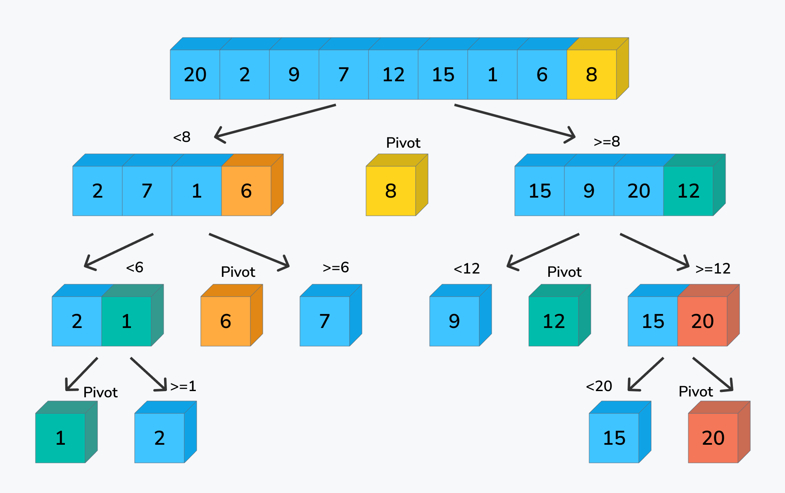
	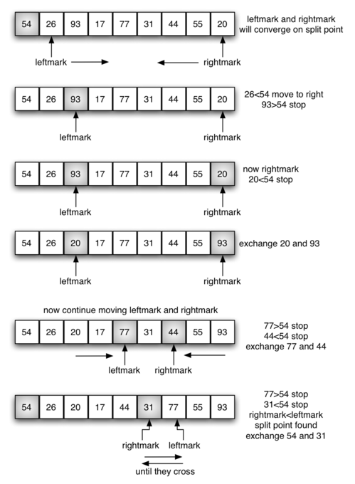
	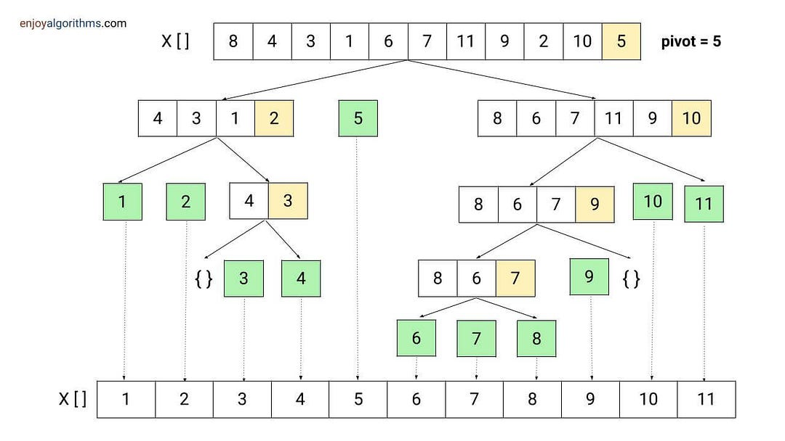
	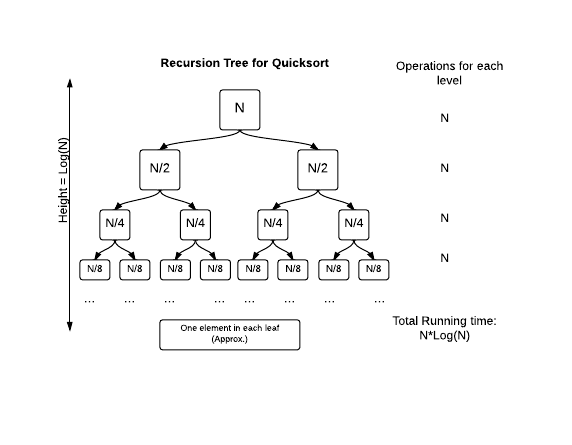
</div>

### Principe
- 1.Choisir un pivot
- 2.Mettre les valeurs plus petites à gauche
- 3.Mettre les plus grandes à droite
- 4.Répéter récursivement

### Complexité
- Moyenne : O(n log n)
- Pire : O(n²)
- Très utilisé en pratique

### Code Java
```java 
public class QuickSort {

    public static void quickSort(int[] array, int low, int high) {

        if (low < high) {

            int pi = partition(array, low, high);

            quickSort(array, low, pi - 1);
            quickSort(array, pi + 1, high);
        }
    }

    private static int partition(int[] array, int low, int high) {

        int pivot = array[high];
        int i = low - 1;

        for (int j = low; j < high; j++) {

            if (array[j] < pivot) {

                i++;

                int temp = array[i];
                array[i] = array[j];
                array[j] = temp;
            }
        }

        int temp = array[i + 1];
        array[i + 1] = array[high];
        array[high] = temp;

        return i + 1;
    }
}
```

# <ins>Comparaison des algorithmes</ins>
| Algorithme     | Complexité moyenne | Stable | Utilisation          |
| -------------- | ------------------ | ------ | -------------------- |
| Bubble Sort    | O(n²)              | Oui    | pédagogique          |
| Selection Sort | O(n²)              | Non    | simple               |
| Insertion Sort | O(n²)              | Oui    | petits tableaux      |
| Merge Sort     | O(n log n)         | Oui    | données volumineuses |
| Quick Sort     | O(n log n)         | Non    | très performant      |

💡 En Java réel, on utilise souvent :
```java 
Arrays.sort(array);
```