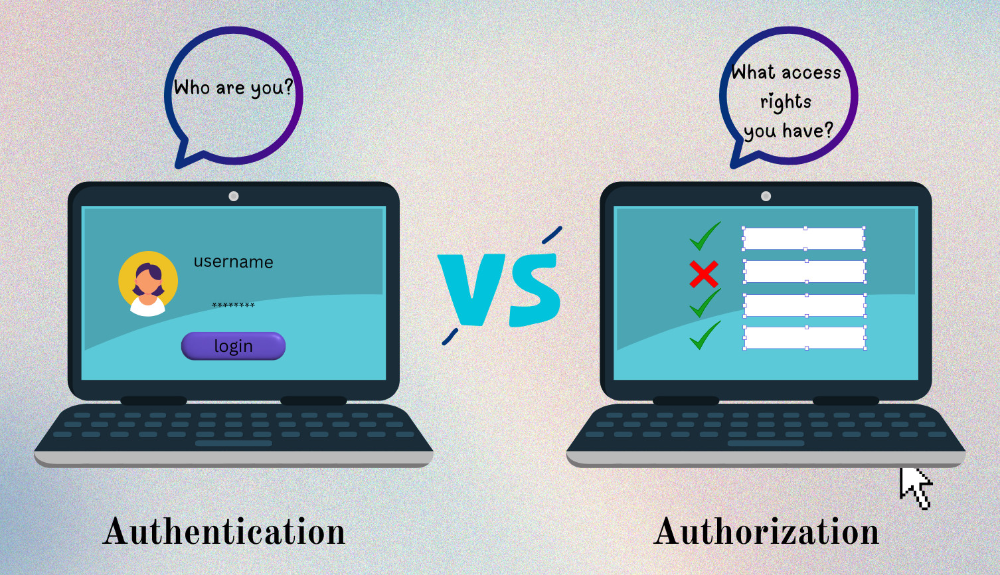
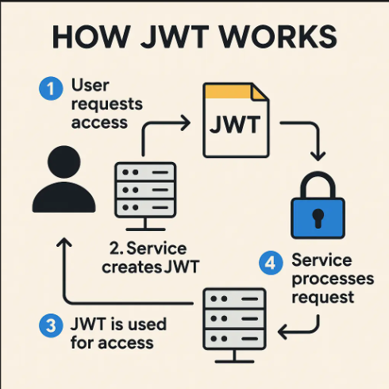
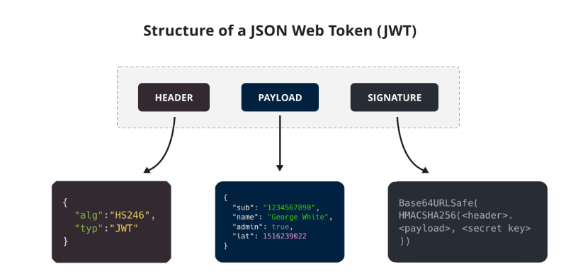
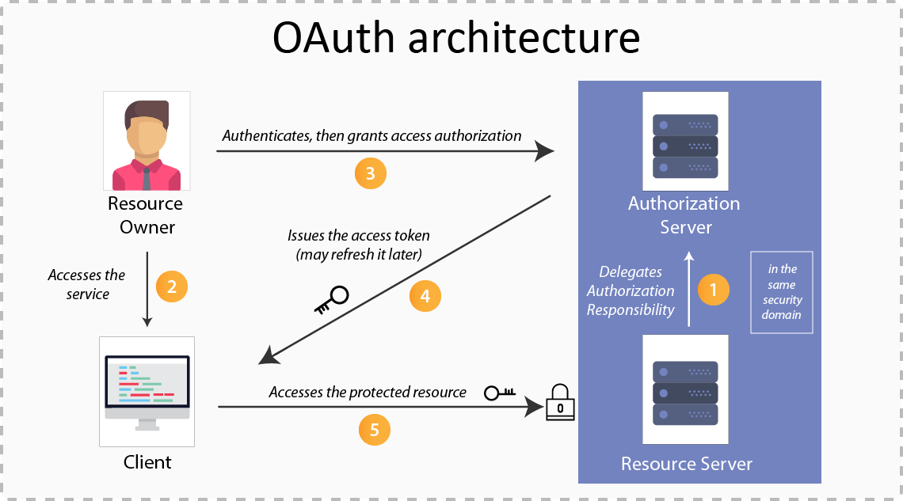
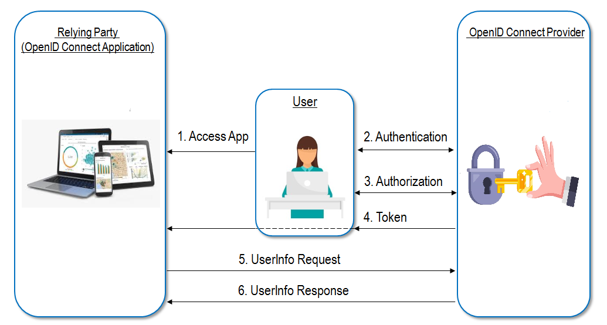
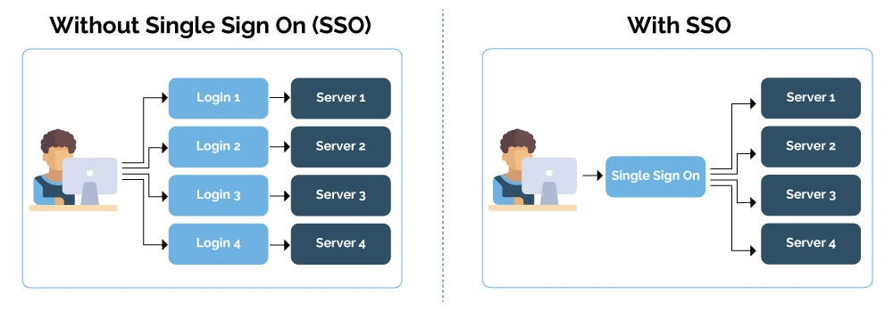
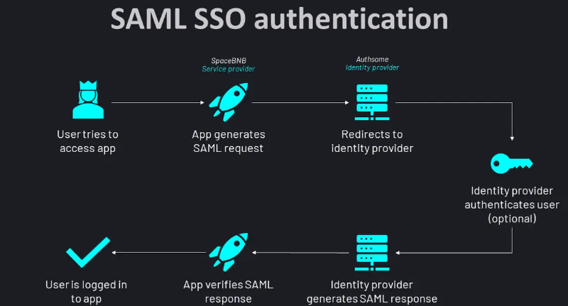

# 🔐 1. <ins>Authentification vs Autorisation</ins>
<div align="center">
	
</div>

**Avant tout :**
- Authentification (AuthN) = Qui es-tu ?
- Autorisation (AuthZ) = Qu’as-tu le droit de faire ?

**Exemple :**
- Login avec mot de passe → Authentification
- Accéder à ```/admin``` → Autorisation

# 🧾 2. <ins>JWT (JSON Web Token)</ins>
<div align="center">
	
</div>
👉 **Concept**
Un JWT est un token signé qui contient des informations (claims).

👉 **Format :**
```
header.payload.signature
```
<div align="center">
	
</div>

**Exemple :**
```
eyJhbGciOiJIUzI1NiIsInR5cCI6IkpXVCJ9...
```

📦 **Contenu d’un JWT**
```json
{
  "sub": "user123",
  "role": "ADMIN",
  "exp": 1712345678
}
```

🔄 **Fonctionnement**
- 1.L’utilisateur se connecte
- 2.Le serveur génère un JWT
- 3.Le client stocke le token (localStorage ou cookie)
- 4.Le client envoie :```Authorization: Bearer <token>```
- 5.Le serveur vérifie la signature

☕ **Exemple Java (Spring Boot)**<br>
Génération :
```java 
String token = Jwts.builder()
    .setSubject("user123")
    .claim("role", "ADMIN")
    .setIssuedAt(new Date())
    .setExpiration(new Date(System.currentTimeMillis() + 86400000))
    .signWith(SignatureAlgorithm.HS256, "secret")
    .compact();
```

Vérification :
```java
Claims claims = Jwts.parser()
    .setSigningKey("secret")
    .parseClaimsJws(token)
    .getBody();

String user = claims.getSubject();
```

✅ **Avantages**
- Stateless (pas de session serveur)
- Très rapide
- Parfait pour les APIs REST

❌ **Inconvénients**
- Difficile à invalider
- Taille plus grande qu’un simple session ID
- Risque si token volé

# 🔐 3. <ins>OAuth2</ins>
👉 OAuth2 = protocole d’autorisation, PAS d’authentification.
<div align="center">
	
</div>

🧠 **Idée principale**<br>
Permet à une app d’accéder à une autre sans donner ton mot de passe.

Exemple :
👉 "Se connecter avec Google"

🎭 **Acteurs**
- Resource Owner → utilisateur
- Client → application
- Authorization Server → Google, Facebook
- Resource Server → API protégée

🔄 **Flow classique (Authorization Code)**
- 1.L’utilisateur clique "Login with Google"
- 2.Redirection vers Google
- 3.Login Google
- 4.Google renvoie un code
- 5.Le backend échange le code contre un access token
- 6.Utilisation du token

📦 **Exemple JSON token**
```json
{
  "access_token": "abc123",
  "expires_in": 3600
}
```

☕ **Exemple Spring Security**
```java
http
  .oauth2Login()
  .and()
  .authorizeRequests()
  .anyRequest().authenticated();
```

🧩 **Flows OAuth2**
| Flow                  | Usage                       |
| --------------------- | --------------------------- |
| Authorization Code    | Web apps (le plus sécurisé) |
| Client Credentials    | Machine-to-machine          |
| Implicit (deprecated) | Ancien SPA                  |
| Password (deprecated) | ⚠️ à éviter                 |


# 🔐 4. <ins>OpenID Connect (OIDC)</ins>
👉 Extension de OAuth2 pour l’authentification
<div align="center">
	
</div>
👉 Ajoute :
- ID Token (JWT)

📦 **ID Token exemple**
```json
{
  "sub": "123456",
  "email": "user@gmail.com",
  "name": "John Doe"
}
```

👉 Donc :
- OAuth2 → autorisation
- OIDC → authentification

# 🔐 5. <ins>SSO (Single Sign-On)</ins>
**Concept**<br>
👉 Un seul login pour plusieurs applications.
<div align="center">
	
</div>
Exemple :
- Tu te connectes à Google
- Tu accèdes à Gmail, YouTube sans te reconnecter

🧠 **Comment ça marche ?**<br>
SSO repose souvent sur :
- OAuth2 + OIDC
- ou SAML

🔄 **Flow simplifié**
- 1.Tu te connectes sur un Identity Provider (IdP)
- 2.Tu reçois un token
- 3.Les autres apps font confiance à ce token

🏢 **Exemples**
- Google
- Microsoft
- Okta
- Auth0

# 🔐 6. <ins>SAML (ancien mais encore utilisé)</ins>
👉 XML-based (très utilisé en entreprise)
<div align="center">
	
</div>
🔄 **Flow**
- 1.Redirection vers IdP
- 2.Authentification
- 3.Retour avec assertion XML signée

⚖️ **Comparaison**
| Technologie | Format | Moderne    |
| ----------- | ------ | ---------- |
| JWT         | JSON   | ✅          |
| OAuth2      | JSON   | ✅          |
| OIDC        | JSON   | ✅          |
| SAML        | XML    | ❌ (legacy) |


# 🔥 7. <ins>Différences clés (résumé)</ins>
| Concept | Type      | Rôle                   |
| ------- | --------- | ---------------------- |
| JWT     | Format    | Transport d’info       |
| OAuth2  | Protocole | Autorisation           |
| OIDC    | Protocole | Authentification       |
| SSO     | Concept   | Expérience utilisateur |
| SAML    | Protocole | Auth entreprise        |


# 🧠 8. <ins>Architecture typique moderne</ins>
👉 Exemple :
- Frontend → React
- Backend → Spring Boot
- Auth → OAuth2 + JWT

🔄 **Flow réel**
- 1.User → login via OAuth2 (Google)
- 2.Backend récupère user
- 3.Backend génère un JWT interne
- 4.Front utilise JWT pour API

# 🧩 9. <ins>Bonnes pratiques</ins>
🔒 **Sécurité**
- Toujours utiliser HTTPS
- Expiration courte des tokens
- Refresh token

🔁 **Refresh Token**
```json
{
  "access_token": "...",
  "refresh_token": "..."
}
```

🚫 **À éviter**
- Stocker JWT en localStorage (XSS risk)
- Tokens sans expiration

# 🎯 10. <ins>Quand utiliser quoi ?</ins>
| Cas              | Solution      |
| ---------------- | ------------- |
| API REST         | JWT           |
| Login via Google | OAuth2 + OIDC |
| Entreprise       | SAML ou OIDC  |
| Microservices    | JWT + OAuth2  |
| Multi-app        | SSO           |

# 🧩 Schéma mental global
```
User
  ↓
Frontend
  ↓
OAuth2 / OIDC (Google)
  ↓
Backend
  ↓
JWT
  ↓
API sécurisée
```
