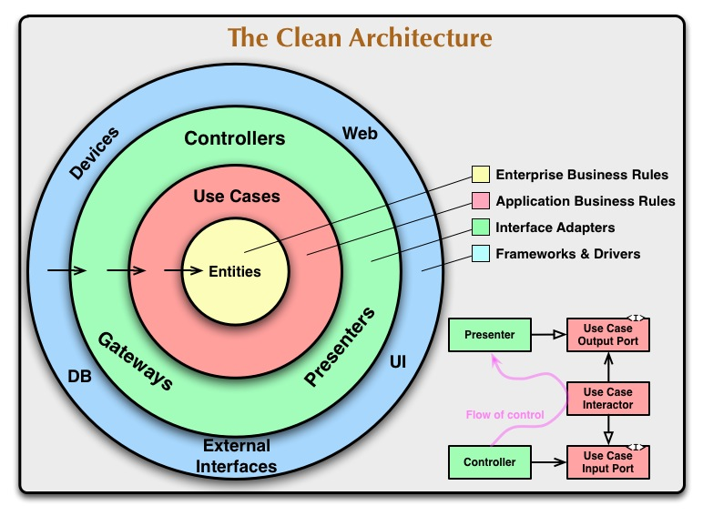

# Clean Architecture
<div align="center">
	
</div>
La Clean Architecture est un style d’architecture logicielle proposé par Robert C. Martin.<br>
Son objectif principal est de séparer clairement les responsabilités afin que le cœur métier de l’application<br>
ne dépende pas des détails techniques (framework, base de données, UI, etc.).

👉 En résumé :<br>
la logique métier doit être indépendante de tout le reste.

# 1. <ins>Le principe fondamental</ins>
Clean Architecture repose sur une règle appelée :<br>
**Dependency Rule**
```
Les dépendances doivent toujours pointer vers l’intérieur (vers le domaine métier).
```
Cela signifie que :
- le framework dépend du métier
- la base de données dépend du métier
- mais le métier ne dépend jamais d’eux

# 2. <ins>Les couches de Clean Architecture</ins>
On représente souvent l’architecture sous forme de cercles concentriques.
```
+-----------------------------+
| Frameworks / Infrastructure |
| (Spring, DB, Web, etc.)    |
+-----------------------------+
| Interface Adapters         |
| (Controllers, Repositories)|
+-----------------------------+
| Use Cases                  |
| (Logique applicative)      |
+-----------------------------+
| Entities                   |
| (Modèle métier)            |
+-----------------------------+
```
Plus on va vers le centre, plus le code est important et stable.

# 3. <ins>Exemple simple en Java</ins>
Imaginons une application qui gère des utilisateurs.

## Entities (le cœur métier)
Les entités contiennent les règles métier.
```java
public class User {
    private String name;
    private String email;

    public User(String name, String email) {
        this.name = name;
        this.email = email;
    }

    public boolean isEmailValid() {
        return email.contains("@");
    }
}
```
✔ Aucun framework<br>
✔ Aucun accès base de données<br>
✔ Code métier pur

## Use Cases (logique applicative)
Les cas d’usage orchestrent le métier.
```java
public class CreateUserUseCase {

    private UserRepository userRepository;

    public CreateUserUseCase(UserRepository userRepository) {
        this.userRepository = userRepository;
    }

    public void execute(String name, String email) {
        User user = new User(name, email);

        if (!user.isEmailValid()) {
            throw new RuntimeException("Invalid email");
        }

        userRepository.save(user);
    }
}
```

## Interface (abstraction)
Le use case dépend d’une interface, pas d’une base de données.
```java
public interface UserRepository {
    void save(User user);
}
```

## Infrastructure (implémentation technique)
Exemple avec Spring Boot.
```java
@Repository
public class UserRepositoryImpl implements UserRepository {

    @Override
    public void save(User user) {
        System.out.println("Saving user to database");
    }
}
```

## Controller (entrée de l’application)
```java
@RestController
public class UserController {

    private CreateUserUseCase createUserUseCase;

    public UserController(CreateUserUseCase createUserUseCase) {
        this.createUserUseCase = createUserUseCase;
    }

    @PostMapping("/users")
    public void createUser(@RequestBody UserRequest request) {
        createUserUseCase.execute(request.name(), request.email());
    }
}
```

# 4. <ins>Structure typique d’un projet Java</ins>
```
src/main/java/com/example

domain
 ├── entity
 │    └── User.java
 └── repository
      └── UserRepository.java

usecase
 └── CreateUserUseCase.java

infrastructure
 └── repository
      └── UserRepositoryImpl.java

controller
 └── UserController.java
```

# 5. <ins>Les avantages de Clean Architecture</ins>

## Indépendance des frameworks
On peut remplacer **Spring Boot** par autre chose.

## Testabilité
On peut tester le use case sans base de données.
```java
UserRepository fakeRepo = new InMemoryUserRepository();
CreateUserUseCase useCase = new CreateUserUseCase(fakeRepo);
```

## Code maintenable
Chaque couche a un rôle clair :
| Couche         | Rôle                |
| -------------- | ------------------- |
| Entities       | règles métier       |
| Use Cases      | logique applicative |
| Adapters       | controllers, DTO    |
| Infrastructure | DB, frameworks      |

# 6. <ins>Lien avec SOLID</ins>
Clean Architecture repose fortement sur :
- Dependency Inversion Principle
- Single Responsibility Principle
- Interface Segregation

Ces principes viennent de SOLID principles.

# 7. <ins>Résumé simple</ins>
Clean Architecture dit :
- Le métier est au centre
- Les frameworks sont des détails
- Les dépendances vont vers l’intérieur
- On code contre des interfaces
