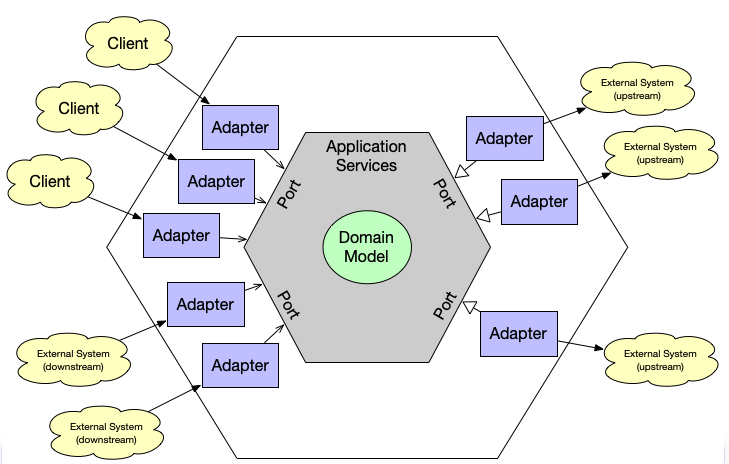

# Hexagonal Architecture
<div align="center">
	
</div>
L’architecture hexagonale (aussi appelée Ports & Adapters) est un style d’architecture logicielle inventé par Alistair Cockburn.<br>
Son objectif principal est de séparer la logique métier du reste du monde (base de données, API, UI, frameworks).

👉 En résumé : le cœur de l’application ne dépend de rien d’extérieur.

# 1. <ins>L’idée principale</ins>
Dans une application classique, la logique métier dépend souvent de :
- la base de données
- le framework (Spring, Hibernate…)
- l’API REST
- l’interface utilisateur

Cela crée un couplage fort.<br>
L’architecture hexagonale inverse cette dépendance :
```
        UI / API
           |
       [Adapter]
           |
        [Port]
           |
      BUSINESS LOGIC
           |
        [Port]
           |
       [Adapter]
           |
       Database
```
Le domaine (business) est au centre et tout le reste vient s’y brancher.

# 2. <ins>Pourquoi un hexagone ?</ins>
Le schéma est souvent dessiné en hexagone pour montrer qu’il peut avoir plusieurs entrées et sorties.

Exemple :
```
           REST API
             |
         [Adapter]
             |
 CLI ---- [PORT] ---- Application ---- [PORT] ---- Database
             |                               |
         [Adapter]                        [Adapter]
             |                               |
          Web UI                         Message Queue
```
L’hexagone montre que le système peut parler avec plusieurs technologies sans changer la logique métier.

# 3. <ins>Les 3 concepts clés</ins>

## 1.Le domaine (core)
C’est la logique métier pure.

Exemple Java :
```java 
public class OrderService {

    private PaymentPort paymentPort;

    public OrderService(PaymentPort paymentPort) {
        this.paymentPort = paymentPort;
    }

    public void placeOrder(Order order) {
        paymentPort.pay(order.getAmount());
    }
}
```
Ce code ne sait pas comment le paiement est fait.

## 2.Les ports (interfaces)
Les ports sont des interfaces qui définissent ce dont l’application a besoin.
```java
public interface PaymentPort {
    void pay(double amount);
}
```
Le domaine dit simplement :
```
"Pour fonctionner j'ai besoin d'un système de paiement".
```
Mais il ne sait pas lequel.

## 3.Les adapters (implémentations)
Les adapters connectent la technologie réelle.

**Adapter Stripe**
```java
public class StripePaymentAdapter implements PaymentPort {

    @Override
    public void pay(double amount) {
        System.out.println("Paiement via Stripe : " + amount);
    }
}
```

**Adapter PayPal**
```
public class PaypalPaymentAdapter implements PaymentPort {

    @Override
    public void pay(double amount) {
        System.out.println("Paiement via PayPal : " + amount);
    }
}
```
👉 On peut changer de fournisseur sans modifier le domaine.

# 4. Exemple concret avec Spring Boot
Structure de projet typique :
```
src/main/java/com/example

domain
 ├── model
 │     └── Order.java
 ├── port
 │     └── PaymentPort.java
 └── service
       └── OrderService.java

application

adapter
 ├── in
 │    └── OrderController.java
 └── out
      └── StripePaymentAdapter.java
```

**Adapter entrant (API REST)**
```java
@RestController
public class OrderController {

    private OrderService orderService;

    public OrderController(OrderService orderService) {
        this.orderService = orderService;
    }

    @PostMapping("/orders")
    public void createOrder(@RequestBody Order order) {
        orderService.placeOrder(order);
    }
}
```

**Adapter sortant (DB / API externe)**
```java
@Repository
public class OrderRepositoryAdapter implements OrderRepositoryPort {

    @Override
    public void save(Order order) {
        // JPA ou JDBC
    }
}
```

# 5. Schéma global
```
                +-------------------+
                |   REST Controller |
                +---------+---------+
                          |
                       Adapter
                          |
                        Port
                          |
                 +----------------+
                 |  OrderService  |
                 |  (Domain)      |
                 +----------------+
                          |
                        Port
                          |
                       Adapter
                          |
                   Database / API
```

# 6. Les avantages

✅ **Testabilité**<br>
On peut tester la logique métier sans base de données.
```java
PaymentPort fakePayment = amount -> {};
OrderService service = new OrderService(fakePayment);
```

✅ **Indépendance technologique**<br>
Changer :
- base de données
- framework
- API

ne casse pas le domaine.

✅ **Architecture propre**<br>
C’est très proche de :
- Clean Architecture
- Onion Architecture

# 7. Quand utiliser l’architecture hexagonale
Très utile pour :
- microservices
- applications métier complexes
- systèmes évolutifs
- projets long terme

Moins utile pour :
- petits projets
- prototypes rapides

✅ Règle d’or :
```
Les dépendances vont toujours vers le domaine, jamais l’inverse.   
```
