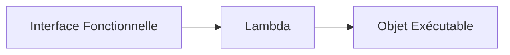
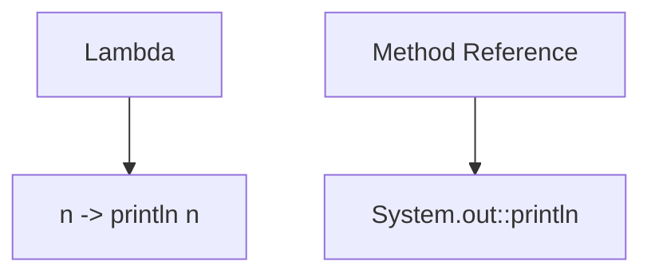
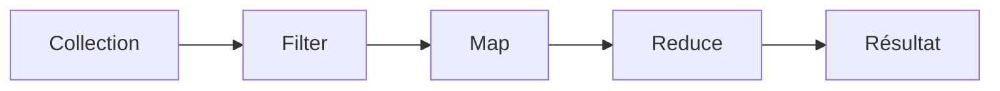
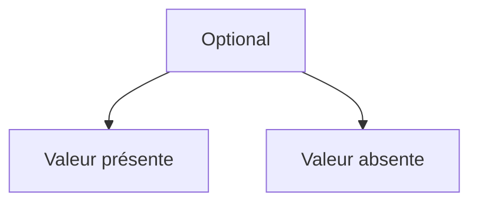
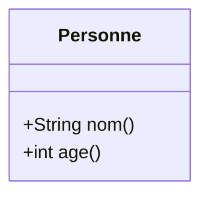
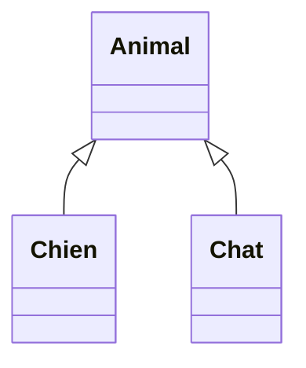
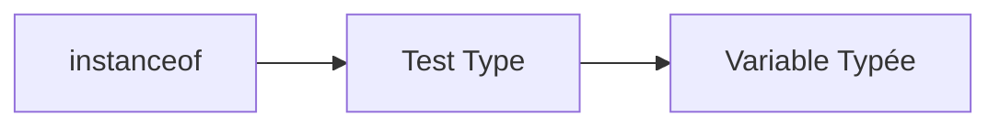
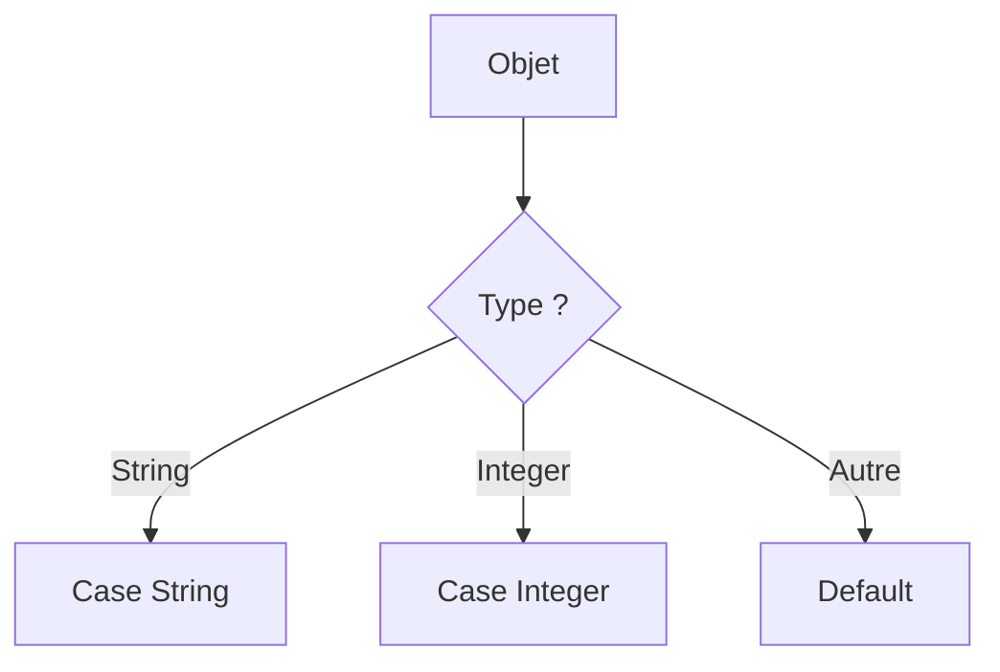
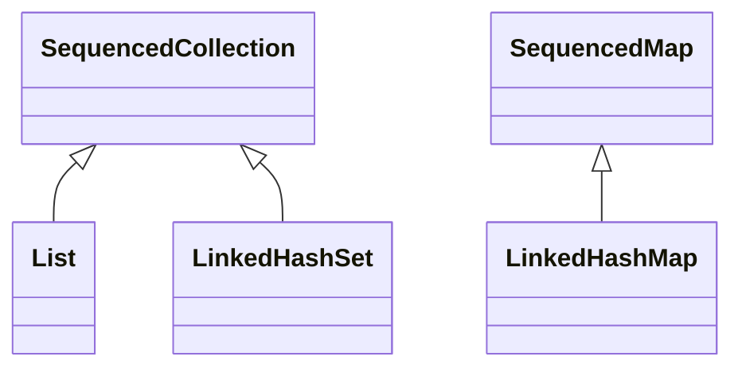
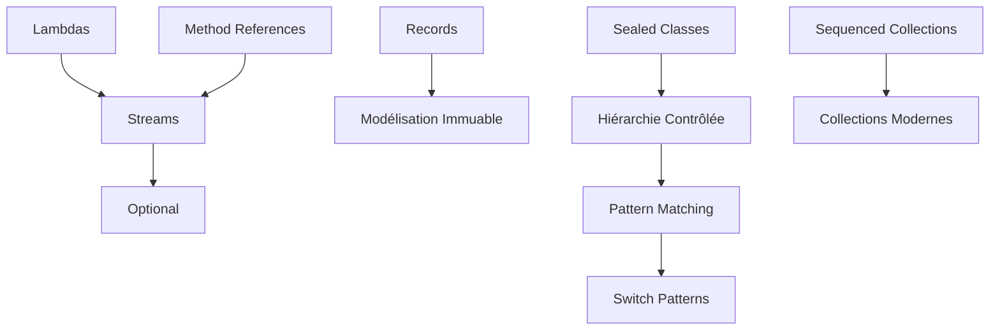

# Cours Magistral Java Moderne
# Lambdas, Streams, Method References, Optional, Records, Sealed Classes, Pattern Matching, Switch Patterns, Sequenced Collections

---

# Introduction

Depuis Java 8, le langage a profondément évolué vers un style plus :

- déclaratif
- fonctionnel
- immuable
- sécurisé au niveau du typage

Les fonctionnalités majeures introduites sont :

| Version | Fonctionnalités |
|----------|----------|
| Java 8 | Lambdas, Streams, Method References, Optional |
| Java 14-16 | Records |
| Java 17 | Sealed Classes |
| Java 17-21 | Pattern Matching |
| Java 21 | Switch Patterns |
| Java 21 | Sequenced Collections |

---

# 1. Les Lambdas

## Problème historique

Avant Java 8 :

```java
List<String> noms = Arrays.asList("Jean", "Marie", "Paul");

Collections.sort(noms, new Comparator<String>() {
    @Override
    public int compare(String a, String b) {
        return a.compareTo(b);
    }
});
```

Très verbeux.

---

## Définition

Une lambda est une fonction anonyme.

Syntaxe :

```java
(paramètres) -> expression
```

ou

```java
(paramètres) -> {
    instructions
}
```

---

## Exemple simple

```java
(a, b) -> a + b
```

Equivalent à :

```java
public int add(int a, int b) {
    return a + b;
}
```

---

## Interfaces Fonctionnelles

Une lambda implémente toujours une interface possédant UNE SEULE méthode abstraite.

Exemple :

```java
@FunctionalInterface
public interface Calcul {
    int calculer(int a, int b);
}
```

---

## Utilisation

```java
Calcul addition = (a, b) -> a + b;

System.out.println(addition.calculer(5, 3));
```

Résultat :

```text
8
```

---

## Lambda avec bloc

```java
Calcul multiplication = (a, b) -> {
    System.out.println("Calcul...");
    return a * b;
};
```

---

## Diagramme



---

# 2. Method References

## Motivation

Parfois une lambda appelle simplement une méthode.

Exemple :

```java
nom -> nom.toUpperCase()
```

Peut être simplifié.

---

## Syntaxe

```java
Classe::méthode
```

ou

```java
objet::méthode
```

---

## Types

### Méthode statique

```java
Integer::parseInt
```

---

### Méthode d'instance

```java
String::toUpperCase
```

---

### Instance spécifique

```java
System.out::println
```

---

### Constructeur

```java
Personne::new
```

---

## Exemple complet

```java
List<String> noms =
        List.of("jean", "marie", "paul");

noms.forEach(System.out::println);
```

Equivalent :

```java
noms.forEach(n -> System.out.println(n));
```

---

## Diagramme



---

# 3. Streams

## Définition

Un Stream représente un flux de données permettant :

- filtrer
- transformer
- agréger
- collecter

sans modifier la collection originale.

---

## Pipeline Stream



---

## Création

```java
List<String> noms =
        List.of("Jean", "Paul", "Marie");

Stream<String> stream = noms.stream();
```

---

# Filter

Garder certains éléments.

```java
List<String> resultat =
        noms.stream()
            .filter(n -> n.startsWith("M"))
            .toList();
```

Résultat :

```text
Marie
```

---

# Map

Transformer.

```java
List<String> resultat =
        noms.stream()
            .map(String::toUpperCase)
            .toList();
```

Résultat :

```text
JEAN
PAUL
MARIE
```

---

# Sorted

```java
noms.stream()
    .sorted()
    .forEach(System.out::println);
```

---

# Distinct

```java
List<Integer> nombres =
        List.of(1,1,2,2,3,3);

nombres.stream()
       .distinct()
       .forEach(System.out::println);
```

---

# Count

```java
long total =
        noms.stream()
            .count();
```

---

# Reduce

Agrégation.

```java
int somme =
        List.of(1,2,3,4)
            .stream()
            .reduce(0, Integer::sum);
```

Résultat :

```text
10
```

---

# Collect

```java
List<String> resultat =
        noms.stream()
            .filter(n -> n.length() > 4)
            .collect(Collectors.toList());
```

---

# Exemple complet

```java
import java.util.List;

public class Main {

    public static void main(String[] args) {

        List<String> noms =
                List.of("Jean", "Marie", "Paul", "Marc");

        List<String> resultat =
                noms.stream()
                        .filter(n -> n.startsWith("M"))
                        .map(String::toUpperCase)
                        .sorted()
                        .toList();

        System.out.println(resultat);
    }
}
```

Résultat :

```text
[MARC, MARIE]
```

---

# Stream Lazy Evaluation

Les opérations intermédiaires ne s'exécutent pas immédiatement.

```java
stream
    .filter(...)
    .map(...)
```

Rien n'est exécuté tant qu'une opération terminale n'arrive pas :

```java
toList()
count()
forEach()
reduce()
```

---

# 4. Optional

## Problème du Null

Avant :

```java
User user = repository.findById(id);

if(user != null){
    System.out.println(user.getName());
}
```

Source fréquente de :

```text
NullPointerException
```

---

## Concept

Optional encapsule :

- une valeur présente
- ou aucune valeur

---

## Création

```java
Optional<String> nom =
        Optional.of("Jean");
```

---

Valeur nullable :

```java
Optional<String> nom =
        Optional.ofNullable(null);
```

---

Vide :

```java
Optional<String> nom =
        Optional.empty();
```

---

## Lire une valeur

```java
nom.ifPresent(System.out::println);
```

---

## Valeur par défaut

```java
String valeur =
        nom.orElse("Inconnu");
```

---

## Valeur calculée

```java
String valeur =
        nom.orElseGet(() -> "Inconnu");
```

---

## Lever une exception

```java
String valeur =
        nom.orElseThrow();
```

---

## Transformation

```java
Optional<String> upper =
        nom.map(String::toUpperCase);
```

---

## Diagramme



---

# 5. Records

Introduit officiellement en Java 16.

---

## Problème

POJO classique :

```java
public class Personne {

    private final String nom;
    private final int age;

    public Personne(String nom, int age) {
        this.nom = nom;
        this.age = age;
    }

    public String nom() {
        return nom;
    }

    public int age() {
        return age;
    }

    // equals
    // hashCode
    // toString
}
```

Beaucoup de code.

---

## Solution

```java
public record Personne(
        String nom,
        int age
) {}
```

---

Le compilateur génère :

- constructeur
- getters
- equals
- hashCode
- toString

---

## Utilisation

```java
Personne p =
        new Personne("Jean", 30);

System.out.println(p.nom());
System.out.println(p.age());
```

---

## Diagramme



---

## Constructeur de validation

```java
public record Personne(
        String nom,
        int age
) {

    public Personne {
        if(age < 0){
            throw new IllegalArgumentException();
        }
    }
}
```

---

# 6. Sealed Classes

Introduites en Java 17.

---

## Problème

Empêcher l'héritage incontrôlé.

---

Avant :

```java
class Animal {}
```

N'importe qui peut faire :

```java
class Chien extends Animal {}
class Chat extends Animal {}
class Dragon extends Animal {}
```

---

## Solution

```java
public sealed class Animal
    permits Chien, Chat {
}
```

---

Classes autorisées :

```java
public final class Chien extends Animal {
}
```

```java
public final class Chat extends Animal {
}
```

---

## Diagramme



---

## Variantes

### final

Aucune extension

```java
final class Chien extends Animal {}
```

---

### sealed

Peut continuer à restreindre

```java
sealed class Mammifere
    extends Animal
    permits Chien {}
```

---

### non-sealed

Rouvre complètement l'héritage

```java
non-sealed class Oiseau
        extends Animal {
}
```

---

# 7. Pattern Matching

## Objectif

Éviter les casts manuels.

---

Avant

```java
if(obj instanceof String){
    String s = (String)obj;
    System.out.println(s.length());
}
```

---

Maintenant

```java
if(obj instanceof String s){
    System.out.println(s.length());
}
```

---

## Diagramme



---

## Exemple complet

```java
Object valeur = "Bonjour";

if(valeur instanceof String texte){
    System.out.println(
            texte.toUpperCase()
    );
}
```

---

# 8. Switch Pattern Matching

Introduit définitivement en Java 21.

---

Avant

```java
if(obj instanceof String s){
}
else if(obj instanceof Integer i){
}
else if(obj instanceof Double d){
}
```

Très lourd.

---

## Nouveau Switch

```java
static String traiter(Object obj){

    return switch(obj){

        case String s ->
                "Texte : " + s;

        case Integer i ->
                "Entier : " + i;

        case Double d ->
                "Double : " + d;

        default ->
                "Inconnu";
    };
}
```

---

## Avec garde (when)

```java
return switch(obj){

    case String s
        when s.length() > 5 ->
            "Long";

    case String s ->
            "Court";

    default ->
            "Autre";
};
```

---

## Diagramme



---

# 9. Sequenced Collections (Java 21)

Nouvelle abstraction.

---

## Avant Java 21

Certaines collections avaient :

```java
getFirst()
getLast()
```

D'autres non.

Incohérence.

---

## Nouvelle hiérarchie



---

# Méthodes

```java
getFirst()
getLast()

addFirst()
addLast()

removeFirst()
removeLast()

reversed()
```

---

## Exemple

```java
SequencedCollection<String> noms =
        new ArrayList<>();

noms.add("Jean");
noms.add("Paul");
noms.add("Marie");

System.out.println(
        noms.getFirst()
);

System.out.println(
        noms.getLast()
);
```

---

## Vue inversée

```java
var inverse =
        noms.reversed();

inverse.forEach(
        System.out::println
);
```

Résultat :

```text
Marie
Paul
Jean
```

---

# Exemple Global Moderne

Combinaison de :

- Record
- Stream
- Lambda
- Method Reference
- Optional

---

```java
import java.util.List;
import java.util.Optional;

public class Main {

    public static void main(String[] args) {

        List<Personne> personnes = List.of(
                new Personne("Jean", 25),
                new Personne("Marie", 30),
                new Personne("Paul", 20)
        );

        Optional<String> resultat =
                personnes.stream()
                        .filter(p -> p.age() >= 25)
                        .map(Personne::nom)
                        .sorted()
                        .findFirst();

        resultat.ifPresent(
                System.out::println
        );
    }
}

record Personne(
        String nom,
        int age
){}
```

Résultat :

```text
Jean
```

---

# Schéma Global des Concepts Modernes Java



---

# Ce qu'il faut retenir absolument

## Lambdas

Permettent d'écrire des fonctions anonymes.

```java
x -> x * 2
```

---

## Method References

Version compacte des lambdas.

```java
System.out::println
```

---

## Streams

Pipeline de traitement déclaratif.

```java
filter()
map()
reduce()
collect()
```

---

## Optional

Alternative sécurisée à `null`.

```java
Optional<T>
```

---

## Records

DTO immuables ultra-compacts.

```java
record Person(String nom){}
```

---

## Sealed Classes

Contrôle strict de l'héritage.

```java
sealed class Animal permits Chien, Chat
```

---

## Pattern Matching

Suppression des casts.

```java
if(obj instanceof String s)
```

---

## Switch Patterns

Switch orienté type.

```java
switch(obj){
    case String s -> ...
}
```

---

## Sequenced Collections

API uniforme pour les collections ordonnées.

```java
getFirst()
getLast()
reversed()
```

---

# Conclusion

Ces fonctionnalités constituent le socle du Java moderne (Java 21+) :

- **Lambdas** → programmation fonctionnelle
- **Streams** → traitement déclaratif des données
- **Method References** → syntaxe concise
- **Optional** → réduction des `NullPointerException`
- **Records** → objets immuables simples
- **Sealed Classes** → hiérarchies maîtrisées
- **Pattern Matching** → code plus lisible
- **Switch Patterns** → polymorphisme moderne
- **Sequenced Collections** → collections cohérentes et expressives

Maîtriser ces concepts permet d'écrire un Java beaucoup plus moderne, concis, sûr et maintenable.
