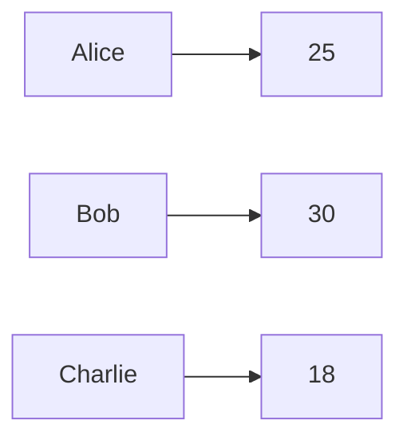
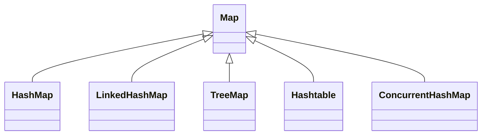
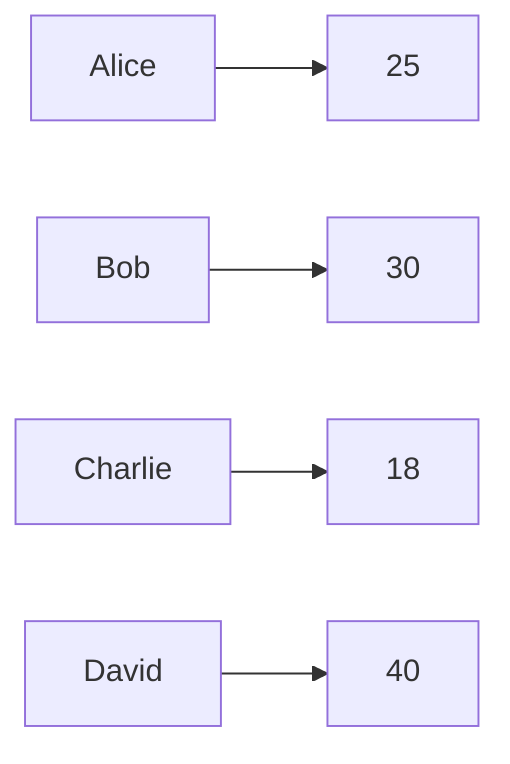
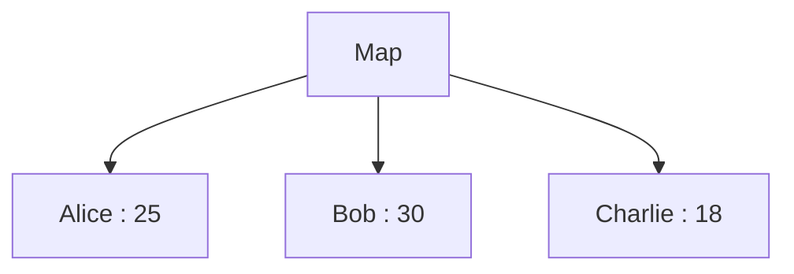
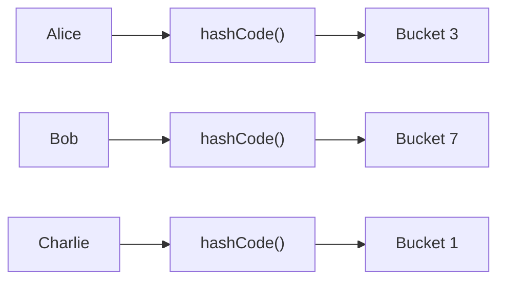
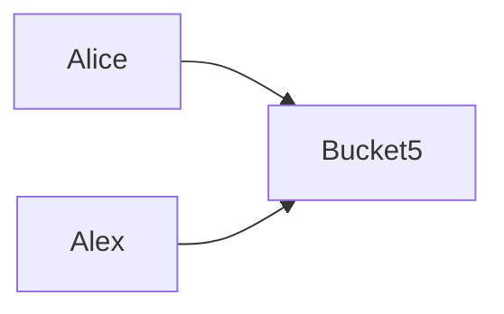
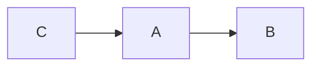
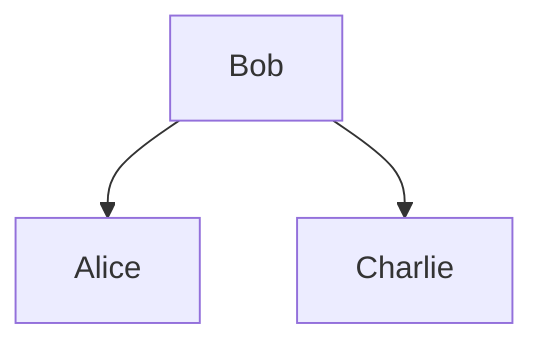
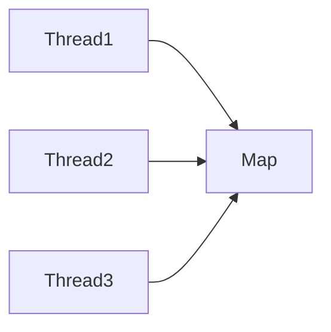
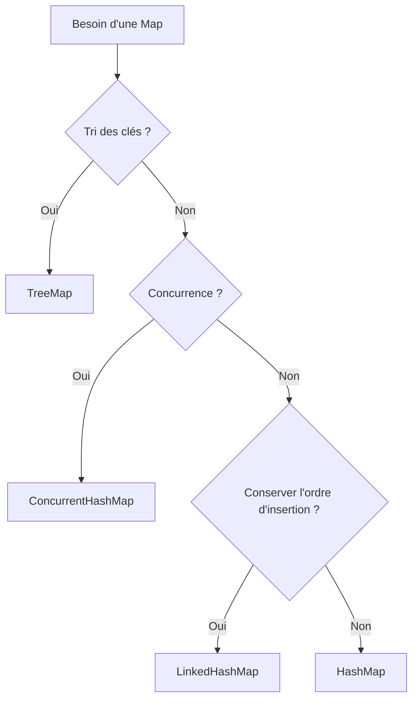

# Tutoriel complet sur les `Map` en Java

Les `Map` font partie des collections les plus utilisées en Java. Elles permettent d'associer une **clé (key)** à une **valeur (value)**.

Exemple :

```text
Nom -------> Âge

Alice -----> 25
Bob   ------> 30
Charlie ---> 18
```

Contrairement à une `List`, où on accède aux éléments par un indice (`0`, `1`, `2`...), dans une `Map`, on accède aux valeurs grâce à une clé.

---

# 1. Qu'est-ce qu'une Map ?

Une `Map<K, V>` est une collection qui associe :

* une clé (`K`)
* une valeur (`V`)

```java
Map<String, Integer> ages = new HashMap<>();
```

Ici :

* K = String
* V = Integer

On peut représenter cela ainsi :



---

# 2. Les principales implémentations

L'interface est toujours la même :

```java
Map<K, V>
```

Mais plusieurs implémentations existent.



Les plus importantes sont :

| Classe            | Ordre             | Tri | Thread-safe |
| ----------------- | ----------------- | --- | ----------- |
| HashMap           | ❌                 | ❌   | ❌           |
| LinkedHashMap     | ordre d'insertion | ❌   | ❌           |
| TreeMap           | triée             | ✅   | ❌           |
| ConcurrentHashMap | non garanti       | ❌   | ✅           |

---

# 3. Créer une Map

```java
Map<String, Integer> ages = new HashMap<>();
```

Ajouter :

```java
ages.put("Alice", 25);
ages.put("Bob", 30);
ages.put("Charlie", 18);
```

Résultat :

```
Alice -> 25
Bob -> 30
Charlie -> 18
```

---

# 4. Ajouter un élément

```java
ages.put("David", 40);
```

Diagramme :



---

# 5. Modifier une valeur

Si la clé existe déjà :

```java
ages.put("Bob", 31);
```

Avant

```
Bob -> 30
```

Après

```
Bob -> 31
```

`put()` remplace automatiquement l'ancienne valeur.

---

# 6. Lire une valeur

```java
Integer age = ages.get("Alice");
```

Retour :

```
25
```

Si la clé n'existe pas :

```java
ages.get("Pierre");
```

retourne

```
null
```

---

# 7. containsKey()

```java
ages.containsKey("Alice");
```

→ true

```java
ages.containsKey("Pierre");
```

→ false

---

# 8. containsValue()

```java
ages.containsValue(30);
```

Recherche une valeur.

Attention :

* recherche plus lente
* parcourt toute la map

---

# 9. remove()

```java
ages.remove("Bob");
```

Avant

```
Alice
Bob
Charlie
```

Après

```
Alice
Charlie
```

---

# 10. size()

```java
ages.size();
```

Retour :

```
3
```

---

# 11. isEmpty()

```java
ages.isEmpty();
```

Renvoie :

```
true
```

ou

```
false
```

---

# 12. Parcourir une Map

## Avec entrySet()

La méthode recommandée.

```java
for (Map.Entry<String, Integer> entry : ages.entrySet()) {

    System.out.println(entry.getKey());
    System.out.println(entry.getValue());

}
```

Diagramme



---

## Avec keySet()

```java
for (String key : ages.keySet()) {

    System.out.println(key);

}
```

Puis

```java
ages.get(key);
```

Mais cela effectue une recherche supplémentaire pour chaque clé. `entrySet()` est généralement préférable lorsque tu as besoin de la clé **et** de la valeur.

---

## Avec values()

```java
for (Integer value : ages.values()) {

    System.out.println(value);

}
```

Affiche uniquement les valeurs.

---

# 13. Les clés doivent être uniques

```
Alice -> 25
```

Puis

```java
ages.put("Alice", 40);
```

Résultat :

```
Alice -> 40
```

La première valeur est écrasée.

---

# 14. Les valeurs peuvent être dupliquées

Ceci est parfaitement valide :

```
Alice -> 25

Bob -> 25

Charlie -> 25
```

---

# 15. Comment fonctionne une HashMap ?

Une `HashMap` repose sur une **table de hachage**.

Lorsque tu fais :

```java
map.put("Alice", 25);
```

Java :

1. calcule le `hashCode()`
2. transforme ce hash en indice
3. stocke l'entrée dans un "bucket"



---

# 16. Les collisions

Deux objets différents peuvent produire le même bucket.



On parle de **collision**.

Java gère automatiquement ces collisions (chaînage et, au-delà d'un certain seuil, transformation en arbre équilibré pour les buckets très chargés).

---

# 17. Pourquoi equals() est important ?

Lorsque deux clés ont le même hash :

Java compare avec :

```java
equals()
```

La règle est :

```
Même hash

↓

equals()

↓

Même clé ?
```

Si `equals()` est mal implémenté, la `Map` peut ne plus retrouver correctement les éléments.

---

# 18. Pourquoi hashCode() est important ?

Si tu utilises un objet personnalisé :

```java
class Person {

    String name;

}
```

Tu dois redéfinir :

```java
equals()
```

et

```java
hashCode()
```

Sinon :

```java
map.get(person);
```

risque de ne pas fonctionner comme attendu, même si un objet "équivalent" est utilisé.

---

# 19. LinkedHashMap

Elle conserve l'ordre d'insertion.

```java
map.put("C", 3);
map.put("A", 1);
map.put("B", 2);
```

Affichage :

```
C
A
B
```

Diagramme



Pratique pour :

* les caches simples ;
* les historiques ;
* les résultats où l'ordre d'insertion compte.

---

# 20. TreeMap

Une `TreeMap` trie automatiquement les clés.

```java
map.put("Charlie", 18);
map.put("Alice", 25);
map.put("Bob", 30);
```

Affichage :

```
Alice
Bob
Charlie
```

Diagramme



Elle s'appuie sur un arbre rouge-noir (*Red-Black Tree*), ce qui lui permet de maintenir les clés triées.

---

# 21. HashMap vs TreeMap

| Opération | HashMap          | TreeMap          |
| --------- | ---------------- | ---------------- |
| Recherche | O(1) en moyenne  | O(log n)         |
| Insertion | O(1) en moyenne  | O(log n)         |
| Tri       | Non              | Oui              |
| Structure | Table de hachage | Arbre rouge-noir |

---

# 22. ConcurrentHashMap

Conçue pour plusieurs threads.



Elle permet des lectures et écritures concurrentes avec une synchronisation fine.

---

# 23. HashMap vs ConcurrentHashMap

| Fonctionnalité                                           | HashMap | ConcurrentHashMap         |
| -------------------------------------------------------- | ------- | ------------------------- |
| Thread-safe                                              | ❌       | ✅                         |
| null                                                     | ✅       | ❌                         |
| Très rapide en mono-thread                               | ✅       | Très bonne en concurrence |
| Opérations atomiques (`compute`, `merge`, `putIfAbsent`) | ❌       | ✅                         |

Exemple :

```java
ConcurrentHashMap<String, Integer> compteur = new ConcurrentHashMap<>();

compteur.merge("Alice", 1, Integer::sum);
```

Cette mise à jour est atomique, même si plusieurs threads l'exécutent en parallèle.

---

# 24. Complexité des opérations

| Opération   | HashMap         | TreeMap  |
| ----------- | --------------- | -------- |
| put         | O(1) en moyenne | O(log n) |
| get         | O(1) en moyenne | O(log n) |
| remove      | O(1) en moyenne | O(log n) |
| containsKey | O(1) en moyenne | O(log n) |

> Les performances de `HashMap` peuvent se dégrader en cas de nombreuses collisions, mais cela reste rare avec une bonne fonction de hachage.

---

# 25. Quand utiliser quelle Map ?

| Situation                     | Choix recommandé                                 |
| ----------------------------- | ------------------------------------------------ |
| Cas général                   | `HashMap`                                        |
| Conserver l'ordre d'insertion | `LinkedHashMap`                                  |
| Trier les clés                | `TreeMap`                                        |
| Plusieurs threads             | `ConcurrentHashMap`                              |
| Ancien code hérité            | `Hashtable` (à éviter pour les nouveaux projets) |

# Résumé



## À retenir

* Une **Map** associe une **clé unique** à une **valeur**.
* **HashMap** est le choix par défaut : rapide et efficace pour la majorité des cas.
* **LinkedHashMap** conserve l'ordre d'insertion.
* **TreeMap** maintient les clés triées.
* **ConcurrentHashMap** est adaptée aux accès concurrents.
* Les performances d'une `HashMap` dépendent du bon fonctionnement de `hashCode()` et `equals()` pour les objets utilisés comme clés.
