Oui. Je te propose un **vrai tutoriel progressif**, en partant de ce que tu connais déjà avec **Java/Spring Boot**, et en construisant une petite API métier de type **gestion de paiements**. L’objectif est surtout de comprendre **ce que Quarkus change par rapport à Spring Boot**, pas seulement de recopier des commandes.

> **Versioning :** la documentation officielle actuelle de Quarkus indique une branche 4.x ; certaines extensions affichent actuellement des versions 4.0.0.Beta1. Les exemples ci-dessous utilisent les API Quarkus modernes (`quarkus-rest`, `quarkus-rest-jackson`, Panache, etc.). ([Quarkus][1])

# 1. Quarkus, c'est quoi ?

<div>
<!-- Image 1 -->


<!-- Image 2 -->


<!-- Image 3 -->

</div>

<!-- Image 4 -->


<!-- Image 5 -->


<!-- Image 6 -->

**Quarkus est un framework Java conçu pour les applications cloud-native**, notamment :

* microservices ;
* conteneurs Docker ;
* Kubernetes / OpenShift ;
* serverless ;
* applications REST ;
* applications réactives ;
* applications nécessitant un démarrage rapide et une faible empreinte mémoire.

L'idée fondamentale est :

> **Déplacer le maximum de travail de l'exécution vers le build.**

Avec un framework Java traditionnel, beaucoup de choses sont découvertes/configurées au démarrage.

Avec Quarkus, une partie importante est préparée **au build time**.

```text
                    APPLICATION JAVA

Spring Boot traditionnel
─────────────────────────────────────────────

        Build
          │
          ▼
     JAR application
          │
          ▼
       STARTUP
          │
    ┌─────┴─────┐
    │ discovery │
    │ scanning  │
    │ config    │
    │ wiring    │
    └─────┬─────┘
          │
          ▼
       RUNNING


Quarkus
─────────────────────────────────────────────

        Build
          │
    ┌─────┴─────────────┐
    │ analyse classes   │
    │ CDI               │
    │ REST              │
    │ Hibernate         │
    │ configuration     │
    │ optimisation      │
    └─────┬─────────────┘
          │
          ▼
   application préparée
          │
          ▼
       STARTUP
          │
          ▼
       RUNNING
```

C'est l'un des concepts fondamentaux à retenir.

---

# 2. Quarkus vs Spring Boot

Comme tu connais déjà Spring Boot, voici le mapping mental le plus utile.

| Spring Boot                | Quarkus                                      |
| -------------------------- | -------------------------------------------- |
| Spring Boot                | Quarkus                                      |
| `@RestController`          | `@Path`                                      |
| `@Service`                 | `@ApplicationScoped`                         |
| `@Repository`              | Panache Repository                           |
| Spring Data JPA            | Hibernate ORM + Panache                      |
| `application.yml`          | `application.properties` / YAML              |
| Spring DI                  | CDI / Jakarta CDI                            |
| Spring MVC / WebFlux       | Quarkus REST                                 |
| `RestTemplate` / WebClient | REST Client                                  |
| Actuator                   | SmallRye Health / Micrometer                 |
| Spring Security            | Quarkus Security                             |
| Spring Batch               | Quarkus + extensions / solutions spécifiques |
| Spring Kafka               | Quarkus Messaging / Kafka                    |
| `@Configuration`           | configuration Quarkus / CDI                  |
| JUnit + Spring Test        | JUnit + QuarkusTest                          |
| Docker                     | Docker                                       |
| Kubernetes                 | Kubernetes                                   |
| GraalVM native             | Native executable                            |

Mais attention :

**Quarkus n'est pas "Spring Boot en plus rapide".**

C'est un écosystème différent, basé notamment sur :

* Jakarta EE ;
* CDI ;
* Vert.x ;
* Hibernate ;
* SmallRye ;
* MicroProfile ;
* GraalVM/Mandrel pour le natif.

Quarkus REST, par exemple, est construit au-dessus de Vert.x et est conçu pour fonctionner de manière réactive tout en supportant aussi les endpoints bloquants. ([Quarkus][2])

---

# 3. Architecture générale

Une application Quarkus peut être représentée ainsi :

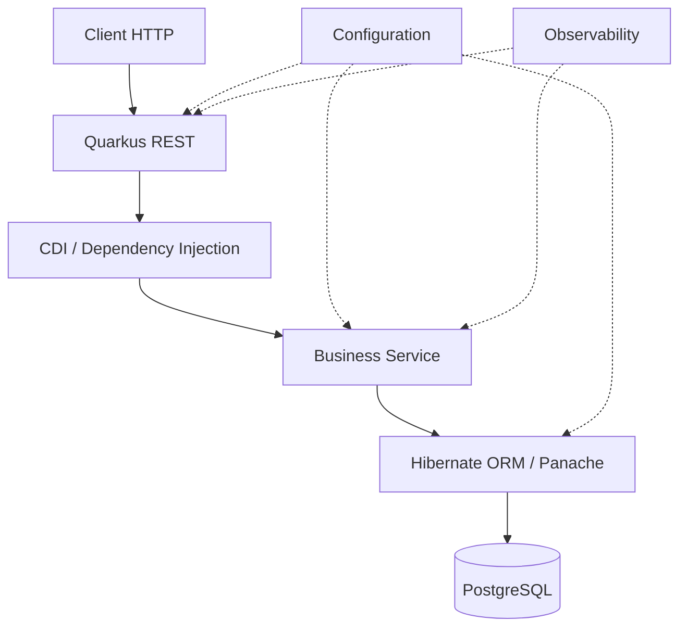

Tu peux donc conserver une architecture très proche de celle que tu utilises actuellement :

```text
Controller
    ↓
Service
    ↓
Repository
    ↓
Database
```

La différence est surtout dans les technologies utilisées.

---

# 4. Créer une première application

Tu peux utiliser le Quarkus CLI ou Maven.

La documentation officielle propose notamment :

```bash
quarkus create app com.example:payment-service
cd payment-service
quarkus dev
```

Le mode `quarkus dev` est l'un des éléments intéressants de Quarkus : le framework fournit du **live coding**, donc tu modifies ton code et l'application est automatiquement rechargée. ([Quarkus][3])

Avec Maven :

```bash
./mvnw quarkus:dev
```

Sous Windows :

```powershell
.\mvnw.cmd quarkus:dev
```

---

# 5. Structure d'un projet Quarkus

Tu obtiens quelque chose ressemblant à :

```text
payment-service/
│
├── src/
│   ├── main/
│   │   ├── java/
│   │   │   └── com/example/
│   │   │       └── PaymentResource.java
│   │   │
│   │   └── resources/
│   │       └── application.properties
│   │
│   └── test/
│       └── java/
│
├── pom.xml
└── mvnw
```

Une application Quarkus minimale n'a pas besoin d'un :

```java
public static void main(String[] args)
```

comme point d'entrée applicatif.

Quarkus gère le démarrage.

---

# 6. Premier endpoint REST

Créons :

```java
@Path("/hello")
public class HelloResource {

    @GET
    public String hello() {
        return "Hello Quarkus";
    }
}
```

Tu peux appeler :

```http
GET http://localhost:8080/hello
```

Réponse :

```text
Hello Quarkus
```

La philosophie est proche de JAX-RS/Jakarta REST.

---

# 7. Comprendre les annotations

### `@Path`

```java
@Path("/payments")
```

définit le chemin HTTP.

### `@GET`

```java
@GET
```

correspond à HTTP GET.

### `@POST`

```java
@POST
```

correspond à HTTP POST.

### `@Produces`

```java
@Produces(MediaType.APPLICATION_JSON)
```

indique le type de réponse.

### `@Consumes`

```java
@Consumes(MediaType.APPLICATION_JSON)
```

indique le type de requête accepté.

Exemple :

```java
@Path("/payments")
@Produces(MediaType.APPLICATION_JSON)
@Consumes(MediaType.APPLICATION_JSON)
public class PaymentResource {
}
```

---

# 8. DTO

Créons notre premier objet :

```java
public record PaymentRequest(
        String reference,
        BigDecimal amount
) {
}
```

Puis :

```java
public record PaymentResponse(
        Long id,
        String reference,
        BigDecimal amount,
        String status
) {
}
```

L'utilisation de `record` est particulièrement agréable avec les versions modernes de Java.

---

# 9. POST

```java
@Path("/payments")
@Produces(MediaType.APPLICATION_JSON)
@Consumes(MediaType.APPLICATION_JSON)
public class PaymentResource {

    @POST
    public PaymentResponse create(PaymentRequest request) {

        return new PaymentResponse(
                1L,
                request.reference(),
                request.amount(),
                "CREATED"
        );
    }
}
```

Appel :

```http
POST /payments
Content-Type: application/json
```

```json
{
  "reference": "PAY-001",
  "amount": 150.50
}
```

Réponse :

```json
{
  "id": 1,
  "reference": "PAY-001",
  "amount": 150.50,
  "status": "CREATED"
}
```

---

# 10. Injection de dépendances : CDI

Maintenant nous voulons séparer le REST de la logique métier.

```text
PaymentResource
       │
       ▼
PaymentService
       │
       ▼
PaymentRepository
```

Avec Quarkus, on utilise **CDI**.

Exemple :

```java
@ApplicationScoped
public class PaymentService {

    public PaymentResponse create(PaymentRequest request) {

        return new PaymentResponse(
                1L,
                request.reference(),
                request.amount(),
                "CREATED"
        );
    }
}
```

Puis :

```java
@Path("/payments")
public class PaymentResource {

    @Inject
    PaymentService service;

    @POST
    public PaymentResponse create(PaymentRequest request) {
        return service.create(request);
    }
}
```

`@ApplicationScoped` signifie que CDI gère le cycle de vie de cette classe.

---

# 11. Injection moderne

Tu peux également utiliser l'injection par constructeur.

```java
@ApplicationScoped
public class PaymentResource {

    private final PaymentService service;

    public PaymentResource(PaymentService service) {
        this.service = service;
    }
}
```

C'est généralement préférable à :

```java
@Inject
PaymentService service;
```

car les dépendances deviennent explicites.

---

# 12. Le modèle mental CDI

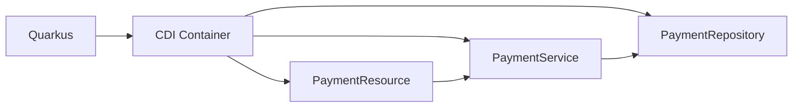

CDI s'occupe de construire et connecter les objets.

---

# 13. Configuration

Dans :

```text
src/main/resources/application.properties
```

tu peux mettre :

```properties
quarkus.http.port=8080

app.payment.max-amount=10000
```

Puis injecter :

```java
@ConfigProperty(name = "app.payment.max-amount")
BigDecimal maxAmount;
```

Exemple :

```java
@ApplicationScoped
public class PaymentService {

    @ConfigProperty(name = "app.payment.max-amount")
    BigDecimal maxAmount;

    public void validate(BigDecimal amount) {

        if (amount.compareTo(maxAmount) > 0) {
            throw new IllegalArgumentException(
                    "Amount exceeds maximum"
            );
        }
    }
}
```

---

# 14. Profils de configuration

Quarkus possède notamment des profils :

```properties
%dev.app.payment.max-amount=1000
%test.app.payment.max-amount=500
%prod.app.payment.max-amount=10000
```

Donc :

```text
quarkus dev
     │
     ▼
   %dev

tests
     │
     ▼
   %test

production
     │
     ▼
   %prod
```

C'est très pratique pour gérer les environnements.

---

# 15. Base de données avec Hibernate ORM

Maintenant passons à quelque chose de plus intéressant.

Nous voulons :

```text
REST
 ↓
Service
 ↓
Database
```

On utilise :

```text
Hibernate ORM
+
Panache
+
PostgreSQL
```

Quarkus propose une extension Panache qui simplifie énormément l'utilisation d'Hibernate ORM/JPA. Elle permet notamment les patterns **Active Record** et **Repository**. ([Quarkus][4])

---

# 16. Dépendances Maven

Les principales extensions :

```xml
<dependency>
    <groupId>io.quarkus</groupId>
    <artifactId>quarkus-rest-jackson</artifactId>
</dependency>

<dependency>
    <groupId>io.quarkus</groupId>
    <artifactId>quarkus-hibernate-orm-panache</artifactId>
</dependency>

<dependency>
    <groupId>io.quarkus</groupId>
    <artifactId>quarkus-jdbc-postgresql</artifactId>
</dependency>
```

Le principe Quarkus est intéressant ici :

**tu ajoutes une extension et Quarkus configure une grande partie de l'intégration pour toi.**

---

# 17. Entity avec Panache

Voici une approche Active Record :

```java
@Entity
public class Payment extends PanacheEntity {

    public String reference;

    public BigDecimal amount;

    public String status;
}
```

C'est extrêmement compact.

Puis :

```java
Payment payment = new Payment();

payment.reference = "PAY-001";
payment.amount = new BigDecimal("150.50");
payment.status = "CREATED";

payment.persist();
```

Et pour rechercher :

```java
Payment payment =
        Payment.find("reference", "PAY-001")
               .firstResult();
```

Panache permet donc de rendre les opérations courantes très concises. ([Quarkus][4])

---

# 18. Active Record vs Repository

Il existe deux approches.

### Active Record

```java
@Entity
public class Payment extends PanacheEntity {

    public String reference;

    public static Payment findByReference(String ref) {
        return find("reference", ref)
                .firstResult();
    }
}
```

Utilisation :

```java
Payment.findByReference("PAY-001");
```

### Repository

```java
@ApplicationScoped
public class PaymentRepository
        implements PanacheRepository<Payment> {

    public Payment findByReference(String ref) {
        return find("reference", ref)
                .firstResult();
    }
}
```

Puis :

```java
@ApplicationScoped
public class PaymentService {

    private final PaymentRepository repository;

    public PaymentService(PaymentRepository repository) {
        this.repository = repository;
    }
}
```

### Pour une architecture entreprise

Je privilégierais généralement :

```text
Resource
   ↓
Service
   ↓
Repository
   ↓
Panache
   ↓
Hibernate
   ↓
PostgreSQL
```

plutôt que de mettre toute la logique dans l'Entity.

---

# 19. Configuration PostgreSQL

Par exemple :

```properties
quarkus.datasource.db-kind=postgresql

quarkus.datasource.username=payment
quarkus.datasource.password=payment

quarkus.datasource.jdbc.url=jdbc:postgresql://localhost:5432/payment
```

Puis :

```properties
quarkus.hibernate-orm.schema-management.strategy=update
```

Pour un environnement de développement.

**Attention :** en production, évite de faire reposer les migrations sur `update`. Utilise plutôt **Flyway ou Liquibase**.

---

# 20. Architecture complète de notre exemple

Nous arrivons à :

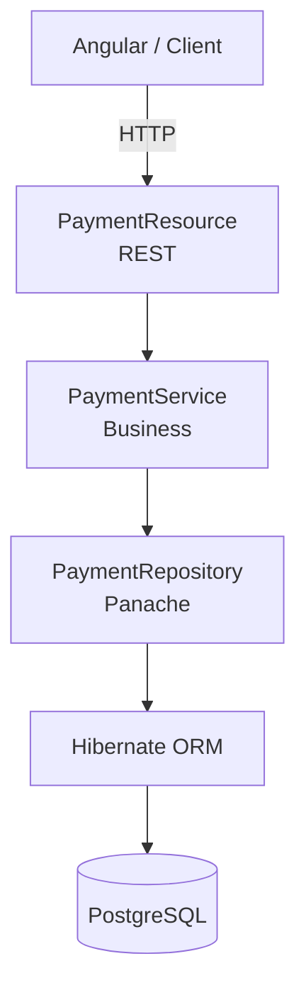

C'est très proche d'une architecture Spring Boot classique.

---

# 21. Transaction

Pour modifier la base :

```java
@Transactional
public Payment create(PaymentRequest request) {

    Payment payment = new Payment();

    payment.reference = request.reference();
    payment.amount = request.amount();
    payment.status = "CREATED";

    repository.persist(payment);

    return payment;
}
```

Le concept est exactement celui que tu connais :

```text
@Transactional
       │
       ▼
BEGIN
       │
       ├── INSERT
       │
       ├── UPDATE
       │
       ▼
COMMIT
```

En cas d'erreur :

```text
BEGIN
   │
   ├── INSERT
   │
   ├── ERROR
   │
   ▼
ROLLBACK
```

---

# 22. Dev Services : une fonctionnalité très intéressante

L'un des concepts très pratiques de Quarkus est **Dev Services**.

Tu développes avec PostgreSQL.

Normalement :

```text
Installer PostgreSQL
        ↓
Créer database
        ↓
Créer user
        ↓
Configurer application
        ↓
Démarrer PostgreSQL
```

Avec Dev Services, Quarkus peut automatiquement démarrer les services nécessaires en développement lorsque les extensions appropriées sont présentes.

Conceptuellement :

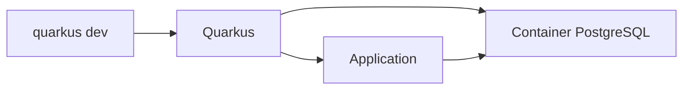

La documentation Quarkus utilise justement cette approche dans ses exemples Hibernate : les informations de connexion peuvent être fournies automatiquement en mode dev/test via Dev Services. ([Quarkus][4])

Pour ton environnement Docker/PostgreSQL, c'est particulièrement intéressant.

---

# 23. REST Client

Supposons que notre service de paiement doive appeler :

```text
Fraud Detection API
```

Architecture :

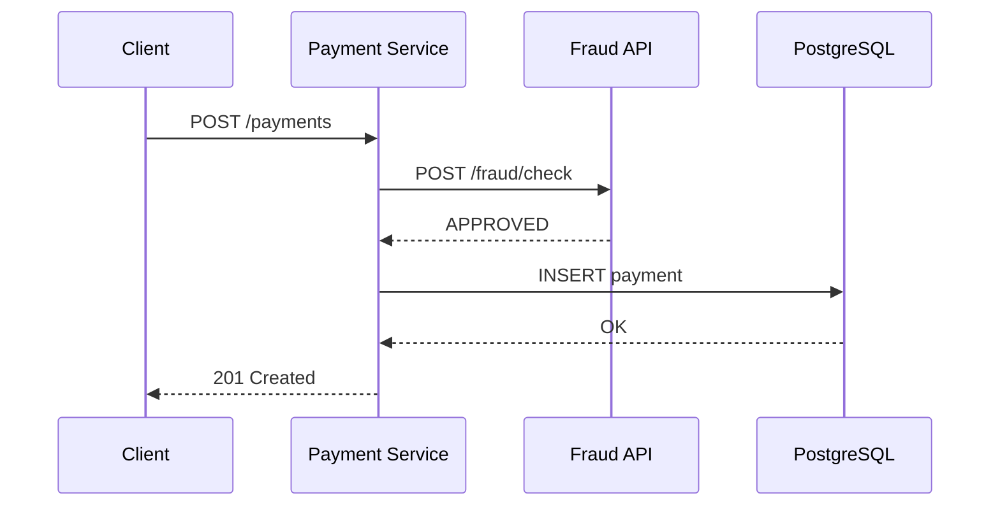

Quarkus possède un **REST Client** intégré à son écosystème. ([Quarkus][5])

Interface :

```java
@Path("/fraud")
@RegisterRestClient
public interface FraudClient {

    @POST
    @Path("/check")
    FraudResponse check(FraudRequest request);
}
```

Puis :

```java
@ApplicationScoped
public class PaymentService {

    private final FraudClient fraudClient;

    public PaymentService(
            @RestClient FraudClient fraudClient) {

        this.fraudClient = fraudClient;
    }
}
```

---

# 24. Réactif vs impératif

C'est un sujet très important avec Quarkus.

Quarkus est fortement intégré à **Vert.x** et supporte les applications réactives. ([Quarkus][2])

Mais :

> **Quarkus ≠ obligation de programmer en reactive.**

Tu peux parfaitement écrire :

```java
public Payment getPayment(Long id) {
    return repository.findById(id);
}
```

avec Hibernate ORM classique.

Tu peux aussi utiliser des APIs réactives.

Par exemple :

```text
Impératif

HTTP
 ↓
Thread
 ↓
JDBC
 ↓
PostgreSQL
```

vs :

```text
Reactive

HTTP
 ↓
Event Loop
 ↓
Reactive Client
 ↓
PostgreSQL
```

---

# 25. Quand utiliser le réactif ?

Ne pars pas directement sur :

```text
Mutiny
Uni
Multi
Reactive SQL
Hibernate Reactive
```

simplement parce que Quarkus le permet.

Pour une application métier classique :

```text
REST
+
Hibernate ORM
+
PostgreSQL
```

est souvent beaucoup plus simple.

La documentation Quarkus indique d'ailleurs que Hibernate Reactive est une stack différente destinée notamment aux cas de forte concurrence, et qu'Hibernate ORM classique reste parfaitement adapté avec Quarkus REST. ([Quarkus][6])

---

# 26. Mutiny

Lorsque tu entres dans le monde réactif Quarkus, tu rencontreras :

```java
Uni<T>
```

et :

```java
Multi<T>
```

### Uni

Représente typiquement **un résultat asynchrone**.

```text
Uni<Payment>
```

équivaut conceptuellement à :

```text
Future<Payment>
```

### Multi

Représente un flux :

```text
Multi<Payment>
```

```text
Payment 1
Payment 2
Payment 3
Payment 4
...
```

---

# 27. Gestion des erreurs

Tu peux créer une exception métier :

```java
public class PaymentNotFoundException
        extends RuntimeException {

    public PaymentNotFoundException(Long id) {
        super("Payment not found: " + id);
    }
}
```

Puis mapper l'erreur :

```java
@Provider
public class PaymentExceptionMapper
        implements ExceptionMapper<PaymentNotFoundException> {

    @Override
    public Response toResponse(
            PaymentNotFoundException e) {

        return Response.status(404)
                .entity(Map.of(
                    "error", e.getMessage()
                ))
                .build();
    }
}
```

Réponse :

```json
{
  "error": "Payment not found: 42"
}
```

---

# 28. Validation

Tu peux utiliser Jakarta Validation.

```java
public record PaymentRequest(

        @NotBlank
        String reference,

        @NotNull
        @Positive
        BigDecimal amount
) {}
```

Puis :

```java
@POST
public PaymentResponse create(
        @Valid PaymentRequest request) {

    return service.create(request);
}
```

Cela donne :

```text
HTTP request
     │
     ▼
Validation
     │
     ├── invalid → 400
     │
     ▼
Service
```

---

# 29. Tests

Quarkus possède une intégration avec JUnit.

Un test typique :

```java
@QuarkusTest
class PaymentResourceTest {

    @Test
    void shouldCreatePayment() {

        given()
            .contentType(ContentType.JSON)
            .body("""
                {
                  "reference": "PAY-001",
                  "amount": 150.50
                }
            """)
        .when()
            .post("/payments")
        .then()
            .statusCode(201);
    }
}
```

L'idée est de pouvoir tester ton application dans un contexte Quarkus réel.

---

# 30. Continuous Testing

Une fonctionnalité intéressante en développement :

```bash
./mvnw quarkus:dev
```

Puis Quarkus peut exécuter les tests automatiquement lorsque tu modifies ton code.

Tu obtiens un cycle :

```text
Modifier code
      ↓
Build
      ↓
Tests
      ↓
Résultat
      ↓
Modifier code
      ↓
...
```

C'est particulièrement agréable pour du TDD.

---

# 31. OpenAPI / Swagger

Tu peux ajouter :

```xml
<dependency>
    <groupId>io.quarkus</groupId>
    <artifactId>quarkus-smallrye-openapi</artifactId>
</dependency>
```

Quarkus génère ensuite une spécification OpenAPI.

Tu peux obtenir une UI Swagger.

Architecture :

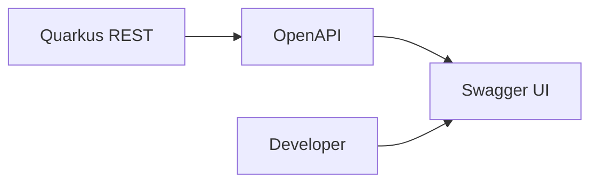

La documentation officielle Quarkus propose également une extension dédiée OpenAPI/Swagger UI. ([Quarkus][7])

---

# 32. Health checks

Dans Kubernetes, c'est essentiel.

Tu veux pouvoir répondre à :

```text
Est-ce que mon application fonctionne ?
```

et :

```text
Est-ce qu'elle est prête à recevoir du trafic ?
```

Quarkus s'intègre avec MicroProfile Health.

Conceptuellement :

```text
Kubernetes
    │
    ├── /health/live
    │
    └── /health/ready
             │
             ├── PostgreSQL
             ├── Kafka
             └── autres dépendances
```

Cela permet à Kubernetes de décider :

```text
Pod healthy ?
    │
    ├── NON → restart
    │
    └── OUI → traffic
```

---

# 33. Metrics

Avec Micrometer, tu peux exposer :

```text
HTTP requests
response time
JVM metrics
database metrics
business metrics
```

Par exemple :

```text
payment_created_total
payment_failed_total
payment_processing_time
```

Architecture :

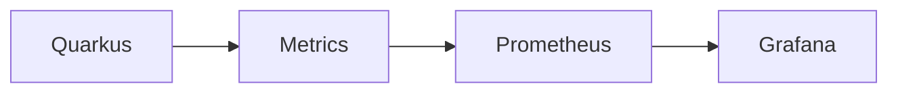

---

# 34. Logging

Tu peux utiliser :

```java
import org.jboss.logging.Logger;

private static final Logger LOG =
        Logger.getLogger(PaymentService.class);
```

Puis :

```java
LOG.infof(
    "Creating payment %s",
    request.reference()
);
```

En production :

```text
Quarkus
   │
   ▼
stdout
   │
   ▼
OpenShift
   │
   ▼
Splunk
```

Cela correspond assez bien à l'architecture d'observabilité que tu rencontres sur tes projets bancaires.

---

# 35. Sécurité

Quarkus possède son propre écosystème sécurité.

Tu peux notamment intégrer :

```text
OIDC
OAuth2
JWT
Keycloak
RBAC
```

Architecture classique :

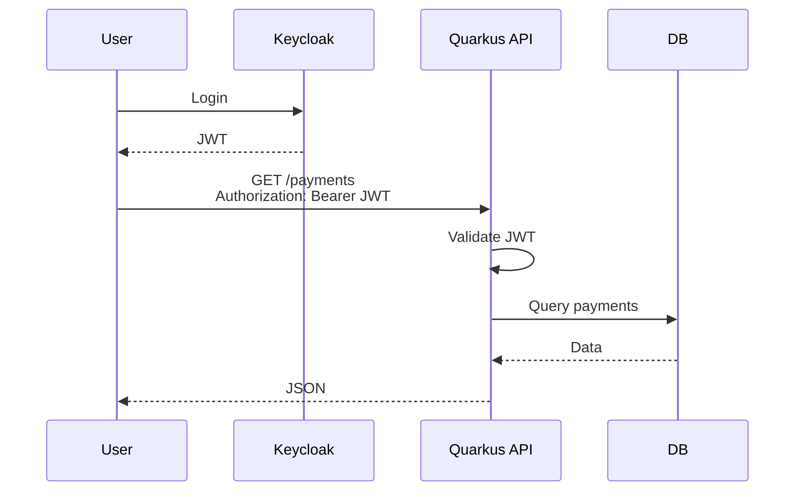

Pour un environnement bancaire avec Active Directory/OIDC/Keycloak, c'est particulièrement pertinent.

---

# 36. Native executable

C'est probablement **la fonctionnalité la plus connue de Quarkus**.

Normalement :

```text
Java application
      ↓
JVM
      ↓
JAR
```

Avec le mode native :

```text
Java source
      ↓
Quarkus build
      ↓
GraalVM / Mandrel
      ↓
Native executable
```

La documentation officielle permet notamment :

```bash
./mvnw install -Dnative
```

ou :

```bash
quarkus build --native
```

pour produire un exécutable natif. ([Quarkus][8])

---

# 37. JVM vs Native

Conceptuellement :

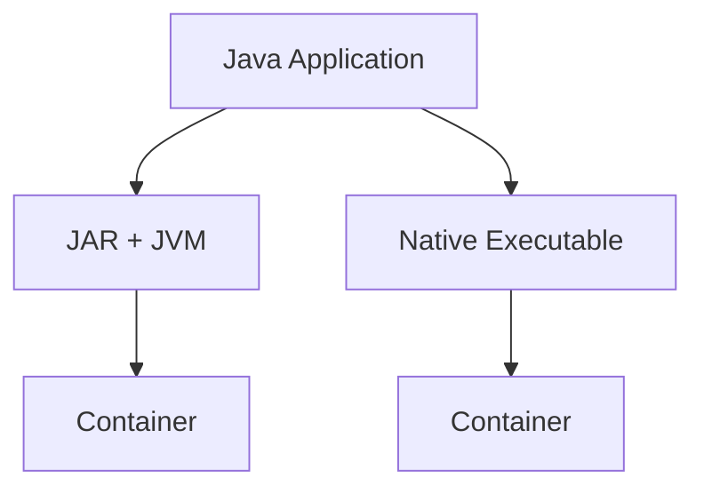

### JVM

```text
Application
+
JVM
```

### Native

```text
Application
```

L'application n'a plus besoin de démarrer une JVM complète.

Cela peut être particulièrement intéressant pour :

* Kubernetes ;
* serverless ;
* scale-to-zero ;
* beaucoup de petits microservices ;
* démarrages fréquents.

---

# 38. Pourquoi Quarkus est intéressant pour Kubernetes ?

Imagine :

```text
100 microservices
```

Chaque service :

```text
Spring Boot
+
JVM
+
mémoire
```

ou :

```text
Quarkus
+
native
```

L'objectif de Quarkus est de réduire notamment :

```text
startup time
memory footprint
container size
```

Mais attention :

> **Native n'est pas automatiquement meilleur.**

Il faut tenir compte :

* temps de compilation native ;
* complexité ;
* compatibilité de certaines librairies ;
* temps de build CI/CD ;
* debugging ;
* contraintes de runtime.

---

# 39. Docker

Une architecture typique :

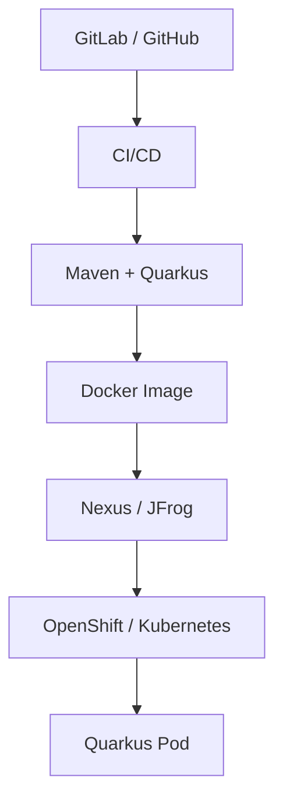

Cela correspond très bien à une stack :

```text
GitLab
   ↓
Jenkins
   ↓
Maven
   ↓
JFrog
   ↓
OpenShift
```

---

# 40. Quarkus et Kubernetes

Quarkus possède beaucoup d'intégrations cloud-native.

Tu peux par exemple produire une image :

```text
payment-service
```

Puis :

```bash
docker build .
```

et déployer :

```text
Deployment
Service
ConfigMap
Secret
Ingress/Route
```

Architecture :

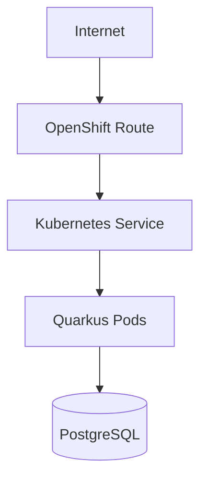

---

# 41. Configuration Kubernetes

Les informations sensibles ne doivent évidemment pas être dans :

```properties
quarkus.datasource.password=myPassword
```

en production.

Préférer :

```text
OpenShift Secret
       ↓
Environment variable
       ↓
Quarkus configuration
       ↓
Datasource
```

Par exemple :

```properties
quarkus.datasource.password=${DB_PASSWORD}
```

---

# 42. Messaging

Quarkus est également très intéressant pour :

```text
Kafka
AMQP
MQTT
RabbitMQ
Messaging
```

Dans ton contexte bancaire, c'est particulièrement intéressant.

On peut avoir :

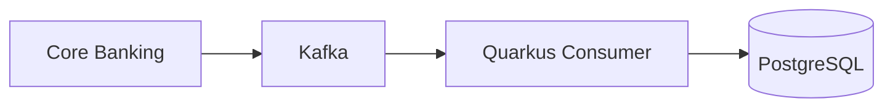

Ou :

```text
IBM MQ
   ↓
Quarkus
   ↓
PostgreSQL
```

---

# 43. Exemple proche de ton projet `payment-messages`

Tu pourrais imaginer :

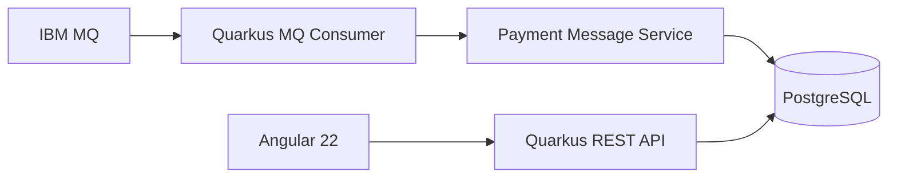

Et là, Quarkus pourrait remplacer :

```text
Spring Boot
```

sur la partie API/consumer.

---

# 44. Quarkus + IBM MQ

Attention cependant : Quarkus n'est pas magique pour toutes les technologies.

Il faut vérifier :

```text
IBM MQ client
        ↓
compatibilité Quarkus
        ↓
native compatibility
        ↓
JVM compatibility
```

Pour ton projet IBM MQ, je commencerais **en JVM**, puis je vérifierais la compatibilité native avant de décider de passer en native.

---

# 45. Quarkus extensions

Un concept central de Quarkus est :

> **Extension = intégration optimisée d'une technologie dans Quarkus.**

Exemples :

```text
quarkus-rest
quarkus-rest-jackson

quarkus-hibernate-orm
quarkus-hibernate-orm-panache

quarkus-jdbc-postgresql

quarkus-smallrye-openapi

quarkus-smallrye-health

quarkus-oidc

quarkus-messaging-kafka
```

Tu peux chercher les extensions disponibles via le catalogue Quarkus ou avec le CLI.

---

# 46. Architecture d'une application Quarkus moderne

Pour une application entreprise, je partirais sur quelque chose comme :

```text
                    ┌─────────────────┐
                    │ Angular / Client│
                    └────────┬────────┘
                             │
                          HTTPS
                             │
                    ┌────────▼────────┐
                    │  Quarkus REST   │
                    │                 │
                    │  Resource      │
                    └────────┬────────┘
                             │
                    ┌────────▼────────┐
                    │     Service     │
                    │  Business Logic │
                    └────────┬────────┘
                             │
              ┌──────────────┼──────────────┐
              │              │              │
              ▼              ▼              ▼
          Repository      REST Client     Kafka
              │              │              │
              ▼              ▼              ▼
        PostgreSQL       External API      Broker
```

---

# 47. Structure de projet que je te conseille

Pour tes projets Java :

```text
src/main/java/com/company/payment/

├── api/
│   ├── PaymentResource.java
│   └── dto/
│       ├── PaymentRequest.java
│       └── PaymentResponse.java
│
├── application/
│   └── PaymentService.java
│
├── domain/
│   └── Payment.java
│
├── infrastructure/
│   ├── PaymentRepository.java
│   └── FraudClient.java
│
└── config/
    └── PaymentConfig.java
```

Tu peux ainsi appliquer une architecture hexagonale :

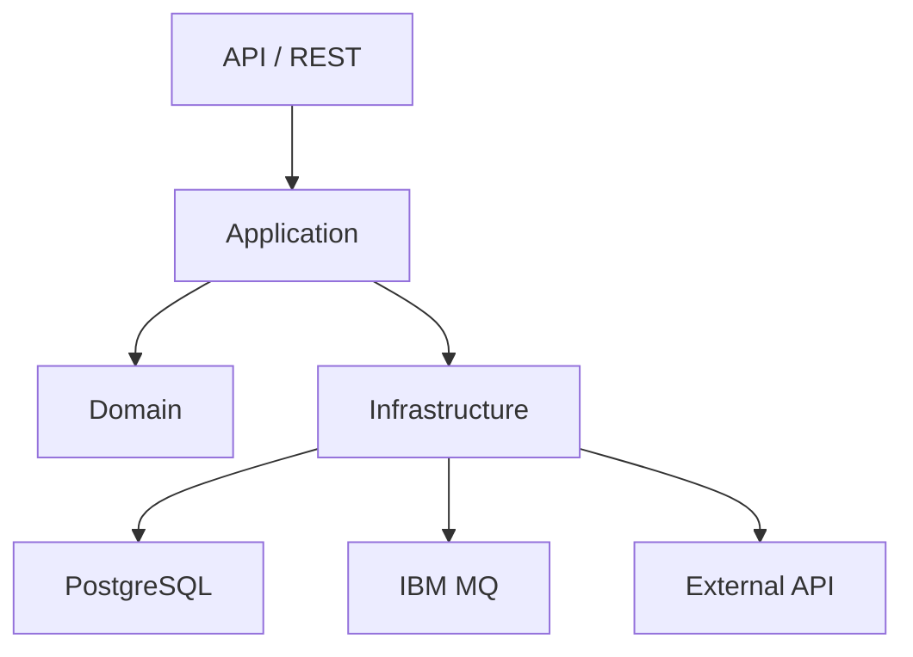

---

# 48. Quarkus et architecture hexagonale

C'est une combinaison intéressante.

```text
                 ┌───────────────┐
                 │ REST Adapter  │
                 └───────┬───────┘
                         │
                         ▼
                ┌─────────────────┐
                │ Application     │
                │ Use Cases       │
                └────────┬────────┘
                         │
                         ▼
                ┌─────────────────┐
                │ Domain          │
                │                 │
                │ Payment         │
                │ Rules           │
                └────────┬────────┘
                         │
             ┌───────────┼───────────┐
             ▼           ▼           ▼
          PostgreSQL   IBM MQ    External API
```

Cela évite de mettre Quarkus partout dans ton domaine métier.

---

# 49. Ce que Quarkus apporte réellement

Il faut éviter de résumer Quarkus à :

> "Java mais plus rapide."

Le vrai concept est plutôt :

```text
Quarkus
   │
   ├── Build-time optimization
   │
   ├── Cloud-native
   │
   ├── Kubernetes
   │
   ├── Container-first
   │
   ├── Native compilation
   │
   ├── Reactive capabilities
   │
   ├── Developer productivity
   │
   ├── Jakarta / MicroProfile
   │
   └── Extensions ecosystem
```

---

# 50. Spring Boot vs Quarkus : exemple concret

### Spring Boot

```java
@RestController
@RequestMapping("/payments")
public class PaymentController {

    private final PaymentService service;

    @PostMapping
    public Payment create(
            @RequestBody PaymentRequest request) {

        return service.create(request);
    }
}
```

### Quarkus

```java
@Path("/payments")
@Consumes(MediaType.APPLICATION_JSON)
@Produces(MediaType.APPLICATION_JSON)
public class PaymentResource {

    private final PaymentService service;

    public PaymentResource(PaymentService service) {
        this.service = service;
    }

    @POST
    public Payment create(PaymentRequest request) {
        return service.create(request);
    }
}
```

La logique métier peut rester pratiquement identique.

---

# 51. La grande différence conceptuelle

Spring Boot :

```text
Spring ecosystem
       +
JVM
       +
runtime configuration
```

Quarkus :

```text
Quarkus ecosystem
       +
build-time augmentation
       +
JVM ou Native
       +
cloud-native
```

C'est vraiment le concept que tu dois retenir.

---

# 52. Quand choisir Quarkus ?

Quarkus est particulièrement intéressant si ton application est :

```text
Microservice
   +
Docker
   +
Kubernetes/OpenShift
   +
cloud
```

et potentiellement :

```text
Serverless
   +
Native
   +
scale-to-zero
```

Pour ton environnement professionnel, je vois également un intérêt pour :

```text
Java 21/25
Spring Boot
       VS
Quarkus
       ↓
OpenShift
       ↓
Kafka / MQ
       ↓
PostgreSQL / Oracle
       ↓
Observability
```

---

# 53. Quand rester sur Spring Boot ?

Si ton entreprise possède déjà :

```text
100+ applications Spring Boot
Spring Cloud
Spring Security
Spring Batch
Spring Integration
Spring Kafka
```

et une forte expertise interne Spring, migrer uniquement pour utiliser Quarkus n'a pas forcément de sens.

Le choix dépend notamment :

```text
coût migration
+
écosystème
+
compétences
+
contraintes runtime
+
performance
+
déploiement
```

---

# 54. Ton parcours d'apprentissage

Vu que tu maîtrises déjà Java/Spring Boot, je te conseille de ne **pas** apprendre Quarkus comme un débutant Java.

Fais plutôt :

```text
                    QUARKUS
                       │
          ┌────────────┴────────────┐
          │                         │
    Concepts Java             Concepts Quarkus
          │                         │
          │                    CDI
          │                    Extensions
          │                    Build time
          │                    Dev Services
          │                    Native
          │
          └────────────┬────────────┘
                       │
                       ▼
                Application REST
                       │
                       ▼
                 PostgreSQL
                       │
                       ▼
                    Kafka
                       │
                       ▼
                  Kubernetes
                       │
                       ▼
                    OpenShift
```

---

# 55. Roadmap Quarkus pour toi

Je ferais **7 étapes**.

### Niveau 1 — Fondamentaux

```text
Quarkus
CLI
Maven
quarkus dev
REST
CDI
configuration
```

### Niveau 2 — Persistence

```text
Hibernate ORM
Panache
PostgreSQL
transactions
Flyway/Liquibase
```

### Niveau 3 — API entreprise

```text
DTO
validation
exceptions
OpenAPI
Swagger
pagination
filtering
```

### Niveau 4 — Integration

```text
REST Client
Kafka
Messaging
IBM MQ
```

### Niveau 5 — Security

```text
OIDC
OAuth2
JWT
Keycloak
RBAC
```

### Niveau 6 — Production

```text
Health
Metrics
Logging
Tracing
Docker
Kubernetes
OpenShift
```

### Niveau 7 — Advanced

```text
Reactive
Mutiny
Native
GraalVM / Mandrel
Virtual Threads
Performance
Architecture cloud-native
```

---

# 56. Projet fil rouge que je te recommande

Pour vraiment apprendre Quarkus, je te conseille de reprendre **ton projet `payment-messages`**, plutôt que de faire un énième CRUD `Employee`.

Architecture :

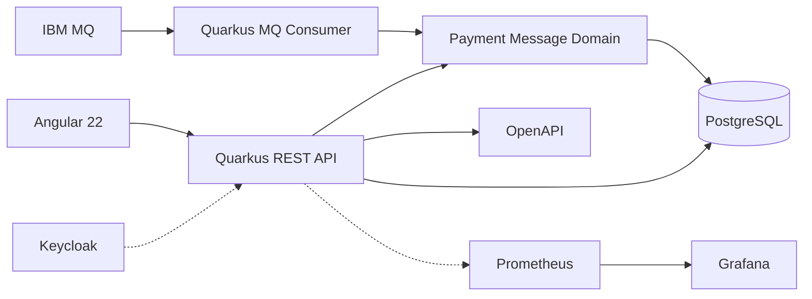

Et progressivement :

```text
Phase 1
Quarkus REST
        ↓
Phase 2
PostgreSQL + Panache
        ↓
Phase 3
OpenAPI
        ↓
Phase 4
Tests
        ↓
Phase 5
Kafka / IBM MQ
        ↓
Phase 6
Keycloak
        ↓
Phase 7
Docker
        ↓
Phase 8
Kubernetes
        ↓
Phase 9
OpenShift
        ↓
Phase 10
Native
```

---

# 57. Les 10 notions Quarkus à absolument retenir

Si tu dois retenir seulement ceci :

```text
1. Quarkus
      ↓
Framework Java cloud-native

2. Extension
      ↓
Intégration d'une technologie

3. CDI
      ↓
Dependency Injection

4. Quarkus REST
      ↓
API HTTP

5. Panache
      ↓
Hibernate/JPA simplifié

6. Dev Services
      ↓
Services de développement automatisés

7. Build time
      ↓
Une grande partie du travail est faite au build

8. Reactive
      ↓
Vert.x + Mutiny

9. Native
      ↓
GraalVM / Mandrel

10. Kubernetes
      ↓
Environnement de déploiement naturel
```

---

# 58. La phrase qui résume Quarkus

Si demain on te demande en entretien :

> **"Qu'est-ce que Quarkus ?"**

Tu peux expliquer :

> **Quarkus est un framework Java orienté cloud-native qui optimise une grande partie de l'application au build time et permet de développer des applications Java adaptées aux conteneurs, Kubernetes et aux architectures serverless. Il propose un écosystème intégré autour de Jakarta REST, CDI, Hibernate, Reactive, Messaging, Security et permet également de compiler l'application en exécutable natif avec GraalVM/Mandrel.**

C'est beaucoup plus juste que :

> "C'est un Spring Boot plus rapide."

---

## Et surtout, pour ton profil Java/Spring Boot

Le point intéressant n'est pas d'abandonner Spring Boot pour Quarkus.

Il est de comprendre le **changement de paradigme** :

```text
                 SPRING BOOT
                     │
                     ▼
              JVM application
                     │
               container
                     │
                 Kubernetes


                   QUARKUS
                     │
          ┌──────────┴──────────┐
          ▼                     ▼
        JVM                  Native
          │                     │
          └──────────┬──────────┘
                     ▼
                 Container
                     │
                 Kubernetes
                     │
                OpenShift
```

Et puisque tu travailles déjà avec **Java moderne, Spring Boot, PostgreSQL, IBM MQ, Kafka, Docker et OpenShift**, le meilleur exercice serait maintenant de construire **un mini `payment-messages` en Quarkus**, étape par étape, avec **Java 25 + Quarkus 4 + PostgreSQL + Panache + REST + OpenAPI + tests + Docker + Kubernetes**, puis comparer chaque composant avec son équivalent Spring Boot. La documentation Quarkus actuelle confirme notamment Java 21 comme minimum pour les extensions Quarkus 4.x que nous avons examinées. ([Quarkus][1])

[1]: https://quarkus.io/extensions/io.quarkus/quarkus-hibernate-orm-rest-data-panache/?utm_source=chatgpt.com "REST resources for Hibernate ORM with Panache | Extensions"
[2]: https://quarkus.io/guides/rest/?utm_source=chatgpt.com "Writing REST services with Quarkus REST (formerly RESTEasy Reactive) - Quarkus"
[3]: https://quarkus.io/version/main/guides/getting-started/?utm_source=chatgpt.com "Creating your first application - main - Quarkus"
[4]: https://quarkus.io/guides/hibernate-orm-panache/?utm_source=chatgpt.com "Simplified Hibernate ORM with Panache - Quarkus"
[5]: https://quarkus.io/guides/rest-client/?utm_source=chatgpt.com "Using the REST Client - Quarkus"
[6]: https://quarkus.io/guides/hibernate-reactive-panache/?utm_source=chatgpt.com "Simplified Hibernate Reactive with Panache - Quarkus"
[7]: https://quarkus.io/version/main/guides/?utm_source=chatgpt.com "Guides - Main branch (SNAPSHOT) - main - Quarkus"
[8]: https://quarkus.io/guides/rest-json/?utm_source=chatgpt.com "Writing JSON REST services - Quarkus"
