# Tutoriel Complet sur l'Écosystème Spring

## Table des matières

1. [Vue d'ensemble de l'écosystème Spring](#1-vue-densemble)
2. [Spring Framework](#2-spring-framework)
3. [Injection de dépendances (IoC)](#3-injection-de-dépendances-ioc)
4. [Spring Boot](#4-spring-boot)
5. [Spring MVC](#5-spring-mvc)
6. [Spring Data JPA](#6-spring-data-jpa)
7. [Spring Validation](#7-spring-validation)
8. [Spring Security](#8-spring-security)
9. [Spring AOP](#9-spring-aop)
10. [Spring Batch](#10-spring-batch)
11. [Spring Cloud](#11-spring-cloud)

---

## 1. Vue d'ensemble

Spring est un ensemble de projets modulaires destinés à construire des applications Java de tous types (web, microservices, batch, sécurité). Le cœur historique est le **Spring Framework**, sur lequel reposent tous les autres modules.

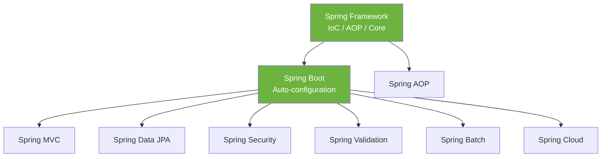

| Module | Rôle principal |
|--------|----------------|
| Spring Framework | Conteneur IoC, AOP, gestion des transactions |
| Spring Boot | Démarrage rapide, auto-configuration, serveur embarqué |
| Spring MVC | Applications web et API REST |
| Spring Data JPA | Accès aux bases relationnelles via repositories |
| Spring Security | Authentification et autorisation |
| Spring Validation | Validation déclarative des données |
| Spring AOP | Programmation orientée aspect (logging, sécurité, transactions) |
| Spring Batch | Traitements par lots volumineux |
| Spring Cloud | Outils pour microservices (config, discovery, gateway) |

---

## 2. Spring Framework

Le Spring Framework fournit le **conteneur IoC** (`ApplicationContext`) qui crée, configure et gère le cycle de vie des objets appelés *beans*.

### 2.1 Concepts fondamentaux

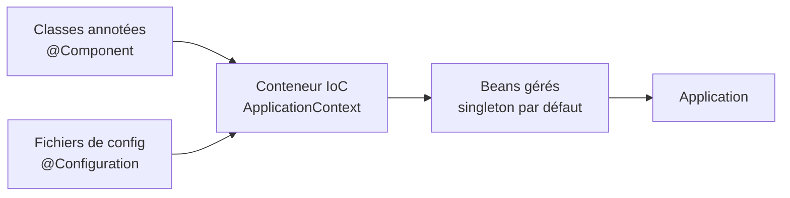

### 2.2 Déclaration d'un bean par configuration Java

```java
// Une classe métier simple, sans annotation Spring
public class MessageService {
    public String getMessage() {
        return "Bonjour depuis Spring !";
    }
}
```

```java
@Configuration // Indique que cette classe contient des définitions de beans
public class AppConfig {

    @Bean // La valeur retournée devient un bean géré par le conteneur
    public MessageService messageService() {
        return new MessageService();
    }
}
```

```java
public class Main {
    public static void main(String[] args) {
        // Création du conteneur à partir de la configuration
        ApplicationContext context =
            new AnnotationConfigApplicationContext(AppConfig.class);

        // Récupération du bean depuis le conteneur
        MessageService service = context.getBean(MessageService.class);
        System.out.println(service.getMessage());
    }
}
```

**Explication** : Spring instancie `MessageService` une seule fois (scope *singleton*) et le stocke dans le conteneur. `getBean(...)` récupère cette instance unique.

### 2.3 Les scopes de beans

| Scope | Description |
|-------|-------------|
| `singleton` | Une seule instance par conteneur (par défaut) |
| `prototype` | Une nouvelle instance à chaque demande |
| `request` | Une instance par requête HTTP (web) |
| `session` | Une instance par session HTTP (web) |

```java
@Bean
@Scope("prototype") // Nouvelle instance à chaque getBean()
public PanierAchat panier() {
    return new PanierAchat();
}
```

---

## 3. Injection de dépendances (IoC)

L'**Inversion de Contrôle** (IoC) signifie que ce n'est plus l'objet qui crée ses dépendances, mais le conteneur qui les lui fournit. L'**injection de dépendances** (DI) en est la mise en œuvre concrète.

### 3.1 Principe

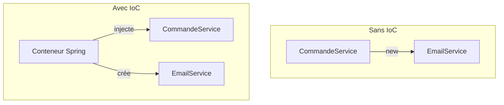

### 3.2 Les trois types d'injection

#### Injection par constructeur (recommandée)

```java
@Service // Déclare la classe comme bean de service
public class CommandeService {

    private final EmailService emailService;

    // Spring injecte automatiquement EmailService via le constructeur.
    // @Autowired est optionnel s'il n'y a qu'un seul constructeur.
    public CommandeService(EmailService emailService) {
        this.emailService = emailService;
    }

    public void passerCommande(String client) {
        // ... logique métier ...
        emailService.envoyer(client, "Commande confirmée");
    }
}
```

```java
@Service
public class EmailService {
    public void envoyer(String destinataire, String message) {
        System.out.println("Email à " + destinataire + " : " + message);
    }
}
```

**Pourquoi le constructeur ?** Les dépendances deviennent `final` (immuables), obligatoires et la classe reste facilement testable (on peut passer un mock dans le constructeur).

#### Injection par setter

```java
@Service
public class RapportService {

    private StockageService stockage;

    @Autowired // Spring appelle ce setter après instanciation
    public void setStockage(StockageService stockage) {
        this.stockage = stockage;
    }
}
```

#### Injection par champ (déconseillée)

```java
@Service
public class FactureService {

    @Autowired // Injection directe dans le champ : difficile à tester
    private PaiementService paiementService;
}
```

### 3.3 Gérer plusieurs implémentations avec `@Qualifier`

```java
public interface Notification {
    void notifier(String message);
}

@Service
@Qualifier("sms")
public class SmsNotification implements Notification {
    public void notifier(String message) { /* envoi SMS */ }
}

@Service
@Qualifier("email")
public class EmailNotification implements Notification {
    public void notifier(String message) { /* envoi email */ }
}
```

```java
@Service
public class AlerteService {

    private final Notification notification;

    // On précise quelle implémentation injecter
    public AlerteService(@Qualifier("sms") Notification notification) {
        this.notification = notification;
    }
}
```

---

## 4. Spring Boot

Spring Boot supprime la configuration manuelle grâce à l'**auto-configuration**, intègre un serveur (Tomcat) et fournit des *starters* (dépendances groupées).

### 4.1 Le point d'entrée

```java
@SpringBootApplication // Combine @Configuration, @EnableAutoConfiguration, @ComponentScan
public class MonApplication {
    public static void main(String[] args) {
        SpringApplication.run(MonApplication.class, args);
    }
}
```

L'annotation `@SpringBootApplication` regroupe :

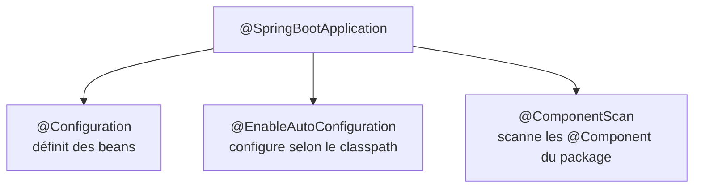

### 4.2 Dépendances Maven (pom.xml)

```xml
<parent>
    <groupId>org.springframework.boot</groupId>
    <artifactId>spring-boot-starter-parent</artifactId>
    <version>3.3.0</version>
</parent>

<dependencies>
    <!-- Starter web : Spring MVC + Tomcat embarqué + Jackson -->
    <dependency>
        <groupId>org.springframework.boot</groupId>
        <artifactId>spring-boot-starter-web</artifactId>
    </dependency>
</dependencies>
```

### 4.3 Configuration externalisée

```properties
# application.properties
server.port=8081
spring.application.name=mon-service
app.message=Configuration externalisée
```

```java
@Component
public class ConfigReader {

    // @Value injecte une propriété depuis application.properties
    @Value("${app.message}")
    private String message;

    public String getMessage() {
        return message;
    }
}
```

### 4.4 Propriétés typées avec `@ConfigurationProperties`

```properties
mail.host=smtp.exemple.com
mail.port=587
mail.from=noreply@exemple.com
```

```java
@Configuration
@ConfigurationProperties(prefix = "mail") // Lie le préfixe "mail" aux champs
public class MailProperties {
    private String host;
    private int port;
    private String from;
    // getters et setters obligatoires pour le binding
}
```

---

## 5. Spring MVC

Spring MVC gère les requêtes HTTP selon le patron **Modèle-Vue-Contrôleur**, très utilisé pour les API REST.

### 5.1 Flux d'une requête

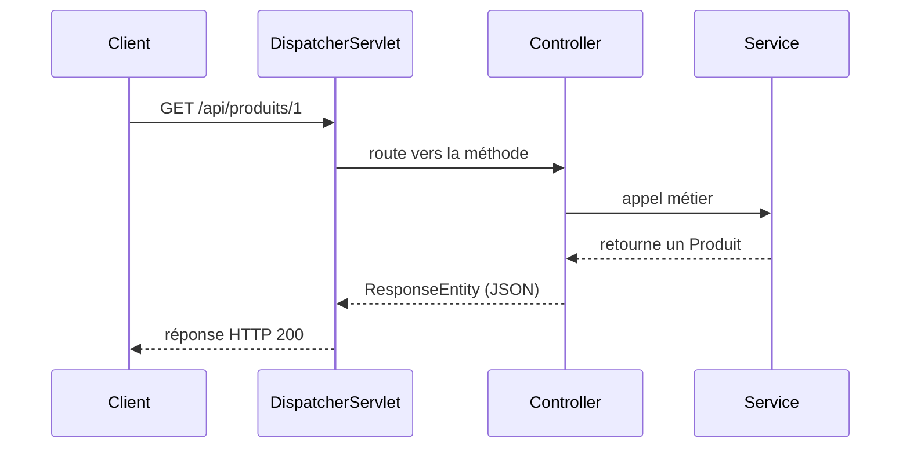

### 5.2 Un contrôleur REST complet

```java
@RestController // @Controller + @ResponseBody : retourne du JSON
@RequestMapping("/api/produits") // Préfixe commun à toutes les routes
public class ProduitController {

    private final ProduitService service;

    public ProduitController(ProduitService service) {
        this.service = service;
    }

    // GET /api/produits
    @GetMapping
    public List<Produit> lister() {
        return service.findAll();
    }

    // GET /api/produits/42
    @GetMapping("/{id}")
    public ResponseEntity<Produit> obtenir(@PathVariable Long id) {
        return service.findById(id)
                .map(ResponseEntity::ok)                 // 200 si trouvé
                .orElse(ResponseEntity.notFound().build()); // 404 sinon
    }

    // POST /api/produits  (corps JSON dans le body)
    @PostMapping
    @ResponseStatus(HttpStatus.CREATED) // renvoie 201
    public Produit creer(@RequestBody Produit produit) {
        return service.save(produit);
    }

    // GET /api/produits/recherche?nom=clavier
    @GetMapping("/recherche")
    public List<Produit> rechercher(@RequestParam String nom) {
        return service.findByNom(nom);
    }

    // DELETE /api/produits/42
    @DeleteMapping("/{id}")
    @ResponseStatus(HttpStatus.NO_CONTENT) // 204
    public void supprimer(@PathVariable Long id) {
        service.delete(id);
    }
}
```

| Annotation | Rôle |
|------------|------|
| `@PathVariable` | Extrait une variable de l'URL (`/{id}`) |
| `@RequestParam` | Extrait un paramètre de requête (`?nom=...`) |
| `@RequestBody` | Désérialise le corps JSON en objet Java |
| `@ResponseStatus` | Définit le code HTTP de la réponse |

### 5.3 Gestion globale des exceptions

```java
@RestControllerAdvice // Intercepte les exceptions de tous les contrôleurs
public class GestionnaireExceptions {

    @ExceptionHandler(ProduitIntrouvableException.class)
    @ResponseStatus(HttpStatus.NOT_FOUND)
    public Map<String, String> gererIntrouvable(ProduitIntrouvableException ex) {
        return Map.of("erreur", ex.getMessage());
    }
}
```

---

## 6. Spring Data JPA

Spring Data JPA simplifie l'accès aux bases relationnelles : on déclare une interface, Spring génère l'implémentation.

### 6.1 Architecture

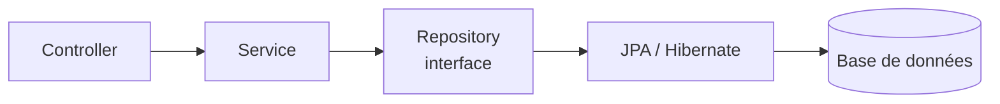

### 6.2 L'entité

```java
@Entity // Mappée vers une table
@Table(name = "produits")
public class Produit {

    @Id // Clé primaire
    @GeneratedValue(strategy = GenerationType.IDENTITY) // auto-incrément
    private Long id;

    @Column(nullable = false)
    private String nom;

    private BigDecimal prix;

    // Constructeurs, getters et setters
}
```

### 6.3 Le repository

```java
public interface ProduitRepository extends JpaRepository<Produit, Long> {

    // Spring génère la requête à partir du nom de la méthode
    List<Produit> findByNomContainingIgnoreCase(String nom);

    List<Produit> findByPrixLessThan(BigDecimal prixMax);

    // Requête JPQL personnalisée
    @Query("SELECT p FROM Produit p WHERE p.prix BETWEEN :min AND :max")
    List<Produit> trouverParFourchette(
        @Param("min") BigDecimal min,
        @Param("max") BigDecimal max);
}
```

`JpaRepository` fournit déjà : `save`, `findById`, `findAll`, `deleteById`, la pagination et le tri.

### 6.4 Dérivation des noms de méthodes

| Méthode | Requête générée |
|---------|-----------------|
| `findByNom(String n)` | `WHERE nom = ?` |
| `findByPrixGreaterThan(BigDecimal p)` | `WHERE prix > ?` |
| `findByNomAndPrix(...)` | `WHERE nom = ? AND prix = ?` |
| `findByNomOrderByPrixDesc(...)` | `WHERE nom = ? ORDER BY prix DESC` |
| `countByActifTrue()` | `SELECT COUNT(*) WHERE actif = true` |

### 6.5 Utilisation dans un service avec transaction

```java
@Service
public class ProduitService {

    private final ProduitRepository repository;

    public ProduitService(ProduitRepository repository) {
        this.repository = repository;
    }

    @Transactional // Toutes les opérations réussissent ou échouent ensemble
    public Produit appliquerRemise(Long id, BigDecimal pourcentage) {
        Produit p = repository.findById(id)
            .orElseThrow(() -> new ProduitIntrouvableException("ID " + id));

        BigDecimal remise = p.getPrix().multiply(pourcentage).divide(BigDecimal.valueOf(100));
        p.setPrix(p.getPrix().subtract(remise));

        return repository.save(p);
    }
}
```

---

## 7. Spring Validation

Spring Validation s'appuie sur **Jakarta Bean Validation** pour vérifier les données de façon déclarative via des annotations.

### 7.1 Annoter un objet de requête

```java
public class UtilisateurDTO {

    @NotBlank(message = "Le nom est obligatoire")
    private String nom;

    @Email(message = "Format d'email invalide")
    @NotBlank
    private String email;

    @Min(value = 18, message = "Âge minimum : 18 ans")
    @Max(150)
    private int age;

    @Size(min = 8, message = "Mot de passe d'au moins 8 caractères")
    private String motDePasse;

    // getters et setters
}
```

### 7.2 Déclencher la validation avec `@Valid`

```java
@RestController
@RequestMapping("/api/utilisateurs")
public class UtilisateurController {

    // @Valid lance la validation ; en cas d'échec, une exception est levée
    @PostMapping
    public ResponseEntity<String> creer(@Valid @RequestBody UtilisateurDTO dto) {
        return ResponseEntity.ok("Utilisateur " + dto.getNom() + " créé");
    }
}
```

### 7.3 Renvoyer des erreurs lisibles

```java
@RestControllerAdvice
public class ValidationExceptionHandler {

    @ExceptionHandler(MethodArgumentNotValidException.class)
    @ResponseStatus(HttpStatus.BAD_REQUEST) // 400
    public Map<String, String> gererErreurs(MethodArgumentNotValidException ex) {
        Map<String, String> erreurs = new HashMap<>();
        // On parcourt chaque champ en erreur
        ex.getBindingResult().getFieldErrors().forEach(err ->
            erreurs.put(err.getField(), err.getDefaultMessage()));
        return erreurs;
    }
}
```

**Exemple de réponse JSON** en cas d'email invalide et d'âge insuffisant :

```json
{
  "email": "Format d'email invalide",
  "age": "Âge minimum : 18 ans"
}
```

### 7.4 Annotations courantes

| Annotation | Vérification |
|------------|--------------|
| `@NotNull` | Non nul |
| `@NotBlank` | Chaîne non vide (hors espaces) |
| `@NotEmpty` | Collection/chaîne non vide |
| `@Size(min, max)` | Longueur ou taille |
| `@Min` / `@Max` | Borne numérique |
| `@Email` | Format email |
| `@Pattern(regexp)` | Expression régulière |
| `@Past` / `@Future` | Date passée/future |

---

## 8. Spring Security

Spring Security gère l'**authentification** (qui êtes-vous ?) et l'**autorisation** (avez-vous le droit ?).

### 8.1 Chaîne de filtres

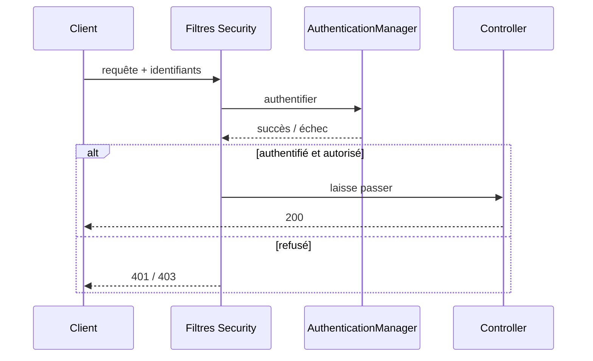

### 8.2 Configuration de la sécurité

```java
@Configuration
@EnableWebSecurity
public class SecurityConfig {

    @Bean
    public SecurityFilterChain filterChain(HttpSecurity http) throws Exception {
        http
            .csrf(csrf -> csrf.disable()) // désactivé pour une API REST stateless
            .authorizeHttpRequests(auth -> auth
                .requestMatchers("/api/public/**").permitAll()       // accès libre
                .requestMatchers("/api/admin/**").hasRole("ADMIN")   // rôle requis
                .anyRequest().authenticated()                        // reste protégé
            )
            .httpBasic(Customizer.withDefaults()); // authentification basique
        return http.build();
    }

    @Bean
    public PasswordEncoder passwordEncoder() {
        // Hachage sécurisé des mots de passe
        return new BCryptPasswordEncoder();
    }
}
```

### 8.3 Charger les utilisateurs depuis la base

```java
@Service
public class UtilisateurDetailsService implements UserDetailsService {

    private final UtilisateurRepository repository;

    public UtilisateurDetailsService(UtilisateurRepository repository) {
        this.repository = repository;
    }

    @Override
    public UserDetails loadUserByUsername(String username) {
        Utilisateur u = repository.findByUsername(username)
            .orElseThrow(() -> new UsernameNotFoundException("Inconnu : " + username));

        return User.builder()
            .username(u.getUsername())
            .password(u.getMotDePasse()) // déjà haché en base
            .roles(u.getRole())          // ex. "ADMIN" -> autorité ROLE_ADMIN
            .build();
    }
}
```

### 8.4 Sécuriser au niveau des méthodes

```java
@Service
public class GestionService {

    @PreAuthorize("hasRole('ADMIN')") // vérifié avant l'exécution
    public void supprimerTout() {
        // accessible uniquement aux administrateurs
    }
}
```

> Nécessite `@EnableMethodSecurity` sur une classe de configuration.

---

## 9. Spring AOP

La **programmation orientée aspect** isole les préoccupations transversales (logging, sécurité, mesure de performance) du code métier.

### 9.1 Vocabulaire

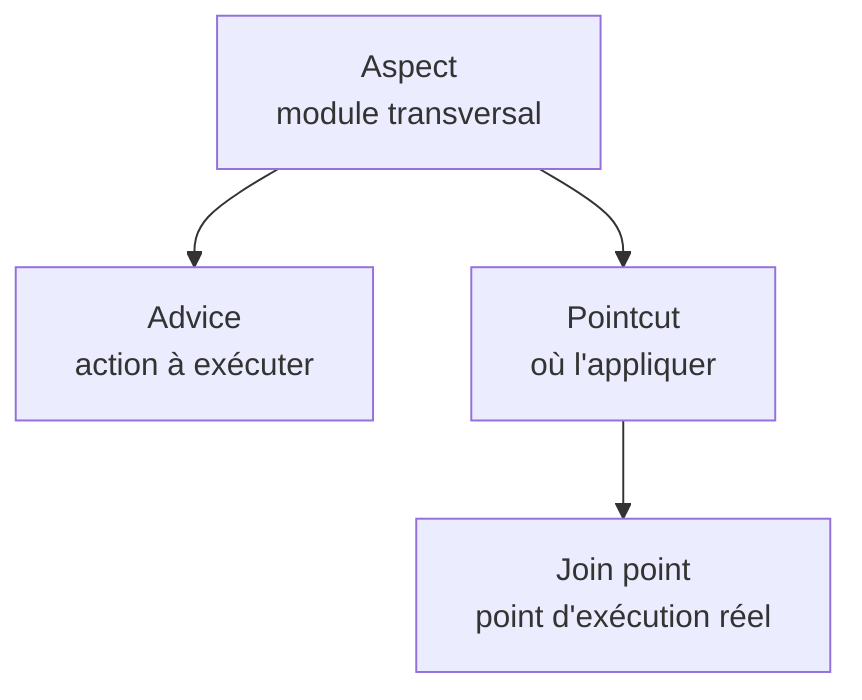

| Terme | Signification |
|-------|---------------|
| Aspect | Classe regroupant la logique transversale |
| Advice | Code exécuté (avant, après, autour) |
| Pointcut | Expression ciblant les méthodes concernées |
| Join point | Point d'exécution effectif (un appel de méthode) |

### 9.2 Un aspect de journalisation

```java
@Aspect    // Déclare un aspect
@Component // Pour que Spring le détecte
public class JournalisationAspect {

    // Pointcut : toutes les méthodes publiques du package service
    @Pointcut("execution(public * com.exemple.service.*.*(..))")
    public void methodesService() {}

    // Advice "before" : exécuté avant la méthode ciblée
    @Before("methodesService()")
    public void avant(JoinPoint jp) {
        System.out.println("➡ Appel de " + jp.getSignature().getName());
    }

    // Advice "around" : encadre l'appel, mesure la durée
    @Around("methodesService()")
    public Object mesurerTemps(ProceedingJoinPoint pjp) throws Throwable {
        long debut = System.currentTimeMillis();
        Object resultat = pjp.proceed(); // exécute la méthode réelle
        long duree = System.currentTimeMillis() - debut;
        System.out.println("⏱ " + pjp.getSignature().getName() + " : " + duree + "ms");
        return resultat;
    }

    // Advice "after returning" : après un retour sans erreur
    @AfterReturning(pointcut = "methodesService()", returning = "resultat")
    public void apresRetour(Object resultat) {
        System.out.println("✔ Retour : " + resultat);
    }
}
```

### 9.3 Types d'advice

| Annotation | Moment d'exécution |
|------------|--------------------|
| `@Before` | Avant la méthode |
| `@After` | Après (succès ou erreur) |
| `@AfterReturning` | Après un retour normal |
| `@AfterThrowing` | Après une exception |
| `@Around` | Encadre totalement l'appel |

> Spring AOP s'appuie sur des **proxys** : il intercepte l'appel à un bean et exécute l'advice autour de la méthode réelle.

---

## 10. Spring Batch

Spring Batch traite de **gros volumes** de données par lots, avec gestion des reprises, transactions et statistiques.

### 10.1 Structure d'un job

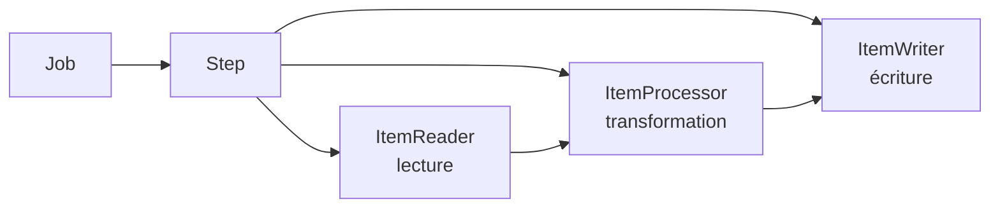

Un **Job** contient un ou plusieurs **Steps**. Un step de type *chunk* lit, transforme puis écrit les données par paquets (*chunks*).

### 10.2 Configuration d'un job d'import CSV → base

```java
@Configuration
public class ImportBatchConfig {

    // 1. Lecteur : lit un fichier CSV ligne par ligne
    @Bean
    public FlatFileItemReader<ClientInput> reader() {
        return new FlatFileItemReaderBuilder<ClientInput>()
            .name("clientReader")
            .resource(new ClassPathResource("clients.csv"))
            .delimited().names("nom", "email") // colonnes du CSV
            .targetType(ClientInput.class)
            .build();
    }

    // 2. Processeur : transforme la donnée lue (ex. mise en majuscules)
    @Bean
    public ItemProcessor<ClientInput, Client> processor() {
        return input -> {
            Client c = new Client();
            c.setNom(input.getNom().toUpperCase());
            c.setEmail(input.getEmail().toLowerCase());
            return c;
        };
    }

    // 3. Écrivain : enregistre en base via JPA
    @Bean
    public JpaItemWriter<Client> writer(EntityManagerFactory emf) {
        JpaItemWriter<Client> writer = new JpaItemWriter<>();
        writer.setEntityManagerFactory(emf);
        return writer;
    }

    // 4. Step : assemble reader, processor, writer par chunks de 100
    @Bean
    public Step importStep(JobRepository jobRepository,
                           PlatformTransactionManager txManager,
                           FlatFileItemReader<ClientInput> reader,
                           ItemProcessor<ClientInput, Client> processor,
                           JpaItemWriter<Client> writer) {
        return new StepBuilder("importStep", jobRepository)
            .<ClientInput, Client>chunk(100, txManager) // commit tous les 100 éléments
            .reader(reader)
            .processor(processor)
            .writer(writer)
            .build();
    }

    // 5. Job : orchestre les steps
    @Bean
    public Job importJob(JobRepository jobRepository, Step importStep) {
        return new JobBuilder("importJob", jobRepository)
            .start(importStep)
            .build();
    }
}
```

### 10.3 Avantages clés

| Fonctionnalité | Bénéfice |
|----------------|----------|
| Traitement par chunk | Limite la mémoire utilisée |
| Transactions par lot | Cohérence des données |
| Reprise sur erreur | Relance là où le job s'est arrêté |
| Métadonnées en base | Suivi des exécutions et statistiques |

---

## 11. Spring Cloud

Spring Cloud fournit les briques pour construire des **architectures microservices** : configuration centralisée, découverte de services, passerelle et résilience.

### 11.1 Architecture microservices typique

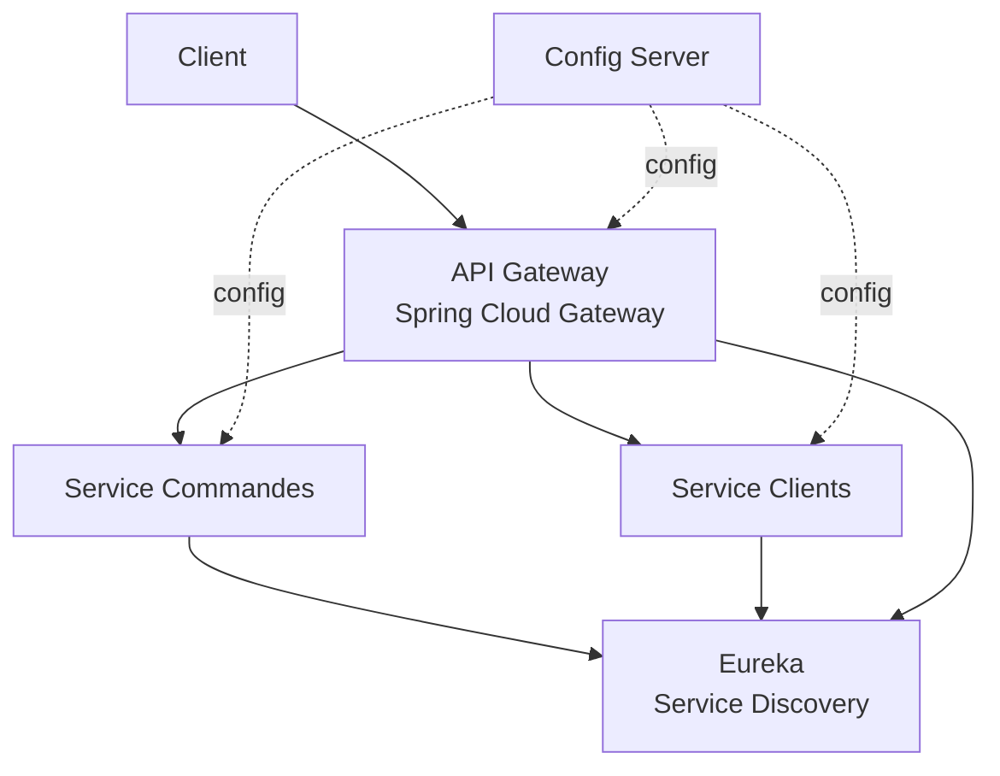

### 11.2 Serveur de configuration centralisé

```java
@SpringBootApplication
@EnableConfigServer // Active le serveur de configuration
public class ConfigServerApplication {
    public static void main(String[] args) {
        SpringApplication.run(ConfigServerApplication.class, args);
    }
}
```

```yaml
# application.yml du Config Server
spring:
  cloud:
    config:
      server:
        git:
          uri: https://github.com/org/configs-microservices
```

### 11.3 Découverte de services avec Eureka

```java
@SpringBootApplication
@EnableEurekaServer // Démarre le registre de services
public class DiscoveryServerApplication {
    public static void main(String[] args) {
        SpringApplication.run(DiscoveryServerApplication.class, args);
    }
}
```

Un microservice s'enregistre automatiquement :

```yaml
# application.yml d'un microservice client
spring:
  application:
    name: service-commandes
eureka:
  client:
    service-url:
      defaultZone: http://localhost:8761/eureka/
```

### 11.4 Communication inter-services avec OpenFeign

```java
@FeignClient(name = "service-clients") // appelle le service enregistré sous ce nom
public interface ClientClient {

    // Spring génère l'implémentation HTTP automatiquement
    @GetMapping("/api/clients/{id}")
    ClientDTO obtenirClient(@PathVariable("id") Long id);
}
```

```java
@Service
public class CommandeService {

    private final ClientClient clientClient;

    public CommandeService(ClientClient clientClient) {
        this.clientClient = clientClient;
    }

    public void traiter(Long clientId) {
        // Appel transparent vers l'autre microservice
        ClientDTO client = clientClient.obtenirClient(clientId);
        System.out.println("Commande pour : " + client.getNom());
    }
}
```

### 11.5 Passerelle (API Gateway)

```yaml
# application.yml de la Gateway
spring:
  cloud:
    gateway:
      routes:
        - id: commandes
          uri: lb://service-commandes   # lb = load-balancing via Eureka
          predicates:
            - Path=/commandes/**
        - id: clients
          uri: lb://service-clients
          predicates:
            - Path=/clients/**
```

### 11.6 Composants Spring Cloud

| Composant | Fonction |
|-----------|----------|
| Config Server | Configuration centralisée |
| Eureka | Annuaire et découverte de services |
| Spring Cloud Gateway | Point d'entrée et routage |
| OpenFeign | Client HTTP déclaratif |
| Resilience4j | Circuit breaker, retry, fallback |
| Sleuth / Micrometer Tracing | Traçabilité distribuée |

---

## Conclusion

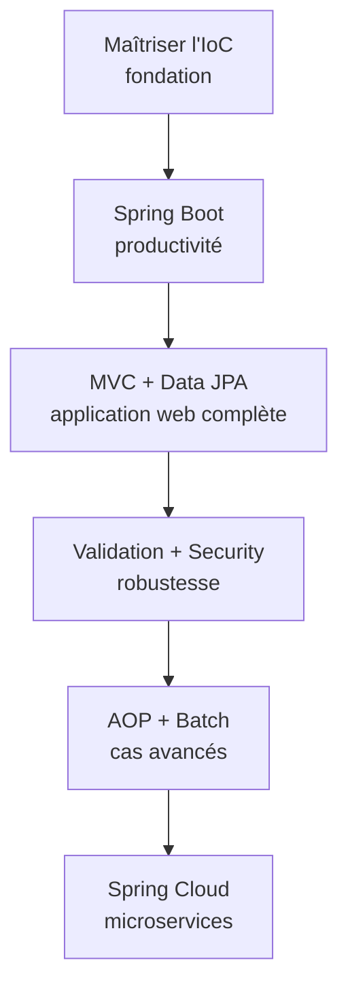

| Étape | Compétence acquise |
|-------|--------------------|
| 1 | Comprendre le conteneur IoC et l'injection de dépendances |
| 2 | Démarrer vite avec Spring Boot |
| 3 | Construire des API REST avec MVC et persister avec Data JPA |
| 4 | Valider et sécuriser les données |
| 5 | Découper les préoccupations avec AOP et traiter des volumes avec Batch |
| 6 | Passer à l'échelle avec Spring Cloud |
